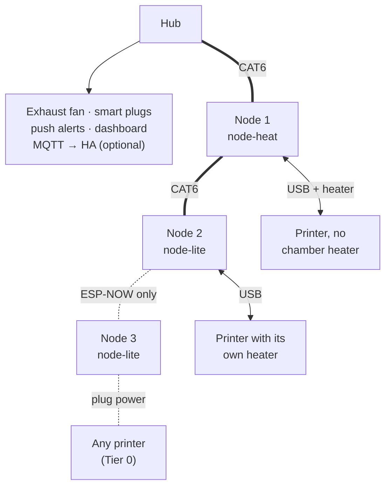

# Fleet Exhaust & Chamber Thermal System

An open-source exhaust, filtration and chamber-heating system for a small fleet of enclosed 3D printers. It has a shared duct and fan, one node per printer, and a hub. It works with any printer that can be connected to a 4″ duct. Printer-specific details come from **printer packs** ([doc 12](docs/12_porting_guide.md)), so the core design never names a printer model.

**What it does:**
- holds every printing chamber at a slight negative pressure and vents fumes outdoors through one shared, filtered duct
- heats chambers that have no heater of their own, for ABS, ASA, PA-CF and PC (up to a 60 °C cap)
- works alongside printers that heat their own chamber, adding exhaust, purge and fire protection
- runs cooling exhaust for PLA, PETG and TPU
- after every print, runs a slicer-controlled purge with a slow cooldown ramp and signals "safe to open"
- cuts a printer's mains on a corroborated fire or a verified heater runaway
- sends private push alerts only when someone's action could help

None of it can shut down Klipper or kill a print.

**Status:** Phase 1 design baseline, decisions D1–D93. What it can do and its limits are in [doc 01](docs/01_system_architecture.md), the requirements in [doc 10](docs/10_requirements.md), and example systems at the edges of what it supports in [doc 11](docs/11_use_envelope.md). Phase 2 (implementation) follows the staged bring-up in [doc 01 §8](docs/01_system_architecture.md#8-phase-2-bring-up-stages-d41).

---

## Architecture at a glance



The CAT6 daisy chain carries 24 V logic power and CAN, with ESP-NOW radio as a backup or as the only link. Each printer talks to its node at one of three link tiers: plug power only, a network API, or USB-serial to a Klipper plugin. A node-heat node also takes 24 V for its heater, from the printer's own supply or from a brick. The smart plugs cut a printer's mains and meter its power.

- **Nodes:** one universal carrier PCB with the ESP32-S3 module on board. Each node runs its own damper and heater control and its own safety. A node-heat node adds a 150 W PTC heater.
- **Klipper plugin `fleet_exhaust`:** a klippy extra makes the chamber a normal Klipper sensor, so `M191` waits for chamber temperature. It also provides `FLEET_EXHAUST` / `FLEET_PURGE` for slicer G-code.
- **Hub:** the same carrier PCB. It holds a constant trunk vacuum, queues purges one at a time, monitors filter loading and room air, cuts a printer's mains on a corroborated fire or a verified heater runaway, and handles notifications.

## Documents

| Doc | Content |
|---|---|
| [01 System overview](docs/01_system_architecture.md) | What it does, its building blocks, topology, key decisions, **risk and open-item register**, bring-up stages |
| [02 Hardware specification](docs/02_hardware_specification.md) | Carrier board roles, heater, sensors, dampers, hub, supported exhaust fans |
| [03 Bill of materials](docs/03_bill_of_materials.md) | Line-item BOM and cost for an example fleet, cost per role, and how it scales |
| [04 Wiring and pinouts](docs/04_wiring_and_pinouts.md) | Cables, RJ45 bus pinout, GPIO map, printer USB link, grounding |
| [05 Safety and failsafes](docs/05_safety_and_failsafes.md) | Safety layers, fault-response matrix, fire logic, commissioning tests |
| [06 Pneumatics and ducting](docs/06_pneumatics_and_ducting.md) | Layout, control loops, purge, material policy, heat budget, filter |
| [07 Firmware and comms](docs/07_firmware_and_comms.md) | Firmware, Klipper plugin, G-code API, protocols, notifications, dashboard |
| [08 Printable parts](docs/08_printable_catalog.md) | Existing models to verify, custom parts to design, and the pack parts index |
| [09 Sensor bus and I/O controller](docs/09_sensor_bus_and_io_controller.md) | Up to 8 sensor headers, one I²C segment each, per-header power, programming every MCU through its ROM bootloader, and the supported sensors |
| [10 Requirements](docs/10_requirements.md) | The requirements the design meets, traced to the decisions and to the commissioning tests |
| [11 Use envelope](docs/11_use_envelope.md) | The limits of use (fleet size, cable length, power, links, heat) and hypothetical systems at those limits |
| [12 Printer packs](docs/12_porting_guide.md) | How a printer pack is made: link tiers, profile schema, mechanical interface, safety contract; the pack list |
| [13 Build your own](docs/13_build_your_own.md) | Quick start: does it fit, plan your fleet, staged build, reading order |
| [Design decisions](docs/design_decisions.md) | Decision record D1–D93, the cost-reduction pass and the trade studies behind them |

## Repository layout (Phase 2)

```text
├── LICENSES/                # Licence texts (REUSE); source files carry SPDX headers
├── docs/                    # Design documents (this baseline)
├── printers/                # Printer packs (doc 12 §9): _template plus one folder per model
├── firmware/
│   ├── fleet_node/          # One ESP-IDF project: node-heat, node-lite and hub roles
│   └── components/fleet_common/ # CAN + USB protocols, control loops, sensor drivers
├── slicer_profiles/orca/    # Filament and printer G-code snippets
└── hardware/
    ├── pcb/carrier/         # KiCad project, JLCPCB BOM/CPL, gerbers
    ├── pcb/sensor/          # Universal sensor board: S, P and E variants (D42)
    ├── cad/                 # CadQuery source + STEP + STL per custom part
    └── cables/              # Cable drawings and harness lists
```

The Klipper side (klippy extra, macros, installers) is published from its own small repo, `fleet-exhaust-klipper`, so Moonraker's update manager doesn't clone this whole repo onto each printer (D27).

## Using this for your own fleet

Keep your own build (which printers, where the duct runs, which fan, plugs and supplies, your BOM and commissioning records) in a repository of your own, and add this one to it as a git submodule. Fleet-specific needs that this framework can't express yet are best raised here as a config option or a new printer pack, so they don't turn into a private fork.

## Licence

By area (details in [doc 12 §8](docs/12_porting_guide.md#8-licensing-and-contributions)):

| Area | Licence |
|---|---|
| Firmware, klippy extra, scripts | MIT ([LICENSE](LICENSE)) |
| Hardware designs (PCBs) | CERN-OHL-P-2.0 |
| Docs, printed-part CAD | CC BY 4.0 |

Licence texts are in [`LICENSES/`](LICENSES/) (the CERN-OHL-P-2.0 text arrives with the first hardware files) and files are labelled following the [REUSE](https://reuse.software/) spec ([`REUSE.toml`](REUSE.toml) covers the docs and printer packs; source files added in Phase 2 carry their own SPDX headers). Contributions: see [CONTRIBUTING.md](CONTRIBUTING.md).
