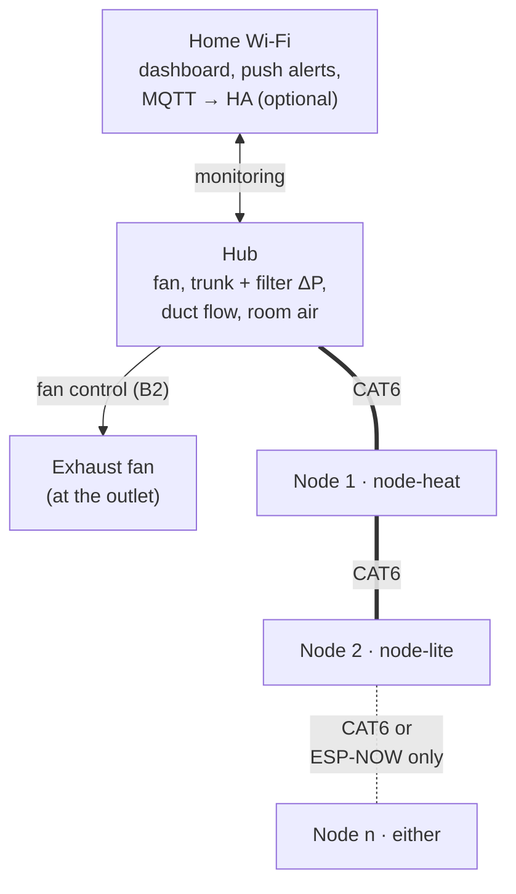
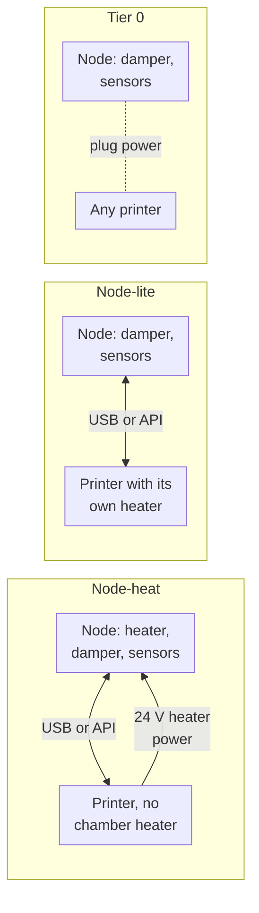
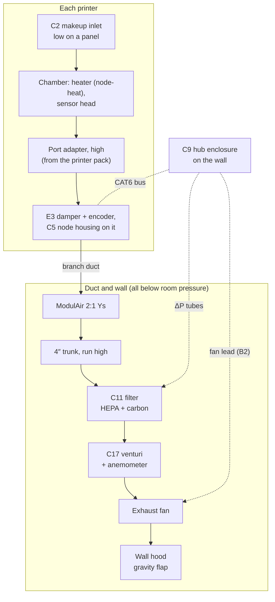
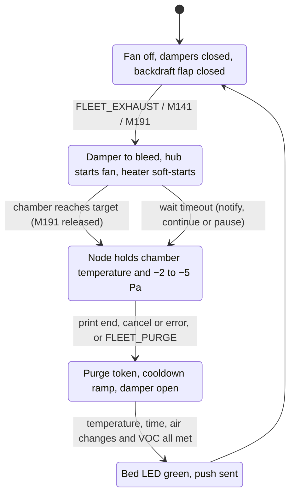
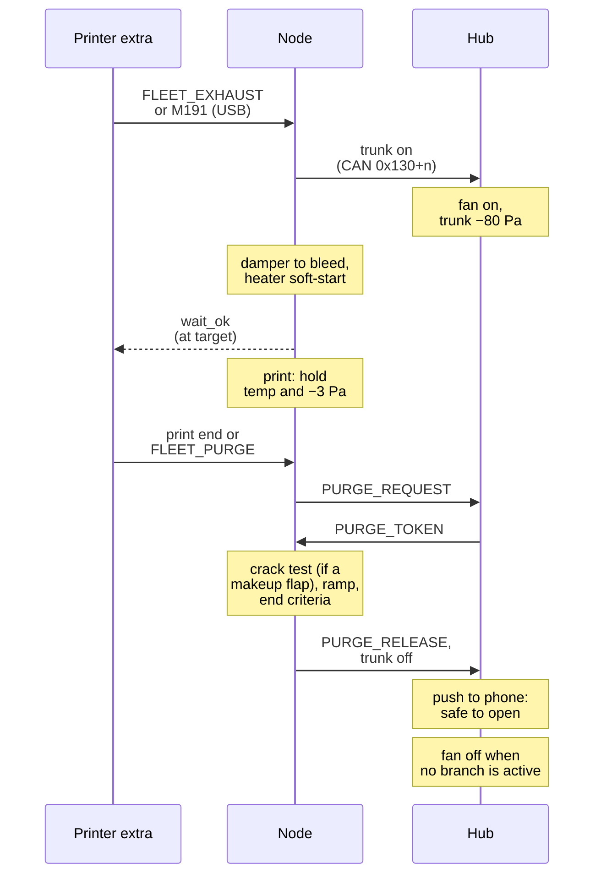
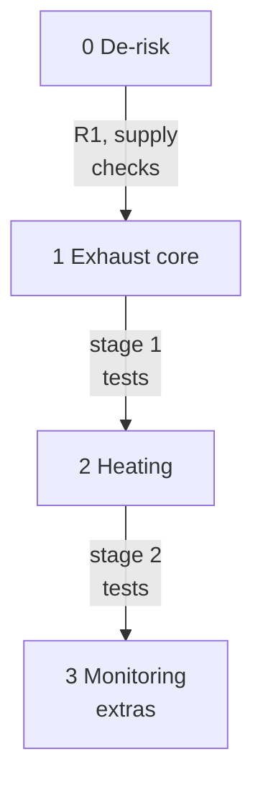

# 01 - System Overview

> **Status:** Phase 1 design baseline, 2026-10-25, updated 2026-11-07. Every decision is recorded as D1–D93 in [design_decisions.md](design_decisions.md). This doc says what the system can do and how it's built; [doc 10](10_requirements.md) lists the requirements it meets, and [doc 11](11_use_envelope.md) the limits of use with example systems.
>
> **Evidence key used across the docs:** **[V]** verified against a primary source · **[E]** engineering estimate · **[U]** unverified, needs a measurement or a test on the real hardware.

---

## 1. What the system does

The system serves a small fleet of enclosed 3D printers (1 to 15) from one shared exhaust duct. It adds:

1. **Fume containment:** every printing chamber is held at a slight negative pressure. Leaks then flow *into* the chamber, and fumes leave only through a shared, filtered duct vented outdoors.
2. **Chamber heating** for ABS, ASA, PA-CF and PC on printers that have no chamber heater of their own, up to a 60 °C cap set by the enclosure's materials.
3. **Exhaust alongside a printer's own chamber heater:** on printers that heat their own chamber, the system adds bleed, purge, fire detection and the mains cut, and drives the printer's own circulation modes.
4. **Cooling exhaust** for PLA, PETG, PETG-CF and TPU, so an enclosed chamber doesn't overheat.
5. **Controlled purge after every print:** a slow cooldown ramp the slicer can set, with a "safe to open" signal.
6. **Monitoring and alerts:** chamber temperature, humidity, VOC and pressure per printer; filter loading; duct flow; fan health. Private push notifications only when someone's action could help, or when a print finishes.
7. **Independent safety layers** for heaters and fire that don't rely on Wi-Fi, Home Assistant or the printer's own firmware, ending in a per-printer mains cut.

**What it works with.** Any printer whose enclosure can be connected to a 4″ duct. How much it can do depends on the printer's link (doc 12 §3.2):

| Link tier | Printers | What the system does there |
|---|---|---|
| 0, plug power only | Any printer on a metering smart plug, including closed firmware | Bleed during prints, purge after, fire detection and mains cut. **No node heater** |
| 1, network API | Klipper with Moonraker (others when their link type is added) | All of tier 0, plus job name and material, door state and mirrored alerts; node heating without a blocking wait |
| 2, USB-serial host plugin | Klipper printers | Everything, router-independent, with `M191` waiting on the chamber |
| 2b, direct serial | Marlin printers without a host | Print state and temperatures; node heating without a blocking wait |

**What it doesn't do.** It doesn't replace a printer's firmware or require a secondary Klipper MCU; it never shuts Klipper down or stops a print except the `PAUSE` of a print hold (doc 05 §4.1); it doesn't heat a chamber above 60 °C with its own heater; it doesn't recirculate filtered air into the room; and it isn't a fire-suppression system (a room smoke alarm stays required, doc 05 S-6).

## 2. Priorities that drove the design

| # | Priority | Consequence |
|---|---|---|
| P-1 | **Keep each printer's own firmware and apps working** | No Klipper secondary MCU (§4.1). Everything integrates through a host plugin, a network API or plug power, chosen per printer by its pack (doc 12). |
| P-2 | **"Alert, but finish the print"** | Nothing in this system can shut down Klipper. Faults degrade chamber heat or exhaust and raise an alert. |
| P-3 | **Safety must not depend on Wi-Fi, Home Assistant or a printer being healthy** | Local hardware safety on each node (two series switches, a hardware enable chain with heater-housing **and chamber-air** thermostats, a TCO), a wired hub↔node link with an ESP-NOW radio backup (D16), and a per-printer mains cut. The hardware layers work with nothing else running; the mains cut needs the node's own access point or Wi-Fi to reach the plug (D12, D15). |
| P-4 | **Near-zero false positives** for anything drastic (mains cut, paging) | Two-signal corroboration for fire response; a narrow paging policy. |
| P-5 | **Mechanically robust assembly, no screw terminals, no wires on PCB pads** | Locking connectors, the ESP32 module on the board (D72), USB to an external port or a header in a footprint. |
| P-6 | **Quiet** (no louder than the printers) | Low-speed bleed most of the time; full-flow purge only briefly. |
| P-7 | **Cost: "do it right", but trimmed** | Full tier with cheaper pressure sensors, one universal carrier PCB plus one small universal sensor board, and off-the-shelf parts (cost per role in doc 03 §1.1). |
| P-8 | **Open source, prefer existing printable models** | Existing models wherever they fit; custom parts only where they're genuinely better. |

## 3. Building blocks and topology

**The fleet.** One hub and one node per printer, daisy-chained on CAT6 (24 V logic + CAN, with ESP-NOW radio as a backup or as the only link). Home Wi-Fi carries monitoring only; nothing safety-critical depends on it. A single printer can use one carrier in a combined role instead (D84).

**Three kinds of printer cell.** Each node sits on its printer's branch damper and has its own smart plug, which joins the node's Wi-Fi access point.

**Physical layout** (side view of one printer and the wall run; other printers join at the Ys):

| Element | Role |
|---|---|
| **Universal carrier PCB** | One JLCPCB-assembled design with an **ESP32-S3-WROOM-1 module on the board** (D72), assembled one way (D47) and set by its role shunt to **node-heat**, **node-lite**, **hub**, or a combined role (D84). |
| **Universal sensor board** | One small board in three populations: **S** (temperature, humidity, VOC), **P** (differential pressure) and **E** (damper angle encoder) (D42, doc 02 §2.3). |
| **Node-heat** | For a printer with no chamber heater. 150 W PTC heater (powered from the printer's own 24 V supply or a brick on the printer's plug, D12, D22, D64), chamber temperature/RH/VOC, chamber ΔP, branch damper, door input, bed LED strip, and switched outputs for a recirculation blower or other loads. It runs its own heater control and safety. |
| **Node-lite** | The same minus the heater stage, for a printer that heats its own chamber or doesn't need heat. The node adds monitoring, the damper, chamber-ΔP control and the LED strip, and drives the printer's own circulation modes through its pack (`klipper.modes`). |
| **Hub** | On the wall next to the fan. It feeds the 24 V **logic** bus (nodes can inject too, D13) and is sized to carry every node's logic with all printers off (D35); runs the trunk-vacuum loop, measures filter loading, duct flow and room air, queues purges, cuts a printer's mains on a corroborated fire or a verified heater runaway, sends notifications and serves the dashboard. It has **no heater switch** (D12). |
| **Combined** (one printer, D84) | One carrier with the shunt in **C-HEAT** or **C-LITE** runs the node for its printer and the hub for the exhaust: no CAN chain, with the exhaust fan on output B2. No other carrier watches it, so a firmware hang is seen only locally (doc 04 §7a, doc 05 §4). |
| **`fleet_exhaust` Klipper plugin** | On each Klipper printer. It provides the G-code commands (`FLEET_EXHAUST`, `FLEET_PURGE`, and `M141`/`M191` on node-heat printers), a klippy extra that makes the chamber look like a normal Klipper temperature sensor, and the USB link to the node. |
| **Printer packs** | One per printer model (doc 12): the profile, port adapter and printer-specific parts, link details and install variant. The core never names a model. |
| **Duct path** | ModulAir L-bayonet joints (D34), dampers, a HEPA + carbon filter, a flow venturi and a low-flow anemometer, the exhaust fan at the outlet, and a wall hood. |

## 4. Key decisions and why

Each row is an approved decision. The full record and the trade studies are in [design_decisions.md](design_decisions.md).

### 4.1 Standalone nodes instead of a Klipper secondary MCU (D3)

- A Klipper secondary MCU needs firmware built from **the exact Klipper source the printer runs**. Vendor forks often have no published source, or a version the community Klipper can't match [V].
- Klipper **shuts down and kills the print** when any MCU drops off [V]. That conflicts with P-2.
- Borrowing spare pins on a printer's main MCU can't carry the feature set and usually means soldering wires to mainboard pads.
- **Result:** each node is an ESP32-S3 with its own safety logic. On Klipper printers it talks to a **klippy extra over USB-serial using its own protocol** (no version matching; an unplug is an alert, not a shutdown). The extra makes `M191` block print start until the chamber is warm, exactly like a native heater. Details in doc 07.

### 4.2 Logic bus and wired CAN from the hub; heater power from each printer (D4, amended by D12)

- **Node logic** comes from a small hub supply (a 24 V desktop brick, D92) over the CAT6 daisy chain, so nodes keep running when a printer is off and can still purge it.
- **Heater power** comes from **the printer's own internal 24 V supply**, reused if its rating shows headroom or upgraded if not, or from an external 24 V brick on the same smart plug, plugged into the node's HEATER DIN or HEATER barrel jack (D22, D52, D64, doc 02 §3.1). The smart plug that feeds a printer therefore removes printer *and* heater power in one cut.
- **Why no hub heater relay (D12):** every fault the relay covered is a heater runaway, and the node handles all single faults itself (two series switches; a hardware enable chain with housing and chamber-air thermostats; a TCO in the load path). A runaway needs a double fault. At that point the print is lost anyway, so a per-printer mains cut costs nothing extra.
- **Extensibility:** adding a printer needs only a CAT6 patch cable, a node and a smart plug (Shelly, Tasmota, or any plug via HA, D14). A CAT6 segment carries about 36 W (1.5 A, kept there on purpose, D21). **Power injection at the nodes (D13)** removes that as a chain limit: every carrier can feed the bus through a current-limited, reverse-blocking eFuse, node-heat nodes do so from their heater tap, and any node can take a 24 V brick. With every printer off, the hub carries the chain alone: the idle load (~1–2 W per node) plus the busiest node's alarm peak, which is what its supply is sized for (D35, doc 04 §6a).
- **ESP-NOW backup (D16):** the same messages also go over ESP32 peer-to-peer radio, so an unplugged or damaged cable costs nothing. A node can also run **wireless-only** (no CAT6) with a 24 V brick (doc 07 §6.4).
- **Safe RJ45 (D17):** the bus pinout puts equal potential on both wires of every pair, and every outgoing jack powers up only for a fleet node, so plugging it into a switch, laptop or PoE port does no harm.
- CAN in a CAT6 cable keeps hub↔node coordination (purge token, runaway reports, heartbeats) working **without the router**. It's daisy-chained hub → node 1 → node 2 → …, standard CAN practice.

### 4.3 Dampers on the nodes with cascaded control (D5)

- Holding **each chamber's** pressure during another printer's purge needs a closed loop per chamber. That loop belongs next to its own ΔP sensor.
- Standalone, bus-powered nodes removed the old objections to printer-side dampers: they still purge a crashed or powered-off printer, a damper fault can't kill a print, and no electronics go inside the printer.
- The hub holds a **constant trunk vacuum** and nodes trim their own branches. One purge runs at a time.

### 4.4 Filtered outdoor venting with the fan at the outlet (D6)

- With the fan at the outlet, every metre of indoor duct is below room pressure, so leaks flow inward.
- A HEPA + thin-carbon combo cartridge costs the same as HEPA alone and handles first-year odour courtesy. No space is reserved for a deep-carbon canister (D6).
- The fan must make purge flow through the whole path and keep running if the hub goes silent (F3, D88, doc 02 §6).

### 4.5 Seal and insulate rather than add watts (D7)

- An unmodified kit enclosure loses roughly 300–450 W at a 45 K temperature difference. Sealed and insulated, it loses about 100–130 W [E], so a 150 W PTC heater has margin (doc 06 §7).
- A node-heat chamber is **capped at `chamber.cap_c` ≤ 60 °C** (hard limit cap + 5 °C), set by the weakest material in the chamber (D26). Each pack records its cap and the stock plastics it still has to check.

### 4.6 One universal carrier PCB with the ESP32 module on board (D9, D47, D72)

- One carrier design, one population and one set of JLC fees covers every role; the role is a shunt (D46). Doc 02 §2.
- The module sits on the carrier (D72), following Espressif's reference layout; there is no plug-in board to work loose.
- The sensors that need a PCB (sensor head, pressure, damper encoder) share a **second, small universal sensor board**, ordered separately because JLC won't panelise two designs (D42, doc 02 §2.3).

## 5. What happens during a print (summary)

1. **Start:** the slicer's filament start G-code calls `FLEET_EXHAUST MODE=abs CHAMBER=50` (or `M141`/`M191`). The node opens its damper to bleed, the hub starts the fan and holds trunk vacuum, and the heater soft-starts. `M191` holds the print until the chamber reaches its target.
2. **Printing:** the node holds chamber temperature and chamber ΔP (−2 to −5 Pa). The bed LED shows status. Faults raise alerts; the print continues.
3. **End, cancel or error:** a purge starts, triggered by `FLEET_PURGE` or by the node seeing the print end. It cools at the slicer-set ramp and finishes when VOC, temperature, time and air-change criteria are all met. The bed LED goes green ("safe to open") and a push notification is sent.
4. **Idle:** fan off, dampers closed, backdraft flap closed.

Prints started without the macros (from the printer's touchscreen or a vendor app) follow the same flow with a default policy (doc 07 §5). On a Tier 0 printer, plug power starts and ends the cycle and the node never heats (doc 07 §6.5).

A heated print end to end, across the printer, its node, the hub and the phone:

## 6. Document map

| Doc | Content |
|---|---|
| 02 | Hardware specification: carrier board roles, heater module, sensors, dampers, hub, supported exhaust fans, supplies |
| 03 | Bill of materials for an example fleet, cost per role, scaling |
| 04 | Wiring, cables, connectors, GPIO map, printer USB links |
| 05 | Safety design, fault-response matrix, commissioning safety tests |
| 06 | Pneumatics: ducting, filter, outlet, control loops, purge, heat budget |
| 07 | Firmware, Klipper plugin, protocols, G-code API, notifications, dashboard |
| 08 | Printable parts catalogue, with the pack parts index |
| 09 | Sensor bus and carrier I/O controller: per-header I²C segments and power, programming every MCU through its ROM bootloader, supported sensors |
| 10 | Requirements, traced to decisions and tests |
| 11 | Use envelope: limits of use and example systems at those limits |
| 12 | Printer packs: how a pack is made, link tiers, profile schema, mechanical interface, safety contract, licensing, the pack list |
| 13 | Build-your-own quick start |
| Design decisions | Decision record D1–D93, cost-reduction pass, trade studies T1–T3 |
| `printers/` | Printer packs, one folder per model (doc 12 §9) |

## 7. Risk and open-item register

Consolidated here; each item is also referenced in the doc it affects. Items that concern one printer model live in its pack (doc 12 §2.2, §9) and keep their IDs; the IDs missing from this table (O1–O6, O10, O11, R7) are pack items.

| # | Item | Impact | Plan / owner |
|---|---|---|---|
| **R1** | **Exhaust-fan control interface and silent-hub behaviour** (F3): a fan with a proprietary controller has an undocumented control port, and its behaviour with the controller silent is unknown | Hub may not set speed; "hub dead → fan keeps running" may be impossible | **First Phase 2 task for such a fan** (D10). Reverse-engineer with a meter and a logic analyser before relying on it. First check whether its port matches one of B2's external jacks (USB-C "FAN 10 V", TRRS, terminal header; D95) by metering it. Fallback: a fan with a documented interface (a mains EC fan whose 0–10 V input has its own +10 V reference, or a board-powered 4-wire PWM fan; supported fans in doc 02 §6, D85–D88, D95). |
| R2 | Fan static-pressure curve unpublished | Purge flow through the filter may be low | Screen against the D88 operating point; measure at commissioning; the airflow budget lowers a purge toward 20 CFM before it caps cooling (D95); drop the carbon layer before buying a bigger fan. |
| R3 | Chamber VOC purge criterion: gas sensor temperature range; adaptive VOC index | Purge-end logic may not validate | **Closed (D20):** the ENS160 (rated −40 to 85 °C) replaces the SGP41 (50 °C) on every sensor head, so the chamber reads through the whole purge. Raw element resistances, cross-calibrated node vs hub at idle. Fallback: time + temperature + air changes. |
| R4 | XGZP6897D offset drift (all six, including the trunk since D11 and the trunk-flow venturi since D30) | Noisy chamber loop; trunk setpoint error | System-wide static auto-zero with plausibility limits and temperature compensation (doc 06 §4.1); deadband; bench test early. |
| R5 | The klippy extra (`fleet_node.py`) must load in vendor Klipper forks, which can differ from mainline in extras path, Python version and internal API (reactor, sensor registration) | The extra may need a per-printer variant, or may not load on one printer | Prototype on one printer of each fork first (each pack records it). Prior art: **FLOOK32** (`ghzserg/flook32_plugin`), a standalone ESP32 chamber controller whose klippy sensor extra runs on vendor forks. If the extra won't load, the plugin runs macros-only: the G-code commands and Moonraker link work, but `M191` can't wait on chamber temperature. |
| R6 | ESP32-S3 Wi-Fi range near metal frames | Moonraker link drop (the backup path on every node, and the only link on a printer without `cdc_acm`) | **Mitigated by placement (D19):** each node's housing sits on its branch damper at the printer's exhaust port, outside the frame and chamber, with the module's antenna end facing away from the printer. No safety function depends on Wi-Fi. Check RSSI at commissioning. |
| R8 | C8 integrated-fan PTC: stall detection without a tach relies on PTC current falling and housing temperature rising | Possible undetected fan stall | Bench test before buying two; fallback is a separate 3-wire blower (+$8). The TCO and KSD301 still protect either way. |
| R9 | **JLC takes one design per board** (no mouse-bite panel of different designs; they must be cut apart by hand), so the sensor board (D42) is its own order, once per population | Three small orders add setup and shipping (≈ $12 each) [E] | Get the quote at Phase 2; merge P and E into hand-soldered bare boards if the setups cost more than the parts, or order S alone and hand-solder the rest. |
| R10 | Low-voltage RJ45/CAT6 bus can be plugged into real Ethernet gear by mistake | Was: 24 V into a switch or laptop port damages it. **Mitigated by D17** (pair-safe pinout, detect-before-power, fault-tolerant CAN, 30 V input cut-off; doc 04 §3a); residual risk is the Phase 2 circuit not behaving as designed (commissioning test 21) | Distinct cable colour; **port names embossed on the printed node housing and hub enclosure** beside each jack (IN, OUT, POWER IN, LAN on the hub, plus "FLEET BUS – NOT ETHERNET"; doc 08 C5, C9); documented in doc 04. |
| R11 | On a node-heat printer fed from its own supply, the heater return shares the USB-link ground (the node's ground also reaches the printer through the USB lead) | Ground offset or heating in the USB lead; USB link errors | 14 AWG heater lead ≤ 1.5 m keeps the USB share ≲ 0.3 A [E]; measure at commissioning (doc 05 §9). Fallback: a USB isolator (ADuM3160-class module, ~$6) on the link. |
| R12 | A printer's 24 V rail sags under bed + heater + motion load (stock supply reused) | Mainboard reset kills the print (P-2) | Sizing rule (doc 02 §3.1) in each pack's heater-supply check; bed-heat interlock and rail-voltage throttle on the node; load test before unattended use (doc 05 §9). |
| O7 | Heater housing temperature in normal operation | Sets the KSD301 and TCO ratings | Measure the chosen element on the bench (doc 05 §3). |
| O8 | ~~Response to runaway trigger RW-a~~ **Closed (D40): immediate mains cut** | — | Pause-and-escalate was considered and not adopted (doc 05 §3.4). |
| O9 | ~~Wired LAN and PoE~~ **Closed: option A decided (D18)** | — | Fleet jacks stay CAN, protected by the D17 safety circuit (detect-before-power, pair-safe pinout, 30 V cut-off), so plugging one into a network port by mistake does no harm. The hub gets a separate, standard LAN jack (fitted on every carrier since D47, so a node can use it too). **PoE power:** no on-board PoE. Use an off-the-shelf 802.3af/at splitter with a 24 V barrel output that plugs straight into POWER IN, either (a) to run one board from PoE alone, or (b) to power the hub and, through its eFuse, the 24 V bus. An 802.3at splitter (≈ 24 W, ≈ $17) covers the hub and the three nodes' logic at idle; LED and servo peaks need the firmware brightness cap or a node-heat tap injecting (D13). |
| O12 | **Fault and recovery UI wording** (doc 05 §4.1): what the printer-side hold message and the dashboard fault and Clear screens say. **Decided (D28):** a level-3 Clear may be done on the dashboard or with `FLEET_CLEAR` on the printer; a level-4 Clear needs the dashboard checklist plus the node's CLEAR button at the printer. **TBD:** a timed inspection window after a cut, with the re-cut paused, so `FLEET_CLEAR` on the powered printer can be the on-site step (doc 05 §4.1); window length and whether it replaces the button | Usability of recovery | Phase 2 dashboard mock-up |
| O13 | **ModulAir licence and fit** (D34): may its parts be remixed and the remixes published with this project, and do the L bayonet and gasket seal and print as described? | Whether doc 08 §3c's extensions are published as ModulAir remixes or as our own compatible interface | Phase 2: read the licence on each ModulAir part; print a Y, two hose adapters and a gasket; run the duct leak test (doc 06 M10) on them |
| **O14** | **Node damper behaviour when the hub is lost.** The trunk-active flag stops with the hub, but the fan keeps running at its last speed (R1). Doc 06 §4 says a node doesn't run its chamber-ΔP loop without the flag; doc 05 §4 says nodes keep their dampers in their loops | Whether chambers stay at −3 Pa or drift during a hub outage | Phase 2 firmware design: either **hold the last damper angle**, or **keep the chamber loop running** on the node's own sensor while chamber ΔP shows the trunk is still drawing. Decide after R1 shows what the fan does with the hub silent |
| O15 | **ROM-bootloader programming over the I²C pins** (D54, doc 09 §4): does the ESP32 program a PY32F030 and a PY32F003 through UART2 on GPIO 8/9 (open-drain, 115200 8E1) when blank, after a reset command and after a watchdog reset; do the on-board XGZP6897D and the I²C switch stay silent during the traffic; does the same work through a switch channel and a 1 m cable; does the bootloader drive PA9/PA14. Also a W5500 LAN module on its socket at 20 and 40 MHz on the IO MUX pins (D72) | Decides the bootloader path or the SWD-pad fallback (doc 09 §4.5) | Bench test on PY32 dev boards and an ESP32-S3 before carrier layout |
| O16 | **Hub supply:** settled (D92, D93): a **24 V, 5 A desktop brick** in either of the hub's barrel jacks, so the printed hub enclosure has no mains wiring. A printer's stock supply freed by an upgrade can run the hub from the internal XT60 instead, with an IEC inlet and mains work in the enclosure | — | Closed |
| O17 | **Shelly BLE RPC in use** (D102): does `Switch.Set` work over a bonded BLE connection on current plug firmware, does the plug's HTTP authentication apply over BLE, how long does `BLE.StartPairing` stay open, and what is the connect-to-off time from the node? | Whether `ble_backup` becomes the recommended setting for `shelly_node` plugs | Bring-up: bond a node to a plug and run doc 05 test 36; until then `ble_backup` stays off |

## 8. Phase 2 bring-up stages (D41)

Phase 2 builds and commissions in stages, so each layer is proven before the next depends on it. Stage 3 holds only monitoring features (doc 05 S-7), so it can slip without any safety impact.

| Stage | Builds | Gate to the next stage |
|---|---|---|
| **0 De-risk** | R1 where the chosen fan has a proprietary controller (first task), each pack's unboxing items (supply rating, stock plastics, USB port and `cdc_acm`), R5 (the extra loads on each fork), bench tests: XGZP noise (M4), heater stall and housing temperatures (R8, O7), damper bleed resolution (M1a), ROM-bootloader programming (O15) | PCB layout waits for R1 and the heater-supply checks |
| **1 Exhaust core** | Hub, fan and trunk loop, filter, ducting with gaskets, the node-lite printers: damper with encoder, chamber ΔP, purge (air changes from time), CAN + ESP-NOW, smart plugs with the mains cut, basic dashboard and pushes | Doc 05 §9 tests 6, 7, 12, 13, 15–22, 25, 27, 29 |
| **2 Heating** | The node-heat printers: heater with every hardware layer, bed interlock, rail throttle, characterise run, print hold | Tests 1–5, 8–11, 14, 23, 24, 26, 30, 31. **No unattended heated printing before they pass** |
| **3 Monitoring extras** | Venturi and low-flow anemometer (M8–M10, test 28), branch angle–flow curves (purge air changes then come from them), thermal model, leak drift and heater step test, Moonraker `[sensor]`, Home Assistant | — |

