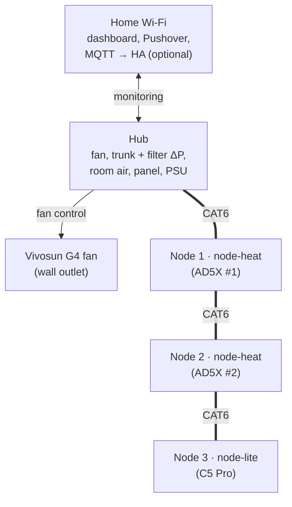
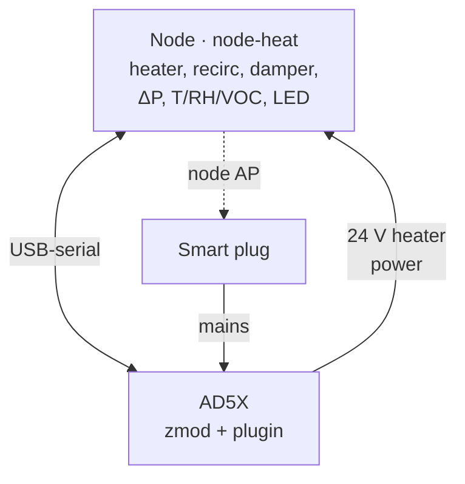
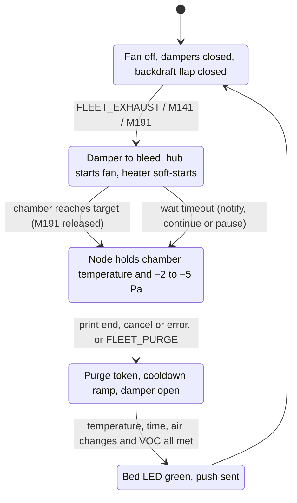

# 01 - System Architecture

> **Status:** Phase 1 design baseline, 2026-10-25, updated 2026-10-28. Every decision is recorded as D1–D64 in [design_decisions.md](design_decisions.md).
>
> **Evidence key used across docs 01–08:** **[V]** verified against a primary source · **[E]** engineering estimate · **[U]** unverified, needs a measurement or a test on the real hardware.

---

## 1. What the system does

The fleet is **2 × Flashforge AD5X** (official Flashforge enclosure kit, modified) and **1 × Flashforge Creator 5 Pro**. All three run **zmod on top of stock Flashforge firmware**. The system adds:

1. **Fume containment:** every printing chamber is held at a slight negative pressure. Leaks then flow *into* the chamber, and fumes leave only through a shared, filtered duct vented outdoors.
2. **Chamber heating on the AD5Xs** for ABS, ASA, PA-CF and PC, so they reach temperatures an open-frame AD5X can't.
3. **Cooling exhaust** for PLA, PETG, PETG-CF and TPU, so an enclosed chamber doesn't overheat.
4. **Controlled purge after every print:** a slow cooldown ramp the slicer can set, with a "safe to open" signal.
5. **Monitoring and alerts:** chamber temperature, humidity, VOC and pressure per printer; filter loading; fan health. Private push notifications only when your action could help, or when a print finishes.
6. **Independent safety layers** for heaters and fire that don't rely on Wi-Fi, Home Assistant or the printer's own firmware.

## 2. Priorities that drove the design

These are the reference build's requirements, and they decided every trade-off below.

| # | Priority | Consequence |
|---|---|---|
| P-1 | **Keep stock Flashforge firmware + zmod** (Flashforge app, FlashPrint, iOS app keep working) | No Klipper secondary MCU (§4.1). Everything integrates through a zmod plugin and Moonraker. |
| P-2 | **"Alert, but finish the print"** | Nothing in this system can shut down Klipper. Faults degrade chamber heat or exhaust and raise an alert. |
| P-3 | **Safety must not depend on Wi-Fi, Home Assistant or a printer being healthy** | Local hardware safety on each node (two series switches, a hardware enable chain with heater-housing **and chamber-air** thermostats, a TCO), a wired hub↔node link with an ESP-NOW radio backup (D16), and a hub-commanded per-printer mains cut. The hardware layers work with nothing else running; the mains cut needs Wi-Fi to reach the Shelly plug (D12). |
| P-4 | **Near-zero false positives** for anything drastic (mains cut, paging) | Two-signal corroboration for fire response; a narrow paging policy. |
| P-5 | **Mechanically robust assembly, no screw terminals, no wires on PCB pads** | Locking connectors, a plug-in ESP32 board, header-on-footprint for the AD5X USB link; the C5's external USB port. |
| P-6 | **Office-quiet** (no louder than the printers) | Low-speed bleed most of the time; full-flow purge only briefly. |
| P-7 | **Cost: "do it right", but trimmed** | Full tier with cheaper pressure sensors, one universal carrier PCB plus one small universal sensor board, and off-the-shelf parts (≈ $650 line-item BOM, see doc 03). |
| P-8 | **Open source, prefer existing printable models** | Existing models wherever they fit; custom parts only where they're genuinely better. |

## 3. Topology

**The fleet.** One hub on the wall and one node per printer, daisy-chained on CAT6 (24 V logic + CAN, with ESP-NOW radio as a backup). Home Wi-Fi carries monitoring only; nothing safety-critical depends on it.

**One printer cell** (AD5X). Each node sits on its printer's branch damper and has its own smart plug, which joins the node's Wi-Fi access point.

The **C5 Pro cell** is the same without heater power: node 3 (node-lite) talks to the C5 over the same USB-serial link, through the C5's external USB port (D24, pending O10). Every node uses Moonraker on Wi-Fi as its backup link.

| Element | Role |
|---|---|
| **Universal carrier PCB** | One JLCPCB-assembled design with a **plug-in ESP32-S3 DevKitC-1-format board**, populated three ways: **node-heat** (AD5X), **node-lite** (C5 Pro), **hub**. Order of 5: 3 nodes, hub, spare. |
| **Node-heat** (AD5X ×2) | 150 W PTC heater (powered from **that AD5X's own 24 V supply**, D12) with recirculation and intake filter, chamber temperature/RH/VOC, chamber ΔP, branch damper, door switch, bed LED strip, and the switched output for the AD5X recirculation-duct blower (O3). It runs its own heater control and safety. |
| **Node-lite** (C5 Pro) | The same minus the heater stage. The C5 keeps its stock chamber heater and fans; the node adds monitoring, the damper, chamber-ΔP control and the LED strip. Its USB lead goes to the C5's **external** USB port, so there's **no wiring inside the C5** unless the J34 fallback is needed (D24). |
| **Hub** | On the wall next to the fan. It feeds the 24 V **logic** bus (nodes can inject too, D13) and is sized to carry every node's logic with all printers off (D35); runs the trunk-vacuum loop, measures filter loading and room air, queues purges, cuts a printer's mains (Shelly) on a corroborated fire or a verified heater runaway, sends notifications and serves the dashboard. It has **no heater switch** (D12). |
| **`fleet_exhaust` zmod plugin** | Installed on each printer. It provides the G-code commands (`FLEET_EXHAUST`, `FLEET_PURGE`, `M141`/`M191` on the AD5X), a klippy extra that makes the chamber look like a normal Klipper temperature sensor, and the USB link to the node on the AD5X. |

## 4. Key decisions and why

Each row is an approved decision. The full record and the trade studies are in [design_decisions.md](design_decisions.md).

### 4.1 Standalone nodes instead of a Klipper secondary MCU (D3)

- A Klipper secondary MCU needs firmware built from **the exact Klipper source the printer runs**. On stock firmware that's a Flashforge fork with no published source found. The C5 Pro can't run zmod's Klipper 13 at all [V].
- Upstream and zmod Klipper **shut down and kill the print** when any MCU drops off [V]. That conflicts with P-2.
- Using the AD5X's free main-MCU pins (option c) can't carry the feature set (about 5 pins, no ADC confirmed, no I²C) and means soldering wires to mainboard pads.
- **Result:** each node is an ESP32-S3 with its own safety logic. On the AD5X it talks to a **klippy extra over USB-serial using our own protocol** (no version matching; an unplug is an alert, not a shutdown). The extra makes `M191` block print start until the chamber is warm, exactly like a native heater. Details in doc 07.

### 4.2 Logic bus and wired CAN from the hub; heater power from each printer (D4, amended by D12)

- **Node logic** comes from a small hub PSU over the CAT6 daisy chain, so nodes keep running when a printer is off and can still purge it.
- **Heater power** comes from **each AD5X's own internal 24 V supply**, reused if its label shows headroom or upgraded if not, or from an external 24 V DIN-4 brick on the same smart plug, connected through a pigtail to the internal XT30 (O1, D52, D22, doc 02 §3.1). The Shelly plug that feeds a printer therefore removes printer *and* heater power in one cut.
- **Why no hub heater relay (D12):** every fault the relay covered is a heater runaway, and the node handles all single faults itself (two series switches; a hardware enable chain with housing and chamber-air thermostats; a TCO in the load path). A runaway needs a double fault. At that point the print is lost anyway, so a per-printer mains cut costs nothing extra.
- **Extensibility:** adding a printer needs only a CAT6 patch cable, a node and a smart plug (Shelly, or any plug via HA, D14). There's no heavy cable, hub relay or larger hub PSU per printer. A CAT6 segment carries about 36 W (1.5 A, kept there on purpose, D21). **Power injection at the nodes (D13)** removes that as a chain limit: every carrier can feed the bus through a current-limited, reverse-blocking eFuse, the AD5X nodes do so from their heater tap, and any node can take a 24 V brick. With every printer off, the hub carries the chain alone: the idle load (~1–2 W per node) plus the busiest node's alarm peak, which is what its supply is sized for (D35, doc 04 §6a).
- **ESP-NOW backup (D16):** the same messages also go over ESP32 peer-to-peer radio, so an unplugged or damaged cable costs nothing. A node can also run **wireless-only** (no CAT6) with a 24 V brick (doc 07 §6.4).
- **Safe RJ45 (D17):** the bus pinout puts equal potential on both wires of every pair, and every outgoing jack powers up only for a fleet node, so plugging it into a switch, laptop or PoE port does no harm.
- CAN in a CAT6 cable keeps hub↔node coordination (purge token, runaway reports, heartbeats) working **without the router**. It's daisy-chained hub → node 1 → node 2 → node 3, which is standard CAN practice.

### 4.3 Dampers on the nodes with cascaded control (D5)

- Holding **each chamber's** pressure during another printer's purge needs a closed loop per chamber. That loop belongs next to its own ΔP sensor.
- Standalone, bus-powered nodes removed the old objections to printer-side dampers: they still purge a crashed or powered-off printer, a damper fault can’t kill a print, and there are no electronics inside the C5 (its USB lead uses the external port, D24).
- The hub holds a **constant trunk vacuum** and nodes trim their own branches. One purge runs at a time.

### 4.4 Filtered outdoor venting with the fan at the outlet (D6)

- With the fan at the outlet, every metre of indoor duct is below room pressure, so leaks flow inward.
- A HEPA + thin-carbon combo cartridge costs the same as HEPA alone and handles first-year odour courtesy. No space is reserved for a deep-carbon canister (D6).

### 4.5 Seal and insulate rather than add watts (D7)

- An uninsulated polycarbonate kit loses roughly 300–400 W at a 40 K temperature difference. Sealed and insulated, it loses about 100–130 W [E], so a 150 W PTC heater has margin.
- The AD5X chamber is **capped at 60 °C (65 °C hard limit)**, assuming the sealed, insulated enclosure and all chamber printed parts in ASA/ABS (D26). The printer was designed open-frame, so its stock toolhead and cable-chain plastics are checked at unboxing (O11); the IFS stays outside the chamber.

### 4.6 One universal PCB with a plug-in ESP32 board (D9)

- One carrier design and one set of JLC fees covers all five boards. No RF or USB layout risk, and a dead ESP32 is a cheap swap. Doc 02 §2.
- The sensors that need a PCB (sensor head, trunk pressure, damper encoder) share a **second, small universal sensor board**, ordered separately because JLC won't panelise two designs for you (D42, doc 02 §2.3).

## 5. What happens during a print (summary)

1. **Start:** Orca filament start G-code calls `FLEET_EXHAUST MODE=abs CHAMBER=50` (or `M141`/`M191`). The node opens its damper to bleed, the hub starts the fan and holds trunk vacuum, and the heater soft-starts. `M191` holds the print until the chamber reaches its target.
2. **Printing:** the node holds chamber temperature and chamber ΔP (−2 to −5 Pa). The bed LED shows status. Faults raise alerts; the print continues.
3. **End, cancel or error:** a purge starts, triggered by `FLEET_PURGE` or by the node seeing the print end. It cools at the slicer-set ramp and finishes when VOC, temperature, time and air-change criteria are all met. The bed LED goes green ("safe to open") and a push notification is sent.
4. **Idle:** fan off, dampers closed, backdraft flap closed.

Prints started from the touchscreen, the Flashforge app or FlashPrint follow the same flow with a default policy (doc 07 §5).

## 6. Document map

| Doc | Content |
|---|---|
| 02 | Hardware specification: carrier board roles, heater module, sensors, dampers, hub, fan, PSU |
| 03 | Bill of materials and cost |
| 04 | Wiring, cables, connectors, GPIO map, printer USB links |
| 05 | Safety design, fault-response matrix, commissioning safety tests |
| 06 | Pneumatics: ducting, filter, outlet, control loops, purge, heat budget |
| 07 | Firmware, zmod plugin, protocols, G-code API, notifications, dashboard |
| 08 | Printable parts catalogue |
| 09 | Sensor bus and carrier I/O controller: per-header I²C segments, power and interrupts, programming every MCU through its ROM bootloader, supported sensors |
| Design decisions | Decision record D1–D64, cost-reduction pass, trade studies T1–T3 |
| 12 | Porting guide: printer packs, link tiers, profile schema, mechanical interface, safety contract, licensing |
| 13 | Build-your-own quick start |
| `printers/` | Printer packs: AD5X and C5 Pro specifics (enclosure mods, USB connection point, Klipper integration, printer-specific parts) |

## 7. Risk and open-item register

Consolidated here; each item is also referenced in the doc it affects.

| # | Item | Impact | Plan / owner |
|---|---|---|---|
| **R1** | **Vivosun G4 control interface undocumented** (E12 controller over a USB-C-shaped cable, powered by the fan); behaviour with the controller silent is unknown | Hub may not set speed; "hub dead → fan keeps running" may be impossible | **First Phase 2 task.** Reverse-engineer with a meter and a logic analyser before PCB layout. Fallback: a fan with a documented interface (e.g. AC Infinity Cloudline + UIS, or a 4-wire PWM EC inline fan). |
| R2 | G4 static-pressure curve unpublished | Purge flow through the O2 filter may be low | Measure at commissioning; drop the carbon layer before buying a bigger fan. |
| R3 | Chamber VOC purge criterion: gas sensor temperature range; adaptive VOC index | Purge-end logic may not validate | **Closed (D20):** the ENS160 (rated −40 to 85 °C) replaces the SGP41 (50 °C) on every sensor head, so the chamber reads through the whole purge. Raw element resistances, cross-calibrated node vs hub at idle. Fallback: time + temperature + air changes. |
| R4 | XGZP6897D offset drift (all six, including the trunk since D11 and the trunk-flow venturi since D30) | Noisy chamber loop; trunk setpoint error | System-wide static auto-zero with plausibility limits and temperature compensation (doc 06 §4.1); deadband; bench test early. |
| R5 | The klippy extra (`fleet_node.py`, the Python module that makes the chamber a normal Klipper sensor) must load in Flashforge's own Klipper forks: the AD5X's Klipper 12-based fork and the C5's fork can differ in extras path, Python version and internal API (reactor, sensor registration) | The extra may need a per-printer variant, or may not load on one printer | Prototype on one AD5X first. Prior art: **FLOOK32** (`ghzserg/flook32_plugin`), a standalone ESP32 chamber controller whose klippy sensor extra already runs on zmod printers. If the extra won't load, the plugin runs macros-only: the G-code commands and Moonraker link work, but `M191` can't wait on chamber temperature. |
| R6 | ESP32-S3 Wi-Fi range near metal frames | Moonraker link drop (backup path on every node; the C5's only link if O10 fails) | **Mitigated by placement (D19):** each node's housing sits on its branch damper at the printer's exhaust port, outside the frame and chamber, with the module's antenna end facing away from the printer. No safety function depends on Wi-Fi. Check RSSI at commissioning. |
| R7 | AD5X bottom internal USB header: footprint type and pin order unreported; **VBUS is live (5.05 V measured)** [V: zmod #207]; stock firmware might claim `/dev/ttyACM*` | Link cable and port claim | Inspect at unboxing; data + GND only; `/dev/serial/by-id/` naming. Fallback: TVOC UART (untested), then UDP over Wi-Fi. |
| R8 | C8 integrated-fan PTC: stall detection without a tach relies on PTC current falling and housing temperature rising | Possible undetected fan stall | Bench test before buying two; fallback is a separate 3-wire blower (+$8). The TCO and KSD301 still protect either way. |
| R9 | **JLC takes one design per board** (no mouse-bite panel of different designs; they must be cut apart by hand), so the sensor board (D42) is its own order, once per population | Three small orders add setup and shipping (≈ $12 each) [E] | Get the quote at Phase 2; merge P and E into hand-soldered bare boards if the setups cost more than the parts, or order S alone and hand-solder the rest. |
| R10 | Low-voltage RJ45/CAT6 bus can be plugged into real Ethernet gear by mistake | Was: 24 V into a switch or laptop port damages it. **Mitigated by D17** (pair-safe pinout, detect-before-power, fault-tolerant CAN, 30 V input cut-off; doc 04 §3a); residual risk is the Phase 2 circuit not behaving as designed (commissioning test 21) | Distinct cable colour; **port names embossed on the printed node housing and hub enclosure** beside each jack (IN, OUT, POWER IN, LAN on the hub, plus "FLEET BUS – NOT ETHERNET"; doc 08 C5, C9); documented in doc 04. |
| R11 | Heater return current shares the AD5X USB-link ground (the heater runs from the printer's supply and the node's ground also reaches the printer through the USB lead) | Ground offset or heating in the USB lead; USB link errors | 14 AWG heater lead ≤ 1.5 m keeps the USB share ≲ 0.3 A [E]; measure at commissioning (doc 05 §9). Fallback: a USB isolator (ADuM3160-class module, ~$6) on the link. |
| R12 | Printer's 24 V rail sags under bed + heater + motion load (stock supply reused) | Mainboard reset kills the print (P-2) | O1 sizing rule (doc 02 §3.1); bed-heat interlock and rail-voltage throttle on the node; load test before unattended use (doc 05 §9). |
| O1 | **AD5X PSU rating, form factor and whether the bed runs from it** | **Decides reuse, upgrade or an external DIN-4 brick for the heater** (doc 02 §3.1, D22) | Read the label and trace the bed supply at unboxing. Every node-heat carrier takes all three, so the answer changes only what you buy. **Also decides the hub supply:** unless an upgrade frees a stock AD5X supply, the leaning is a **24 V desktop brick** (Mean Well GST60A24 class) into the hub's POWER IN instead of the LRS-100 and IEC inlet, which takes all mains wiring out of the printed hub enclosure at about the same cost. |
| O2 | ~~IFS on top of or beside the enclosure~~ **Closed: beside the enclosure** (the standard arrangement, assumed) | Bowden pass-through plate location | E2 plate goes on the panel facing the IFS. |
| O3 | ~~Does the kit's chamber/filter fan exhaust or recirculate?~~ **Closed: it recirculates** | No conflict with the exhaust | **Required on each AD5X:** a printed recirculation duct with a 24 V 5015 blower that pulls chamber air through the AD5X's rear filter and returns it (doc 08 E7: Printables #1473971, alternative #1472826). Node output B1 switches it. |
| O4 | C5 Pro side port: **mostly answered from published models.** The port is the stock **7025 exhaust fan** (Peerless DF7025B24V class, 24 V) behind the right side cover; an internal **9733 blower** (DB9733B24V class) circulates chamber air. The exhaust fan runs in "Adaptive Air Circulation" (external) mode for PLA/PETG/TPU; in engineering-filament (internal) mode it is off and its outlet is open. Still unconfirmed: which Klipper name (`chamber_fan` / `chamber_cool_fan`) is which [U] | C5 shroud design | Base C7 on Printables #1802285 (adaptor over the exhaust fan with a side-cover gasket and a ⌀80 mm hose fixture) or MakerWorld #2934469 (80 mm duct held by the filament-holder pins), opened up to 100 mm (doc 08 E8). Port dimensions come from those models; read the fan names from `printer.cfg` at setup. |
| O5 | zmod #699 (`zmod_ifs` material status) merged? | Default-policy level 4 only | Check the zmod version at setup. |
| O6 | Do Flashforge-app and FlashPrint jobs populate Moonraker `filament_type` metadata? | Default-policy level 3 | Test at setup. |
| O7 | Heater housing temperature in normal operation | Sets the KSD301 and TCO ratings | Measure the chosen element on the bench (doc 05 §3). |
| O8 | ~~Response to runaway trigger RW-a~~ **Closed (D40): immediate mains cut** | — | Pause-and-escalate was considered and not adopted (doc 05 §3.4). |
| O9 | ~~Wired LAN and PoE~~ **Closed: option A decided (D18)** | — | Fleet jacks stay CAN, protected by the D17 safety circuit (detect-before-power, pair-safe pinout, 30 V cut-off), so plugging one into a network port by mistake does no harm. The hub gets a separate, standard LAN jack (fitted on every carrier since D47, so a node can use it too). **PoE power:** no on-board PoE. Use an off-the-shelf 802.3af/at splitter with a 24 V barrel output and a barrel-to-XT30 lead into POWER IN, either (a) to run one board from PoE alone, or (b) to power the hub and, through its eFuse, the 24 V bus. An 802.3at splitter (≈ 24 W, ≈ $17) covers the hub and the three nodes' logic at idle; LED and servo peaks need the firmware brightness cap or a node-heat tap injecting (D13). |
| O10 | **Does the C5 Pro's kernel have `cdc_acm` (USB-serial), and does the plugin's klippy extra load on the C5's Klipper?** | Decides whether the C5 gets the USB link (D24) or stays on Moonraker over Wi-Fi only | At unboxing: plug a node into the C5's external USB port and look for `/dev/ttyACM*` (and `dmesg`). Check where the external port sits relative to the side exhaust port. If `cdc_acm` is missing, the C5 stays on Moonraker with no other change. |
| O11 | **AD5X stock plastics inside the chamber** (toolhead shroud, fan ducts, cable chain, spool-path parts): what are they made of? | Sets whether the 60 °C AD5X cap (D26) holds | At unboxing: check markings (`>ABS<`, `>PC<`, `>PLA<`) and look for heat creep after a 2 h soak at 60 °C. Replace PLA/PETG parts with ASA prints, or drop `chamber.cap_c` to 55 °C in the AD5X profile. |
| O12 | **Fault and recovery UI wording** (doc 05 §4.1): what the printer-side hold message and the dashboard fault and Clear screens say. **Decided (D28):** a level-3 Clear may be done on the dashboard or with `FLEET_CLEAR` on the printer; a level-4 Clear needs the dashboard checklist plus the node's CLEAR button at the printer. **TBD:** a timed inspection window after a cut, with the re-cut paused, so `FLEET_CLEAR` on the powered printer can be the on-site step (doc 05 §4.1); window length and whether it replaces the button | Usability of recovery | Phase 2 dashboard mock-up |
| O13 | **ModulAir licence and fit** (D34): may its parts be remixed and the remixes published with this project, and do the L bayonet and gasket seal and print as described? | Whether doc 08 §3c's extensions are published as ModulAir remixes or as our own compatible interface | Phase 2: read the licence on each ModulAir part; print a Y, two hose adapters and a gasket; run the duct leak test (doc 06 M10) on them |
| **O14** | **Node damper behaviour when the hub is lost.** The trunk-active flag stops with the hub, but the fan keeps running at its last speed (R1). Doc 06 §4 says a node doesn't run its chamber-ΔP loop without the flag; doc 05 §4 says nodes keep their dampers in their loops | Whether chambers stay at −3 Pa or drift during a hub outage | Phase 2 firmware design: either **hold the last damper angle**, or **keep the chamber loop running** on the node's own sensor while chamber ΔP shows the trunk is still drawing. Decide after R1 shows what the fan does with the hub silent |
| O15 | **ROM-bootloader programming over the I²C pins** (D54, doc 09 §4): does the ESP32 program a PY32F030 and a PY32F003 through UART2 on GPIO 8/9 (open-drain, 115200 8E1) when blank, after a reset command and after a watchdog reset; do the on-board XGZP6897D and the I²C switch stay silent during the traffic; does the same work through a switch channel and a 1 m cable; does the bootloader drive PA9/PA14. Also the LAN chip at 20 and 40 MHz on the IO MUX pins | Decides the bootloader path or the SWD-pad fallback (doc 09 §4.5) | Bench test on PY32 dev boards and an ESP32-S3 before carrier layout |

## 8. Phase 2 bring-up stages (D41)

Phase 2 builds and commissions in stages, so each layer is proven before the next depends on it. Stage 3 holds only monitoring features (doc 05 S-7), so it can slip without any safety impact.

| Stage | Builds | Gate to the next stage |
|---|---|---|
| **0 De-risk** | R1 (G4 interface, first task), O1 (AD5X supply) and O11 at unboxing, O10 (C5 `cdc_acm`), R5 (extra loads on both forks), bench tests: XGZP noise (M4), heater stall and housing temperatures (R8, O7), damper bleed resolution (M1a) | PCB layout waits for R1 and O1 |
| **1 Exhaust core** | Hub, fan and trunk loop, filter, ducting with gaskets, the C5 node (node-lite): damper with encoder, chamber ΔP, purge (air changes from time), CAN + ESP-NOW, smart plugs with the mains cut, basic dashboard and pushes | Doc 05 §9 tests 6, 7, 12, 13, 15–22, 25, 27, 29 |
| **2 Heating** | Both AD5X nodes (node-heat): heater with every hardware layer, bed interlock, rail throttle, characterise run, print hold | Tests 1–5, 8–11, 14, 23, 24, 26, 30, 31. **No unattended heated printing before they pass** |
| **3 Monitoring extras** | Venturi and low-flow anemometer (M8–M10, test 28), branch angle–flow curves (purge air changes then come from them), thermal model, leak drift and heater step test, Moonraker `[sensor]`, Home Assistant | — |
