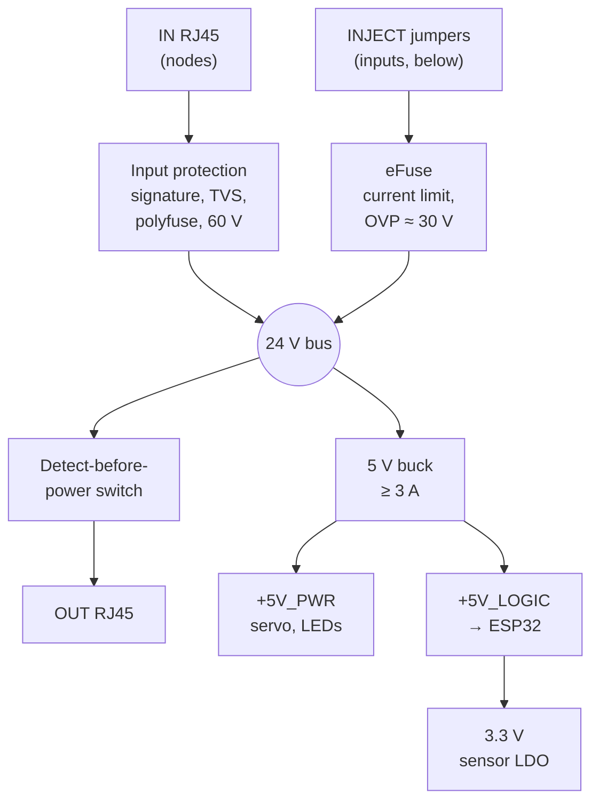
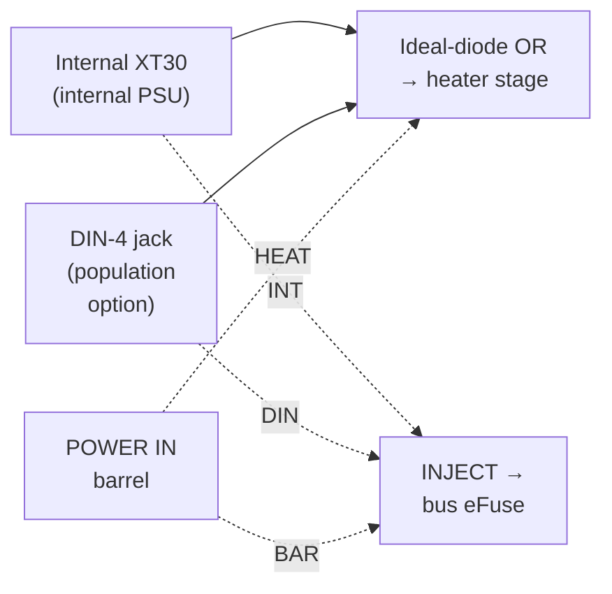
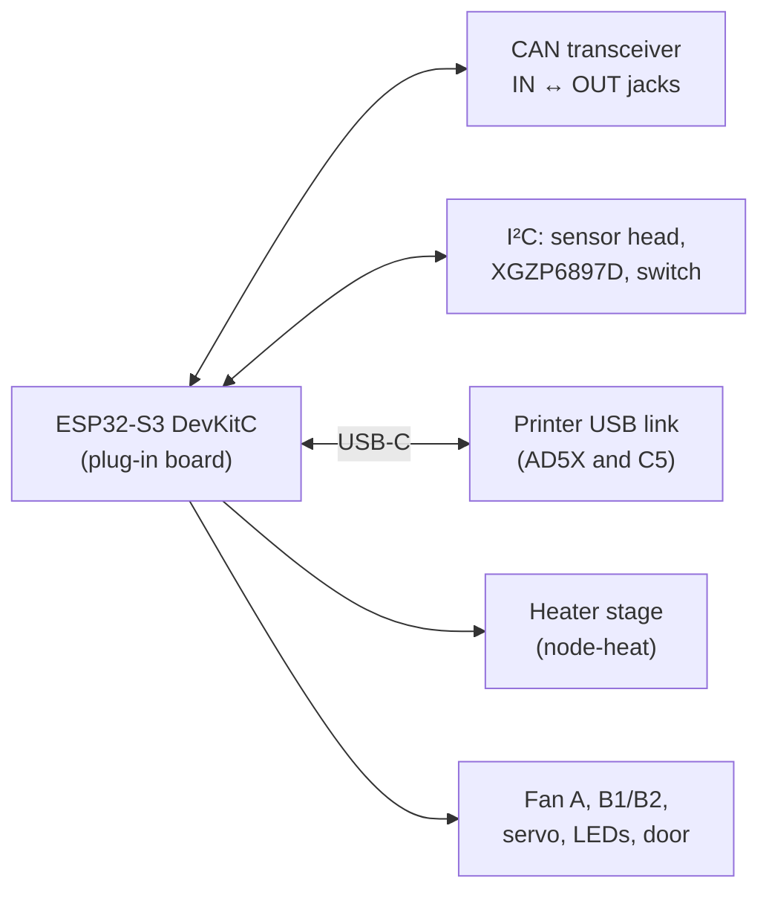

# 02 - Hardware Specification

> Design baseline, 2026-10-25. Part numbers marked *(candidate)* are confirmed against JLCPCB stock during Phase 2 PCB design. Wiring is in doc 04, cost in doc 03.

---

## 1. Hardware inventory

| Assembly | Qty | Where |
|---|---|---|
| Universal carrier PCB + ESP32-S3 DevKitC-1-format board | 5 built (3 nodes, 1 hub, 1 spare) | Nodes in a housing on each printer's branch damper at the exhaust port (D19); hub on the wall by the fan |
| **Universal sensor board** (D42), variant S: sensor head | 5 (3 chambers + hub room sensor + spare) | Inside each chamber near the exhaust port; room air at the hub |
| Universal sensor board, variant P: XGZP6897D pressure sensor | 3 (trunk vacuum, trunk flow, spare) | Hub trunk tap; hub instrument spool |
| Universal sensor board, variant E: AS5600 encoder | 4 (3 dampers + spare) | On each damper's shaft end |
| PTC heater module, 150 W, 24 V | 2 | Low at the rear inside each AD5X enclosure |
| Branch damper (printed, MG90S servo) with an **AS5600 angle encoder** on the blade shaft (D30) | 3 | In each printer's branch duct |
| Trunk flow: printed **venturi** with an XGZP6897D, and a printed **thermistor anemometer** in its throat (D30, D32, D33) | 1 | Hub instrument spool, between the filter and the fan (doc 08 §3c) |
| Printed **reference venturis**, 10 mm and 15 mm throats (commissioning only, M9) | 2 | Fitted in the spool's calibration slot when calibrating |
| Hub power (logic only): Mean Well LRS-100-24 (or a stock AD5X supply freed by an upgrade), IEC inlet; a 24 V desktop brick is the leaning alternative, decided with O1 | 1 | Hub enclosure |
| AD5X internal 24 V supply, **reused or upgraded** per O1, with a fused heater tap | 2 | Printer base |
| Exhaust fan: **VIVOSUN AeroZesh G4** (reference fan; not in the BOM) | 1 | At the through-wall outlet |
| Filter: printed housing + HEPA/carbon combo cartridge | 1 | On the wall, upstream of the fan |
| Mains-cut smart plug: **Shelly Plus Plug US** (recommended) or any plug Home Assistant can switch (D14) | 3 | Each printer's mains |

## 2. Universal carrier PCB

### 2.1 Why a carrier with a plug-in ESP32 board (D9)

| Option | Verdict |
|---|---|
| ESP32-S3-WROOM module soldered on a custom board, separate node and hub designs | Rejected: two sets of JLC fees, 10 boards for 5 needed, and antenna-keepout, USB and boot-circuit layout risk. |
| **Carrier + plug-in DevKitC-1-format ESP32-S3 board, one design** | **Chosen:** one order of 5, a certified module with native USB-C already on it, and a $6 swap if it dies. About $45 cheaper. |
| Tiny "S3 SuperMini/Zero" boards | Rejected: marginal pin breakout for the ~19 GPIO needed [U]. |

**Dev board requirements:**
- ESP32-S3 with **native USB on its own USB-C port** (the DevKitC "USB" port), 2 × 22-pin 2.54 mm headers, N8 or N16 flash.
- Octal-PSRAM variants are fine; the carrier avoids GPIO 35–37.
- The carrier also avoids the onboard RGB LED pin (GPIO 38 on DevKitC-1 v1.1, GPIO 48 on v1.0).
- **A Schottky between each USB port's VBUS and the board's 5 V net** (D37). Espressif's DevKitC-1 v1.1 has them (1N5819HW, D1 and D7, 40 V), so nothing on the 5 V pin, ripple, spikes or a failed carrier buck below 40 V, can reach a USB host. Checked on every board at incoming inspection (doc 05 §9 test 31).
- Clones (~$6–7) are acceptable if they pass that check. Buy two spares.

**Mechanics:**
- The dev board sits in female headers and is retained by two M3 standoffs and a printed hold-down clip.
- The dev board's USB-C ports face the board edge, so the printer USB lead plugs straight in.

**Power into the dev board (D37):** the carrier's `+5V_LOGIC` feeds the dev board's 5 V pin through an **integrated ideal diode**, *TI LM66100DCKR* (LCSC C2869734, SC-70-6, 1.5 A, ~79 mΩ; chip-enable tied to enable it per the datasheet [V]). **Alternate:** *Maxinmicro MX66100T* (C53121238, SOT-23-6, 2 A, ~100 mΩ, blocks within 10 µs once the output is 20 mV above the input, ON pin tied to VIN). They are not pin-compatible; pick one at layout. It blocks the dev board's USB 5 V from the carrier rails and the buck whenever the output is above the input, with no threshold to latch on, and drops ~40 mV at 0.5 A instead of a Schottky's ~0.4 V, so a clone's AMS1117 3.3 V regulator keeps its headroom. Place it after the buck's output capacitors (its absolute maximum is ~6 V). The printer USB lead (AD5X and C5) carries **no VBUS** (doc 04 §5), so the printer and the carrier never back-feed each other.

**Carrier-power reset hold (D36):** if the dev board is powered from its USB socket while the carrier is off (an ordinary cable with VBUS, or a laptop on the bench), the ESP32 would run and drive its pins into unpowered carrier parts, partly powering them through their input clamp diodes. So the carrier holds the dev board's **EN** pin low unless its own `+5V_LOGIC` is above ~4.3 V:

| Part | Connection |
|---|---|
| Q1 (2N7002 class) | Drain to EN (header), source to GND. Gate pulled up to the dev board's 3V3 pin through 100 kΩ |
| Q2 (2N7002 class) | Drain to Q1 gate, source to GND. Gate from a divider on `+5V_LOGIC` (carrier side of the ideal diode), set so Q2 turns on above ~4.3 V |

Carrier off and dev board on USB: Q2 off, so Q1 holds the ESP32 in reset with its pins high-impedance, and the ideal diode blocks the USB 5 V from the carrier. Carrier up: Q2 on, Q1 releases EN (the dev board's own RC sets the start-up delay). The hold also resets the ESP32 if `+5V_LOGIC` sags below ~4.3 V. Component values are set in Phase 2 [U].

**No bypass (D36):** there's deliberately no jumper to defeat the hold, since one left fitted would silently remove both the back-power protection and the brown-out reset. For bench work, **power the carrier** (a 24 V brick into the barrel jack), which releases the hold so USB flashing and the serial console work normally, or **pull the dev board** from its headers and use it on USB alone.

*Discrete alternatives considered and rejected (D37):* a gate-to-ground P-FET conducts both ways once either side is powered; a P-FET switched by a "carrier above 4.3 V" detector latches on, because USB back-feeds the carrier rail through it and keeps the detector satisfied; a two-PNP discrete ideal diode works on paper but adds matching, temperature and stability questions for a ~$3 saving.

### 2.2 Functional blocks and role population

Power and signal flow on the carrier (all roles). **Since D47 every carrier is assembled with the same parts**; the columns below say what each role *uses*, and the only per-board differences are shunt positions (the role, TERM, INJECT/HEAT, the eFuse limit and the NTC ranges).

**Power path:**

**Power inputs (D22):**

Dashed lines are jumpers. The INJECT header picks which inputs power the board and the bus (the board's logic always runs from the bus rail) (each through its own Schottky, so two fitted jumpers can't back-feed each other). The HEAT jumper lets the barrel input also feed the heater, capped at ~100 W.

**Controller and I/O:**

| Block | Node-heat (AD5X) | Node-lite (C5) | Hub | Notes |
|---|:-:|:-:|:-:|---|
| Input: 24 V logic from the **IN** RJ45: 10 kΩ node signature, reverse-polarity P-FET, SMBJ33A TVS, 2 A polyfuse; input parts rated 60 V | ✓ | ✓ | Fitted, not used (the hub is a chain end; nothing plugs into IN) | D17, doc 04 §3a. Fitted on the hub too since D47, so its IN jack is never an unprotected path onto CAN, and a spare board can be any role. |
| **OUT RJ45 with detect-before-power:** window comparator + latch → bidirectional current-limited switch on +24 V, held on by **current magnitude > 5 mA in either direction** (bidirectional sense, D35); direction readable by firmware; powers the OUT jack only for a fleet node signature or a powered fleet segment | ✓ | ✓ | ✓ (the hub's only jack) | D17. Plugging into a switch, laptop or PoE port puts 0 V on it. |
| **24 V POWER IN → bus injection:** **INJECT jumper header** (INT, BAR, DIN; one Schottky per input) → **eFuse with reverse-current blocking** *(candidate: TPS2663 class)* → the RJ45 bus rail. Current limit set by a resistor, **~1 A by default**, raised to **~1.5 A by the ILIM shunt** (a second resistor in parallel; fitted on the hub only, D47; a missing shunt gives the lower limit, the safe direction) (the CAT6 segment allowance since D17, kept at 1.5 A so cheap CCA or Cat5 patch cables stay inside their rating, D21). **Over-voltage cut-off ≈ 30 V**. The jumpers choose which supplies power the board and feed downstream nodes: an internal supply on the XT30 (INT), a brick or PoE splitter on the barrel jack (BAR), or a DIN-4 brick (DIN) | ✓ (INT fitted: fed from the printer's supply tap) | Optional (BAR fitted with a 24 V brick; **required on a wireless-only node**, doc 07 §6.4) | ✓ (INT fitted: **the hub PSU, wired inside the enclosure to the internal XT30, is the hub's only path onto the bus**) | D13, doc 04 §6a. Blocks back-feed into any source and current-limits a short. |
| **24 → 5 V buck, ≥3 A** *(candidate: TPS54331 / MP2315 class)*; separate `+5V_PWR` (servo, LEDs) and `+5V_LOGIC` branches | ✓ | ✓ | ✓ | ARG-08. |
| 3.3 V LDO for off-board sensors (separate from the dev board's own 3.3 V) | ✓ | ✓ | ✓ | ARG-11: clean sensor supply. |
| **Carrier-power reset hold** (two 2N7002-class FETs, divider, no bypass), and the **ideal-diode dev-board feed** (LM66100, alt. MX66100T) (§2.1) | ✓ | ✓ | ✓ | D36, D37. Keeps a USB-powered dev board in reset and stops it back-feeding the carrier. |
| **CAN transceiver**, fault-tolerant bus pins ±58 V (*candidate: TJA1051T/3 with 3.3 V VIO*), IN + OUT RJ45 for the daisy chain, **TERM jumper** (120 Ω 1 % in series with a 2-pin shunt; fitted at the two chain ends, doc 04 §3) | ✓ | ✓ | ✓ | D17: survives Ethernet or PoE on pins 1/2. |
| **LAN jack (D18):** standard 10/100 RJ45 MagJack + SPI Ethernet chip (W5500 or DM9051, both supported by ESP-IDF) + 25 MHz crystal, on **GPIOs 10–13**, SPI2's IO MUX pins (D45, doc 04 §4) | ✓ (optional wired link) | ✓ (optional wired link) | ✓ | A normal network port, separate from the fleet jacks, with no 24 V on it. Fitted on every carrier since D47 (was hub only), so any node can use a wired link instead of Wi-Fi. |
| **Power inputs (D22):** three 24 V inputs, each through an **ideal-diode controller + N-FET** *(candidate: LM74700 class)* where it joins the heater rail, so no input back-feeds another. **Internal (INT):** XT30 on the inside face of the housing, for wiring from a supply inside the housing or printer: the printer's supply tap or an upgraded internal supply on a node, the hub PSU in the hub enclosure. It is the **system input**, not only the heater supply: with INJECT INT fitted it powers the board and the bus, so the hub powers itself and a node with an internal supply can power nodes downstream. **POWER IN (BAR):** **5.5 × 2.5 mm barrel jack** (≤ 5 A) on the outside face, for a logic brick, a PoE splitter (D18) or a Mean Well GST120A24-P1M-class brick; it reaches the heater rail only through the **HEAT jumper** (default open), and then the firmware caps the heater at ~100 W. **External (DIN):** **4-pin DIN power jack** *(Kycon KPJX-4S class, 7.5 A at 48 V, the plug on Mean Well GST160/220 bricks)* on the outside face, a **population option**: the footprint, housing opening and ideal-diode circuit are on every carrier, and only the THT jack is left off the baseline order, so fitting it later is one through-hole part. A weighted divider puts the DIN input and the HEAT-jumpered barrel input on one ADC input of the carrier I/O expander (§2.4, D47) as four distinct levels, so the firmware knows which heater sources are live and **caps the heater at ~100 W whenever the barrel is the only live heater source** (HEAT jumper closed, no DIN, internal input absent per the heater-rail reading) | ✓ (INT + BAR; DIN optional) | ✓ (INT + BAR; DIN optional) | ✓ (INT + BAR; DIN optional) | Makes the supply a choice at install time, not a design change. Unused openings take a printed blanking plug (doc 08 C15). |
| **Heater stage:** ORed heater rail, **high-side P-FET enable** (driven by the hardware enable chain), **low-side logic-level N-FET PWM**, 10 kΩ gate pull-downs, 100 Ω series gate resistors, XT30 heater output | ✓ | Fitted, held off | Fitted, held off | Two independent switches in series (doc 05). ARG-09. Fitted on every role since D47; see the note below the table. |
| **Hardware enable chain:** RC **charge-pump** fed by a toggling GPIO, in series with the **KSD301 loop** (off-board, normally closed: **heater-housing KSD301 + chamber-air KSD301 in series**) → high-side gate driver | ✓ | Fitted, loop open | Fitted, loop open | A hung MCU (pin stuck high or low) or either KSD301 opening turns the heater off. |
| **Heater current sense (D50):** 5 mΩ low-side shunt (LRAM25EJER005 class, 2512, ±5 %) + LM2904 at gain 40 with a ~10 mV input pedestal → ADC; zeroed in firmware at boot (doc 04 §4) | ✓ | Fitted, unused | Fitted, unused | Open element, welded FET, inrush, and C8 stall detection. |
| **Fan channel A:** 24 V high-side switched, tach input (pull-up + clamp), plus open-drain PWM output | ✓ (recirc fan if not integrated) | Fitted, spare | ✓ (**G4 fan port**, finalised after R1) | High-side switching keeps the tach valid (F5). The 0–10 V output stage is footprint-only, unpopulated until R1 says whether it's needed. |
| **Low-side outputs B1, B2:** switched 24 V, flyback diode each | ✓ (B1 AD5X recirculation-duct blower, O3; B2 spare) | Fitted, spare | ✓ (B1 **anemometer heater**, PWM, D32; B2 buzzer) | |
| 2 × NTC 100k inputs (ADC1, RC filter): **47 kΩ** pull-up to the sensor 3.3 V on every board, plus **5.1 kΩ through a RANGE shunt** per channel (≈ 4.6 kΩ with the shunt on, D47) | ✓ (chamber air, heater housing; **both RANGE shunts on**) | Fitted, spare | ✓ (**low-flow anemometer**: reference and heated NTC, D32; **RANGE shunts off**) | 47 kΩ gives resolution at 20–80 °C (anemometer); ≈ 4.6 kΩ covers the hot range of the heater housing. A wrong shunt is caught at boot (doc 04 §4). |
| **On-board XGZP6897D** pressure sensor (I²C 0x6D), two barbs | ✓ (chamber vs room) | ✓ | ✓ (**across the filter**) | |
| **Sensor headers 1–6** (JST-XH 5: 3.3 V, GND, SDA, SCL, INT/SWIO) behind an **8-channel I²C switch** (TCA9548A, one channel per header), with a **CH32V003 I/O controller** for per-header power, interrupts and CH32 programming; **slot 7** is the on-carrier I/O expander (§2.4) (D45, doc 09) | Header 1: **sensor head**. Header 2: **AS5600 damper encoder** (sensor board E, D30). Header 3: unused (per-branch flow option). Header 4: optional OLED (D48) | Header 1: **sensor head**. Header 2: **AS5600 damper encoder**. Header 4: optional OLED (D48). Headers 3, 5, 6: unused | Header 1: **room sensor head**. Header 2: **XGZP6897D trunk sensor** (sensor board P). Header 3: **XGZP6897D trunk-flow sensor** at the venturi (D30, D33). Header 4: optional 0.96″ OLED at 0x3C (D48) | Every XGZP6897D is fixed at 0x6D, so each off-board one sits on its own switch channel and can't clash with the on-board one (D11; supersedes C7). Each header being its own segment also keeps bus capacitance low. **A display never shares a channel with a sensor** (D48, doc 09 §3), so a locked-up OLED can't take a sensor reading with it. Headers 5–6 (and 3 on nodes) are free for further sensor boards. |
| Servo header (`+5V_PWR`, signal held low at boot) | ✓ | ✓ | Fitted, unused | The damper's **AS5600 angle encoder** (D30) reads the blade shaft and connects to I²C header 2, not here. |
| Door input (reed switch, pull-up, RC + ESD), **read through the carrier I/O expander** (§2.4) | ✓ | Fitted, optional | Fitted, unused | The C5's doors are read from Moonraker. For the AD5X the reed is primary and Moonraker is the backup (doc 05 §4). |
| LED chain 1: 74AHCT1G125 level shifter, 330 Ω series, 1000 µF bulk (chain 2 dropped, D45) | ✓ | ✓ | ✓ (LED1 = panel RGB) | LED 0 of the bed strip is the status pixel. The strip is ~48 LEDs per printer (D44); the firmware caps its current at 0.5 A (doc 04 §3). |
| **AUX header** (D48): JST-XH 5 (3.3 V, GND, A = GPIO 5, B = GPIO 6, GND), each line through a **2N7002 level shifter** (gate to 3.3 V; 10 kΩ pull-up to 3.3 V on the ESP32 side, 4.7 kΩ to 3.3 V on the connector side) and ESD-protected | Spare, or the **UART printer link** (A = TX, B = RX; doc 12 `marlin_serial`) | Spare, or the UART printer link | ✓ (A = smoke dry contact; B = acknowledge button; each with its own GND pin) | Replaces the two spare-input headers. An **on-board tact switch** (TS-1187A-B-A-B, LCSC C318884, a Basic part) sits on B's connector side, in parallel with the AUX pin, on every carrier (D49): the hub's front panel presses it through a printed plunger, and a builder can still cable a remote button to AUX B. It is on B, the UART **RX** line, so a press on a node using the UART link only garbles a received frame; on A, the TX line, it would short a driven output through the shifter. The shifter makes both lines **5 V-tolerant** and still passes a contact pulling low, so edge interrupts work. GPIO 5/6 are no longer analog inputs. Pinout in doc 04 §4. |
| **Heater-input senses**, read by the **carrier I/O expander's ADC** (§2.4): **heater-rail voltage** via a divider, and the **external heater-input sense** (DIN and HEAT-jumpered barrel on one weighted divider, four levels, D22) | ✓ | Fitted, read | Fitted, read | Moved off GPIO 5/6 by D47. The ~100 W barrel cap and the rail throttle (doc 05 §3) then depend on the expander, so a missing or silent expander **holds the heater off** (§2.4). |
| **Board identity header** (D46): 2 × 3 pin header + shunt (HEAT, LITE, HUB) on a divider to GPIO 3, checked against the stored role at boot (doc 04 §4) | ✓ (HEAT) | ✓ (LITE) | ✓ (HUB) | Wrong or missing shunt → safe hold, nothing switches on. Since D47 it is the only part of the role set on the board. The dev board's BOOT button doubles as a service button after boot (doc 04 §4). |
| Status LEDs (power, CAN activity) and a **board status LED** driven by the carrier I/O expander (§2.4) | ✓ | ✓ | ✓ | |

**One population (D47).** JLC assembles one BOM per order [E], so three populations would mean three assembly orders, each with its own setup and extended-part fees, and a spare board that fits only one role. Fitting every block on every carrier costs less than that and lets the spare stand in for any role. The heater stage is safe to fit on a board that doesn't use it: its high-side switch needs both the charge-pump wave and a closed KSD301 loop (doc 05 §3.1), the KSD301 loop is not wired on a node-lite or the hub, and the firmware refuses to drive it unless the role shunt says HEAT. A node-lite becomes a node-heat by moving the role shunt, fitting both RANGE shunts and wiring the heater and KSD301 loop.

**Board size:** set by its connectors, not a target size (ARG-12). Estimated ~100 × 70 mm, 2-layer, 2 oz copper on the heater path.

**Connectors:**
- Power: XT30 (internal 24 V input, heater output); 5.5 × 2.5 mm barrel (POWER IN); 4-pin DIN (external heater input, population option); INJECT and HEAT jumper headers (D22); ILIM and RANGE 1/2 shunt headers (D47).
- AUX: JST-XH 5, smoke contact and an optional remote acknowledge button on the hub, or a UART printer link on a node (D48, D49).
- Acknowledge button: on-board SMD tact switch on AUX B, pressed through a printed plunger (D49).
- Bus: RJ45.
- Signals: JST-XH 2.54 mm. Use **pre-crimped pigtails**, so no crimp tool is needed.
- Servo: standard 3-pin header.
- No screw terminals anywhere (P-5).

### 2.3 Universal sensor board (D42)

JLCPCB assembles only one design per board, and a panel of different designs has to be cut apart by hand (their panelization rules), so the sensor head is **not** a break-off tab of the carrier. Every sensor that must sit on a PCB uses **one small second board**, ordered separately from the carrier. It is ~30 × 20 mm, 2-layer, with a 5-pin JST-XH (3.3 V, GND, SDA, SCL, INT/SWIO; D45), two M2 holes at the same spacing on every variant, and 100 nF decoupling. It has no pull-ups (the carrier fits them per header, after the header's power switch; doc 09 §2.2).

**One set of Gerbers, three populations** (the unused footprints stay empty):

| Variant | Fitted parts | Used for | Qty |
|---|---|---|---|
| **S** sensor head | **SHT40** (T/RH, I²C 0x44, ±0.2 °C / ±1.8 % RH; the SHT45 isn't needed, C2) + **ENS160** (metal-oxide gas sensor, 4 heated elements, I²C 0x52/0x53, rated **−40 to 85 °C** so it reads through the whole purge including ~60 °C chamber air, R3, D20) + a **1.8 V LDO** for the ENS160's VDD (VDDIO at 3.3 V). The firmware reads the ENS160's **raw element resistances**, with the SHT40's temperature and humidity written in for compensation | Chamber sensor heads, hub room sensor | 5 |
| **P** pressure | **XGZP6897D**, ±500 Pa class (I²C 0x6D), its two ports taking silicone tube directly or printed barbs | Hub trunk vacuum and trunk flow (D11, D33) | 3 |
| **E** encoder | **AS5600** (I²C 0x36), facing the damper shaft magnet | Damper angle (D30) | 4 |

- **No address clashes:** every header is its own I²C switch channel (D45), so two boards of the same kind never share a segment, and no off-board XGZP6897D shares one with the on-board one (D11).
- **Ordering:** each variant is its own JLC order of 5 boards (the minimum), so each carries its own setup and shipping. S must be JLC-assembled (the ENS160 and SHT40 can't be hand-soldered). P and E are assembled by JLC if the parts are in stock, otherwise hand-soldered, since the XGZP6897D and the AS5600 are the easy parts here. The quote can merge variants if JLC's rules allow; see R9.
- **Footprint layout:** the XGZP6897D and AS5600 footprints sit away from the SHT40/ENS160 corner, so a board never has a fitted part in another variant's mounting zone. The same two M2 holes let the C4 cover, C12 mount, C16 encoder bracket and C17 venturi mount all take any variant.
- **Source:** `hardware/pcb/sensor/` (KiCad), with the three BOMs as variants of one project.

In the chamber, it mounts at the exhaust port, out of the heater jet, behind a printed ASA vented cover. The hub's head sits in free room air away from the fan.

### 2.4 Carrier I/O expander (D45)

One extra CH32V003 sits on the carrier itself as an **internal sensor header** (the seventh switch channel and header slot in doc 09 §2.1). It is programmed through the carrier CH32 like any sensor-board CH32 (doc 09 §4.2). It takes the slow, non-safety signals that used to need ESP32 GPIOs, so every role has the same pin map and the same parts (D47), LAN included (doc 04 §4):

| Signal | Was | Safety role |
|---|---|---|
| Door reed | GPIO 13 | None; door-open → purge and an advisory (doc 05 §6). Moonraker is the backup on the AD5X |
| KSD301 loop sense | GPIO 41 | None; the loop works in hardware, the sense only reports it |
| 24V_HEAT switched-output sense | GPIO 42 | Diagnostic; read at start-up and in tests. If a pre-heat check uses it, a missing expander **blocks heating**, which is the safe direction |
| Heater-rail voltage (divider, expander ADC) | GPIO 5 (D47) | Feeds the rail throttle and the barrel cap (doc 05 §3), both firmware limits, not a safety layer. **No reading → heater held off** |
| External heater-input sense (weighted divider, four levels, expander ADC) | GPIO 6 (D47) | Feeds the ~100 W barrel cap. **No reading → heater held off** |
| Board status LED | GPIO 47 | None. The expander blinks a fast "no heartbeat" pattern if the ESP32 stops talking to it |
| LED chain 2 | GPIO 21 | Dropped from the fixed map; a future overhead strip uses a sensor-header board with its own CH32 and level shifter |

Nothing on this list feeds a safety layer (S-7). Without the expander, **heating is blocked** (the heater-input readings are missing, which is the safe direction); the fan, dampers, CAN and every sensor still work. The expander's 10-bit ADC is enough for both senses: ≈ 32 mV per step on the rail divider, against the 23.0 V throttle threshold [E].

## 3. Chamber heater module (node-heat)

| Item | Specification |
|---|---|
| Element | **24 V, 150 W PTC air heater**, aluminium-housed, self-limiting |
| Preferred form (C8) | **Integrated-fan PTC module** of the kind sold for 3D-printer chambers, **with separate fan leads** so the fan runs from fan channel A (always-on 24 V) and keeps cooling the element after a heater cut. Adopted only if a bench test confirms that a fan stall shows up as a drop in PTC current plus a rise in housing temperature (R8) |
| Fallback | Bare PTC + **3-wire 24 V 5015 blower** on fan channel A (tach) + metal shroud |
| Cold inrush | 2–3× rated current [E]. Firmware soft-start ramp; bed-heat interlock when the stock supply is reused (§3.1); fuse and FETs sized for it |
| Mounting | Low at the rear, blowing along the floor away from the bed. The element sits inside a **sheet-aluminium shroud** with ASA brackets kept away from the hot surfaces (doc 08) |
| Intake filter | Printed ASA cap over the intake holding a cut-to-size carbon/HEPA pad. Replaces a BentoBox-style recirculating filter |
| Protection | **KSD301** (normally closed, on the shroud/bracket, in the enable chain), **chamber-air KSD301** (≈ 70 °C, in the same chain, §3.2), **TCO** in series with the load, 10 A fuse at the supply tap and on the node. Trip temperatures are set from a bench measurement of the chosen element (O7, doc 05 §3) |
| Chamber limits | From the printer profile: AD5X operating cap **60 °C**, hard limit **65 °C** (doc 01 §4.5, D26) |

### 3.1 Heater power source (D12)

By default the heater runs from **its own printer's internal 24 V supply**. An **external 24 V brick** on the DIN-4 input (population option) is the alternative, and a ≤ 120 W barrel brick can run it at reduced power (D22). There is no heater feed from the hub.

| Item | Specification |
|---|---|
| Reuse, upgrade or brick (sizing rule) | **Reuse** the printer's supply if rated power ≥ (printer 24 V peak load + 150 W heater) × 1.2. Otherwise **upgrade** it to a higher-wattage 24 V supply with the same connections and cooling (Mean Well LRS-class preferred), **or use an external brick** (below). Each printer pack records its check; for the AD5X that's open item O1 ([pack §3](../printers/flashforge_ad5x/README.md#3-heater-supply-o1)). |
| External brick (optional, D22) | **24 V, ≥ 160 W desktop brick with a 4-pin DIN plug**, e.g. Mean Well GST160A24-R7B (6.67 A, ≈ $50) or GST220A24-R7B (9.2 A, ≈ $69) → node DIN-4 input. No work inside the printer, and the printer's supply carries no heater load, so the bed interlock and rail throttle aren't needed. **The brick must plug in on the same smart plug as its printer** (a short 2-outlet adapter on the plug), so one mains cut still removes printer and heater power; the node checks this (doc 05 §3.3). Fit the DIN-4 jack on that carrier. |
| Barrel brick (reduced power, D22) | **24 V barrel brick ≤ 5 A**, e.g. Mean Well GST120A24-P1M (120 W) → POWER IN with the **HEAT jumper** fitted. The firmware caps the heater at ~100 W (slower warm-up; bench-check that the soft-start keeps the brick out of over-current hiccup). Same smart-plug rule and check as the DIN brick. Mean Well stops at 120 W for barrel plugs, and the 6–10 A barrel bricks sold for LED strips have no trustworthy rating, so full power needs DIN-4. |
| Hub supply | If a printer's supply is upgraded, the removed stock unit becomes the hub logic supply if it's a 24 V, ≥ 75 W unit. Otherwise the hub uses an LRS-100-24. Either way the hub PSU is wired inside the enclosure to the carrier's **internal XT30**, with INJECT INT fitted. A 24 V barrel brick into POWER IN (INJECT BAR) is the no-mains alternative. |
| Tap | 24 V terminals of the printer supply → **inline 10 A ATO fuse within 15 cm of the terminals** → 14 AWG 2-core, ≤ 1.5 m, out through the port adapter's grommet (doc 08 C8) → XT30 → node internal input. |
| Power budget (reused stock supply) | The plugin sends bed target and temperature over the USB link (doc 07 §6.1). The node **holds the heater off while the bed is ramping**, then soft-starts it. It also measures the heater-rail voltage (spare input 1) and **throttles the heater if the rail drops below 23.0 V**, so the printer's mainboard never sees a sag (R12). |
| Mains work | Reuse needs only 24 V DC work at the supply's terminals. An upgrade means mains work inside the printer: same terminals, earth bond restored, cover refitted, possible warranty impact. |
| Printer off | Heater power is gone with the printer. The node still runs from the hub bus and can purge. |
| Mains cut | The printer's Shelly plug removes printer and heater power together (with an external brick, only if it's on the same plug; checked at commissioning and in service, doc 05 §3.3). |

### 3.2 Chamber-air thermostat

| Item | Specification |
|---|---|
| Part | KSD301, normally closed, **≈ 70 °C** nominal (±5 °C tolerance; the 65 °C firmware hard limit trips first). Rated about cap + 10 °C (D26) |
| Location | High in the chamber next to the sensor head, out of the heater jet, held by the sensor-head cover (doc 08 C4) |
| Wiring | In series with the heater-housing KSD301 in the enable loop. The carrier I/O expander reports "loop open" (§2.4) without saying which one; firmware infers which from the temperatures |
| Why | Caps chamber air temperature in hardware even if the firmware is running but wrong (for example an NTC that has fallen off its mount and reads cold). The housing KSD301 only protects the heater body |

## 4. Branch dampers

| Item | Specification |
|---|---|
| Type | 100 mm butterfly, printed in **ASA** with a **TPU edge seal** on the blade (P11, ARG-12) |
| Actuator | **MG90S** metal-gear servo, plain (no feedback tap, C3) |
| Angle feedback (D30) | **AS5600** magnetic encoder on a printed bracket, reading a diametric magnet on the blade shaft's free end (doc 08 C16), on the node's I²C header 2. Confirms closed even with the fan off |
| Stuck-damper detection | Encoder angle > 5° from the command for 5 s → fault (D30). Backed by the ΔP check (commanded change with no chamber-ΔP response), which is the only check if the encoder fails (doc 06 §3) |
| Location | In the branch duct just above the printer's exhaust port, with a ≤0.5 m servo lead to the node |
| Positions | Continuous 0–90°, set by the chamber-ΔP loop. 0° = closed (idle) |
| Fail behaviour | Holds its last position if unpowered. The hub and the other nodes are told over CAN. A spring-return actuator is a possible later upgrade |

## 5. Hub

| Item | Specification |
|---|---|
| Board | Universal carrier, hub population (§2.2) |
| PSU | **Logic only:** Mean Well **LRS-100-24** (4.5 A), or a stock AD5X supply freed by an upgrade (§3.1). Sized for the whole chain with **every printer off and the busiest node at its alarm peak** (doc 04 §6a, D35); nodes on their own bricks carry their own peaks. If it fails, the nodes whose printers are on keep the hub running (back-fed mode, doc 07 §11.7). **Output set to ≈ 24.5 V** (LRS trim pot) so the hub carries the bus by default and local sources only take over where the voltage droops (doc 04 §6a). **−V left floating** (Mean Well default) so the AD5X USB grounds never form a loop through mains earth (doc 04 §6). **Alternative, decided with O1:** a 24 V desktop brick (Mean Well GST60A24 class, floating output) into POWER IN, so the hub enclosure has no mains wiring (doc 01 §7) |
| Mains input | Fused, switched IEC C14 inlet module |
| Mains cut | No heater switch at the hub (D12). The hub cuts a printer's **mains-cut plug** (Shelly or HA backend, D14) on a corroborated fire or a verified heater runaway (doc 05 §3.4, §5); that removes printer and heater power together |
| Trunk pressure | **XGZP6897D, ±500 Pa class**, on a **sensor board, variant P** (§2.3) at the trunk tap upstream of the filter, on I²C header 2 behind the I²C switch (D11) |
| Filter loading | On-board XGZP6897D (hub board fitted with the ±1 kPa class variant), barbs across the filter housing |
| Trunk flow (D30, D33) | **XGZP6897D, ±500 Pa class**, on a **sensor board, variant P** (§2.3) across a printed **venturi** between the filter and the fan (doc 06 §4.3, doc 08 C17), on I²C header 3 behind the I²C switch. Measures total flow from ~15 CFM upward (purges, cooling mode); the anemometer covers below. A Sensirion SDP31 fits the same header if bench test M4 shows the XGZP needs it |
| Low flow (D32) | **Printed thermistor anemometer** in the venturi throat (doc 06 §4.4, doc 08 C18): a heated NTC on a small resistor heater (output B1) and a reference NTC at the venturi inlet, on the hub's NTC inputs. Covers ~0.5–15 CFM, where the venturi can't |
| Pressure calibration | Static auto-zero of all six pressure sensors, coordinated by the hub (doc 06 §4.1) |
| Room air | Sensor head (SHT40 + ENS160) |
| Fan | G4 via fan channel A. Interface finalised after **R1**; an adapter board is allowed if needed |
| Panel | 1–2 WS2812 behind a printed light pipe (LED1), an **active 24 V buzzer** on output B2, an **acknowledge button** (the carrier's on-board tact switch on AUX B, pressed through a captive plunger in the C9 front panel, D49), and an optional 0.96″ I²C OLED on its own sensor header (header 4, D48) |
| Smoke input | Dry-contact input for an optional relay-output smoke detector |
| Enclosure | Printed, wall-mounted, with PSU, inlet and carrier; vents for the PSU (doc 08) |

## 6. Exhaust fan

| Item | Value |
|---|---|
| Model | VIVOSUN AeroZesh G4 (VSV-AZG4) [V: owner] |
| Rated | 195 CFM, 20–27 W, 28 dB(A), 2700 RPM, 10 speed levels [V: Vivosun listing] |
| Control | E12 controller over a USB-C-shaped cable, powered by the fan. **Pinout and signalling undocumented → R1** |
| Static pressure | Unpublished (R2) |
| Placement | At the through-wall outlet, so all indoor duct is under negative pressure (P7) |
| Required hub behaviour | Set speed; read speed or a health signal if one is available; **the fan must keep running if the hub goes silent mid-print** (F3). If the G4 can't do that, use the fallback fan |

## 7. Mains-cut smart plugs (D14)

One smart plug per printer. Uses:
- printer mains cut on a corroborated fire or a verified heater runaway (doc 05)
- per-printer power metering on the dashboard and for fire signal F-e, if the plug measures power

Each printer is configured with one of four **backends** (doc 07 §10):

| Backend | Plugs | Path | Robustness |
|---|---|---|---|
| **`shelly_node`** (recommended) | Shelly Gen2+ plugs (e.g. Shelly Plus Plug US) | Node → plug over the node's own access point (D15); hub → node over CAN | Best: no router, HA or cloud. Falls back to home Wi-Fi if the node dies |
| **`shelly`** | Shelly Gen2+ plugs | Hub → plug, local HTTP RPC over the home LAN | Needs the router. No HA, no cloud |
| **`ha`** | Any plug Home Assistant can switch: Matter (e.g. existing Matter plugs), Zigbee, Z-Wave, ESPHome, Tasmota, TP-Link, etc. | Hub → HA REST API → plug | Also depends on the HA server and that plug's integration. Avoid cloud-only integrations |
| **`none`** | — | — | No mains cut. Runaway and fire responses alert only; the node's hardware layers still apply |

In the rest of the docs, "Shelly cut" means "the configured mains-cut plug". Doc 05 §3.5 covers what each backend changes.

## 8. Printer-specific enclosure modifications

Each printer's enclosure work (port adapter, pass-throughs, seals, insulation, door switch, recirculation) lives in its printer pack (doc 12):
- [Flashforge AD5X](../printers/flashforge_ad5x/README.md#2-enclosure-modifications)
- [Flashforge Creator 5 Pro](../printers/flashforge_c5pro/README.md#2-enclosure-modifications)
