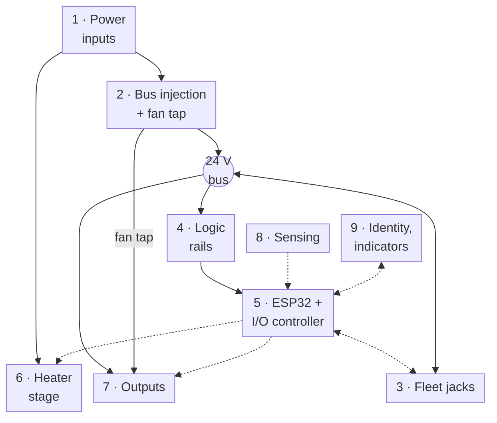
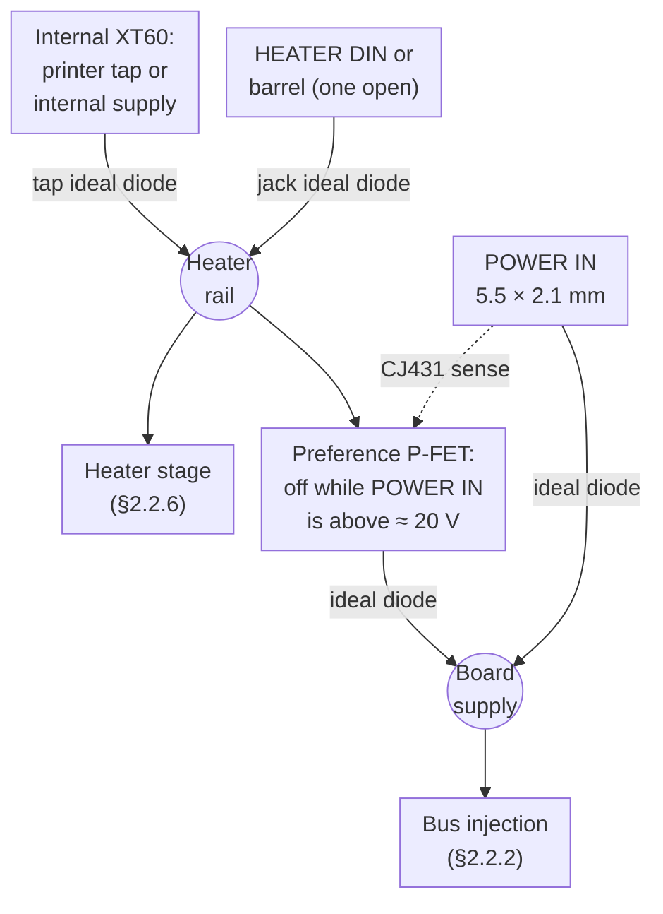
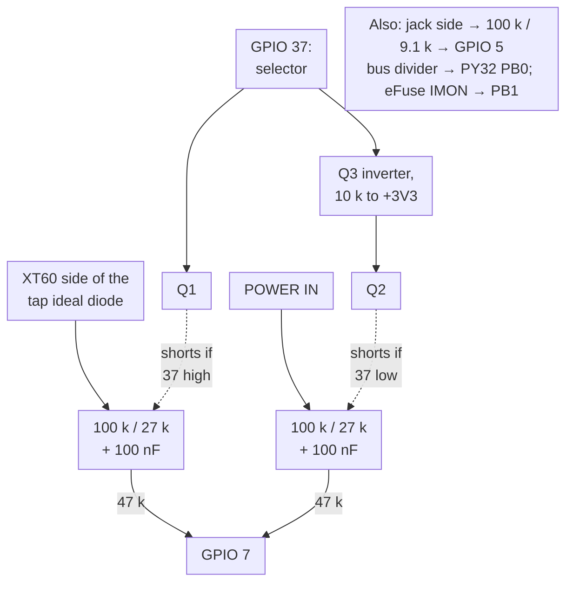
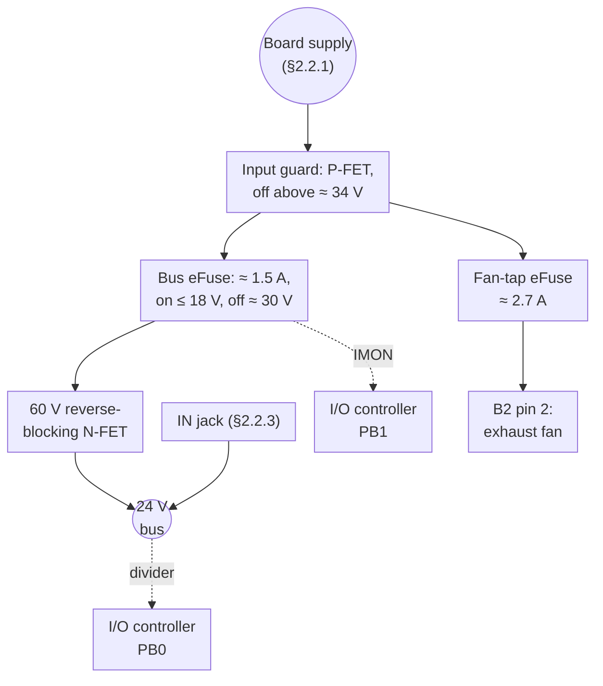
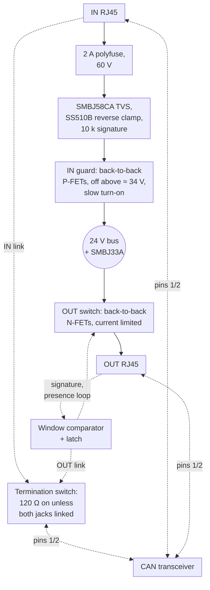
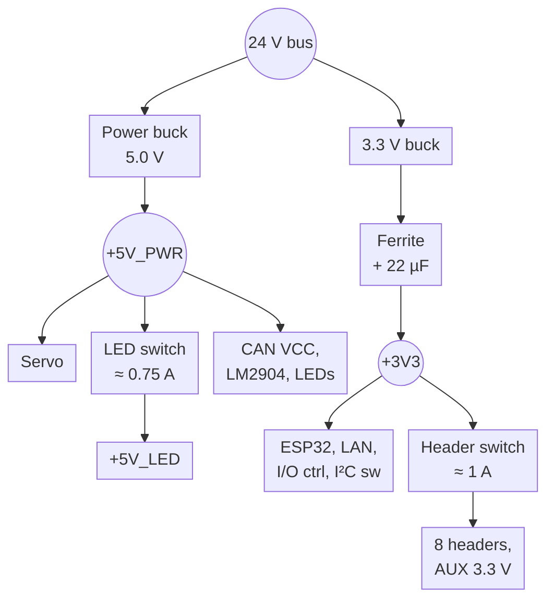
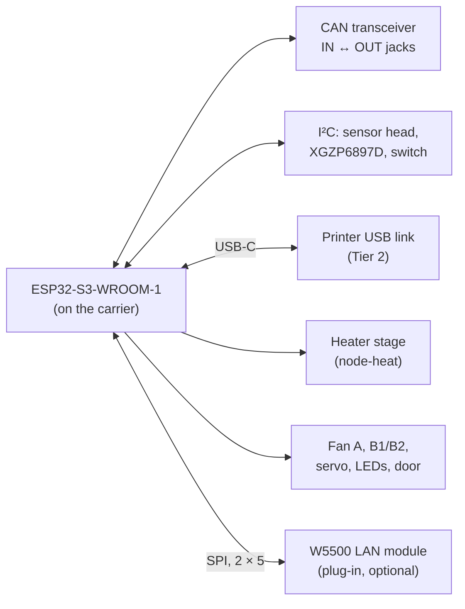
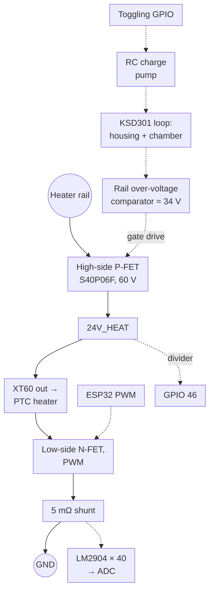
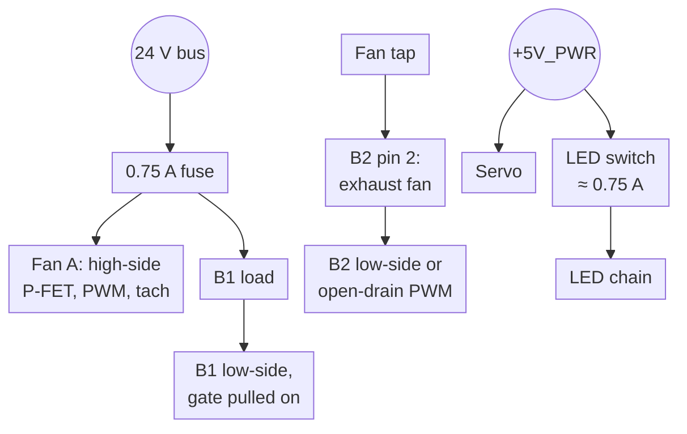
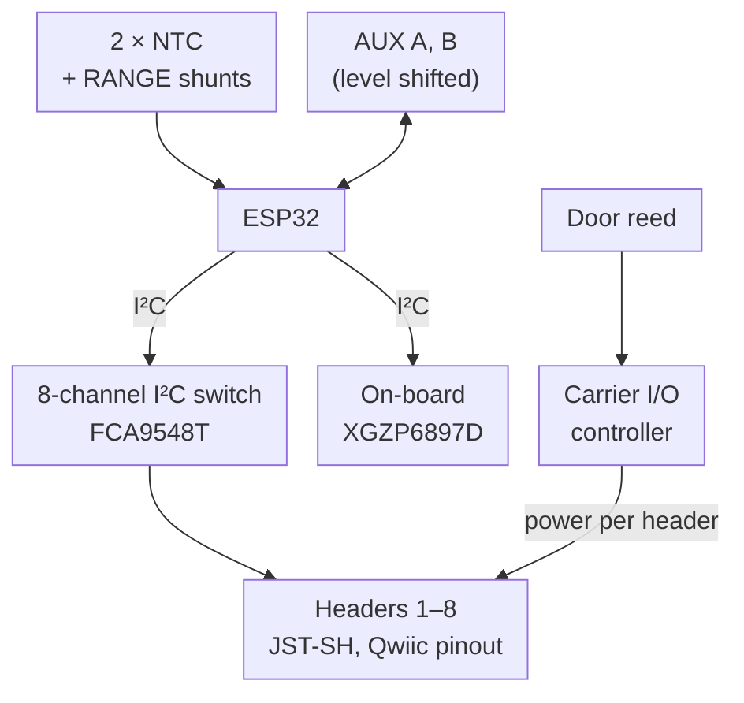

# 02 - Hardware Specification

> Design baseline, 2026-10-25. Part numbers marked *(candidate)* are confirmed against JLCPCB stock during Phase 2 PCB design. Wiring is in doc 04, cost in doc 03.

---

## 1. Hardware inventory

Quantities are for a fleet of **N printers**, H of them node-heat (one heater each). A single printer uses one carrier in a combined role in place of the hub and its node (doc 11).

| Assembly | Qty | Where |
|---|---|---|
| Universal carrier PCB with the ESP32-S3 module on board (D72) | N nodes + 1 hub (+ 1 spare suggested) | Nodes in a housing on each printer's branch damper at the exhaust port (D19); hub on the wall by the fan |
| **Universal sensor board** (D42), variant S: sensor head | N chambers + 1 room (hub) | Inside each chamber near the exhaust port; room air at the hub |
| Universal sensor board, variant P: XGZP6897D pressure sensor | 2 (trunk vacuum, trunk flow) | Hub trunk tap; hub instrument spool |
| Universal sensor board, variant E: AS5600 encoder | N (one per damper) | On each damper's shaft end |
| PTC heater module, 150 W, 24 V | H | Low inside each node-heat enclosure (the pack says where) |
| Branch damper (printed, MG90S servo) with an **AS5600 angle encoder** on the blade shaft (D30) | N | In each printer's branch duct |
| Trunk flow: printed **venturi** with an XGZP6897D, and a printed **thermistor anemometer** in its throat (D30, D32, D33) | 1 | Hub instrument spool, between the filter and the fan (doc 08 §3c) |
| Printed **reference venturis**, 10 mm and 15 mm throats (commissioning only, M9) | 2 | Fitted in the spool's calibration slot when calibrating |
| Hub power (logic only): a 24 V desktop brick in either hub barrel (D92, D93); an LRS-100-24 or a printer's freed stock supply on the internal XT60, with an IEC inlet, is the alternative | 1 | Beside the hub enclosure |
| Heater supply per node-heat printer: the printer's own 24 V supply (reused or upgraded) with a fused tap, or an external brick (§3.1) | H | Printer base, or beside the printer on its smart plug |
| Exhaust fan meeting §6 | 1 | At the outlet |
| Filter: printed housing + HEPA/carbon combo cartridge | 1 | On the wall, upstream of the fan |
| Mains-cut smart plug: Shelly Gen2+ (recommended), a metering plug sold with Tasmota (D73), or any plug Home Assistant can switch (D14) | N | Each printer's mains |

## 2. Universal carrier PCB

### 2.1 ESP32-S3 module on the carrier (D9, D72)

| Option | Verdict |
|---|---|
| **ESP32-S3-WROOM-1 module soldered on the carrier, one design for every role** | **Chosen (D72):** one order, ≈ $2.50 cheaper per board than a dev board, and none of the circuits a plug-in board needs. A dead ESP32 means swapping the carrier; the spare carrier covers it. |
| Carrier + plug-in DevKitC-1-format ESP32-S3 board | Chosen by D9, replaced by D72: the dev board's own USB 5 V needed a reset hold (D36), an ideal-diode feed (D37) and a 5 V logic buck, and a $6 board on top of the carrier. |
| Tiny "S3 SuperMini/Zero" boards | Rejected: marginal pin breakout for the ~19 GPIO needed [U]. |

**Module:** **ESP32-S3-WROOM-1-N8R2** (C2913204, JLC-stocked extended part: $4.60 each at 1+, $4.00 at 10+, $3.57 at 30+, $3.16 at 100+ [V: JLC parts page, 2026-10-29]), 8 MB flash, 2 MB quad PSRAM, rated −40 to 85 °C. The octal-PSRAM R8 variants are rated to 65 °C only [V: ESP32-S3-WROOM-1 datasheet], too low beside an exhaust port. The carrier avoids GPIO 26–34 (flash and PSRAM) and uses **GPIO 37** (D74), which the quad-PSRAM N8R2 leaves free and the R8 variants don't, so the board needs an R2 or no-PSRAM module.
- **Supply:** `+3V3`, the 3.3 V buck (§2.2), which also feeds the carrier I/O controller, the I²C switch and the headers. ≈ 1.7 A peak with Wi-Fi bursts and a LAN module [E]. Decoupling per Espressif: 22 µF and 100 nF at the module's 3V3 pin.
- **Layout:** Espressif's reference layout. The antenna sits at the board edge with no copper on any layer under or beside it, and faces away from the damper's metal and the housing's fasteners [E: check RSSI in the housing at bring-up].
- **EN:** 10 kΩ to `+3V3` and 1 µF to GND, so the module starts once the rail is up. The ESP32's brown-out detector resets it if the rail sags.
- **BOOT / service button:** a TS-1187A SMD tact switch (C318884, the acknowledge button's part) from GPIO 0 to GND. It is the node's **service and CLEAR button** (D46, doc 04 §4); its position is fixed at layout under the SERVICE plunger (doc 08 C5, C9). Held through a reset, it enters download mode as usual.

**USB-C, data only (D72):** a USB-C receptacle (C2765186, ≈ $0.08) at the board edge on the module's native USB (GPIO 19/20), so the printer USB lead plugs straight in.
- **VBUS is not connected**, so nothing on USB can power the board, and the board can't back-feed a USB host or the printer (the lead has no VBUS either, doc 04 §5).
- 5.1 kΩ from each CC pin to GND, so a USB-C host (a laptop on a C-to-C cable) enables the port.
- Single-line ESD diodes (H5VL10B) on D+ and D−.
- With only the carrier's supply able to power the ESP32, the D36 reset hold and the D37 ideal diode are gone: there's no state where the ESP32 runs and the carrier is off. **For bench work, power the carrier** (a 24 V brick in POWER IN); USB alone doesn't start it.

**UART0 console header (D72):** a 1 × 3 2.54 mm pin header (GPIO 43 TX, GPIO 44 RX, GND; 3.3 V levels) for a USB-UART adapter. In service the native USB is the printer link, so this header is the console while the link is up, and with BOOT held through a reset it is the ROM download path if native USB is misconfigured (doc 07 §11.8).

### 2.2 Functional blocks and role population

**Since D47 every carrier is assembled with the same parts**, so one board serves any role and the spare stands in for any of them. The only per-board settings are shunts: the role header and the two RANGE shunts. CAN termination sets itself (D96). There are no power jumpers (D94). This section shows how the blocks connect, which blocks each role uses, and then each block in turn: what it is for, how it works, and the parts and ratings that implement it.

**Top level.** Solid arrows carry power; dashed arrows carry signals. Numbers are the subsections below.

**What each role uses.** The combined roles (C-HEAT, C-LITE) use their node column, plus the hub's exhaust fan on B2 and the buzzer on the servo header (D84, D85).

| Block | Node-heat | Node-lite | Hub |
|---|---|---|---|
| 1 Power inputs | Heater supply: the printer's supply tap or a brick; a logic brick on POWER IN is optional | POWER IN brick, or none if the bus powers it; **required on a wireless-only node** (doc 07 §6.4) | A brick in either barrel, or an internal supply on the XT60 |
| 2 Bus injection | Injects from its heater supply | Injects from POWER IN, if fitted | **The hub's only path onto the bus** |
| 3 Fleet jacks | IN and OUT | IN and OUT | OUT only (IN fitted, unused) |
| 4 Logic rails | ✓ | ✓ | ✓ |
| 5 Controllers, ports | LAN socket empty unless the link is wired | Same | W5500 module fitted |
| 6 Heater stage | ✓ | Fitted, held off | Fitted, held off |
| 7 Outputs | Fan A: recirculation fan if not built in; B1: recirculation blower where the pack fits one; B2 spare; servo: damper | Fan A, B1, B2 spare; servo: damper | Fan A: second exhaust fan from ≈ 9 printers (D95), otherwise spare; B1: anemometer heater (D32); B2: **exhaust fan** (D85); servo header: **buzzer** |
| 8 Sensing | NTCs: chamber air and heater housing, both RANGE shunts on; headers 1 sensor head, 2 damper encoder, 4 optional OLED; door reed; AUX spare or UART link | NTCs spare; headers 1, 2, 4; door optional; AUX spare or UART link | NTCs: low-flow anemometer, RANGE shunts off; headers 1 room sensor head, 2 trunk pressure, 3 trunk flow, 4 optional OLED; AUX A smoke contact, B acknowledge button |
| 9 Identity, indicators | Role shunt HEAT | LITE | HUB |

#### 2.2.1 Power inputs and supply selection (D22, D64, D66, D94)

**Goal.** Accept whatever supplies a role needs, a heater supply and a logic supply, with nothing to configure. No supply may ever feed another; in particular a brick must never keep the printer's supply or the heater live after the printer's mains cut. When a logic supply is present it, not the printer's supply, carries the board and the exhaust fan.

**How it works.** The board has two power nodes:
- The **heater rail** feeds the heater stage. It is fed by one of three heater sockets: the internal XT60 (the printer's supply tap, or an internal supply) or a brick in the HEATER DIN or HEATER barrel jack.
- The **board supply** feeds everything else through bus injection (§2.2.2). It is fed by POWER IN and, as a fallback, by the heater rail.

Every input enters through its own **ideal diode**: a MOSFET that a controller turns on for forward current and off for reverse current, dropping ≈ 0.02–0.03 V where a Schottky diode would drop ≈ 0.5 V. So any mix of supplies can be connected and none back-feeds another. A **preference switch** takes the heater rail off the board supply while POWER IN is live. The rule on every board is: **a live POWER IN powers the board; otherwise the heater rail does.** POWER IN never reaches the heater rail, so a logic brick can sit on an ordinary outlet and keep the node up when its printer's plug is cut. Voltage senses on the tap side, the jack side and POWER IN let the firmware catch two heater supplies at once and a wrong supply voltage.

**Which supply carries what, by setup (D94):**
- **Hub:** a brick in either barrel (HEATER or POWER IN), or a supply on the XT60. Whichever is live powers the board; the hub's heater stage stays off.
- **Combined-heat or combined-lite board:** its POWER IN brick carries the logic and the exhaust fan; the heater rail only heats.
- **Wired node-heat:** its heater supply powers the board, or a logic brick does if one is fitted.
- **Wireless node-heat:** its logic brick powers the board.

Apart from the two-supply check, the board doesn't need to know which supply feeds the heater: the heater is limited by the node's `heater_power` and a learned supply cap (doc 05 §3.3, D64). This makes the supply a choice at install time, not a design change.

**Heater sockets (D64, D66).** Three sockets, one in use, joined to the heater rail by copper pours:
- **Internal XT60**, inside the housing: the printer's supply tap or an upgraded internal supply on a node, or an internal hub supply in the hub enclosure. Plugged in with the cover off.
- **HEATER DIN:** a board-mount right-angle 4-pin power DIN jack (*GlobTek JACKPWRDIN4LS*, ≈ $1.15 at DigiKey, −20 to 50 °C; or *Kycon KPJX-4S-S*, C2875467, −40 to 75 °C). Both are rated 7.5 A and mate the KPPX-4P plug of the Mean Well -R7B bricks [V] [V: Mean Well GST160A spec, R7B plug: pins 1 and 4 +V, pins 2 and 3 −V]. The footprint is on every board; the jack is hand-soldered only where a DIN brick is used, since JLC stocks neither part.
- **HEATER barrel:** board-mount right-angle 5.5 × 2.5 mm, 15 A, 30 V (*G-Switch DC-S007B-D025-15A*, C7464909, D66), mid-mount in a 9.8 mm notch at the board edge. JLC-fitted on every board, for a full-power barrel brick.
- The two HEATER jacks sit side by side on the outside face under a printed **shutter** (doc 08 C21) that leaves only one open and covers both when the tap is used. Unused openings take a printed blanking plug (doc 08 C15).

**POWER IN** (labelled LOGIC 24 V): a **5.5 × 2.1 mm** barrel jack (*XKB DC-005-5A-2.0*, C381116, 5 A, D66) on the outside face, so a logic plug can't enter the HEATER barrel. It takes a logic brick or a PoE splitter (D18), for **logic and bus injection only**.

**Tap and jack ideal diodes (D64, D94).**
- The internal XT60 reaches the heater rail through one ideal diode (*MX74700T* controller + *SP40N05GNJ* N-FET, ≈ $0.62, ≈ 20–30 mV at the heater current [E]). If a tap and a brick in an open jack are ever connected together, the brick can't back-feed the printer's 24 V rail after its plug is cut, which would defeat the mains cut.
- The MX74700T's EN is tied to its anode, so the diode is always on (D94). From D64 to D94 a 2N7002 on GPIO 37 could turn it off, but a disabled ideal diode still conducts forward through its FET's body diode.
- The two jacks reach the rail through a second ideal diode (the same MX74700T + SP40N05GNJ, D94; direct before). Its FET only ever sees the tap's voltage in reverse.

**Board-supply ideal diodes (D80, D91, D94).** The heater rail (since D80; through the INJECT INT jumper until D94) and POWER IN (since D91; INJECT BAR until D94) each reach the board supply through an ideal diode (MX74700T + SP60N12GNJ, ≈ 0.02–0.03 V at 1 A [E]), always connected. The MX74700T's 75 V cathode–anode rating covers a wrong 48–57 V brick on one input reverse-biasing the other. Until D94 the XT60 side of the tap diode also had an SS56 leg into INJECT INT; it went because the tap diode is now never switched off.

**Preference switch (D94).** Without it, the higher of the two supplies would carry the board, its share of the chain and the board-powered exhaust fan, by a few tens of millivolts, and bricks aren't trimmed (D79). On a combined-heat board that could put the fan (35–50 W) and the logic on the printer's supply or the heater brick, depending on tolerances.
- An **S40P06F** P-FET sits in series with the heater-rail leg, source on the heater rail, so its body diode opposes the ideal diode FET's and the pair blocks both ways.
- Its gate is pulled down through 47 kΩ with a 12 V gate–source zener, so it is on by default.
- A **CJ431** reads POWER IN, ahead of its ideal diode, through a divider set for **≈ 20 V** [E: values at schematic time]. Above that it sinks an **MMBT3906**'s base, and the PNP pulls the gate to the source, turning the FET off. These are the IN guard's parts (D56, D57).
- 20 V sits above the eFuse turn-on point (≤ ≈ 18 V), so if a logic brick fails the heater rail takes over before the bus drops [U: bench check with the fan at full, test 35].
- The FET drops ≈ 0.03 V at 1 A and dissipates ≈ 0.6 W at 4.2 A hot (34 mΩ at 85 °C [E]), so its drain pad gets copper.
- Faults: stuck off, and a board fed only from a heater input doesn't start (seen at commissioning; a node on the bus still runs and heats). Stuck on, and the board is back to sharing by voltage, an equipment risk only.

**Two-supply check (D94).** The tap side and the jack side both reading above ≈ 18 V means a tap and a brick are connected together, at any voltages: the node refuses to heat, or stops, and alerts "two heater supplies connected, remove one". It is a continuous reading, with no heater pulse and nothing switched off. The heater rail is live when either side reads live. (From D64 to D94 the check turned the tap diode off and pulsed the heater, which missed a brick more than ≈ 1 V below the tap, since the tap kept feeding the rail through the body diode.)

**Wrong supply on a heater input (D57).** A wrong brick (48–57 V) on any heater input reaches the heater rail.
- A second copy of the guard comparator (CJ431, 33 V cathode zener, MMBT3906) on the rail breaks the hardware enable chain above **≈ 34 V** (§2.2.6), and the high-side switch is rated 60 V. With it off, the heater and the low-side FET see only leakage current, so their 40 V ratings hold.
- The tap ideal diode's 40 V N-FET sees at most ≈ 33 V in reverse (a 57 V brick in a jack against a live tap), and the jack diode's FET the tap's voltage [V: MX74700T datasheet: CATHODE to ANODE −5 to 75 V, ANODE to GND ±100 V]. [U: a 57 V brick in a jack with no tap puts ≈ 57 V across the tap FET in reverse, above its 40 V; check at schematic time whether that needs a 60 V FET there.]
- Heater-rail capacitors are rated ≥ 63 V, and the tap- and jack-side dividers' top resistors are ≥ 100 kΩ, so 57 V stays inside the ADC pin's injection limit.
- The firmware alerts "wrong supply on heater input" whenever either side reads above 30 V.
- Fan A and B1 run from the bus, behind the input guard, so the comparator no longer has to hold them off (D94; it did from D78).

**Supply senses (D64, D75, D93, D94).** What the ESP32 reads on the power path, all on its **ADC1** (D75):
- **GPIO 5: the jack side** of the jack ideal diode (D94; the heater rail before), through a **100 kΩ / 9.1 kΩ** divider with 100 nF at the pin, ≈ 2.8 V at 34 V, inside the 12 dB range [E].
- **GPIO 7: the tap side (D64) or POWER IN (D93)**, selected by GPIO 37. Each has its own **100 kΩ / 27 kΩ** divider with 100 nF and 47 kΩ to the pin (≈ 2.9 V at 34 V [E]). A 2N7002 grounds the one not selected, and a third inverts GPIO 37 for the POWER IN one. GPIO 37 low (its reset state) grounds the POWER IN divider through Q2 and reads the tap side; high grounds the tap divider through Q1 and reads POWER IN, so POWER IN is sampled for ≈ 1 ms at a time (D93). GPIO 37 no longer switches the tap ideal diode (D94).
- The **bus voltage** and the **injection current** are read by the carrier I/O controller (§2.2.2).
- These senses were on the controller from D47 to D75 and are back on the ESP32 since D75, so the rail throttle, the two-supply check and the supply-drop detection behind the learned supply cap (doc 05 §3.3, D64) keep working while the controller is silent. The tap- and jack-side readings are trimmed once against a meter at commissioning (doc 05 §9 test 8). The barrel heater-input sense went in D64.

#### 2.2.2 Bus injection and fan tap (D13, D52, D61, D81, D91)

**Goal.** Let the board's own supply power the board and feed the fleet bus for the nodes downstream, without letting one board's fault take down the chain. Each board's injection is limited to what a CAT6 segment can carry, never feeds back into its source, and refuses a wrong supply. The exhaust fan gets its own current path, so its ≈ 2 A never counts against the bus or the cable.

**How it works.** The board supply passes an **input guard** that opens above ≈ 34 V, then splits:
- the **bus eFuse** limits the current to ≈ 1.5 A, turns on above ≈ 18 V, cuts off above ≈ 30 V, and with its external FET blocks reverse current, so the bus (also fed from the IN jack, §2.2.3) can't back-feed the supply;
- the **fan-tap eFuse** limits the exhaust fan's feed on B2 to ≈ 2.7 A.

The eFuse's current monitor lets the firmware report each board's injected current and alert on an overloaded segment. Whatever supply is connected powers the board and feeds downstream nodes, with nothing to set (D94). See doc 04 §6a for how injection shares the chain.

**Input guard (D52).** A 100 V P-FET between the input ideal diodes and the eFuse (the IN guard's XR20P10D since D60, so one part serves both; the XR15P06D from D56, RC3P06 class before), turned off by a CJ431 comparator above ≈ 34 V, with the IN guard's 33 V cathode zener (since D56; the threshold was ≈ 36 V, at the CJ431's 36 V cathode limit). A wrong supply on either input (a 48 V brick or passive PoE) therefore never holds the eFuse above its 40 V operating range. It carries the injection current and the fan tap: ≤ 1.5 A (≈ 0.4 W) without a board-powered fan, up to ≈ 4.2 A (≈ 1.1–1.3 W) on the hub at full fan and an alarm peak (D91), so its drain pad gets ≈ 1 in² of copper on both layers [E].

**Bus eFuse.**
- **MX26631DL** (C18197523, D52): TPS26631-compatible, 60 V absolute maximum, 40 V operating; the TI TPS26630/31 fit the same footprint. The TPS26632 is not a substitute: it has a fixed 35 V clamp in place of the adjustable cut-off.
- **Reverse blocking:** an external **60 V N-FET** on its B_GATE/DRV pins (SP60N12GNJ since D80, HL2310A class before). With the input at 0 V it sees the full bus voltage, which the IN guard and the bus TVS hold at ≤ ≈ 40 V since D56, so 40 V would do; the 60 V part stays because it is the B1/B2 switch FET and adds no line (D58).
- **Current limit:** one resistor sets **~1.5 A on every board** (D81; the value the hub's old ILIM pair gave, D47). That is the CAT6 segment allowance since D17, kept at 1.5 A so cheap CCA or Cat5 patch cables stay inside their rating (D21).
- **Under-voltage turn-on ≤ ≈ 18 V** (D64): the EN/UVLO divider sits well below the lowest bus (≈ 22.4 V at a far node [E], doc 04 §6a), so injection doesn't cycle as a printer's rail sags.
- **Over-voltage cut-off ≈ 30 V**, set by a divider on the OVP pin (1.21 V threshold; the part has no internal default).

**Current monitor (D61).** The eFuse's IMON pin sources 27.9 µA per amp of output current (25.7–30.1 µA/A over 0.6–2 A [V]; not specified below 0.6 A [U]) into a **47 kΩ** resistor with a 100 nF filter capacitor: ≈ 1.3 V per amp, ≈ 2 V at 1.5 A, inside the pin's 4 V limit. The carrier I/O controller's ADC reads it (§2.4). The firmware reports each board's injected current in the bus telemetry (on the hub, the whole chain's draw from the hub supply) and alerts when it stays ≥ 90 % of the limit for 10 s, a partial short or an overloaded segment. A divider with a ≥ 100 kΩ top resistor on the bus rail gives the **bus voltage** on the same ADC (D64). It sets the drive voltage for fan A, B1 and the anemometer (doc 06 §4.4), each node's bus voltage and injected power (V × I) in the telemetry, and the hub's voltage in back-fed mode.

**Fan tap (D85, D87, D91, D92).** A second branch after the input ideal diodes and the input guard, ahead of the bus eFuse, through its own **tap eFuse**, a second MX26631DL limited to **≈ 2.7 A** (D91; ≈ 2.3 A in D87, a 2 A polyfuse in D85), wired direct to B2's pin 2 (a FAN V jumper chose it or the bus in D85 and D86). The fan's current never crosses the bus eFuse or the CAT6, and a fan short stays on the tap. A 24 V fan here may draw up to ≈ 2.2 A, ≈ 50 W, at full speed. Pin 2 is live whenever the board has a supply of its own, so a fan or adapter with its own supply leaves it unconnected.

#### 2.2.3 Fleet jacks: IN, OUT and CAN (D17, D52, D56, D57, D62, D63, D96)

**Goal.** Chain carriers with ordinary RJ45 patch cables that carry 24 V and CAN, and survive anything a person might plug into those jacks by mistake: Ethernet, a PoE switch or injector, a 48–57 V passive injector of either polarity. Each end of a cable should show whether it is connected the right way round.

**How it works.**
- **IN** takes power from upstream. A polyfuse, a TVS and a reverse clamp absorb faults. The **IN guard**, two P-FETs back to back, conducts both ways while the voltage is normal and blocks both ways above ≈ 34 V. It turns on slowly, so plugging a supply into IN charges the bus gently.
- **OUT** stays at 0 V until it detects a fleet node on the far end (**detect-before-power**). It then switches the bus onto the jack through a current-limited switch that conducts both ways. A **presence loop** on pair 3 holds it on while the cable stays connected.
- The **CAN transceiver** sits on pins 1/2 of both jacks, with bus pins rated ±58 V.
- **Termination switches itself (D96):** 120 Ω goes across the bus whenever either jack has no link, which is true only at the two ends of the chain.
- An LED beside each jack shows its state: IN link (the far end is an OUT) and OUT port-live.

**IN protection, in order from the jack (D51, D56):**
- **2 A polyfuse rated 60 V** (2920L200/60GR class; 4 A trip).
- **SMBJ58CA** bidirectional TVS (C19077592, Preferred): 58 V stand-off, breakdown ≥ 64.4 V, 93.6 V clamp at 6.41 A [V], so it stays off at a steady 48–57 V passive injector of either polarity.
- **SS510B** reverse clamp to GND (C7420368, Preferred; 100 V, 5 A), so a negative spike stops at about −1 V.
- The 10 kΩ node signature, as **two 4.99 kΩ 1206 resistors in series** (≤ 0.2 W each at 58 V).
- The **IN guard**: two 100 V P-FETs back to back, sources joined (**XR20P10D** class, C50314136, PDFN 3 × 3, 60 mΩ typ / 75 mΩ max at V_GS −10 V, 20 A, since D60; the 60 V XR15P06D before), so it conducts both ways when on (D35) and blocks both ways when off. A CJ431 comparator on the joined sources turns it off above **≈ 34 V** (the D52 guard circuit): the divider feeds REF, and the cathode pulls the base of a PNP that shorts the gate to the source. The CJ431's cathode is rated only 36 V [V: VKA 36 V absolute maximum], and while it is off it sits near the rail, so a **33 V zener** across it (BZT52C33, C19077419, Preferred, 31.35–34.65 V, since D59; the MMSZ5257B is out of stock) holds it below 35 V. The zener also trips the guard on its own at ≈ 32–35 V. The 22 kΩ 1206 base resistor limits the current at a 93.6 V clamp to ≈ 3 mA. A 12 V gate–source zener holds V_GS inside its ±20 V rating.
- **Slow turn-on:** a gate–drain capacitor on the bus-side FET sets a ramp of **≥ 20 ms per 470 µF** of bus capacitance, which keeps the charging current near **0.5 A** (≈ 12 W peak in the FET, inside its 10–100 ms SOA with margin for a board-mounted case [E: the XR20P10D SOA chart is at T_C = 25 °C]). A ramp of a few ms would put 4–8 A and 100–200 W into the FET.
- On the bus side, the **SMBJ33A** (C19077586, Preferred) is the second stage.
- Ratings: polyfuse 60 V, FETs and reverse clamp 100 V. The FETs' 100 V rating covers the TVS's 93.6 V clamp, so a spike up to the clamp no longer drives the bus-side FET into avalanche (D60; surge scope in §2.2.10).
- Fitted on the hub too since D47, so its IN jack is never an unprotected path onto CAN, and a spare board can be any role. Before D56 nothing cut over-voltage on IN: a passive 48 V injector held the SMBJ33A in breakdown, a small brick never reached the polyfuse's 4 A trip, and the bus sat at the TVS's 42–45 V until the TVS failed. See doc 04 §3a.

**OUT with detect-before-power (D17, D52, D57).** A window comparator and latch drive a bidirectional current-limited switch on +24 V, held on by the **presence loop** on pair 3: pins 3/6 are pulled up at the OUT jack and tied to GND through a resistor by the next node's IN jack (D63). The loop works whichever way current flows. OUT powers the jack only for a fleet node signature or a powered fleet segment, so a switch, laptop or PoE port sees 0 V. **Ratings (D57):** an **SMBJ58CA** on the jack's +24 V pins (as on IN); the switch's back-to-back N-FETs rated 60 V (SP60N12GNJ, C22466779, 16 mΩ max, ≈ 0.05 W each at 1.5 A hot, D80; HL2310A class before); the prober and window comparator reach the pins through a series resistor and clamp rated for 60 V. So a 48–57 V injector plugged into OUT is refused and damages nothing.

**CAN transceiver (D17).** Fault-tolerant bus pins ±58 V (*candidate: TJA1051T/3 with 3.3 V VIO*), on the IN and OUT jacks for the daisy chain, so it survives Ethernet or PoE on pins 1/2. **Automatic termination (D96):** 120 Ω (2 × 59 Ω 1 % around back-to-back 60 V N-FETs) switches on whenever either jack has no link, so the hub and the last node terminate and every other node doesn't, with no jumper (doc 04 §3).

**Jack LEDs (D62, D63).**
- **OUT port-live LED (D62):** one **blue side-view LED** (XL-1606UBC class, C965865, 120°, ≈ 260 mcd at 20 mA per its listing [E: confirm V_F on the datasheet]) at the board edge beside the OUT jack, lit whenever the port's +24 V switch is on. A 2N7002-class FET driven by the port-on latch pulls the LED's 1 kΩ to GND from `+5V_PWR` (D72), ≈ 2 mA (≈ 1.6–2.6 mA over the V_F range). It is logic-side, so it never loads the 5 V / 1 mA prober or the 10 kΩ signature and sees no bus voltage [U: circuit in Phase 2]. It faces the housing wall, so a 2.5–3 mm window in the wall lights it with no light pipe (doc 08 C5, C9, C20). Blue, so it can't be mistaken for an Ethernet jack's green and amber link lights.
- **IN link LED (D62, D63):** a second blue side-view LED beside the IN jack, lit when the far end of the cable is an OUT jack. The IN jack ties pins 3/6 to GND through a resistor equal to the OUT pull-up, so with an OUT on the far end the pair sits at ≈ half of 3.3 V (≈ 1.6 V), and with another IN, an Ethernet or LAN jack, or nothing, at ≈ 0 V. The cable's ground offset, ≈ 0.3 V at full load, stays below the NPN's turn-on. An NPN with a 10 kΩ base resistor on that node switches the LED's 1 kΩ from `+5V_PWR` (D72; `+5V_LOGIC` before), so it needs no firmware, and the OUT jack's presence loop reads ≈ 1.6 V as closed [U: values in Phase 2]. It lights as soon as the cable is seated, before power arrives, and on a node with no supply of its own once the upstream OUT has powered it. With the OUT LED, both ends confirm a correct IN-to-OUT connection.

#### 2.2.4 Logic rails (D56, D60, D72)

**Goal.** Make the board's 5 V and 3.3 V rails from the bus so that a load fault (a servo stall, a shorted LED strip, a shorted sensor cable) can't brown out the ESP32, and every part stays inside its rating up to the bus's over-voltage cut-off.

**How it works.** Two identical bucks run from the bus. The **power buck** (5 V) feeds the noisy and high-current loads; the **3.3 V buck** feeds the logic alone. The LED chain and the eight sensor headers each sit behind their own current-limit switch, so a short there sags only that group. The IN guard (≈ 34 V) and the eFuse cut-off (≈ 30 V) keep the bus inside the bucks' 40 V rating, which is why no 60 V buck is needed.

**Bucks (D56, D60, D72).** Two **LMR14030SDDAR** (C182078, since D60; XL1509 before) from the 24 V bus; there were three before D72, and D85's 12 V fan buck was dropped in D86.
- The LMR14030 is rated 4–40 V operating, 44 V absolute maximum on VIN and EN, 3.5 A, 90 mΩ typ high-side switch, cycle-by-cycle current limit 4.4–6.6 A, 170 °C thermal shutdown, R_θJA 43.2 °C/W in the SO PowerPAD-8 package [V].
- Each runs at **500 kHz** (RT 49.9 kΩ [V]) with a 0.1 µF boot capacitor, a soft-start capacitor, a feedback divider, one **15 µH shielded inductor** (HCMA-0630-150-M-K class, C54431704, 7.3 × 6.6 mm, 3 A rated, 4.5 A saturation, 110 mΩ) and one **SS56** catch diode (60 V, 5 A, C18199169, Preferred; SS36 from D58 to D80). The 15 µH part gives ≈ 0.5 A p-p ripple on the 5 V rail and ≈ 0.4 A on 3.3 V from 24 V [E].
- **Power buck** (5.0 V) → `+5V_PWR`: the servo, the LED chain through its switch (§2.2.7), and since D72 the CAN transceiver's VCC and the LM2904, each through 10 Ω and 10 µF [E], and the three blue indicator LEDs. ≤ ≈ 2 A worst case, a stall with the LED limit reached.
- **3.3 V buck** (34.0 kΩ over 10 kΩ from the 0.75 V reference) → `+3V3`. The 5 V logic buck (`+5V_LOGIC`, the dev board's feed) was removed by D72.
- Bus-side capacitors are rated ≥ 50 V, the bulk electrolytic included (63 V before D58). EN is tied to VIN through a pull-up only, or, if a divider is fitted, set to turn on at ≤ ≈ 18 V (D64).
- **Thermal:** at the power rail's 1.9 A worst case the LMR14030 dissipates ≈ 0.25–0.3 W [E], ≈ +12 °C over ambient through its exposed pad and a GND pour. The XL1509 it replaced (D60) dissipated ≈ 0.65 W at ≈ 100 °C/W and ran near its thermal shutdown at that load.
- **Faults:** the inductor saturates (4.5 A) below the switch's worst-case current limit (6.6 A), so a hard output short pushes it into saturation for a few cycles before the frequency fold-back takes over [E]. The rails' loads sit behind their own current-limit switches, so only a board fault reaches that. A servo stall can't be sustained: the encoder's stuck-damper check stops the servo pulses within ≈ 5 s (doc 06 §3). ARG-08, ARG-11.
- The earlier candidates (TPS54331, 28 V; MP2315, 24 V) were rated below the bus's ~30 V over-voltage cut-off (D51).

**3.3 V rail `+3V3`** (`+3V3_SENS` before D72), from the 3.3 V buck (D56). It replaces D51's XC6206 200 mA LDO, whose ≈ 140 mA thermal limit was below the eight headers' worst case of ≈ 0.4 A average and ≈ 0.6 A peak [E].
- It feeds the ESP32 module and a LAN module (D72; ≈ 1.7 A peak in all [E]), the carrier I/O controller, the I²C switch and the eight header P-FETs. A ferrite bead and 22 µF after the buck keep the 500 kHz ripple ≲ 10 mV [E].
- The **header P-FETs are fed as a group through a current-limit switch** (the LED switch's part, set to **≈ 1 A** with 6.8 kΩ, 0.75–1.25 A over tolerance, so its low end clears the headers' ≈ 0.6 A peak), so a shorted header cable can't pull the controller or the switch down with it. The **AUX 3.3 V pin** also comes from this group rail (D57), since it leaves the board too. The controller reads the group rail on PF3 through a divider (D68), and the firmware finds the shorted header by powering them one at a time (doc 09 §2.2).
- The controller's ADC is referenced to this rail (≈ ±3 %: the LMR14030's 0.735–0.765 V feedback reference over temperature [V], plus the 1 % divider), so the firmware calibrates it against the PY32's internal reference before trusting a reading (doc 09 §2.4). The NTC pull-ups use this rail since D72 (§2.2.8).

#### 2.2.5 Controllers and data ports (D9, D18, D45, D54, D72)

**Goal.** One controller runs every role; slow and per-header I/O is offloaded so the main controller's pins and timing go to what needs them; and the board connects to its printer, to a wired network where wanted, and to debug tools.

**How it works.** The **ESP32-S3 module** (§2.1) runs the firmware, the CAN bus, the printer link on its native USB, and Wi-Fi / ESP-NOW. The **carrier I/O controller**, a PY32F030 (§2.4), handles per-header power, the slow carrier I/O (door, B1, board status LED, LED chain data) and the ADC for the bus voltage and injection current; the ESP32 programs it, and any sensor-board MCU, through its ROM bootloader (D45, D54, doc 09). A **W5500 LAN module** plugs into a socket where a wired network link is wanted.

- **ESP32 support (D72):** data-only USB-C (VBUS unconnected, CC 5.1 kΩ to GND, ESD on D+/D−), EN RC, BOOT / service tact switch and the UART0 console header (§2.1). They replace the D36 reset hold and the D37 ideal-diode feed, which only a plug-in dev board needed.
- **LAN module socket (D18, D72):** a 2 × 5 2.54 mm female socket at the board edge on **GPIOs 10–13**, SPI2's IO MUX pins (D45, doc 04 §4), plus `+3V3` and GND, for a common **W5500 module** (ESP-IDF `esp_eth` W5500 driver). The module's interrupt goes to **GPIO 38** with a 10 kΩ pull-up (interrupt-driven, no polling), its own RC resets it, and the ESP32's eFuse Ethernet MAC is used, since the W5500 has none. Pin order follows the common 2 × 5 module [E: confirm on the purchased module before layout]. It is a normal network port, separate from the fleet jacks, with no 24 V on it. The CH390D, MagJack and crystal were on every carrier from D47 to D72; now only a board that uses LAN pays for it.
- **Debug headers:** a **1 × 5 2.54 mm SWD header** (3.3 V, SWDIO, SWCLK, NRST, GND; D65, doc 09 §4.5) gives the I/O controller full probe debugging, and a **1 × 6 2.54 mm JTAG header** (3.3 V, TMS, TCK, TDO, TDI, GND on ESP32 GPIOs 42, 39, 40, 41; D68, doc 07 §11.8) does the same for the ESP32.
- **Expansion port:** a 2 × 5 2.54 mm pin header on the I/O controller's spare pins, with SPI, UART and four analog inputs (D77, doc 09 §2.5).

#### 2.2.6 Heater stage (D50, D51, D57, D64, D82)

**Goal.** Switch the 150 W PTC heater so that no single failure keeps it on. A firmware hang, a thermostat opening or a wrong supply must each turn it off in hardware; a failed switch must be caught; and the firmware must see the heater current to find an open element, a welded FET, inrush and a stalled fan.

**How it works.** Two **independent switches in series** (doc 05, ARG-09):
- a **high-side P-FET**, the enable, driven only by the **hardware enable chain**: an RC charge pump that produces gate drive only while a GPIO keeps toggling, in series with the **KSD301 loop** (the heater-housing and chamber-air thermostats, normally closed) and the **heater-rail over-voltage comparator** (≈ 34 V, §2.2.1). A hung MCU (pin stuck high or low), either KSD301 opening, or a wrong supply on the heater rail turns the heater off.
- a **low-side N-FET**, the PWM, driven by the firmware.

A low-side shunt and amplifier measure the heater current, and a sense on the switched high-side node reads whether the enable is really off.

- **Switches:** the low side is a logic-level N-FET (40 V, 5 mΩ class, PDFN 3 × 3, SP40N05GNJ class, D51; see §2.2.10 for its gate drive). The high side is **60 V, ≈ 19/24 mΩ typ/max** (HL S40P06F, C41406794, PDFN 5 × 6, since D82; the XR30P06F before, D59; 60 V since D57), ≈ 0.5 W hot at 4.2 A on a copper pour, with a **12 V gate–source zener**, since its gate is pulled toward GND and the rail alone exceeds its ±20 V V_GS rating. 10 kΩ gate pull-downs, 100 Ω series gate resistors, XT60 heater output.
- **High-side output sense (D64):** the switched `24V_HEAT` node feeds a divider (100 kΩ over 15 kΩ [E]: 24 V reads ≈ 3.1 V, high above ≈ 19 V; the top resistor ≥ 100 kΩ so a stuck-on high side at 57 V stays inside the clamp) with a 3.3 V clamp diode into **ESP32 GPIO 46**, a digital input. It reads low whenever the high side is off, including at reset, where the 15 kΩ overrides the strapping pin's weak internal pull-down. It is the only independent check on a high-side FET stuck on (current sensing can't see it while the low side is off): doc 05 L4 locks the heater out if it reads high with the charge pump stopped.
- **Heater current sense (D50):** a 5 mΩ low-side shunt (LRAM25EJER005 class, 2512, ±5 %) and an LM2904 at gain 40 with a ~10 mV input pedestal into the ADC, zeroed in firmware at boot (doc 04 §4). It catches an open element, a welded FET, inrush, and the C8 stall.
- **Roles:** used on node-heat; fitted on every role since D47 and held off elsewhere, with the KSD301 loop open (§2.2.10, one population).

#### 2.2.7 Outputs: fans, servo and LEDs (D51, D57, D70, D75, D84, D85, D92, D94, D95)

**Goal.** Drive the fans and other loads so that the fans run at full speed whenever the firmware or controller is down, a shorted lead takes out only its own output, and the exhaust fan gets its full current without loading the bus.

**How it works.**
- **Fan A** is switched on the high side, so its tach stays valid, and its PWM output floats to full speed in reset.
- Fan A and B2 are the same **6-pin fan port** (D95): GND, V+, tach, PWM, and a REF/CTRL pair that drives a mains EC fan's 0–10 V or 10 V PWM input from the fan's own 10 V, so that fan also runs at full speed whenever the board is down or unpowered.
- **B1** is a low-side switch whose gate is pulled on, so it runs at full duty whenever its controller isn't driving it.
- **B2** is the **exhaust fan port**: it switches a 2- or 3-wire fan, drives a 4-wire fan's PWM or an EC fan's CTRL input, takes a board-powered fan's supply from the fan tap (§2.2.2), and adds three external jacks for bought fans (D95).
- Fan A and B1 share one resettable fuse from the bus.
- The servo header and the LED chain run from `+5V_PWR`, the LED chain behind a current-limit switch.

**Fan channel A (D51, D70).** 24 V switched on the high side (60 V P-FET, D51; the heater stage's S40P06F since D82; the XR20P10D in D80), on the 6-pin fan port below (D95). ESP32 GPIO 14 (D70) drives the PWM pin through a **2N7002** (60 V, gate pull-down), not directly, since a 4-wire fan may pull PWM up to 5.25 V and a 10 V EC input higher, both above the pin's 3.3 V rating; the FET is off in reset, so the pin floats to full speed [E: the Intel 4-wire fan specification, as Noctua's PWM white paper quotes it, has the fan pull PWM up and run at full speed with no signal; a fan without that pull-up won't, so check the fitted fan], and the firmware inverts the duty. Its tach (GPIO 17) comes in through a 1N4148WS with a pull-up to 3.3 V, as B2's does, so a fan's 10 V push-pull tach can't reach the pin. High-side switching keeps the tach valid (F5). On the hub fan A drives the **second exhaust fan** of a large fleet (D95, §6.1 FN-10), with pin 2 not connected.

**Low-side outputs B1, B2 (D51, D68, D75, D80, D84).** Switched 24 V (60 V N-FET, D51; SP60N12GNJ since D80), with a flyback diode each.
- B1 is driven by the carrier I/O controller (PA8, D68), with a **10 kΩ gate pull-up** so it runs at full duty while the controller is in reset, in its bootloader or blank (D75).
- B2 is driven by ESP32 GPIO 45 (gate pull-down). **B2 is a fan port (D84, D95):** the 6-pin port below, with the fan tap on pin 2 (D92). It switches a 2- or 3-wire fan low-side or drives a 4-wire fan's PWM input as an open-drain output, and its tach reaches the carrier I/O controller's PA9 through a 1N4148WS (doc 04 §7a). On the hub and the combined roles B2 is the exhaust fan (D84, D85). The footprint-only 0–10 V output stage (D85) is gone: it output 0 V, and so stopped the fan, whenever the hub was down (D95).

**6-pin fan port (D95).** Fan A and B2 share one pinout (JST-XH 6, doc 04 §7a): **1 GND, 2 V+** (fan A: the bus through its high-side switch; B2: the fan tap), **3 TACH** (open-collector input, as above), **4 PWM** (open drain on a 60 V FET, ≈ 25 kHz, for a 4-wire fan), **5 REF** (the fan's own +10 V, in) and **6 CTRL** (10 kΩ pull-up to REF, pulled down by its own 2N7002 on the same GPIO as pin 4).
- **Fails to full speed:** both FETs are off at reset and with the board unpowered, so CTRL sits at the fan's 10 V (100 % duty) and pin 4 floats to a 4-wire fan's pull-up. A mains EC fan on CTRL keeps running at full speed through a hub-supply failure too (F3).
- **Jumpers:** **DC** puts an RC filter in the CTRL line for a fan that takes 0–10 V but not PWM; **STRONG** adds 1.5 kΩ to REF for an input that needs a stiffer pull-up [U: whether any fan needs it; it draws ≈ 7 mA, so leave it off a fan whose reference is rated ≈ 1 mA, such as the prioAir EC's]. PWM mode is the default: a 10 kΩ pull-up into a ≈ 100 kΩ input reaches only ≈ 9 V in DC mode [E], and a fan that accepts PWM on its 0–10 V line reads the duty, not the level.
- **CTRL is not pin 4:** on B2, pin 4's flyback diode to the fan tap would drag a pulled-up line low with the board off.
- **REF** feeds only the pull-ups, never the board.

**B2 external jacks (D95).** In parallel with B2's XH 6, on the carrier edge, for one bought fan at a time:

| Jack | Part | Wiring | For |
|---|---|---|---|
| USB-C receptacle, labelled **"FAN 10 V"** | TYPE-C-31-M-12 class (C165948, 20 V rated) | VBUS → REF, D+ → CTRL, D− → TACH, GND, through a **SWAP** jumper that crosses D+ and D−; 5.1 kΩ on CC1 and CC2 | USB-C-shaped control ports: AC Infinity UIS (older 4-pin Molex ones through the maker's AC-ADP3 dongle), Vivosun [U: pinout from hobby projects, not from either maker] |
| 3.5 mm TRRS | PJ-320A class (C2884926; C3038674 is cheaper but thinly stocked) | +10 V → REF, 0–10 V/PWM → CTRL, GND → GND, tach → TACH | TerraBloom ECMF series, on a plain male-to-male TRRS cable [V: signals, maker manual; U: which contact is which] |
| 4-pole 3.5 mm pluggable terminal header | 15EDGRC class (C5188297, $0.078), push-in plug of the 15EDGKNH class (no screw terminal) | REF, CTRL, GND, TACH | Bare-lead EC fans (Fantech, ebm-papst: +10 V, 0–10 V, GND, tach), and TerraBloom's own breakout cable |

A laptop or charger in the USB-C jack sees only Rd and supplies 5 V, which feeds just the pull-up. The USB-C pinout comes from hobby projects that disagree on which data line carries PWM, so the **SWAP** jumper (2 × 3 header, two shunts; default D+ → CTRL) lets a builder cross them after metering the fan; a hobby controller that works with these fans pulls PWM to 10 V through 1 kΩ, so STRONG is the first thing to try if a fan ignores CTRL [U]. The ESD diodes on REF, CTRL and TACH at these jacks are rated above 10 V, not the 5 V class used elsewhere. The housing has an opening per jack with a printed snap-in blank and a label, and the fan USB-C sits well apart from the printer-link USB-C. **No RJ12:** brands' pinouts are unpublished and differ, and an RJ12 plug fits the RJ45 bus jack. Fan A has only its XH 6.

**Output feeds (D57, D94).** Fan A and B1 take their 24 V from the bus through a **0.75 A hold, 1.5 A trip, 60 V** resettable fuse (2018L075/60GR class, C33977642), so a shorted lead opens it before the segment or injection limit trips and the rest of the chain stays up. A 5015 blower draws 0.18 A [V]; the PTC module's fan is [U] until R8. From D78 to D94 fan A and B1 had a two-leg feed, from the heater rail while it was live and from the bus otherwise; D94 put them back on the bus, since B2 no longer shares their fuse and a heating node's own supply feeds its bus. When every output on one fuse stops at once, the firmware raises an output-fault alert. On a node-heat the firmware keeps fan A and B1 off while no heater supply is live (D78, D94), and both off while the bus reads 30–34 V.

**Servo header.** `+5V_PWR`, signal held low at boot. On a node it drives the damper servo; the damper's **AS5600 angle encoder** (D30) reads the blade shaft and connects to I²C header 2, not here. On the hub and the combined roles it drives a **5 V active buzzer module** (3-pin, transistor input, active high), silent through a reset because the signal is held low at boot (D85).

**LED chain 1 (D44, D45, D51, D56, D70, D71).**
- A **current-limit switch** from `+5V_PWR` (SY6280AAAC class, C207620, SOT-23-5, 63 mΩ; limit = 6800 / R_SET, **≈ 0.75 A with 9.1 kΩ**, 0.56–0.93 A over tolerance [V: datasheet ±25 % at 1 A]; enable tied high) makes `+5V_LED`, with 1000 µF bulk.
- A **2N7002 inverting level shifter** (1 kΩ pull-up to `+5V_LED`, so the data line never sits above a sagging LED supply) and 330 Ω series resistor carry the data. The carrier I/O controller's timer output runs with inverted polarity to match (D51, D70, D71); the ESP32's RMT drove it before D70. Chain 2 was dropped (D45).
- LED 0 of the bed strip is the status pixel; on the hub LED1 is the panel RGB. The strip is ~48 LEDs per printer (D44), ≈ 2.9 A at full white. The firmware caps it at 0.5 A (doc 04 §3), below the switch's lowest limit; the switch is the hardware backstop (D56). In limit it holds the current and lets `+5V_LED` sag, so the LEDs dim, the servo and the power buck stay inside their ratings, and it soft-starts the 1000 µF. Loss ≈ 20 mW at 0.5 A.

#### 2.2.8 Sensing and inputs (D11, D30, D32, D42, D47, D48, D49, D68, D69)

**Goal.** Connect every sensor the roles need through a few standard connectors, so that one faulty sensor or cable can't take the others down, and every analog reading can be trusted.

**How it works.**
- An **8-channel I²C switch** gives each of the eight Qwiic-style sensor headers its own bus segment, and the carrier I/O controller powers each header separately.
- An **on-board XGZP6897D** pressure sensor sits on the main I²C bus.
- Two **NTC inputs** cover either the anemometer's range or the heater housing's hot range, chosen by a RANGE shunt.
- The **door reed** is read through the I/O controller.
- The **AUX header** gives two 5 V-tolerant lines: a smoke contact and an acknowledge button on the hub, or a UART printer link on a node.

**Sensor headers 1–8 (D51, D68, D69).** JST-SH 4 with the Qwiic / STEMMA QT pinout (GND, 3.3 V, SDA, SCL), one per channel of a TCA9548A-compatible switch (FCA9548T fitted, D51), with per-header power from the **PY32F030 carrier I/O controller** (§2.4). Every XGZP6897D is fixed at 0x6D, so each off-board one sits on its own switch channel and can't clash with the on-board one (D11; supersedes C7). Each header being its own segment also keeps bus capacitance low. **A display never shares a channel with a sensor** (D48, doc 09 §3), so a locked-up OLED can't take a sensor reading with it. Headers 5–8 (and 3 on nodes) are free for further sensor boards.

| Header | Node-heat | Node-lite | Hub |
|---|---|---|---|
| 1 | Sensor head | Sensor head | Room sensor head |
| 2 | AS5600 damper encoder (sensor board E, D30) | AS5600 damper encoder | XGZP6897D trunk sensor (sensor board P) |
| 3 | Unused (per-branch flow option) | Unused | XGZP6897D trunk-flow sensor at the venturi (D30, D33) |
| 4 | Optional OLED (D48) | Optional OLED | Optional 0.96″ OLED at 0x3C (D48) |
| 5–8 | Free | Free | Free |

**On-board XGZP6897D** pressure sensor (I²C 0x6D), two barbs: chamber against room on a node, **across the filter** on the hub.

**NTC inputs (D32, D47, D56, D72).** Two NTC 100k inputs on ADC1 with an RC filter: a **47 kΩ** pull-up to **`+3V3`** (the ESP32's own supply, D56, D72) on every board, plus **5.1 kΩ through a RANGE shunt** per channel (≈ 4.6 kΩ with the shunt on, D47).
- 47 kΩ gives resolution at 20–80 °C for the hub's **low-flow anemometer** (reference and heated NTC, D32; RANGE shunts off). ≈ 4.6 kΩ covers the hot range of the heater housing on a node-heat (chamber air and heater housing; both RANGE shunts on). A wrong shunt is caught at boot (doc 04 §4).
- The ESP32's ADC isn't ratiometric, so the pull-up rail's error becomes a temperature error. Since D72 the rail is the 3.3 V buck (≈ ±3 %, against a dev board regulator's ±1–2 % before), so the firmware scales each reading by the rail voltage the carrier I/O controller measures against its internal reference (doc 09 §2.4) [E: residual error at layout].
- Pulling the pins up to their own chip's supply means they can never sit above it while the rails come up. The pull-ups draw ≈ 60 µA in total; the anemometer's heater runs from B1 at 24 V, not from this rail.

**Door input.** A reed switch with a pull-up, RC filter and ESD, **read through the carrier I/O controller** (§2.4). Fitted on every role; used on node-heat, optional on node-lite. A printer that reports its doors over its link can use them instead (`door.source: link`, doc 12 §4). With a reed fitted, the reed is primary and the link is the backup (doc 05 §4).

**AUX header (D48, D49, D75).** JST-XH 5: 3.3 V, GND, A = GPIO 36, B = GPIO 6, GND (A was GPIO 5 before D75). Each line passes a **2N7002 level shifter** (gate to 3.3 V; 10 kΩ pull-up to 3.3 V on the ESP32 side, 4.7 kΩ to 3.3 V on the connector side) and is ESD-protected. The shifter makes both lines **5 V-tolerant** and still passes a contact pulling low, so edge interrupts work. Both lines are digital only; pinout in doc 04 §4.
- **Hub:** A = smoke dry contact, B = acknowledge button, each with its own GND pin.
- **Node:** spare, or the **UART printer link** (A = TX, B = RX; doc 12 `marlin_serial`).
- An **on-board tact switch** (TS-1187A-B-A-B, LCSC C318884, a Basic part) sits on B's connector side, in parallel with the AUX pin, on every carrier (D49). The hub's front panel presses it through a printed plunger, and a builder can still cable a remote button to AUX B. It is on B, the UART **RX** line, so a press on a node using the UART link only garbles a received frame; on A, the TX line, it would short a driven output through the shifter. AUX replaces the two spare-input headers.

#### 2.2.9 Identity and indicators (D46, D62, D63, D84)

**Goal.** Make a board refuse to run as the wrong role, and let a person see power, link and bus traffic at a glance, without tools or firmware.

**How it works.** A **role shunt** on a divider gives each role a distinct voltage, which the firmware checks against the stored role at boot. Indicator LEDs are driven in hardware wherever possible, so they keep telling the truth when the firmware doesn't run.

**Board identity header (D46, D84).** A 2 × 5 pin header and shunt (HEAT, C-HEAT, LITE, C-LITE, HUB; 2 × 3 until D84) on a divider to the carrier I/O controller's PA0 (D68; GPIO 3 before), checked against the stored role at boot (doc 04 §4). A wrong or missing shunt gives a safe hold: nothing switches on. Since D47 it is the only part of the role set on the board. The carrier's BOOT switch doubles as a service button after boot (doc 04 §4, D72).

**Status LEDs.** A power LED, a **CAN activity** LED, and a **board status LED** driven by the carrier I/O controller (§2.4); the jack LEDs are in §2.2.3.

**CAN activity LED (D63), hardware-driven.**
- **What it shows:** a blue LED blinks for ≈ 30 ms whenever another unit drives a dominant bit, detected as the transceiver's RXD low while its TXD is high. The unit's own frames are excluded, and the ACK another unit gives to its frames is counted. No firmware or controller pin is involved.
- **Circuit:** a PNP on RXD in series with a small N-FET on TXD charges a 100 nF capacitor through a diode, a bleed resistor sets the ≈ 30 ms stretch, and an NPN drives the LED. A **minimum-off timer** (a second NPN with its own RC, started by the end of each on-pulse) blocks the charge path for another ≈ 30 ms. So a busy bus gives a fixed ≈ 30 ms on / ≈ 30 ms off blink (≤ ≈ 16 Hz), as an Ethernet activity LED does, instead of a solid LED [U: values tuned and simulated at bring-up].
- **Reading it:** every unit sends a 1 Hz heartbeat (doc 07 §6.2), so a connected neighbour makes it blink about once a second at the least.
  - ≈ 1 blink a second or a few more: healthy.
  - A steady fast flicker (≈ 16 Hz): heavy traffic, or a unit holding the bus dominant [E].
  - **Dark:** this unit hears no other unit. It is alone, its neighbours are off, or the cable's CAN pair (pins 1/2) is broken.
  - It shows the bus, not one cable, since both jacks share the CAN pair on ≤ 50 mm stubs. A break in the middle of a chain leaves both sides blinking from their own neighbours, and shows on the hub's dashboard instead (doc 07 §6.2).
- **Suggested layout:** put the activity LED **between the IN and OUT jacks**, with the solid link LEDs on the outer sides, in the order *IN link LED, IN jack, activity LED, OUT jack, OUT port-live LED*, so the eye reads the solid LEDs as per-port link and the blinking one as the traffic between them [U: spacing set at layout]. On the hub, which uses only the OUT jack, the activity LED sits beside it.

#### 2.2.10 Part ratings, population, size and connectors

**Part choices and ratings (D51).** Named parts are JLC-stocked and chosen for cost; equivalents are fine if they meet the same ratings:
- **Anything switching or blocking on the 24 V side is rated ≥ 60 V.** Fan A and the POWER IN preference switch use the S40P06F P-FET (60 V, PDFN 5 × 6, D82, D94) and B1/B2 the SP60N12GNJ N-FET (60 V, PDFN 3 × 3), so they outlast a fan-lead short until its fuse trips (D80). 30 V SOT-23 FETs leave no margin above the ~37 V TVS breakdown. The bucks are the exception (40 V): they sit behind the IN guard and the eFuse cut-off (D56). On the heater rail, only the high-side switch and the preference switch are 60 V; the rest sees leakage only once the D57 comparator opens it.
- **Surge scope (D56).** The fleet cables are indoor and short (≤ ~6 m total), so the design covers ESD (IEC 61000-4-2), fast transients, unplugging under load and a wrong supply on any jack, not the IEC 61000-4-5 lightning surge, which applies to longer or outdoor cables [E]. Fast events are absorbed by the jack TVS and the bus capacitance; the guard turns off within ≈ 10 µs [E], long before a 48 V step charges the bus from 24 V to 45 V (≈ 80 µs through the path's ≈ 0.4 Ω into ≥ 100 µF). The guard FETs (XR20P10D since D60, in both IN-guard positions and the injection guard) are rated for V_DS −100 V, I_D −20 A, I_DM −72 A and **E_AS 42 mJ** [V]. Its datasheet is inconsistent in places (the E_AS test condition, 0.5 mH at 23 A, implies ≈ 130 mJ, and R_θJC is printed as 0.45 °C/W), so only the lower figures are relied on. A steady 57 V injector and a spike up to the SMBJ58CA's 93.6 V clamp at 6.41 A both stay inside V_DS, so inside the surge scope the FETs never avalanche; the full clamp needs a 600 W pulse the scope excludes. (The 60 V XR15P06D before D60 avalanched in the 60–93.6 V band and relied on its 18.1 mJ rating.) An 8 kV contact discharge stores ≈ 4.8 mJ, most of it lost in the source resistance, so it is well under E_AS [E]. One residual: a 48 V step while the bus is live at 24 V pushes ≈ (48 − 24) V / 0.4 Ω ≈ 60 A for the ≤ 10 µs before the guard opens. That is inside I_DM (≈ 1.2× margin) and the ≈ 100 A, 10 µs SOA line up to ≈ 40 V at T_C = 25 °C, and the heating is only ≈ 3 mJ, but the margin is thin and the part is new [U: bench test with a 48 V brick hot-plugged into a live node]. The comparator's cathode (36 V maximum [V]) is low whenever it conducts, above the threshold; below it, the 33 V zener holds it under 35 V, and the zener also covers the ≈ 1 µs a fast step takes to turn the CJ431 on.
- **3.3 V-side switches** use Preferred parts: HL3401 (P-FET, per-header power) and HL3400A (N-FET).
- **Heater-current FETs** (the low side): one part, SP40N05GNJ class, 40 V, 5 mΩ at 10 V, 8 mΩ at 4.5 V. At the 3.3 V GPIO drive of the low side its resistance is higher [U: measure at bring-up; drive the gate from 5 V through a 2N7002 stage if it exceeds ~12 mΩ].
- **ESD:** a single-line 5 V bidirectional diode (H5VL10B class, DFN1006) on every off-board signal line.
- **Clones:** the MX74700T and FCA9548T are pin-compatible with the LM74700 and TCA9548A [E: confirm each pinout on the datasheet before layout].

**One population (D47).** JLC assembles one BOM per order [E], so three populations would mean three assembly orders, each with its own setup and extended-part fees, and a spare board that fits only one role. Fitting every block on every carrier costs less than that and lets the spare stand in for any role. The heater stage is safe to fit on a board that doesn't use it: its high-side switch needs both the charge-pump wave and a closed KSD301 loop (doc 05 §3.1), the KSD301 loop is not wired on a node-lite or the hub, and the firmware refuses to drive it unless the role shunt says HEAT. A node-lite becomes a node-heat by moving the role shunt, fitting both RANGE shunts and wiring the heater and KSD301 loop.

**Board size:** set by its connectors, not a target size (ARG-12). Estimated ~100 × 70 mm, 2-layer, **1 oz** copper (2 oz before D59). The heater path (heater inputs → high-side and low-side FETs → XT60 out) runs as ≥ 4 mm pours on both layers, stitched with vias, for ≤ 20 °C rise at 4.2 A [E: IPC-2221].

**Connectors:**
- Power: two XT60s inside the housing (internal heater supply, heater output); HEATER DIN (right-angle power DIN, fitted where used) and HEATER barrel (5.5 × 2.5 mm, 15 A, D66) under the housing shutter (D64); POWER IN barrel (5.5 × 2.1 mm, logic only, D66); no power jumpers (the INJECT header went in D94, the HEAT header in D64); RANGE 1/2 shunt headers (D47; the ILIM header went in D81).
- AUX: JST-XH 5, smoke contact and an optional remote acknowledge button on the hub, or a UART printer link on a node (D48, D49).
- Acknowledge button: on-board SMD tact switch on AUX B, pressed through a printed plunger (D49).
- Bus: RJ45.
- Signals: JST-XH 2.54 mm. Use **pre-crimped pigtails**, so no crimp tool is needed. Fan A and B2 are JST-XH 6 (D95).
- B2 external fan jacks: USB-C "FAN 10 V", 3.5 mm TRRS and a 4-pole 3.5 mm pluggable terminal header with a push-in plug (D95, §2.2.7).
- Sensor headers: JST-SH 1.0 mm 4-pin (Qwiic / STEMMA QT, D69), with bought pre-made cables.
- USB: USB-C receptacle, data only (D72).
- LAN: 2 × 5 2.54 mm female socket for a W5500 module (D72).
- Debug: SWD 1 × 5 (carrier I/O controller, D65), JTAG 1 × 6 (ESP32, D68) and UART0 1 × 3 (ESP32 console, D72), 2.54 mm pin headers.
- Expansion port: 2 × 5 2.54 mm pin header on the carrier I/O controller's spare pins, SPI, UART and four analog inputs (D77, doc 09 §2.5).
- Servo: standard 3-pin header.
- No screw terminals anywhere (P-5).

### 2.3 Universal sensor board (D42)

JLCPCB assembles only one design per board, and a panel of different designs has to be cut apart by hand (their panelization rules), so the sensor head is **not** a break-off tab of the carrier. Every sensor that must sit on a PCB uses **one small second board**, ordered separately from the carrier. It is ~30 × 20 mm, 2-layer, with a right-angle 4-pin JST-SH in the Qwiic pinout (GND, 3.3 V, SDA, SCL; D69), two M2 holes at the same spacing on every variant, and 100 nF decoupling. It has no pull-ups (the carrier fits them per header, after the header's power switch; doc 09 §2.2).

**One set of Gerbers, three populations** (the unused footprints stay empty):

| Variant | Fitted parts | Used for | Qty |
|---|---|---|---|
| **S** sensor head | **SHT40** (T/RH, I²C 0x44, ±0.2 °C / ±1.8 % RH; the SHT45 isn't needed, C2) + **ENS160** (metal-oxide gas sensor, 4 heated elements, I²C 0x52/0x53, rated **−40 to 85 °C** so it reads through the whole purge including ~60 °C chamber air, R3, D20) + a **1.8 V LDO** for the ENS160's VDD (VDDIO at 3.3 V). The ENS160's INTn is left unconnected; it is polled (D68). The firmware reads the ENS160's **raw element resistances**, with the SHT40's temperature and humidity written in for compensation. **AHT20 alternate footprint** (I²C 0x38, ±0.3 °C / ±2 % RH, ≈ $0.80, D55) for **room-side heads only**: its normal range is 10–50 °C and its humidity reading drifts above that [V: AHT20 datasheet], so chamber heads always carry the SHT40 | Chamber sensor heads, hub room sensor | 5 |
| **P** pressure | **XGZP6897D**, ±500 Pa class (I²C 0x6D), its two ports taking silicone tube directly or printed barbs | Hub trunk vacuum and trunk flow (D11, D33) | 3 |
| **E** encoder | **AS5600** (I²C 0x36), facing the damper shaft magnet | Damper angle (D30) | 4 |

- **No address clashes:** every header is its own I²C switch channel (D45), so two boards of the same kind never share a segment, and no off-board XGZP6897D shares one with the on-board one (D11).
- **Ordering:** each variant is its own JLC order of 5 boards (the minimum), so each carries its own setup and shipping. S must be JLC-assembled (the ENS160 and SHT40 can't be hand-soldered). P and E are assembled by JLC if the parts are in stock, otherwise hand-soldered, since the XGZP6897D and the AS5600 are the easy parts here. The quote can merge variants if JLC's rules allow; see R9.
- **Footprint layout:** the XGZP6897D and AS5600 footprints sit away from the SHT40/ENS160 corner, so a board never has a fitted part in another variant's mounting zone. The same two M2 holes let the C4 cover, C12 mount, C16 encoder bracket and C17 venturi mount all take any variant.
- **Source:** `hardware/pcb/sensor/` (KiCad), with the three BOMs as variants of one project (S also has a room-side BOM with the AHT20 in place of the SHT40).
- **Bought boards:** SparkFun Qwiic and Adafruit STEMMA QT boards plug straight into the headers (D69); other bought 3.3 V I²C sensor boards take an adapter cable; doc 09 §8 lists the base set and the supported catalogue.

In the chamber, it mounts at the exhaust port, out of the heater jet, behind a printed ASA vented cover. The hub's head sits in free room air away from the fan.

### 2.4 Carrier I/O controller (D45, D54)

The **PY32F030** that switches the sensor headers (doc 09 §2) also takes the slow, non-safety signals that used to need ESP32 GPIOs, so every role has the same pin map and the same parts (D47), LAN included (doc 04 §4):

| Signal | Was | Safety role |
|---|---|---|
| Door reed | GPIO 13 | None; door-open → purge and an advisory (doc 05 §6). the printer link is the backup where the pack provides one |
| Bus voltage (divider, controller ADC; D64) | — (new) | Telemetry and the anemometer's drive power |
| Injection current (eFuse IMON, controller ADC; D61) | — (new) | Bus telemetry only since D64 (the barrel cap it also fed is gone) |
| Board status LED (PA11 since D68) | GPIO 47 | None. The controller blinks a fast "no heartbeat" pattern if the ESP32 stops talking to it (doc 09 §2.1) |
| Board identity (role shunt divider, controller ADC; D68) | GPIO 3 | None; read once at boot. **No reading → the stored role is used, with an alert**, and the heater stays off until the identity has been read once since boot (D75) |
| Output B1 PWM (controller timer; D68) | GPIO 39 | None: a chamber recirculation blower or the hub anemometer heater (safe at full duty, doc 06 §4.4). **No controller → B1 at full duty** (gate pull-up, D75) |
| LED chain 1 (controller timer PWM with DMA; D70, D71) | GPIO 14 | Indication only: the bed strip (LED 0 = status) or the hub's panel RGB. **No controller → the LEDs freeze or go dark**; the buzzer and pushes still alarm |
| Expansion port (D77): SPI1, USART2, four analog inputs, two digital pins | — (new) | None. Slow by design (I²C uplink); nothing on it gates the heater (doc 09 §2.5) |
| LED chain 2 | GPIO 21 | Dropped from the fixed map; a future overhead strip uses a sensor-header board with its own MCU and level shifter (doc 09 §4.4); the bed strip is on the carrier I/O controller since D70 (doc 09 §2.1) |

D74 moved two signals back to the ESP32: the **KSD301 loop sense** (GPIO 48), so the safety task sees a tripped thermostat even while the controller is hung, reset or being reprogrammed, and the **tap ideal-diode disable** (GPIO 37), so the disable and the two-supply check's heater pulse were timed by one chip (D94 then made the check a passive reading and the tap diode always on). D75 then moved the heater-rail and tap-side voltages to ESP32 GPIO 5 and 7, so every heater input and output is on the ESP32.

Nothing on this list feeds a safety layer (S-7), and nothing on it gates the heater (D75). A controller that is missing at boot holds the heater off only until the board identity has been read once; after that, a hung, resetting or held controller raises an alert and **heating carries on**. The fan, dampers, CAN and every sensor still work; B1 runs at full duty and LED chain 1 goes dark or freezes. The one failure that is still shared is an I²C block that holds SDA low while the controller's firmware runs, which takes the bus down for every I²C sensor until the watchdog or the ESP32's bus-recovery clocking frees it [U: whether the PY32F030's I²C has a hardware bus timeout]. The ESP32 can also reset the controller itself (D76): the interrupt line reaches the controller's reset pin through an RC filter (doc 09 §2.3). D77 puts the controller's seven spare pins on an expansion header for SPI, UART and analog sensors (doc 09 §2.5); it is not on any path the heater or a safety layer uses.

## 3. Chamber heater module (node-heat)

| Item | Specification |
|---|---|
| Element | **24 V, 150 W PTC air heater**, aluminium-housed, self-limiting |
| Preferred form (C8) | **Integrated-fan PTC module** of the kind sold for 3D-printer chambers, **with separate fan leads** so the fan runs from fan channel A (always-on 24 V) and keeps cooling the element after a heater cut. Adopted only if a bench test confirms that a fan stall shows up as a drop in PTC current plus a rise in housing temperature (R8) |
| Fallback | Bare PTC + **3-wire 24 V 5015 blower** on fan channel A (tach) + metal shroud |
| Cold inrush | 2–3× rated current [E]. Firmware soft-start ramp; bed-heat interlock when the stock supply is reused (§3.1); fuse and FETs sized for it |
| Mounting | Low at the rear, blowing along the floor away from the bed. The element sits inside a **sheet-aluminium shroud** with ASA brackets kept away from the hot surfaces (doc 08) |
| Intake filter | Printed ASA cap over the intake holding a cut-to-size carbon/HEPA pad. Replaces a BentoBox-style recirculating filter |
| Protection | **KSD301** (normally closed, on the shroud/bracket, in the enable chain), **chamber-air KSD301** (≈ 70 °C, in the same chain, §3.2), **TCO** in series with the load, 10 A fuse at the supply tap and on the node. Trip temperatures are set from a bench measurement of the chosen element (O7, doc 05 §3) |
| Chamber limits | From the printer profile (`chamber.cap_c`): never above **60 °C** with a node heater, firmware hard limit cap + 5 °C (D26, doc 12 §6) |

### 3.1 Heater power source (D12)

By default the heater runs from **its own printer's internal 24 V supply**. An **external 24 V brick** with a DIN-4 plug in the node's HEATER DIN jack is the alternative, and so is a 5.5 × 2.5 mm barrel brick in the HEATER barrel jack, at full power from 160 W (D22, D64, D66). The POWER IN barrel never feeds the heater. There is no heater feed from the hub.

| Item | Specification |
|---|---|
| Reuse, upgrade or brick (sizing rule) | **Reuse** the printer's supply if rated power ≥ (printer 24 V peak load + 150 W heater) × 1.2. Otherwise **upgrade** it to a higher-wattage 24 V supply with the same connections and cooling (Mean Well LRS-class preferred), **or use an external brick** (below). Each printer pack records its check (doc 12 §7). |
| External brick (optional, D22) | **24 V, ≥ 160 W desktop brick with a 4-pin DIN plug**, e.g. Mean Well GST160A24-R7B (6.67 A, ≈ $50) or GST220A24-R7B (9.2 A, ≈ $69) → the node's **HEATER DIN** jack, in place of the printer tap (D52, D64). No work inside the printer, and the printer's supply carries no heater load. **The brick must plug in on the same smart plug as its printer** (a short 2-outlet adapter on the plug), so one mains cut still removes printer and heater power; the node checks this (doc 05 §3.3). No carrier change is needed. |
| Barrel brick (D22, D64, D66) | **24 V barrel brick, 5.5 × 2.5 mm plug, ≥ 160 W (6.67 A) and ≤ 10 A** for full power → the node's **HEATER barrel** jack (15 A), in place of the printer tap; not the POWER IN (LOGIC 24 V) barrel, which is 5.5 × 2.1 mm and never feeds the heater. Pick a brick with a recognised safety listing and a cord rated for its current; the learned supply cap catches one that can't deliver its label. A smaller brick runs at reduced power: e.g. Mean Well GST120A24-P1M (120 W) with `heater_power` ≤ 95 W, which leaves room for the board's own bus injection (slower warm-up; bench-check that the soft-start keeps the brick out of over-current hiccup). Same smart-plug rule and check as the DIN brick. |
| Hub supply | The hub takes a **24 V brick** in either barrel (D92, D93), with no mains work: the **HEATER barrel** or **POWER IN**, with nothing to set (D94). **≥ 4 A** (5 A preferred) with a board-powered exhaust fan, **≥ 2 A** without. If a printer's supply is upgraded, the removed stock unit can be the hub supply instead if it's a 24 V, ≥ 75 W unit (≥ 100 W with a board-powered exhaust fan), wired inside the enclosure to the carrier's **internal XT60**, like an LRS-100-24. The hub reads its supply on the tap side, the jack side and POWER IN (D93, D94, doc 07 §11.7). |
| Tap | 24 V terminals of the printer supply → **inline 10 A ATO fuse within 15 cm of the terminals** → 14 AWG 2-core, ≤ 1.5 m, out through the port adapter's grommet (doc 08 C8) → strain relief → XT60 → node internal XT60, plugged in with the housing cover off (D64). |
| Power budget (reused stock supply) | The plugin sends bed target and temperature over the USB link (doc 07 §6.1). The node **holds the heater off until the bed reaches its target**, on every supply (D64), then soft-starts it. A supply that still drops out sets the learned supply cap (doc 05 §3.3). It also measures the heater-rail voltage (spare input 1) and **throttles the heater if the rail drops below 23.0 V**, so the printer's mainboard never sees a sag (R12). |
| Mains work | Reuse needs only 24 V DC work at the supply's terminals. An upgrade means mains work inside the printer: same terminals, earth bond restored, cover refitted, possible warranty impact. |
| Printer off | Heater power is gone with the printer. The node still runs from the hub bus and can purge. |
| Mains cut | The printer's Shelly plug removes printer and heater power together (with an external brick, only if it's on the same plug; checked at commissioning and in service, doc 05 §3.3). |

### 3.2 Chamber-air thermostat

| Item | Specification |
|---|---|
| Part | KSD301, normally closed, **≈ 70 °C** nominal (±5 °C tolerance; the 65 °C firmware hard limit trips first). Rated about cap + 10 °C (D26) |
| Location | High in the chamber next to the sensor head, out of the heater jet, held by the sensor-head cover (doc 08 C4) |
| Wiring | In series with the heater-housing KSD301 in the enable loop. The carrier I/O controller reports "loop open" (§2.4) without saying which one; firmware infers which from the temperatures |
| Why | Caps chamber air temperature in hardware even if the firmware is running but wrong (for example an NTC that has fallen off its mount and reads cold). The housing KSD301 only protects the heater body |

## 4. Branch dampers

| Item | Specification |
|---|---|
| Type | 100 mm butterfly, printed in **ASA** with a **TPU edge seal** on the blade (P11, ARG-12) |
| Actuator | **MG90S** metal-gear servo, plain (no feedback tap, C3) |
| Angle feedback (D30) | **AS5600** magnetic encoder on a printed bracket, reading a diametric magnet on the blade shaft's free end (doc 08 C16), on the node's I²C header 2. Confirms closed even with the fan off |
| Stuck-damper detection | Encoder angle > 5° from the command for 5 s → fault (D30). Backed by the ΔP check (commanded change with no chamber-ΔP response), which is the only check if the encoder fails (doc 06 §3) |
| Location | In the branch duct just above the printer's exhaust port, with a ≤0.5 m servo lead to the node |
| Positions | Continuous 0–90°, set by the chamber-ΔP loop. 0° = closed (idle) |
| Fail behaviour | Holds its last position if unpowered. The hub and the other nodes are told over CAN. A spring-return actuator is a possible later upgrade |

## 5. Hub

| Item | Specification |
|---|---|
| Board | Universal carrier, hub population (§2.2) |
| PSU | **Logic only:** a **24 V, 5 A (120 W) desktop brick** with a 5.5 × 2.5 mm plug in the hub's **HEATER barrel** (D92; Mean Well GST120A24-P1M class, floating output), or one with a 5.5 × 2.1 mm plug on **POWER IN** (D93), with nothing to set (D94); ≥ 4 A with a board-powered exhaust fan, ≥ 2 A without, so the hub enclosure has no mains wiring (doc 01 §7). The alternative, with mains work, is a Mean Well **LRS-100-24** (4.5 A) or a printer's stock supply freed by an upgrade (§3.1) on the internal XT60. Sized for the whole chain with **every printer off and the busiest node at its alarm peak** (doc 04 §6a, D35); nodes on their own bricks carry their own peaks. A board-powered exhaust fan (D85) adds up to ≈ 2.7 A through the fan tap (D91): 1.5 A of bus plus 2.7 A of fan stays inside the brick's 5 A (or the LRS-100-24's 4.5 A). If it fails, the nodes whose printers are on keep the hub running (back-fed mode, doc 07 §11.7). **Output left at its factory 24 V** (no trim, D79); sources share the bus by voltage (doc 04 §6a). ±5 % or tighter (D80; ±3 % under D79). **−V left floating** (Mean Well default) so the printers' USB-link grounds never form a loop through mains earth (doc 04 §6). |
| Mains input | None with a brick (D92). With an internal supply on the XT60: a fused, switched IEC C14 inlet module |
| Mains cut | No heater switch at the hub (D12). The hub cuts a printer's **mains-cut plug** (Shelly or HA backend, D14) on a corroborated fire or a verified heater runaway (doc 05 §3.4, §5); that removes printer and heater power together |
| Trunk pressure | **XGZP6897D, ±500 Pa class**, on a **sensor board, variant P** (§2.3) at the trunk tap upstream of the filter, on I²C header 2 behind the I²C switch (D11) |
| Filter loading | On-board XGZP6897D (hub board fitted with the ±1 kPa class variant), barbs across the filter housing |
| Trunk flow (D30, D33) | **XGZP6897D, ±500 Pa class**, on a **sensor board, variant P** (§2.3) across a printed **venturi** between the filter and the fan (doc 06 §4.3, doc 08 C17), on I²C header 3 behind the I²C switch. Measures total flow from ~15 CFM upward (purges, cooling mode); the anemometer covers below. A Sensirion SDP31 fits the same header if bench test M4 shows the XGZP needs it |
| Low flow (D32) | **Printed thermistor anemometer** in the venturi throat (doc 06 §4.4, doc 08 C18): a heated NTC on a small resistor heater (output B1) and a reference NTC at the venturi inlet, on the hub's NTC inputs. Covers ~0.5–15 CFM, where the venturi can't |
| Pressure calibration | Static auto-zero of all six pressure sensors, coordinated by the hub (doc 06 §4.1) |
| Room air | Sensor head (SHT40 + ENS160) |
| Fan | Exhaust on the **B2 fan port** (D85, doc 04 §7a), powered from the fan tap (D92). A fan on its own mains uses only B2's control pins, or one of B2's external jacks (D95). From ≈ 9 printers, a second fan in series on **fan A**, on its own brick (D95). Supported fans in §6 |
| Panel | 1–2 WS2812 behind a printed light pipe (LED1), a **5 V active buzzer module** on the servo header (D85), an **acknowledge button** (the carrier's on-board tact switch on AUX B, pressed through a captive plunger in the C9 front panel, D49), and an optional 0.96″ I²C OLED on its own sensor header (header 4, D48) |
| Smoke input | Dry-contact input for an optional relay-output smoke detector |
| Enclosure | Printed, wall-mounted, holding the carrier, with the brick outside it (D92). With an internal supply it also holds the supply and inlet, with vents (doc 08 C9) |

## 6. Exhaust fan

The framework sets what an exhaust fan must do and lists products known to qualify; each build picks its own fan and records it in its own fleet record. Any fan that meets every requirement below is supported. To add a product, add a row to the status table (§6.2) and its evidence to §6.3; it reaches Validated only through the bench check in §6.2.

### 6.1 Requirements

| # | Requirement | Value | Source |
|---|---|---|---|
| FN-1 | Placement | At the outlet end of the run, downstream of the filter, so all indoor duct is below room pressure | D6 |
| FN-2 | Operating point | **≥ 50 CFM at ≥ ≈ 250 Pa (1.0 inH₂O)** at full speed, read off the maker's P–Q curve. Long or bendy runs (≈ 330 Pa budget): **≥ 50 CFM at ≥ ≈ 330 Pa (1.33 inH₂O)** | D88 |
| FN-3 | Screening without a P–Q curve | Shut-off pressure **≥ ≈ 1.4 inH₂O (≈ 350 Pa)** for a 120 × 38 mm axial fan (it keeps only ≈ 70–77 % of shut-off at 50 CFM [V: two maker P–Q curves]); otherwise measure before relying on it. Speed and current alone don't predict it | D88 |
| FN-4 | Duct connection | 4″ (100 mm) on 4″ duct (1–4 printers); 6″ (150 mm) on the 6″ kit (5–15 printers); directly or through a printed adapter | doc 06 §2, D95 |
| FN-5 | Control input | **4-wire PWM** (pin 4 of the fan port), or a **0–10 V or 10 V PWM input with the fan's own +10 V reference** (pins 5 and 6, or one of B2's external jacks). On/off-only fans, and 0–10 V inputs with no reference output, are not supported | D85, D95 |
| FN-6 | No-signal behaviour | **Runs at full speed with the control signal absent or the hub silent** (a 4-wire PWM fan does this by its standard; an EC fan on CTRL does it from its own reference, even with the hub unpowered) | F3, D95 |
| FN-7 | Feedback | Tach or a health output, open collector or push-pull up to its reference voltage, read on pin 3 (doc 04 §7a), where the fan has one; pulses per revolution set in config | D84, D95 |
| FN-8a | Power, board-powered | **24 V** from the fan tap: running current **≤ ≈ 2.2 A (≈ 50 W) at full speed**, starting current inside the tap eFuse's **≈ 2.7 A** limit. A 12 V fan runs only through an inline 24 → 12 V adapter that passes PWM and tach and limits a short | D86, D87, D91 |
| FN-8b | Power, own supply | Any mains or separate supply, with B2 pin 2 not connected. Keeps running through a hub-supply failure | D85, doc 05 §2 |
| FN-9 | Noise | Should run at or below the printers' own noise at bleed speed; full speed is used only during a purge | P-6 |
| FN-10 | Second fan (9–15 printers) | A 4-wire PWM fan meeting FN-2, in series with the main fan downstream of the filter, on **fan A** of the hub, from its **own 24 V brick** through a passive adapter (pin 2 not connected); the brick's −V must float from mains earth (Mean Well GST60A24 class, ≈ 60 W: −V not connected to the earth pin [V: maker spec]); or a 6″ mains EC fan in place of the pair | D95, doc 06 §2 |

A fan with a proprietary controller qualifies only once its control port is mapped to FN-5, through one of B2's jacks or an adapter, and FN-6 is shown on the bench.

**How bought fans connect (D95).** Three wiring families cover the fans checked:
- **4-wire PWM** (120 mm and similar): GND, V+, tach (open collector, 2 pulses/rev), PWM (21–28 kHz, pulled up in the fan to ≤ 5.25 V, full speed when open) [V: Intel 4-wire specification as quoted in Noctua's PWM white paper]. Pins 1–4.
- **HVAC EC with a 0–10 V input** (Fantech prioAir EC and FG EC; ebm-papst uses the same colours): red +10 V out (1.1 mA, isolated), yellow "0…10V or PWM" in (isolated), blue GND, white tach (open collector, 1 pulse/rev, 10 mA) [V: Fantech prioAir IOM]. Red joined to yellow is the maker's maximum-speed hookup. Bare leads to B2's 4-pole terminal header, or to pins 1, 3, 5 and 6.
- **Grow-room EC with a USB-C-shaped port** (AC Infinity UIS, Vivosun): VBUS +10 V from the fan, D+ PWM (pulled down against the fan's 10 V), D− tach (2–3 pulses/rev) [U: two hobby projects, not the makers]. B2's USB-C jack. TerraBloom's ECMF series uses a TRRS socket carrying GND, +10 V, tach and 0–10 V/PWM (PWM 15–32 kHz at 10–12 V; maximum speed is +10 V joined to the input; 10 kΩ speed pot) [V: maker manual; U: which contact is which], and **does not start unless a controller is connected before power-up** [V: maker manual], so FN-6 needs a bench check: does CTRL pulled to REF count as a controller? RJ12-port fans (Spider Farmer, Mars Hydro, TrolMaster controllers) have unpublished pinouts and need an adapter proven on the bench.
- **Shared ground:** pin 1 ties the fan's control GND to the board's, so the control side must be isolated from mains (SELV) [V: isolated on the prioAir EC; U: grow-room fans, to check on the bench with the mains plug in before connecting].

### 6.2 Fan status (D95)

Every fan the framework knows about has one status. "Class" means any fan with the same ratings and wiring has the same status.

| Status | Meaning |
|---|---|
| **Validated** | Passed the bench check below on a carrier, with the results recorded in §6.3. |
| **Qualifies on paper** | The maker's own data meets every §6.1 requirement; only the listed checks are open. |
| **Designed for, not validated** | The carrier is wired for it, but at least one §6.1 item rests on unverified data [U]. Use it only once its open checks pass. |
| **Not suitable** | Fails a §6.1 requirement, or has no supported connection. |

**No fan is Validated yet.**

| Fan (class) | Status | Printers | Connects to | Open checks | Settings |
|---|---|---|---|---|---|
| 24 V 120 × 38 mm 4-wire PWM, high pressure (Jentech JC12038B24UC2 class) | **Qualifies on paper** | 1–15 (a second one on fan A from ≈ 9) | B2 XH 6 pins 1–4, fan tap; a printed 120 mm → 4″ or 6″ adapter | Starting and full-speed current (FN-8a, D87) | Tach 2 pulses/rev; jumpers off |
| 6″ mains EC with 0–10 V input and +10 V reference (Fantech prioAir 6 EC, FG 6M EC) | **Qualifies on paper** | 5–15 (6″ kit) | B2 terminal header: red → REF, yellow → CTRL, blue → GND, white → TACH | Full speed through the 10 kΩ pull-up with the hub off (F3) | Tach 1 pulse/rev; PWM mode (DC off); **STRONG never** (1.1 mA reference) |
| 24 V 120 × 38 mm 4-wire PWM, budget (Jentech JC12038B24UC1 class) | Designed for, not validated | 1–4, short runs | As the high-pressure class | Purge flow through the filter: ≈ 176 Pa at 50 CFM is below FN-2 | Tach 2 pulses/rev |
| 24 V 120 × 38 mm 4-wire PWM, industrial (Delta PFB1224SE / HE class) | Designed for, not validated | 1–15 | As the high-pressure class | Running current, P–Q curve | Tach 2 pulses/rev |
| 12 V 120 × 38 mm 4-wire PWM (Wathai 12038 class) | Designed for, not validated | 1–4 | B2 pins 1–4 through an inline 24 → 12 V adapter (D86) | P–Q curve (below the FN-3 screen) | Tach 2 pulses/rev |
| USB-C-port grow EC (AC Infinity UIS: Cloudline T6 class; Vivosun) | Designed for, not validated | 5–15 for 6″ models | B2 USB-C "FAN 10 V" | Which data line is PWM (SWAP); whether STRONG is needed; full speed with the hub off (F3); P–Q curve | Tach 2–3 pulses/rev [U]; SWAP and STRONG as measured |
| TRRS-port EC (TerraBloom ECMF-150 class) | Designed for, not validated | 5–15 (6″ kit) | B2 TRRS jack, or the maker's breakout cable on the terminal header | TRRS contact positions; whether it starts with CTRL pulled to REF in place of its controller (F3); P–Q curve | Tach [U]; PWM mode |
| TRRS-port 4″ EC (TerraBloom ECMF-100 class) | Designed for, not validated; marginal | 1–4 | As the ECMF-150 | As the ECMF-150; ≈ 254 Pa at 50 CFM [E] leaves nothing for leakage at a loaded filter | As the ECMF-150 |
| 4″ grow EC below FN-2 (AC Infinity Cloudline S4 class) | Not suitable | – | (B2 USB-C) | ≈ 185 Pa at 50 CFM [E] | – |
| RJ12-port grow fans (Spider Farmer, Mars Hydro, TrolMaster controllers) | Not suitable | – | No jack (an RJ12 plug fits the RJ45 bus jack) | An adapter after mapping the port on the bench (R1) could move it to Designed for | – |
| 120 × 25 mm case fans; on/off fans; 0–10 V inputs without a +10 V reference output | Not suitable | – | – | Too little pressure, or stop when the hub is down (F3) | – |

**Bench check (to reach Validated).** On a carrier with the fan in a test duct:
1. **Flow:** delivered CFM at full speed through the filter at the trunk setpoint, read on the venturi (M1, M2); meets FN-2.
2. **Current** (board-powered fans): start and full-speed current inside FN-8a.
3. **Control and tach:** speed follows the duty from 0 to 100 %; tach RPM matches a handheld tachometer within 5 %, which fixes pulses per revolution.
4. **F3, three ways:** full speed with the ESP32 held in reset, with the hub unpowered (a fan on its own mains), and with the control cable unplugged where the fan allows it.
5. **Record** the fan, its date code, the jumper settings and the numbers in §6.3, citing the build that measured them, and change its status here.

### 6.3 Performance and evidence

Ratings and maker data behind the statuses above, with the evidence shown.

| Class | Against §6.1 | Example | Supply | Notes |
|---|---|---|---|---|
| Budget | Short, low-loss runs only (≈ 176 Pa at 50 CFM); bench-check | 24 V 120 × 38 mm 4-wire PWM fan, ≤ ≈ 2.2 A: Jentech JC12038B24UC1 class (228 CFM, 1.03 inH₂O shut-off, ≈ 176 Pa at 50 CFM, 1.3 A, 58 dB(A)) [V: maker datasheet and P–Q curve] | Fan tap | Printed 120 mm → 4″ adapter. Below the 250 Pa requirement: reaches 50 CFM only on short, low-loss runs (≈ 40–60 CFM with a new filter, D88 [E]), so **bench-check purge flow** through the filter. Loud at full speed; normal running is well below it |
| Industrial | [U] running current, P–Q curve | 24 V 120 × 38 mm 4-wire PWM fan: Delta PFB1224SE / PFB1224HE class (≈ $46–51) [U: running current] | Fan tap (≤ ≈ 2.2 A) | More pressure than the budget class; the same adapter |
| High pressure | **Yes** on paper, with margin; measure the starting current (FN-8a) | 24 V 120 × 38 mm 4-wire PWM fan: Jentech JC12038B24UC2 class (270 CFM, 1.97 inH₂O shut-off, ≈ 380 Pa at 50 CFM, 1.63 A typ, 1.80 A max) [V: maker datasheet and P–Q curve; U: starting current, sourcing] | Fan tap | Meets the requirement with margin (≈ 55–85 CFM delivered, D88 [E]), so it runs well below full speed and quieter in normal use. **Measure** its starting and full-speed current on samples (D87) |
| 12 V | [U] no P–Q curve; below the FN-3 screen | 12 V 120 × 38 mm 4-wire PWM fan meeting the same operating point (Wathai 12038 class, 1.17 inH₂O shut-off, 2.0 A, below the 1.4 inH₂O screen) [U: retailer listing, no P–Q curve], through an **inline 24 → 12 V adapter** | Fan tap | Off the board (D86). The adapter passes PWM and tach through and limits a short on its output |
| 6″ mains EC (quiet, own mains) | **Yes** on paper, with margin; 6″ kit (FN-4) | Fantech **prioAir 6 EC** (published curve to 1.0″: 261 CFM at 249 Pa; ≈ 434 / 395 / 355 Pa at 50 / 100 / 150 CFM; ≈ $274 list) [V: maker catalogue]; Fantech **FG 6M EC** / FGC 6M EC with a cord (1.92 inH₂O shut-off; ≈ 432 / 386 / 326 Pa) [V: maker catalogue] | Pin 2 not connected | CTRL from the fan's own +10 V, through B2's terminal header; full speed with the hub down (FN-6) [V: IOM wiring]. Alone in the 6″ kit it beats one high-pressure 120 mm fan by ≈ 25–30 CFM; with one in series it is the strongest pair modelled (D95 [E]) |
| 6″ grow EC | [U] curve shape, port pinout, FN-6 | AC Infinity **Cloudline T6** class (503 Pa rated; ≈ 459 / 415 / 362 Pa at 50 / 100 / 150 CFM with the FG curve shape assumed) [U]; TerraBloom **ECMF-150** class (350 CFM, 2.01 inH₂O ≈ 500 Pa rated [V: maker manual]; curve [U]) | Pin 2 not connected | B2's USB-C or TRRS jack. Bench-check the pinout and F3 (full speed with the cable at the jack and the hub off) before relying on it; the ECMF needs a controller present to start (§6.1) |
| 4″ EC inline (bleed and cooling only) | Marginal: ≈ 250 Pa at 50 CFM [E] leaves nothing for leakage at a loaded filter | TerraBloom **ECMF-100** class (160 CFM, 1.34 inH₂O ≈ 334 Pa rated [V: maker manual], ≈ $78; ≈ 254 / 136 Pa at 50 / 100 CFM, FG curve shape assumed [E]); AC Infinity **Cloudline S4** class (205 CFM, 223 Pa rated; ≈ 185 / 135 Pa) [U], below FN-2 | Pin 2 not connected | B2's TRRS or USB-C jack. Neither holds a 50 CFM purge through a filter at its alert, even at four printers (D95 [E]); the airflow budget's 20 CFM purge floor helps, but a high-pressure 120 mm fan does better for a fraction of the cost |

FN-2 covers a typical run (≈ 15 ft of 4″ semi-rigid duct, five bends, the makeup inlet, the filter at its +60 % alert, the venturi and the hood) [E].

Not suitable: 120 × 25 mm case fans (well under 1 inH₂O [E]), on/off fans with no PWM input, which stop when the board goes silent, and a 0–10 V input with no reference output, which reads 0 V when the hub is down. On the hub, a fan on 24V stops if the hub supply fails (doc 05 §4); one on its own mains doesn't.

**Bench results:** none recorded yet.

### 6.4 Sources

- Intel 4-wire fan behaviour: [Noctua PWM specifications white paper](https://noctua.at/pub/media/wysiwyg/Noctua_PWM_specifications_white_paper.pdf).
- Fantech prioAir EC wiring and curves: [prioAir IOM](https://hvacquick.com/catalog_files/Fantech_prioAir_IOM.pdf), [prioAir catalogue](https://hvacquick.com/catalog_files/Fantech_prioAir_Catalog.pdf), [FG EC catalogue](https://www.hvacquick.com/catalog_files/Fantech_FG_EC_Series_Catalog.pdf).
- TerraBloom ECMF signals, PWM range, ratings and controller-present start: [ECMF manual](https://manuals.plus/terrabloom/ecmf-web-duct-fan-with-remote-speed-controller-manual).
- USB-C-port grow fans (hobby projects, not makers' documents): [awysocki/AC-Infinity-Ctrl](https://github.com/awysocki/AC-Infinity-Ctrl), [gemivnet/EC_Fan_ESPHome](https://github.com/gemivnet/EC_Fan_ESPHome), [RollItUp ESP32 guide](https://www.rollitup.org/t/idiots-guide-to-getting-an-esp32-to-control-ac-infinity-cloudline-ec-fans-esphome-ha.1053910/); [AC Infinity Molex-to-UIS adapter](https://acinfinity.com/hydroponics-growers/controllers/smart-uis-controllers/molex-to-uis-port-adapter-dongle-conversion-cable-cord/).
- Second-fan brick isolation: [Mean Well GST60A specification](https://www.meanwell.com/Upload/PDF/GST60A/GST60A-SPEC.PDF).

## 7. Mains-cut smart plugs (D14)

One smart plug per printer. Uses:
- printer mains cut on a corroborated fire or a verified heater runaway (doc 05)
- per-printer power metering on the dashboard and for fire signal F-e, if the plug measures power

Each printer is configured with one of six **backends** (doc 07 §10):

| Backend | Plugs | Path | Robustness |
|---|---|---|---|
| **`shelly_node`** (recommended) | Shelly Gen2+ plugs (e.g. Shelly Plus Plug US) | Node → plug over the node's own access point (D15); hub → node over CAN | Best: no router, HA or cloud. Falls back to home Wi-Fi if the node dies |
| **`shelly`** | Shelly Gen2+ plugs | Hub → plug, local HTTP RPC over the home LAN | Needs the router. No HA, no cloud |
| **`tasmota_node`**, **`tasmota`** (D73) | Metering plugs sold with Tasmota, with a relay (e.g. Athom Tasmota US plug V2/V3; not the "no relay" model) | As `shelly_node` and `shelly`, over Tasmota's HTTP command API | As the Shelly backend of the same kind. Shelly stays recommended (documented, versioned API); Tasmota plugs cost ≈ $10–18 against $20 |
| **`ha`** | Any plug Home Assistant can switch: Matter (e.g. existing Matter plugs), Zigbee, Z-Wave, ESPHome, Tasmota, TP-Link, etc. | Hub → HA REST API → plug | Also depends on the HA server and that plug's integration. Avoid cloud-only integrations |
| **`none`** | — | — | No mains cut. Runaway and fire responses alert only; the node's hardware layers still apply |

In the rest of the docs, "Shelly cut" means "the configured mains-cut plug". Doc 05 §3.5 covers what each backend changes.

## 8. Printer-specific enclosure modifications

Each printer's enclosure work (port adapter, pass-throughs, seals, insulation, door switch, recirculation) lives in its printer pack. Doc 12 §9 lists the packs.
