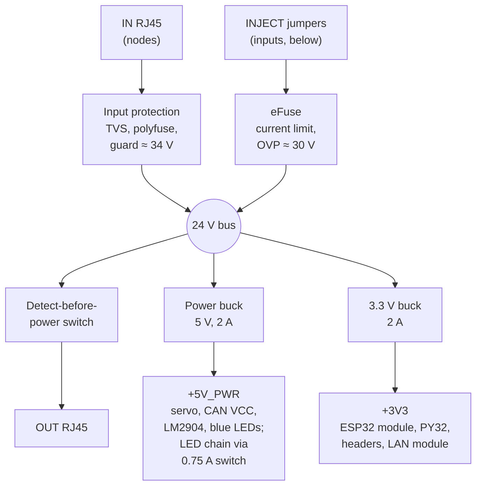
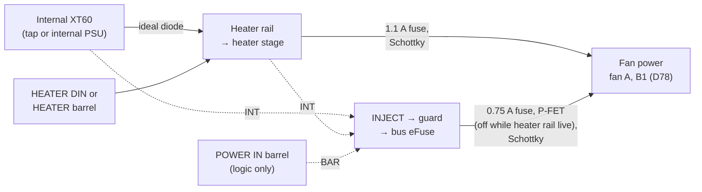
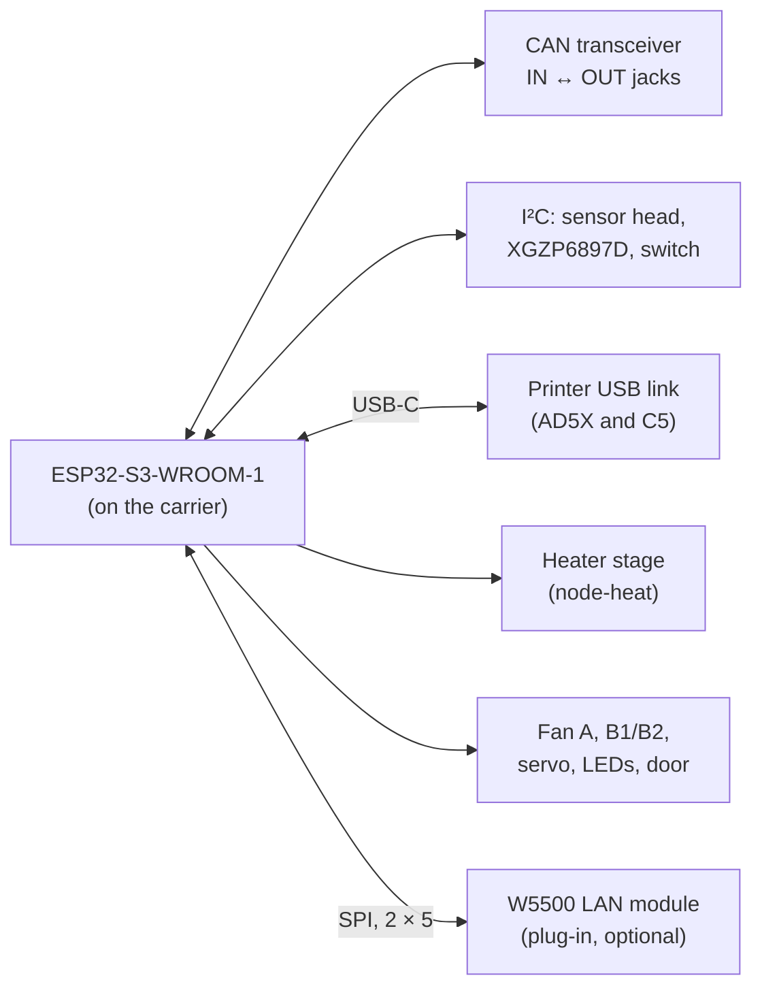

# 02 - Hardware Specification

> Design baseline, 2026-10-25. Part numbers marked *(candidate)* are confirmed against JLCPCB stock during Phase 2 PCB design. Wiring is in doc 04, cost in doc 03.

---

## 1. Hardware inventory

| Assembly | Qty | Where |
|---|---|---|
| Universal carrier PCB with the ESP32-S3 module on board (D72) | 5 built (3 nodes, 1 hub, 1 spare) | Nodes in a housing on each printer's branch damper at the exhaust port (D19); hub on the wall by the fan |
| **Universal sensor board** (D42), variant S: sensor head | 5 (3 chambers + hub room sensor + spare) | Inside each chamber near the exhaust port; room air at the hub |
| Universal sensor board, variant P: XGZP6897D pressure sensor | 3 (trunk vacuum, trunk flow, spare) | Hub trunk tap; hub instrument spool |
| Universal sensor board, variant E: AS5600 encoder | 4 (3 dampers + spare) | On each damper's shaft end |
| PTC heater module, 150 W, 24 V | 2 | Low at the rear inside each AD5X enclosure |
| Branch damper (printed, MG90S servo) with an **AS5600 angle encoder** on the blade shaft (D30) | 3 | In each printer's branch duct |
| Trunk flow: printed **venturi** with an XGZP6897D, and a printed **thermistor anemometer** in its throat (D30, D32, D33) | 1 | Hub instrument spool, between the filter and the fan (doc 08 §3c) |
| Printed **reference venturis**, 10 mm and 15 mm throats (commissioning only, M9) | 2 | Fitted in the spool's calibration slot when calibrating |
| Hub power (logic only): Mean Well LRS-100-24 (or a stock AD5X supply freed by an upgrade), IEC inlet; a 24 V desktop brick is the leaning alternative, decided with O1 | 1 | Hub enclosure |
| AD5X internal 24 V supply, **reused or upgraded** per O1, with a fused heater tap | 2 | Printer base |
| Exhaust fan: **VIVOSUN AeroZesh G4** (reference fan; not in the BOM) | 1 | At the through-wall outlet |
| Filter: printed housing + HEPA/carbon combo cartridge | 1 | On the wall, upstream of the fan |
| Mains-cut smart plug: **Shelly Plus Plug US** (recommended), a metering plug sold with Tasmota (D73), or any plug Home Assistant can switch (D14) | 3 | Each printer's mains |

## 2. Universal carrier PCB

### 2.1 ESP32-S3 module on the carrier (D9, D72)

| Option | Verdict |
|---|---|
| **ESP32-S3-WROOM-1 module soldered on the carrier, one design for every role** | **Chosen (D72):** one order, ≈ $2.50 cheaper per board than a dev board, and none of the circuits a plug-in board needs. A dead ESP32 means swapping the carrier; the spare carrier covers it. |
| Carrier + plug-in DevKitC-1-format ESP32-S3 board | Chosen by D9, replaced by D72: the dev board's own USB 5 V needed a reset hold (D36), an ideal-diode feed (D37) and a 5 V logic buck, and a $6 board on top of the carrier. |
| Tiny "S3 SuperMini/Zero" boards | Rejected: marginal pin breakout for the ~19 GPIO needed [U]. |

**Module:** **ESP32-S3-WROOM-1-N8R2** (C2913204, JLC-stocked extended part: $4.60 each at 1+, $4.00 at 10+, $3.57 at 30+, $3.16 at 100+ [V: JLC parts page, 2026-10-29]), 8 MB flash, 2 MB quad PSRAM, rated −40 to 85 °C. The octal-PSRAM R8 variants are rated to 65 °C only [V: ESP32-S3-WROOM-1 datasheet], too low beside an exhaust port. The carrier avoids GPIO 26–34 (flash and PSRAM) and uses **GPIO 37** (D74), which the quad-PSRAM N8R2 leaves free and the R8 variants don't, so the board needs an R2 or no-PSRAM module.
- **Supply:** `+3V3`, the 3.3 V buck (§2.2), which also feeds the carrier I/O controller, the I²C switch and the headers. ≈ 1.7 A peak with Wi-Fi bursts and a LAN module [E]. Decoupling per Espressif: 22 µF and 100 nF at the module's 3V3 pin.
- **Layout:** Espressif's reference layout. The antenna sits at the board edge with no copper on any layer under or beside it, and faces away from the damper's metal and the housing's fasteners [E: check RSSI in the housing at bring-up].
- **EN:** 10 kΩ to `+3V3` and 1 µF to GND, so the module starts once the rail is up. The ESP32's brown-out detector resets it if the rail sags.
- **BOOT / service button:** a TS-1187A SMD tact switch (C318884, the acknowledge button's part) from GPIO 0 to GND. It is the node's **service and CLEAR button** (D46, doc 04 §4); its position is fixed at layout under the SERVICE plunger (doc 08 C5, C9). Held through a reset, it enters download mode as usual.

**USB-C, data only (D72):** a USB-C receptacle (C2765186, ≈ $0.08) at the board edge on the module's native USB (GPIO 19/20), so the printer USB lead plugs straight in.
- **VBUS is not connected**, so nothing on USB can power the board, and the board can't back-feed a USB host or the printer (the lead has no VBUS either, doc 04 §5).
- 5.1 kΩ from each CC pin to GND, so a USB-C host (a laptop on a C-to-C cable) enables the port.
- Single-line ESD diodes (H5VL10B) on D+ and D−.
- With only the carrier's supply able to power the ESP32, the D36 reset hold and the D37 ideal diode are gone: there's no state where the ESP32 runs and the carrier is off. **For bench work, power the carrier** (a 24 V brick in POWER IN); USB alone doesn't start it.

**UART0 console header (D72):** a 1 × 3 2.54 mm pin header (GPIO 43 TX, GPIO 44 RX, GND; 3.3 V levels) for a USB-UART adapter. In service the native USB is the printer link, so this header is the console while the link is up, and with BOOT held through a reset it is the ROM download path if native USB is misconfigured (doc 07 §11.8).

### 2.2 Functional blocks and role population

Power and signal flow on the carrier (all roles). **Since D47 every carrier is assembled with the same parts**; the columns below say what each role *uses*, and the only per-board differences are shunt positions (the role, TERM, INJECT/HEAT and the NTC ranges).

**Power path:**

**Power inputs (D22):**

Dashed lines are jumpers. The INJECT header picks which inputs power the board and the bus (the board's logic always runs from the bus rail) (each through its own diode, an ideal diode from the heater rail and a Schottky otherwise (D80), so two fitted jumpers can't back-feed each other). The heater rail has three inputs and only one is used at a time: the internal XT60, the HEATER DIN jack or the HEATER barrel jack (D64; a shutter on the housing leaves one jack open). The internal XT60 reaches the rail through an ideal diode, so a brick in a jack can never feed the printer's supply, and INJECT INT takes both sides of that diode, so the board's logic never depends on it. The POWER IN barrel is for logic and bus injection only. Fan A and B1 run from the heater rail whenever it is live and from the bus otherwise; B2 is always on the bus (D78).

**Controller and I/O:**

| Block | Node-heat (AD5X) | Node-lite (C5) | Hub | Notes |
|---|:-:|:-:|:-:|---|
| Input: 24 V logic from the **IN** RJ45 (D56), in order from the jack: **2 A polyfuse rated 60 V** (2920L200/60GR class, D51; 4 A trip); **SMBJ58CA** bidirectional TVS (C19077592, Preferred; 58 V stand-off, breakdown ≥ 64.4 V, 93.6 V clamp at 6.41 A [V], so it stays off at a steady 48–57 V passive injector of either polarity); an **SS510B** reverse clamp to GND (C7420368, Preferred; 100 V, 5 A), so a negative spike stops at about −1 V; the 10 kΩ node signature as **two 4.99 kΩ 1206 resistors in series** (≤ 0.2 W each at 58 V); then the **IN guard**: two 100 V P-FETs back to back, sources joined (**XR20P10D** class, C50314136, PDFN 3 × 3, 60 mΩ typ / 75 mΩ max at V_GS −10 V, 20 A, since D60; the 60 V XR15P06D before), so it conducts both ways when on (D35) and blocks both ways when off. A CJ431 comparator on the joined sources turns it off above **≈ 34 V** (the D52 guard circuit): the divider feeds REF, and the cathode pulls the base of a PNP that shorts the gate to the source. The CJ431's cathode is rated only 36 V [V: VKA 36 V absolute maximum], and while it is off it sits near the rail, so a **33 V zener** across it (BZT52C33, C19077419, Preferred, 31.35–34.65 V, since D59; the MMSZ5257B is out of stock) holds it below 35 V. The zener also trips the guard on its own at ≈ 32–35 V. The 22 kΩ 1206 base resistor limits the current at a 93.6 V clamp to ≈ 3 mA. Then the gate turns on slowly, so a raw supply plugged into IN charges the bus gently: a gate–drain capacitor on the bus-side FET sets a ramp of **≥ 20 ms per 470 µF** of bus capacitance, which keeps the charging current near **0.5 A** (≈ 12 W peak in the FET, inside its 10–100 ms SOA with margin for a board-mounted case [E: the XR20P10D SOA chart is at T_C = 25 °C]). A ramp of a few ms would put 4–8 A and 100–200 W into the FET. A 12 V gate–source zener holds V_GS inside its ±20 V rating. On the bus side, the **SMBJ33A** (C19077586, Preferred) stays as the second stage. Polyfuse rated 60 V, the FETs and the reverse clamp 100 V. The FETs' 100 V rating covers the TVS's 93.6 V clamp, so a spike up to the clamp no longer drives the bus-side FET into avalanche (D60; below). **IN link LED (D62, D63):** a second blue side-view LED beside the IN jack, lit when the far end of the cable is an OUT jack. The IN jack ties pins 3/6 to GND through a resistor equal to the OUT pull-up, so with an OUT on the far end the pair sits at ≈ half of 3.3 V (≈ 1.6 V), and with another IN, an Ethernet or LAN jack, or nothing, at ≈ 0 V (the cable's ground offset, ≈ 0.3 V at full load, stays below the NPN's turn-on). An NPN with a 10 kΩ base resistor on that node switches the LED's 1 kΩ from `+5V_PWR` (D72; `+5V_LOGIC` before), so it needs no firmware, and the OUT jack's presence loop reads ≈ 1.6 V as closed [U: values in Phase 2]. It lights as soon as the cable is seated, before power arrives, and on a node with no supply of its own, once the upstream OUT has powered it. Together with the OUT jack's LED (below) both ends confirm a correct IN-to-OUT connection. | ✓ | ✓ | Fitted, not used (the hub is a chain end; nothing plugs into IN) | D17, D56, doc 04 §3a. Fitted on the hub too since D47, so its IN jack is never an unprotected path onto CAN, and a spare board can be any role. Before D56 nothing cut over-voltage on IN: a passive 48 V injector held the SMBJ33A in breakdown, a small brick never reached the polyfuse's 4 A trip, and the bus sat at the TVS's 42–45 V until the TVS failed. |
| **OUT RJ45 with detect-before-power:** window comparator + latch → bidirectional current-limited switch on +24 V, held on by the **presence loop** on pair 3 (D52: pins 3/6 pulled up at the OUT jack, tied to GND through a resistor by the next node's IN jack, D63), which works whichever way current flows; powers the OUT jack only for a fleet node signature or a powered fleet segment | ✓ | ✓ | ✓ (the hub's only jack) | D17. Plugging into a switch, laptop or PoE port puts 0 V on it. **OUT jack ratings (D57):** an **SMBJ58CA** on the jack's +24 V pins (as on IN), the switch's back-to-back N-FETs rated 60 V (SP60N12GNJ, C22466779, 16 mΩ max, ≈ 0.05 W each at 1.5 A hot, D80; HL2310A class before), and the prober and window comparator reaching the pins through a series resistor and clamp rated for 60 V, so a 48–57 V injector plugged into OUT is refused and damages nothing. **Port-live LED (D62):** one **blue side-view LED** (XL-1606UBC class, C965865, 120°, ≈ 260 mcd at 20 mA per its listing [E: confirm V_F on the datasheet]) at the board edge beside the OUT jack, lit whenever the port's +24 V switch is on. A 2N7002-class FET driven by the OUT circuit's port-on latch pulls the LED's 1 kΩ resistor to GND from `+5V_PWR` (D72) (≈ 2 mA, so ≈ 1.6–2.6 mA over the V_F range). It is logic-side, so it never loads the 5 V / 1 mA prober or the 10 kΩ signature and sees no bus voltage [U: circuit in Phase 2]. It faces the housing wall, so a 2.5–3 mm window in the wall lights it with no light pipe (doc 08 C5, C9, C20). Blue, so it can't be mistaken for an Ethernet jack's green and amber link lights. |
| **24 V POWER IN → bus injection:** **INJECT jumper header** (INT, BAR, D64: one diode on BAR and two on INT, from the internal XT60's side of the tap ideal diode and from the heater rail, cathodes joined; each supply passes through exactly one. Since D80 the heater-rail one is an **ideal diode** (MX74700T + SP60N12GNJ, ≈ 0.02–0.03 V at 1 A [E]) and the other two are **SS56** Schottkys (C18199169, Preferred, 60 V, 5 A, the buck catch diode; SS36 before). The 60 V Schottkys and the MX74700T's 75 V cathode–anode rating cover a wrong 48–57 V brick on one input reverse-biasing the others) → **input guard** → **eFuse with reverse-current blocking** *(MX26631DL, C18197523, D52: TPS26631-compatible, 60 V absolute maximum, 40 V operating; the TI TPS26630/31 fit the same footprint)* with an external **60 V reverse-blocking N-FET** on its B_GATE/DRV pins (SP60N12GNJ since D80, HL2310A class before; with the input at 0 V it sees the full bus voltage, which the IN guard and the bus TVS hold at ≤ ≈ 40 V since D56, so 40 V would do; the 60 V part stays because it is the B1/B2 switch FET and adds no line, D58) → the RJ45 bus rail. **Input guard (D52):** a 100 V P-FET (the IN guard's XR20P10D since D60, so one part serves both; the XR15P06D from D56, RC3P06 class before) between the INJECT Schottkys and the eFuse, turned off by a CJ431 comparator above ≈ 34 V (with the IN guard's 33 V cathode zener since D56; it was ≈ 36 V, which was at the CJ431's 36 V cathode limit), so a wrong supply on either input (a 48 V brick or passive PoE) never holds the eFuse above its 40 V operating range. It carries only the injection current (≤ 1.5 A, ≈ 0.4 W). Current limit set by one resistor to **~1.5 A on every board** (D81; the value the hub's old ILIM pair gave, D47; the CAT6 segment allowance since D17, kept at 1.5 A so cheap CCA or Cat5 patch cables stay inside their rating, D21). **Current monitor (D61):** the eFuse's IMON pin sources 27.9 µA per amp of output current (25.7–30.1 µA/A over 0.6–2 A [V]; not specified below 0.6 A [U]) into a **47 kΩ** resistor with a 100 nF filter capacitor, ≈ 1.3 V per amp (≈ 2 V at 1.5 A, inside the pin's 4 V limit), read by the carrier I/O controller's ADC (§2.4). The firmware reports each board's injected current (on the hub, the whole chain's draw from the hub supply), alerts when it stays ≥ 90 % of the limit for 10 s (a partial short or an overloaded segment), reported in the bus telemetry (D61). **Under-voltage turn-on ≤ ≈ 18 V** (D64): the EN/UVLO divider sits well below the lowest bus (≈ 22.4 V at a far node [E], doc 04 §6a), so injection doesn't cycle as a printer's rail sags. **Over-voltage cut-off ≈ 30 V**, set by a divider on the OVP pin (1.21 V threshold; the part has no internal default). The TPS26632 is not a substitute: it has a fixed 35 V clamp in place of the adjustable cut-off. The jumpers choose which supplies power the board and feed downstream nodes: an internal supply or a DIN-4 or barrel brick in a HEATER jack (INT), or a brick or PoE splitter on the barrel jack (BAR) | ✓ (INT fitted: fed from the printer's supply tap) | Optional (BAR fitted with a 24 V brick; **required on a wireless-only node**, doc 07 §6.4) | ✓ (INT fitted: **the hub's supply, an internal PSU on the XT60 or a brick in a HEATER jack (D78), is the hub's only path onto the bus**) | D13, doc 04 §6a. Blocks back-feed into any source and current-limits a short. |
| **Two bucks from the 24 V bus (D56, D72; three before D72), both LMR14030SDDAR** (C182078, since D60; XL1509 before): 4–40 V operating, 44 V absolute maximum on VIN and EN, 3.5 A, 90 mΩ typ high-side switch, cycle-by-cycle current limit 4.4–6.6 A, 170 °C thermal shutdown, R_θJA 43.2 °C/W in the SO PowerPAD-8 package [V]. Each runs at **500 kHz** (RT 49.9 kΩ [V]) with a 0.1 µF boot capacitor, a soft-start capacitor, a feedback divider, one **15 µH shielded inductor** (HCMA-0630-150-M-K class, C54431704, 7.3 × 6.6 mm, 3 A rated, 4.5 A saturation, 110 mΩ) and one **SS56** catch diode (60 V, 5 A, C18199169, Preferred; SS36 from D58 to D80). The 15 µH part gives ≈ 0.5 A p-p ripple on the 5 V rails and ≈ 0.4 A on 3.3 V from 24 V [E]. **power buck** (set to 5.0 V) → `+5V_PWR` (servo, LED chain through its switch below, and since D72 the CAN transceiver's VCC and the LM2904, each through 10 Ω and 10 µF [E], and the three blue indicator LEDs; ≤ ≈ 2 A worst case, a stall with the LED limit reached); **3.3 V buck** (34.0 kΩ over 10 kΩ from the 0.75 V reference) → `+3V3` (below). The 5 V logic buck (`+5V_LOGIC`, the dev board's feed) was removed by D72. Bus-side capacitors rated ≥ 50 V, the bulk electrolytic included (63 V before D58). EN is tied to VIN through a pull-up only, or, if a divider is fitted, set to turn on at ≤ ≈ 18 V (D64) | ✓ | ✓ | ✓ | ARG-08, ARG-11. A servo stall or an LED fault can't brown out the ESP32, which is on the 3.3 V buck. The IN guard (≈ 34 V) and the eFuse cut-off (≈ 30 V) keep the bus inside the 40 V rating, which is why no 60 V buck is needed. At the power rail's 1.9 A worst case the LMR14030 dissipates ≈ 0.25–0.3 W [E], ≈ +12 °C over ambient through its exposed pad and a GND pour; the XL1509 it replaced (D60) dissipated ≈ 0.65 W at ≈ 100 °C/W and ran near its thermal shutdown at that load. The inductor saturates (4.5 A) below the switch's worst-case current limit (6.6 A), so a hard output short pushes it into saturation for a few cycles before the frequency fold-back takes over [E]; the rails' loads sit behind their own current-limit switches, so only a board fault reaches that. A servo stall can't be sustained: the encoder's stuck-damper check stops the servo pulses within ≈ 5 s (doc 06 §3). The earlier candidates (TPS54331, 28 V; MP2315, 24 V) were rated below the bus's ~30 V over-voltage cut-off (D51). |
| **3.3 V rail `+3V3`** (`+3V3_SENS` before D72), from the 3.3 V buck (D56; replaces D51's XC6206 200 mA LDO, whose ≈ 140 mA thermal limit was below the eight headers' worst case of ≈ 0.4 A average and ≈ 0.6 A peak [E]). It feeds the ESP32 module and a LAN module (D72; ≈ 1.7 A peak in all [E]), the carrier I/O controller, the I²C switch and the eight header P-FETs. The **header P-FETs are fed as a group through a current-limit switch** (the LED switch's part, set to **≈ 1 A** with 6.8 kΩ, 0.75–1.25 A over tolerance, so its low end clears the headers' ≈ 0.6 A peak), so a shorted header cable can't pull the controller or the switch down with it. The **AUX 3.3 V pin** also comes from this group rail (D57), since it leaves the board too; the controller reads the group rail on PF3 (through a divider, D68), and the firmware finds the shorted header by powering them one at a time (doc 09 §2.2). A ferrite bead and 22 µF after the buck keep the 500 kHz ripple ≲ 10 mV [E] | ✓ | ✓ | ✓ | The controller's ADC is referenced to this rail (≈ ±3 %: the LMR14030's 0.735–0.765 V feedback reference over temperature [V], plus the 1 % divider), so the firmware calibrates it against the PY32's internal reference before trusting the heater-rail reading (doc 09 §2.4). The NTC pull-ups use this rail since D72 (below). |
| **ESP32 support (D72):** data-only USB-C (VBUS unconnected, CC 5.1 kΩ to GND, ESD on D+/D−), EN RC, BOOT / service tact switch, UART0 console header (§2.1) | ✓ | ✓ | ✓ | Replaces the D36 reset hold and the D37 ideal-diode feed, which only a plug-in dev board needed. |
| **CAN transceiver**, fault-tolerant bus pins ±58 V (*candidate: TJA1051T/3 with 3.3 V VIO*), IN + OUT RJ45 for the daisy chain, **TERM jumper** (120 Ω 1 % in series with a 2-pin shunt; fitted at the two chain ends, doc 04 §3) | ✓ | ✓ | ✓ | D17: survives Ethernet or PoE on pins 1/2. |
| **LAN module socket (D18, D72):** a 2 × 5 2.54 mm female socket at the board edge on **GPIOs 10–13**, SPI2's IO MUX pins (D45, doc 04 §4), plus `+3V3` and GND, for a common **W5500 module** (ESP-IDF `esp_eth` W5500 driver). The module's interrupt goes to **GPIO 38** with a 10 kΩ pull-up (interrupt-driven, no polling), its own RC resets it, and the ESP32's eFuse Ethernet MAC is used, since the W5500 has none. Pin order follows the common 2 × 5 module [E: confirm on the purchased module before layout] | Socket only (module for a wired link) | Socket only (module for a wired link) | ✓ (module fitted) | A normal network port, separate from the fleet jacks, with no 24 V on it. The CH390D, MagJack and crystal were on every carrier from D47 to D72; now only a board that uses LAN pays for it. |
| **Power inputs (D22, D52, D64, D66):** **Heater supply (INT): three sockets, one in use.** The heater rail is fed by whichever is used, joined by copper pours: (a) the **internal XT60**, inside the housing, for the printer's supply tap or an upgraded internal supply on a node and the hub PSU in the hub enclosure, plugged in with the cover off; (b) the **HEATER DIN** jack, a board-mount right-angle 4-pin power DIN jack (*GlobTek JACKPWRDIN4LS*, ≈ $1.15 at DigiKey, −20 to 50 °C; or *Kycon KPJX-4S-S*, C2875467, −40 to 75 °C; both 7.5 A and mating the KPPX-4P plug of the Mean Well -R7B bricks [V]) [V: Mean Well GST160A spec, R7B plug: pins 1 and 4 +V, pins 2 and 3 −V], footprint on every board, hand-soldered only where a DIN brick is used (JLC doesn't stock either part); (c) the **HEATER barrel** jack, board-mount right-angle 5.5 × 2.5 mm, 15 A, 30 V (*G-Switch DC-S007B-D025-15A*, C7464909, D66; mid-mount in a 9.8 mm notch at the board edge), JLC-fitted on every board, for a full-power barrel brick. The two HEATER jacks sit side by side on the outside face under a printed **shutter** (doc 08 C21) that leaves only one open and covers both when the tap is used. **Tap ideal diode (D64):** the internal XT60 reaches the heater rail through one ideal diode (*MX74700T* controller + *SP40N05GNJ* N-FET, ≈ $0.62, ≈ 20–30 mV at the heater current [E]), so if a tap and a brick in an open jack are ever connected together, the brick can't back-feed the printer's 24 V rail after its plug is cut, which would defeat the mains cut. A divider on the XT60 side of the diode (ESP32 GPIO 7, D75; the controller's PB1 before) shows whether the tap is live. The MX74700T's EN is pulled up to its input, and a 2N7002 on **ESP32 GPIO 37** pulls it low (D74; on the controller's PF1 before, D65; a 4.7 kΩ gate pull-down keeps the gate under its threshold while the pin floats), so the diode conducts unless firmware turns it off. **Two-supply check:** at boot and before each heating session, if the tap is live, the firmware turns the diode off, pulses the heater for ≈ 50 ms to drain the rail capacitors, and reads the rail. If the rail collapses, nothing is on the jacks and heating goes ahead with the diode back on. If it holds, a brick is connected as well, at whatever voltage: the node refuses to heat and alerts "two heater supplies connected, remove one". A disable stuck on reads as no heater supply, and one stuck off as two supplies; both stop heating and both are visible. INJECT INT takes both sides of the diode (above), so turning it off never drops a tap-fed node's logic. With INJECT INT fitted the heater rail also powers the board and the bus, so the hub powers itself, one heater brick runs a whole node, and a node with an internal supply can power nodes downstream. **POWER IN (BAR, labelled LOGIC 24 V):** a **5.5 × 2.1 mm** barrel jack (*XKB DC-005-5A-2.0*, C381116, 5 A, D66) on the outside face, so a logic plug can't enter the HEATER barrel, for a logic brick or a PoE splitter (D18), **logic and bus injection only**: it never reaches the heater rail, so a brick here can sit on an ordinary outlet and keep the node up when its printer's plug is cut. Apart from the tap check, the board doesn't need to know which supply feeds the heater: it is limited by the node's `heater_power` and a learned supply cap (doc 05 §3.3, D64). **Heater-rail over-voltage (D57):** a wrong brick (48–57 V) on any heater input reaches the heater rail, so a second copy of the guard comparator (CJ431, 33 V cathode zener, MMBT3906) on the rail breaks the hardware enable chain above **≈ 34 V**, and the high-side switch is rated 60 V (below). With it off, the heater and the low-side FET see only leakage current, so their 40 V ratings hold. The tap ideal diode's 40 V N-FET sees at most ≈ 33 V (a 57 V brick in a jack against a live tap), and the firmware never runs the two-supply check while the rail reads above 30 V [V: MX74700T datasheet: CATHODE to ANODE −5 to 75 V, ANODE to GND ±100 V]. Heater-rail capacitors are rated ≥ 63 V, and the rail-sense divider's top resistor is ≥ 100 kΩ so 57 V stays inside the ADC pin's injection limit. The firmware alerts "wrong supply on heater input" whenever the rail reads above 30 V. The same comparator also holds fan A and B1 off (D78) | ✓ (INT + BAR) | ✓ (INT + BAR) | ✓ (INT + BAR) | Makes the supply a choice at install time, not a design change. Unused openings take a printed blanking plug (doc 08 C15). |
| **Heater stage:** ORed heater rail, **high-side P-FET enable** (driven by the hardware enable chain), **low-side logic-level N-FET PWM** (40 V, 5 mΩ class, PDFN 3×3, D51; the high-side P-FET is **60 V, ≈ 24 mΩ** (XR30P06F class, C42457008, PDFN 5 × 6, since D59; ≈ 0.6 W hot at 4.2 A, on a copper pour; 60 V since D57), with a **12 V gate–source zener**, since its gate is pulled toward GND and the rail alone exceeds its ±20 V V_GS rating), 10 kΩ gate pull-downs, 100 Ω series gate resistors, XT60 heater output. **High-side output sense (D64):** the switched `24V_HEAT` node feeds a divider (100 kΩ over 15 kΩ [E]: 24 V reads ≈ 3.1 V, high above ≈ 19 V; the top resistor ≥ 100 kΩ so a stuck-on high side at 57 V stays inside the clamp) with a 3.3 V clamp diode into **ESP32 GPIO 46**, a digital input. It reads low whenever the high side is off, including at reset, where the 15 kΩ overrides the strapping pin's weak internal pull-down | ✓ | Fitted, held off | Fitted, held off | Two independent switches in series (doc 05). ARG-09. Fitted on every role since D47; see the note below the table. The GPIO 46 sense is the only independent check on a high-side FET stuck on (current sensing can't see it while the low side is off): doc 05 L4 locks the heater out if it reads high with the charge pump stopped. |
| **Hardware enable chain:** RC **charge-pump** fed by a toggling GPIO, in series with the **KSD301 loop** (off-board, normally closed: **heater-housing KSD301 + chamber-air KSD301 in series**) and the **heater-rail over-voltage comparator** (≈ 34 V, D57) → high-side gate driver | ✓ | Fitted, loop open | Fitted, loop open | A hung MCU (pin stuck high or low), either KSD301 opening, or a wrong supply on the heater rail turns the heater off. |
| **Heater current sense (D50):** 5 mΩ low-side shunt (LRAM25EJER005 class, 2512, ±5 %) + LM2904 at gain 40 with a ~10 mV input pedestal → ADC; zeroed in firmware at boot (doc 04 §4) | ✓ | Fitted, unused | Fitted, unused | Open element, welded FET, inrush, and C8 stall detection. |
| **Fan channel A:** 24 V high-side switched (60 V P-FET, D51; XR20P10D since D80), tach input (pull-up + clamp), plus open-drain PWM output on ESP32 GPIO 14 (D70), which floats to full speed while the ESP32 is in reset [E: the Intel 4-wire fan specification, as Noctua's PWM white paper quotes it, has the fan pull PWM up and run at full speed with no signal; a fan without that pull-up won't, so check the fitted fan] | ✓ (recirc fan if not integrated) | Fitted, spare | ✓ (**G4 fan port**, finalised after R1) | High-side switching keeps the tach valid (F5). The 0–10 V output stage is footprint-only, unpopulated until R1 says whether it's needed. Fan A and B1 take their 24 V from the fan power net (D57, D78, below). |
| **Low-side outputs B1, B2:** switched 24 V (60 V N-FET, D51; SP60N12GNJ since D80), flyback diode each. B1 is driven by the carrier I/O controller (PA8, D68), with a **10 kΩ gate pull-up** so it runs at full duty while the controller is in reset, in its bootloader or blank (D75), and B2 by ESP32 GPIO 45 (gate pull-down). **Output feeds (D57, D78):** B2 takes its 24 V from the bus through a **0.75 A hold, 1.5 A trip, 60 V** resettable fuse (2018L075/60GR class, C33977642), so a shorted lead opens it before the segment or injection limit trips and the rest of the chain stays up. Fan A and B1 share a **fan power** net fed by two legs, each through its own fuse and then an SS56 Schottky (D80). The **heater leg** comes from the heater rail, ahead of the high-side switch, through a **1.1 A hold, 2.2 A trip, 60 V** fuse with a 40 A fault rating (2920L100/60GRL, C18198350, D80; the 2 A IN polyfuse part before, which let a fan-lead short overheat the output switches). The **bus leg** comes through the same bus fuse and a P-FET (XR20P10D since D80, HL2309 class before; 12 V gate zener) that two 2N7002s turn off while the heater rail is above ≈ 15.5 V (network in D78). So the heater rail feeds the fans whenever it is live, and the bus feeds them otherwise. Above ≈ 34 V the heater-rail comparator (D57) holds fan A and B1 off, through two 2N7002s on their gate drives. When every output on one fuse stops at once, the firmware raises an output-fault alert. On a node-heat, the firmware keeps fan A and B1 off while the heater rail is down (D78) | ✓ (B1 AD5X recirculation-duct blower, O3; B2 spare) | Fitted, spare | ✓ (B1 **anemometer heater**, PWM, D32; B2 buzzer) | |
| 2 × NTC 100k inputs (ADC1, RC filter): **47 kΩ** pull-up to **`+3V3`** (the ESP32's own supply, D56, D72) on every board, plus **5.1 kΩ through a RANGE shunt** per channel (≈ 4.6 kΩ with the shunt on, D47) | ✓ (chamber air, heater housing; **both RANGE shunts on**) | Fitted, spare | ✓ (**low-flow anemometer**: reference and heated NTC, D32; **RANGE shunts off**) | 47 kΩ gives resolution at 20–80 °C (anemometer); ≈ 4.6 kΩ covers the hot range of the heater housing. A wrong shunt is caught at boot (doc 04 §4). The ESP32's ADC isn't ratiometric, so the pull-up rail's error becomes a temperature error. Since D72 the rail is the 3.3 V buck (≈ ±3 %, against a dev board regulator's ±1–2 % before), so the firmware scales each reading by the rail voltage the carrier I/O controller measures against its internal reference (doc 09 §2.4) [E: residual error at layout]. Pulling the pins up to their own chip's supply means they can never sit above it while the rails come up. The pull-ups draw ≈ 60 µA in total; the anemometer's heater runs from B1 at 24 V, not from this rail. |
| **On-board XGZP6897D** pressure sensor (I²C 0x6D), two barbs | ✓ (chamber vs room) | ✓ | ✓ (**across the filter**) | |
| **Sensor headers 1–8** (JST-SH 4, Qwiic / STEMMA QT pinout: GND, 3.3 V, SDA, SCL; D68, D69) behind an **8-channel I²C switch** (TCA9548A-compatible; FCA9548T fitted, D51; one channel per header), with a **PY32F030 carrier I/O controller** for per-header power and the slow carrier I/O (§2.4); the ESP32 programs it, and any sensor-board MCU, through its ROM bootloader (D45, D54, doc 09). A **1 × 5 2.54 mm SWD header** (3.3 V, SWDIO, SWCLK, NRST, GND; D65, doc 09 §4.5) gives the controller full probe debugging, and a **1 × 6 2.54 mm JTAG header** (3.3 V, TMS, TCK, TDO, TDI, GND on ESP32 GPIOs 42, 39, 40, 41; D68, doc 07 §11.8) does the same for the ESP32 | Header 1: **sensor head**. Header 2: **AS5600 damper encoder** (sensor board E, D30). Header 3: unused (per-branch flow option). Header 4: optional OLED (D48) | Header 1: **sensor head**. Header 2: **AS5600 damper encoder**. Header 4: optional OLED (D48). Headers 3, 5–8: unused | Header 1: **room sensor head**. Header 2: **XGZP6897D trunk sensor** (sensor board P). Header 3: **XGZP6897D trunk-flow sensor** at the venturi (D30, D33). Header 4: optional 0.96″ OLED at 0x3C (D48) | Every XGZP6897D is fixed at 0x6D, so each off-board one sits on its own switch channel and can't clash with the on-board one (D11; supersedes C7). Each header being its own segment also keeps bus capacitance low. **A display never shares a channel with a sensor** (D48, doc 09 §3), so a locked-up OLED can't take a sensor reading with it. Headers 5–8 (and 3 on nodes) are free for further sensor boards. |
| Servo header (`+5V_PWR`, signal held low at boot) | ✓ | ✓ | Fitted, unused | The damper's **AS5600 angle encoder** (D30) reads the blade shaft and connects to I²C header 2, not here. |
| Door input (reed switch, pull-up, RC + ESD), **read through the carrier I/O controller** (§2.4) | ✓ | Fitted, optional | Fitted, unused | The C5's doors are read from Moonraker. For the AD5X the reed is primary and Moonraker is the backup (doc 05 §4). |
| LED chain 1: **current-limit switch** from `+5V_PWR` (SY6280AAAC class, C207620, SOT-23-5, 63 mΩ; limit = 6800 / R_SET, **≈ 0.75 A with 9.1 kΩ**, 0.56–0.93 A over tolerance [V: datasheet ±25 % at 1 A]; enable tied high) → `+5V_LED`; **2N7002 inverting level shifter** (1 kΩ pull-up to `+5V_LED`, so the data line never sits above a sagging LED supply; the carrier I/O controller's timer output runs with inverted polarity to match, D51, D70, D71; the ESP32's RMT drove it before D70), 330 Ω series, 1000 µF bulk on `+5V_LED` (chain 2 dropped, D45) | ✓ | ✓ | ✓ (LED1 = panel RGB) | LED 0 of the bed strip is the status pixel. The strip is ~48 LEDs per printer (D44), ≈ 2.9 A at full white. The firmware caps it at 0.5 A (doc 04 §3), below the switch's lowest limit; the switch is the hardware backstop (D56). In limit it holds the current and lets `+5V_LED` sag, so the LEDs dim, the servo and the power buck stay inside their ratings, and it soft-starts the 1000 µF. Loss ≈ 20 mW at 0.5 A. |
| **AUX header** (D48): JST-XH 5 (3.3 V, GND, A = GPIO 36, B = GPIO 6, GND; A was GPIO 5 before D75), each line through a **2N7002 level shifter** (gate to 3.3 V; 10 kΩ pull-up to 3.3 V on the ESP32 side, 4.7 kΩ to 3.3 V on the connector side) and ESD-protected | Spare, or the **UART printer link** (A = TX, B = RX; doc 12 `marlin_serial`) | Spare, or the UART printer link | ✓ (A = smoke dry contact; B = acknowledge button; each with its own GND pin) | Replaces the two spare-input headers. An **on-board tact switch** (TS-1187A-B-A-B, LCSC C318884, a Basic part) sits on B's connector side, in parallel with the AUX pin, on every carrier (D49): the hub's front panel presses it through a printed plunger, and a builder can still cable a remote button to AUX B. It is on B, the UART **RX** line, so a press on a node using the UART link only garbles a received frame; on A, the TX line, it would short a driven output through the shifter. The shifter makes both lines **5 V-tolerant** and still passes a contact pulling low, so edge interrupts work. Both lines are digital only. Pinout in doc 04 §4. |
| **Power senses:** the **heater-rail voltage** (ESP32 GPIO 5) and **tap-side heater voltage** (ESP32 GPIO 7, D64), read by the **ESP32's ADC1** (D75), each via a **100 kΩ / 9.1 kΩ** divider with 100 nF at the pin (≈ 2.8 V at 34 V, inside the 12 dB range [E]); the **bus voltage** (D64), via a divider with a ≥ 100 kΩ top resistor on the RJ45 bus rail, and the **injection current** (the eFuse's IMON, D61), both read by the **carrier I/O controller's ADC** (§2.4) | ✓ | Fitted, read | Fitted, read | On the controller from D47 to D75. Back on the ESP32 since D75, so the rail throttle, the two-supply check and the supply-drop detection behind the learned supply cap (doc 05 §3.3, D64) keep working while the controller is silent. The rail reading is trimmed once against a meter at commissioning (doc 05 §9 test 8). The barrel heater-input sense went in D64. The bus voltage gives the anemometer's drive power (doc 06 §4.4), each node's bus voltage and injected power (V × I) in the bus telemetry, and the hub's voltage in back-fed mode. |
| **Board identity header** (D46): 2 × 3 pin header + shunt (HEAT, LITE, HUB) on a divider to the carrier I/O controller's PA0 (D68; GPIO 3 before), checked against the stored role at boot (doc 04 §4) | ✓ (HEAT) | ✓ (LITE) | ✓ (HUB) | Wrong or missing shunt → safe hold, nothing switches on. Since D47 it is the only part of the role set on the board. The carrier's BOOT switch doubles as a service button after boot (doc 04 §4, D72). |
| Status LEDs (power, CAN activity) and a **board status LED** driven by the carrier I/O controller (§2.4). **The CAN activity LED is hardware-driven (D63):** a blue LED that blinks for ≈ 30 ms whenever another unit drives a dominant bit, detected as the transceiver's RXD low while its TXD is high (so the unit's own frames are excluded, and the ACK another unit gives to its frames is counted). A PNP on RXD in series with a small N-FET on TXD charges a 100 nF capacitor through a diode, a bleed resistor sets the ≈ 30 ms stretch, and an NPN drives the LED. **A minimum-off timer** (a second NPN with its own RC, started by the end of each on-pulse) blocks the charge path for another ≈ 30 ms, so a busy bus gives a fixed ≈ 30 ms on / ≈ 30 ms off blink (≤ ≈ 16 Hz) instead of a solid LED, as an Ethernet activity LED does [U: values tuned and simulated at bring-up]. No firmware or controller pin is involved. Every unit sends a 1 Hz heartbeat (doc 07 §6.2), so a connected neighbour makes it blink about once a second at the least. **Reading it:** ≈ 1 blink a second or a few more = healthy; a steady fast flicker (≈ 16 Hz) = heavy traffic or a unit holding the bus dominant [E]; **dark = this unit hears no other unit** (it is alone, its neighbours are off, or the cable's CAN pair, pins 1/2, is broken). It shows the bus, not one cable, since both jacks share the CAN pair on ≤ 50 mm stubs, so a break in the middle of a chain leaves both sides blinking from their own neighbours and shows on the hub's dashboard instead (doc 07 §6.2). **Suggested layout:** put the activity LED **between the IN and OUT jacks**, with the solid link LEDs on the outer sides, in the order *IN link LED, IN jack, activity LED, OUT jack, OUT port-live LED*, so the eye reads the solid LEDs as per-port link and the blinking one as the traffic between them [U: spacing set at layout]. On the hub, which uses only the OUT jack, the activity LED sits beside it. | ✓ | ✓ | ✓ | D63 |

**Part choices and ratings (D51).** Named parts are JLC-stocked and chosen for cost; equivalents are fine if they meet the same ratings:
- **Anything switching or blocking on the 24 V side is rated ≥ 60 V.** Fan A and the fan feed's bus leg use the XR20P10D P-FET (100 V) and B1/B2 the SP60N12GNJ N-FET (60 V), both PDFN 3 × 3, so they outlast a fan-lead short until its fuse trips (D80). 30 V SOT-23 FETs leave no margin above the ~37 V TVS breakdown. The bucks are the exception (40 V): they sit behind the IN guard and the eFuse cut-off (D56). On the heater rail, only the high-side switch is 60 V; the rest sees leakage only once the D57 comparator opens it.
- **Surge scope (D56).** The fleet cables are indoor and short (≤ ~6 m total), so the design covers ESD (IEC 61000-4-2), fast transients, unplugging under load and a wrong supply on any jack, not the IEC 61000-4-5 lightning surge, which applies to longer or outdoor cables [E]. Fast events are absorbed by the jack TVS and the bus capacitance; the guard turns off within ≈ 10 µs [E], long before a 48 V step charges the bus from 24 V to 45 V (≈ 80 µs through the path's ≈ 0.4 Ω into ≥ 100 µF). The guard FETs (XR20P10D since D60, in both IN-guard positions and the injection guard) are rated for V_DS −100 V, I_D −20 A, I_DM −72 A and **E_AS 42 mJ** [V]. Its datasheet is inconsistent in places (the E_AS test condition, 0.5 mH at 23 A, implies ≈ 130 mJ, and R_θJC is printed as 0.45 °C/W), so only the lower figures are relied on. A steady 57 V injector and a spike up to the SMBJ58CA's 93.6 V clamp at 6.41 A both stay inside V_DS, so inside the surge scope the FETs never avalanche; the full clamp needs a 600 W pulse the scope excludes. (The 60 V XR15P06D before D60 avalanched in the 60–93.6 V band and relied on its 18.1 mJ rating.) An 8 kV contact discharge stores ≈ 4.8 mJ, most of it lost in the source resistance, so it is well under E_AS [E]. One residual: a 48 V step while the bus is live at 24 V pushes ≈ (48 − 24) V / 0.4 Ω ≈ 60 A for the ≤ 10 µs before the guard opens. That is inside I_DM (≈ 1.2× margin) and the ≈ 100 A, 10 µs SOA line up to ≈ 40 V at T_C = 25 °C, and the heating is only ≈ 3 mJ, but the margin is thin and the part is new [U: bench test with a 48 V brick hot-plugged into a live node]. The comparator's cathode (36 V maximum [V]) is low whenever it conducts, above the threshold; below it, the 33 V zener holds it under 35 V, and the zener also covers the ≈ 1 µs a fast step takes to turn the CJ431 on.
- **3.3 V-side switches** use Preferred parts: HL3401 (P-FET, per-header power) and HL3400A (N-FET).
- **Heater-current FETs** (the low side): one part, SP40N05GNJ class, 40 V, 5 mΩ at 10 V, 8 mΩ at 4.5 V. At the 3.3 V GPIO drive of the low side its resistance is higher [U: measure at bring-up; drive the gate from 5 V through a 2N7002 stage if it exceeds ~12 mΩ].
- **ESD:** a single-line 5 V bidirectional diode (H5VL10B class, DFN1006) on every off-board signal line.
- **Clones:** the MX74700T and FCA9548T are pin-compatible with the LM74700 and TCA9548A [E: confirm each pinout on the datasheet before layout].

**One population (D47).** JLC assembles one BOM per order [E], so three populations would mean three assembly orders, each with its own setup and extended-part fees, and a spare board that fits only one role. Fitting every block on every carrier costs less than that and lets the spare stand in for any role. The heater stage is safe to fit on a board that doesn't use it: its high-side switch needs both the charge-pump wave and a closed KSD301 loop (doc 05 §3.1), the KSD301 loop is not wired on a node-lite or the hub, and the firmware refuses to drive it unless the role shunt says HEAT. A node-lite becomes a node-heat by moving the role shunt, fitting both RANGE shunts and wiring the heater and KSD301 loop.

**Board size:** set by its connectors, not a target size (ARG-12). Estimated ~100 × 70 mm, 2-layer, **1 oz** copper (2 oz before D59). The heater path (heater inputs → high-side and low-side FETs → XT60 out) runs as ≥ 4 mm pours on both layers, stitched with vias, for ≤ 20 °C rise at 4.2 A [E: IPC-2221].

**Connectors:**
- Power: two XT60s inside the housing (internal heater supply, heater output); HEATER DIN (right-angle power DIN, fitted where used) and HEATER barrel (5.5 × 2.5 mm, 15 A, D66) under the housing shutter (D64); POWER IN barrel (5.5 × 2.1 mm, logic only, D66); INJECT jumper header (D22; the HEAT header went in D64); RANGE 1/2 shunt headers (D47; the ILIM header went in D81).
- AUX: JST-XH 5, smoke contact and an optional remote acknowledge button on the hub, or a UART printer link on a node (D48, D49).
- Acknowledge button: on-board SMD tact switch on AUX B, pressed through a printed plunger (D49).
- Bus: RJ45.
- Signals: JST-XH 2.54 mm. Use **pre-crimped pigtails**, so no crimp tool is needed.
- Sensor headers: JST-SH 1.0 mm 4-pin (Qwiic / STEMMA QT, D69), with bought pre-made cables.
- USB: USB-C receptacle, data only (D72).
- LAN: 2 × 5 2.54 mm female socket for a W5500 module (D72).
- Debug: SWD 1 × 5 (carrier I/O controller, D65), JTAG 1 × 6 (ESP32, D68) and UART0 1 × 3 (ESP32 console, D72), 2.54 mm pin headers.
- Expansion port: 2 × 5 2.54 mm pin header on the carrier I/O controller's spare pins, SPI, UART and four analog inputs (D77, doc 09 §2.5).
- Servo: standard 3-pin header.
- No screw terminals anywhere (P-5).

### 2.3 Universal sensor board (D42)

JLCPCB assembles only one design per board, and a panel of different designs has to be cut apart by hand (their panelization rules), so the sensor head is **not** a break-off tab of the carrier. Every sensor that must sit on a PCB uses **one small second board**, ordered separately from the carrier. It is ~30 × 20 mm, 2-layer, with a right-angle 4-pin JST-SH in the Qwiic pinout (GND, 3.3 V, SDA, SCL; D69), two M2 holes at the same spacing on every variant, and 100 nF decoupling. It has no pull-ups (the carrier fits them per header, after the header's power switch; doc 09 §2.2).

**One set of Gerbers, three populations** (the unused footprints stay empty):

| Variant | Fitted parts | Used for | Qty |
|---|---|---|---|
| **S** sensor head | **SHT40** (T/RH, I²C 0x44, ±0.2 °C / ±1.8 % RH; the SHT45 isn't needed, C2) + **ENS160** (metal-oxide gas sensor, 4 heated elements, I²C 0x52/0x53, rated **−40 to 85 °C** so it reads through the whole purge including ~60 °C chamber air, R3, D20) + a **1.8 V LDO** for the ENS160's VDD (VDDIO at 3.3 V). The ENS160's INTn is left unconnected; it is polled (D68). The firmware reads the ENS160's **raw element resistances**, with the SHT40's temperature and humidity written in for compensation. **AHT20 alternate footprint** (I²C 0x38, ±0.3 °C / ±2 % RH, ≈ $0.80, D55) for **room-side heads only**: its normal range is 10–50 °C and its humidity reading drifts above that [V: AHT20 datasheet], so chamber heads always carry the SHT40 | Chamber sensor heads, hub room sensor | 5 |
| **P** pressure | **XGZP6897D**, ±500 Pa class (I²C 0x6D), its two ports taking silicone tube directly or printed barbs | Hub trunk vacuum and trunk flow (D11, D33) | 3 |
| **E** encoder | **AS5600** (I²C 0x36), facing the damper shaft magnet | Damper angle (D30) | 4 |

- **No address clashes:** every header is its own I²C switch channel (D45), so two boards of the same kind never share a segment, and no off-board XGZP6897D shares one with the on-board one (D11).
- **Ordering:** each variant is its own JLC order of 5 boards (the minimum), so each carries its own setup and shipping. S must be JLC-assembled (the ENS160 and SHT40 can't be hand-soldered). P and E are assembled by JLC if the parts are in stock, otherwise hand-soldered, since the XGZP6897D and the AS5600 are the easy parts here. The quote can merge variants if JLC's rules allow; see R9.
- **Footprint layout:** the XGZP6897D and AS5600 footprints sit away from the SHT40/ENS160 corner, so a board never has a fitted part in another variant's mounting zone. The same two M2 holes let the C4 cover, C12 mount, C16 encoder bracket and C17 venturi mount all take any variant.
- **Source:** `hardware/pcb/sensor/` (KiCad), with the three BOMs as variants of one project (S also has a room-side BOM with the AHT20 in place of the SHT40).
- **Bought boards:** SparkFun Qwiic and Adafruit STEMMA QT boards plug straight into the headers (D69); other bought 3.3 V I²C sensor boards take an adapter cable; doc 09 §8 lists the base set and the supported catalogue.

In the chamber, it mounts at the exhaust port, out of the heater jet, behind a printed ASA vented cover. The hub's head sits in free room air away from the fan.

### 2.4 Carrier I/O controller (D45, D54)

The **PY32F030** that switches the sensor headers (doc 09 §2) also takes the slow, non-safety signals that used to need ESP32 GPIOs, so every role has the same pin map and the same parts (D47), LAN included (doc 04 §4):

| Signal | Was | Safety role |
|---|---|---|
| Door reed | GPIO 13 | None; door-open → purge and an advisory (doc 05 §6). Moonraker is the backup on the AD5X |
| Bus voltage (divider, controller ADC; D64) | — (new) | Telemetry and the anemometer's drive power |
| Injection current (eFuse IMON, controller ADC; D61) | — (new) | Bus telemetry only since D64 (the barrel cap it also fed is gone) |
| Board status LED (PA11 since D68) | GPIO 47 | None. The controller blinks a fast "no heartbeat" pattern if the ESP32 stops talking to it (doc 09 §2.1) |
| Board identity (role shunt divider, controller ADC; D68) | GPIO 3 | None; read once at boot. **No reading → the stored role is used, with an alert**, and the heater stays off until the identity has been read once since boot (D75) |
| Output B1 PWM (controller timer; D68) | GPIO 39 | None: the AD5X recirculation blower or the hub anemometer heater (safe at full duty, doc 06 §4.4). **No controller → B1 at full duty** (gate pull-up, D75) |
| LED chain 1 (controller timer PWM with DMA; D70, D71) | GPIO 14 | Indication only: the bed strip (LED 0 = status) or the hub's panel RGB. **No controller → the LEDs freeze or go dark**; the buzzer and pushes still alarm |
| Expansion port (D77): SPI1, USART2, four analog inputs, two digital pins | — (new) | None. Slow by design (I²C uplink); nothing on it gates the heater (doc 09 §2.5) |
| LED chain 2 | GPIO 21 | Dropped from the fixed map; a future overhead strip uses a sensor-header board with its own MCU and level shifter (doc 09 §4.4); the bed strip is on the carrier I/O controller since D70 (doc 09 §2.1) |

D74 moved two signals back to the ESP32: the **KSD301 loop sense** (GPIO 48), so the safety task sees a tripped thermostat even while the controller is hung, reset or being reprogrammed, and the **tap ideal-diode disable** (GPIO 37), so the disable and the two-supply check's heater pulse are timed by one chip D75 then moved the heater-rail and tap-side voltages to ESP32 GPIO 5 and 7, so every heater input and output is on the ESP32.

Nothing on this list feeds a safety layer (S-7), and nothing on it gates the heater (D75). A controller that is missing at boot holds the heater off only until the board identity has been read once; after that, a hung, resetting or held controller raises an alert and **heating carries on**. The fan, dampers, CAN and every sensor still work; B1 runs at full duty and LED chain 1 goes dark or freezes. The one failure that is still shared is an I²C block that holds SDA low while the controller's firmware runs, which takes the bus down for every I²C sensor until the watchdog or the ESP32's bus-recovery clocking frees it [U: whether the PY32F030's I²C has a hardware bus timeout]. The ESP32 can also reset the controller itself (D76): the interrupt line reaches the controller's reset pin through an RC filter (doc 09 §2.3). D77 puts the controller's seven spare pins on an expansion header for SPI, UART and analog sensors (doc 09 §2.5); it is not on any path the heater or a safety layer uses.

## 3. Chamber heater module (node-heat)

| Item | Specification |
|---|---|
| Element | **24 V, 150 W PTC air heater**, aluminium-housed, self-limiting |
| Preferred form (C8) | **Integrated-fan PTC module** of the kind sold for 3D-printer chambers, **with separate fan leads** so the fan runs from fan channel A (always-on 24 V) and keeps cooling the element after a heater cut. Adopted only if a bench test confirms that a fan stall shows up as a drop in PTC current plus a rise in housing temperature (R8) |
| Fallback | Bare PTC + **3-wire 24 V 5015 blower** on fan channel A (tach) + metal shroud |
| Cold inrush | 2–3× rated current [E]. Firmware soft-start ramp; bed-heat interlock when the stock supply is reused (§3.1); fuse and FETs sized for it |
| Mounting | Low at the rear, blowing along the floor away from the bed. The element sits inside a **sheet-aluminium shroud** with ASA brackets kept away from the hot surfaces (doc 08) |
| Intake filter | Printed ASA cap over the intake holding a cut-to-size carbon/HEPA pad. Replaces a BentoBox-style recirculating filter |
| Protection | **KSD301** (normally closed, on the shroud/bracket, in the enable chain), **chamber-air KSD301** (≈ 70 °C, in the same chain, §3.2), **TCO** in series with the load, 10 A fuse at the supply tap and on the node. Trip temperatures are set from a bench measurement of the chosen element (O7, doc 05 §3) |
| Chamber limits | From the printer profile: AD5X operating cap **60 °C**, hard limit **65 °C** (doc 01 §4.5, D26) |

### 3.1 Heater power source (D12)

By default the heater runs from **its own printer's internal 24 V supply**. An **external 24 V brick** with a DIN-4 plug in the node's HEATER DIN jack is the alternative, and so is a 5.5 × 2.5 mm barrel brick in the HEATER barrel jack, at full power from 160 W (D22, D64, D66). The POWER IN barrel never feeds the heater. There is no heater feed from the hub.

| Item | Specification |
|---|---|
| Reuse, upgrade or brick (sizing rule) | **Reuse** the printer's supply if rated power ≥ (printer 24 V peak load + 150 W heater) × 1.2. Otherwise **upgrade** it to a higher-wattage 24 V supply with the same connections and cooling (Mean Well LRS-class preferred), **or use an external brick** (below). Each printer pack records its check; for the AD5X that's open item O1 ([pack §3](../printers/flashforge_ad5x/README.md#3-heater-supply-o1)). |
| External brick (optional, D22) | **24 V, ≥ 160 W desktop brick with a 4-pin DIN plug**, e.g. Mean Well GST160A24-R7B (6.67 A, ≈ $50) or GST220A24-R7B (9.2 A, ≈ $69) → the node's **HEATER DIN** jack, in place of the printer tap (D52, D64). No work inside the printer, and the printer's supply carries no heater load. **The brick must plug in on the same smart plug as its printer** (a short 2-outlet adapter on the plug), so one mains cut still removes printer and heater power; the node checks this (doc 05 §3.3). No carrier change is needed. |
| Barrel brick (D22, D64, D66) | **24 V barrel brick, 5.5 × 2.5 mm plug, ≥ 160 W (6.67 A) and ≤ 10 A** for full power → the node's **HEATER barrel** jack (15 A), in place of the printer tap; not the POWER IN (LOGIC 24 V) barrel, which is 5.5 × 2.1 mm and never feeds the heater. Pick a brick with a recognised safety listing and a cord rated for its current; the learned supply cap catches one that can't deliver its label. A smaller brick runs at reduced power: e.g. Mean Well GST120A24-P1M (120 W) with `heater_power` ≤ 95 W, which leaves room for the board's own bus injection (slower warm-up; bench-check that the soft-start keeps the brick out of over-current hiccup). Same smart-plug rule and check as the DIN brick. |
| Hub supply | If a printer's supply is upgraded, the removed stock unit becomes the hub logic supply if it's a 24 V, ≥ 75 W unit. Otherwise the hub uses an LRS-100-24. The hub PSU is wired inside the enclosure to the carrier's **internal XT60**. With no mains work, a 24 V brick can go in the hub's **HEATER barrel** or **HEATER DIN** jack instead (D78). Either way, fit INJECT INT; the hub reads its supply on the heater rail (doc 07 §11.7). POWER IN (INJECT BAR) also runs a hub, with its fans on the bus leg, but nothing reads that input, so the hub stays in back-fed mode. It is not recommended. |
| Tap | 24 V terminals of the printer supply → **inline 10 A ATO fuse within 15 cm of the terminals** → 14 AWG 2-core, ≤ 1.5 m, out through the port adapter's grommet (doc 08 C8) → strain relief → XT60 → node internal XT60, plugged in with the housing cover off (D64). |
| Power budget (reused stock supply) | The plugin sends bed target and temperature over the USB link (doc 07 §6.1). The node **holds the heater off until the bed reaches its target**, on every supply (D64), then soft-starts it. A supply that still drops out sets the learned supply cap (doc 05 §3.3). It also measures the heater-rail voltage (spare input 1) and **throttles the heater if the rail drops below 23.0 V**, so the printer's mainboard never sees a sag (R12). |
| Mains work | Reuse needs only 24 V DC work at the supply's terminals. An upgrade means mains work inside the printer: same terminals, earth bond restored, cover refitted, possible warranty impact. |
| Printer off | Heater power is gone with the printer. The node still runs from the hub bus and can purge. |
| Mains cut | The printer's Shelly plug removes printer and heater power together (with an external brick, only if it's on the same plug; checked at commissioning and in service, doc 05 §3.3). |

### 3.2 Chamber-air thermostat

| Item | Specification |
|---|---|
| Part | KSD301, normally closed, **≈ 70 °C** nominal (±5 °C tolerance; the 65 °C firmware hard limit trips first). Rated about cap + 10 °C (D26) |
| Location | High in the chamber next to the sensor head, out of the heater jet, held by the sensor-head cover (doc 08 C4) |
| Wiring | In series with the heater-housing KSD301 in the enable loop. The carrier I/O controller reports "loop open" (§2.4) without saying which one; firmware infers which from the temperatures |
| Why | Caps chamber air temperature in hardware even if the firmware is running but wrong (for example an NTC that has fallen off its mount and reads cold). The housing KSD301 only protects the heater body |

## 4. Branch dampers

| Item | Specification |
|---|---|
| Type | 100 mm butterfly, printed in **ASA** with a **TPU edge seal** on the blade (P11, ARG-12) |
| Actuator | **MG90S** metal-gear servo, plain (no feedback tap, C3) |
| Angle feedback (D30) | **AS5600** magnetic encoder on a printed bracket, reading a diametric magnet on the blade shaft's free end (doc 08 C16), on the node's I²C header 2. Confirms closed even with the fan off |
| Stuck-damper detection | Encoder angle > 5° from the command for 5 s → fault (D30). Backed by the ΔP check (commanded change with no chamber-ΔP response), which is the only check if the encoder fails (doc 06 §3) |
| Location | In the branch duct just above the printer's exhaust port, with a ≤0.5 m servo lead to the node |
| Positions | Continuous 0–90°, set by the chamber-ΔP loop. 0° = closed (idle) |
| Fail behaviour | Holds its last position if unpowered. The hub and the other nodes are told over CAN. A spring-return actuator is a possible later upgrade |

## 5. Hub

| Item | Specification |
|---|---|
| Board | Universal carrier, hub population (§2.2) |
| PSU | **Logic only:** Mean Well **LRS-100-24** (4.5 A), or a stock AD5X supply freed by an upgrade (§3.1). Sized for the whole chain with **every printer off and the busiest node at its alarm peak** (doc 04 §6a, D35); nodes on their own bricks carry their own peaks. If it fails, the nodes whose printers are on keep the hub running (back-fed mode, doc 07 §11.7). **Output left at its factory 24 V** (no trim, D79); sources share the bus by voltage (doc 04 §6a). ±5 % or tighter (D80; ±3 % under D79). **−V left floating** (Mean Well default) so the AD5X USB grounds never form a loop through mains earth (doc 04 §6). **Alternative, decided with O1:** a 24 V desktop brick (Mean Well GST60A24 class, floating output, ±5 % or tighter) in a HEATER jack (D78), so the hub enclosure has no mains wiring (doc 01 §7) |
| Mains input | Fused, switched IEC C14 inlet module |
| Mains cut | No heater switch at the hub (D12). The hub cuts a printer's **mains-cut plug** (Shelly or HA backend, D14) on a corroborated fire or a verified heater runaway (doc 05 §3.4, §5); that removes printer and heater power together |
| Trunk pressure | **XGZP6897D, ±500 Pa class**, on a **sensor board, variant P** (§2.3) at the trunk tap upstream of the filter, on I²C header 2 behind the I²C switch (D11) |
| Filter loading | On-board XGZP6897D (hub board fitted with the ±1 kPa class variant), barbs across the filter housing |
| Trunk flow (D30, D33) | **XGZP6897D, ±500 Pa class**, on a **sensor board, variant P** (§2.3) across a printed **venturi** between the filter and the fan (doc 06 §4.3, doc 08 C17), on I²C header 3 behind the I²C switch. Measures total flow from ~15 CFM upward (purges, cooling mode); the anemometer covers below. A Sensirion SDP31 fits the same header if bench test M4 shows the XGZP needs it |
| Low flow (D32) | **Printed thermistor anemometer** in the venturi throat (doc 06 §4.4, doc 08 C18): a heated NTC on a small resistor heater (output B1) and a reference NTC at the venturi inlet, on the hub's NTC inputs. Covers ~0.5–15 CFM, where the venturi can't |
| Pressure calibration | Static auto-zero of all six pressure sensors, coordinated by the hub (doc 06 §4.1) |
| Room air | Sensor head (SHT40 + ENS160) |
| Fan | G4 via fan channel A. Interface finalised after **R1**; an adapter board is allowed if needed |
| Panel | 1–2 WS2812 behind a printed light pipe (LED1), an **active 24 V buzzer** on output B2, an **acknowledge button** (the carrier's on-board tact switch on AUX B, pressed through a captive plunger in the C9 front panel, D49), and an optional 0.96″ I²C OLED on its own sensor header (header 4, D48) |
| Smoke input | Dry-contact input for an optional relay-output smoke detector |
| Enclosure | Printed, wall-mounted, with PSU, inlet and carrier; vents for the PSU (doc 08) |

## 6. Exhaust fan

| Item | Value |
|---|---|
| Model | VIVOSUN AeroZesh G4 (VSV-AZG4) [V: owner] |
| Rated | 195 CFM, 20–27 W, 28 dB(A), 2700 RPM, 10 speed levels [V: Vivosun listing] |
| Control | E12 controller over a USB-C-shaped cable, powered by the fan. **Pinout and signalling undocumented → R1** |
| Static pressure | Unpublished (R2) |
| Placement | At the through-wall outlet, so all indoor duct is under negative pressure (P7) |
| Required hub behaviour | Set speed; read speed or a health signal if one is available; **the fan must keep running if the hub goes silent mid-print** (F3). If the G4 can't do that, use the fallback fan |

## 7. Mains-cut smart plugs (D14)

One smart plug per printer. Uses:
- printer mains cut on a corroborated fire or a verified heater runaway (doc 05)
- per-printer power metering on the dashboard and for fire signal F-e, if the plug measures power

Each printer is configured with one of six **backends** (doc 07 §10):

| Backend | Plugs | Path | Robustness |
|---|---|---|---|
| **`shelly_node`** (recommended) | Shelly Gen2+ plugs (e.g. Shelly Plus Plug US) | Node → plug over the node's own access point (D15); hub → node over CAN | Best: no router, HA or cloud. Falls back to home Wi-Fi if the node dies |
| **`shelly`** | Shelly Gen2+ plugs | Hub → plug, local HTTP RPC over the home LAN | Needs the router. No HA, no cloud |
| **`tasmota_node`**, **`tasmota`** (D73) | Metering plugs sold with Tasmota, with a relay (e.g. Athom Tasmota US plug V2/V3; not the "no relay" model) | As `shelly_node` and `shelly`, over Tasmota's HTTP command API | As the Shelly backend of the same kind. Shelly stays recommended (documented, versioned API); Tasmota plugs cost ≈ $10–18 against $20 |
| **`ha`** | Any plug Home Assistant can switch: Matter (e.g. existing Matter plugs), Zigbee, Z-Wave, ESPHome, Tasmota, TP-Link, etc. | Hub → HA REST API → plug | Also depends on the HA server and that plug's integration. Avoid cloud-only integrations |
| **`none`** | — | — | No mains cut. Runaway and fire responses alert only; the node's hardware layers still apply |

In the rest of the docs, "Shelly cut" means "the configured mains-cut plug". Doc 05 §3.5 covers what each backend changes.

## 8. Printer-specific enclosure modifications

Each printer's enclosure work (port adapter, pass-throughs, seals, insulation, door switch, recirculation) lives in its printer pack (doc 12):
- [Flashforge AD5X](../printers/flashforge_ad5x/README.md#2-enclosure-modifications)
- [Flashforge Creator 5 Pro](../printers/flashforge_c5pro/README.md#2-enclosure-modifications)
