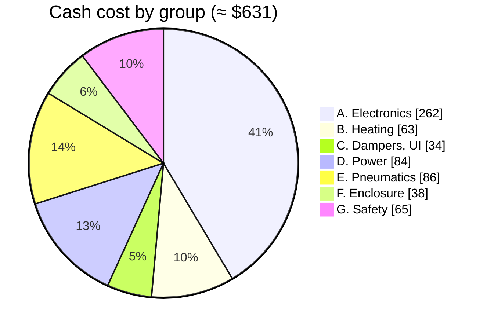

# 03 - Bill of Materials

> System-level BOM for the **reference build** (2 × AD5X + 1 × C5 Pro), built bottom-up for the approved design (Full tier with the D8 sensor choices and the cost-reduction pass in [design_decisions.md](design_decisions.md#cost-reduction-pass-c1c9)). §1.2 shows how it scales to other fleets. Prices are typical US street / AliExpress / JLCPCB prices in late 2026, **[E] ±20 %**. The board-level JLCPCB BOM (part numbers and LCSC codes) is a Phase 2 deliverable.
>
> **Not in the total** (the reference build already had them; add them if you don't): VIVOSUN AeroZesh G4 fan, the AD5X enclosure kits, a room smoke alarm (mandatory, doc 05), and an optional CO alarm.

---

## 1. Cost summary

| Group | Est. cost |
|---|---|
| A. Electronics (boards, ESP32s, sensors) | $262 |
| B. Chamber heating and recirculation (2 × AD5X) | $63 |
| C. Dampers and user interface | $34 |
| D. Power distribution and cabling | $84 |
| E. Pneumatics and filtration | $86 |
| F. Enclosure modifications | $38 |
| G. Safety and smart home | $65 |
| **Total (cash)**, AD5X supplies reused | **≈ $631** |
| Contingency if O1 shows the AD5X supplies need upgrading: 2 replacement supplies (~$80), less the hub LRS-100 (a removed stock unit replaces it, −$17) | **+≈ $63 → ≈ $694** |
| Alternative to upgrading: external DIN-4 heater brick per AD5X (Mean Well GST160A24-R7B, D22) + HEATER DIN jack, hand-soldered (≈ $1.15, D64) + 2-outlet adapter on its smart plug | ≈ $56 each, **+≈ $112 → ≈ $743** (no mains work in the printers) |
| Reduced-power alternative: barrel brick per AD5X (Mean Well GST120A24-P1M, `heater_power` ≤ 95 W, D22, D64) in the HEATER barrel jack + 2-outlet adapter | ≈ $40 each |
| Optional 24 V brick per extra injection point (larger fleets, D13) or per **wireless-only node** (D16; saves that node's CAT6 cable) | ≈ $8 each |
| Contingency if R1 fails (the G4 can't be controlled, or stops when the hub goes silent): a fan with a documented interface, e.g. AC Infinity Cloudline 4″ with its controller port, or a 4-wire PWM EC inline fan (D41) | ≈ $100–150, **not in the total** |
| Filament for printed parts (~2 kg ASA/ABS + 0.3 kg TPU), if not already on hand | ≈ $40 |

### 1.1 Why this is higher than the first $470–490 estimate

> **Updates 2026-10-25:** D11 (XGZP6897D trunk sensor) took the total from ≈ $570 to ≈ $550. D12 (heater power from each AD5X's own supply, no hub relay, chamber-air KSD301) took it to ≈ $515. D13 (bus power injection) took it to ≈ $527. D17 (RJ45 safety) took it to ≈ $536. D18 (hub LAN jack) and D19 (AD5X recirculation blowers) took it to ≈ $548. D20 (ENS160, −$15) and D22 (three isolated power inputs with jumper selection; DIN-4 jack as a population option, +$25) took it to ≈ $558. D24 (C5 USB lead) took it to ≈ $561. D30 (damper encoders, trunk flow venturi) took it to ≈ $573. D31 (SDP31 on the venturi) took it to ≈ $587. D32 (low-flow thermistor anemometer) took it to ≈ $589. D33 (back to an XGZP6897D on the venturi) took it to ≈ $575. D35 (two-way current sense on the OUT ports) took it to ≈ $577. D36–D37 (reset hold, ideal-diode dev-board feed) took it to ≈ $581. D42 (a separate universal sensor board, ordered on its own, replacing the break-off tab and the XGZP and AS5600 breakouts) took it to ≈ $609. D43 (the carrier's connectors itemised, plus the extra XT30 plugs) took it to ≈ $635. D44 (a denser, diffused LED strip) took it to ≈ $640. D45 (carrier I/O controller, 8-channel I²C switch, 7 headers) took it to ≈ $650 (including the on-carrier I/O expander). D47 (one carrier population: LAN on every board, ILIM and RANGE shunts) took it to ≈ $670. D50 (LM2904 heater current sense, one extended-part fee less) took it to ≈ $666. D51 (clone and Preferred part swaps, rating fixes, carrier lines repriced from JLC stock prices, connectors at LCSC-class clone prices) took it to ≈ $638. D52 (pair-3 presence loop in place of the INA190, MX26631DL eFuse with an input guard, CH390D LAN chip, DIN brick on a pigtail) took it to ≈ $609. D54 (one PY32F030 carrier I/O controller in place of two CH32V003s, eight sensor headers) left it at ≈ $609. D56 (three bucks in place of one buck and an LDO, LED and header current-limit switches, the IN over-voltage guard) took it to ≈ $619. D57 (heater-rail over-voltage cut, OUT jack ratings, shared output fuse) took it to ≈ $624. D59 (1 oz copper, cheaper heater P-FET and MagJack) took it to ≈ $618; the A.Electronics subtotal is also corrected to the sum of its lines. D60 (LMR14030 bucks, 100 V guard FETs) took it to ≈ $622. D62 (port-live LED, its one extended-part fee) took it to ≈ $625. D63 (IN link LED, hardware CAN activity LED) took it to ≈ $626. D64 (heater sockets on the board: no ideal diodes, HEAT header, barrel heater sense or DIN pigtail; a HEATER barrel jack added) took it to ≈ $622, and its follow-up (a tap ideal diode with a two-supply check, and a bus-voltage sense) to ≈ $629, and XT60 sockets for the heater input and output (D64) to ≈ $631. The rest of this section explains the original $570.

The first estimate used group-level figures. Building the BOM line by line added items those estimates **under-counted**:
- ΔP tubing, the AD5X USB leads, pre-crimped pigtails, fasteners and standoffs (~$35)
- JLC extended-part fees and shipping on the board order (~$20)
- a spare ESP32 board and spare servo, TCO and fuses (~$15)

The cost-reduction measures (C1–C9) still save about **$110** against the same design built the original way. It's the starting estimate that was low, not the savings.

**If you want to get closer to $500,** these are the remaining levers. None of them changes function:
- Buy the Shelly plugs as a multi-pack or on sale (~$10–15).
- Skip the spare ESP32 board (−$6).
- Source duct parts from a local hardware store's dryer-vent aisle (~$10).
- Use reflective bubble insulation instead of foil-faced foam (~$8).

### 1.2 Scaling to another fleet

The line items in §2 fall into three kinds. Re-count each against your own fleet:

| Kind | Scales with | Examples |
|---|---|---|
| Per printer | Every printer | Carrier board and ESP32 board, sensor board (S), damper and encoder (E), CAT6 segment, USB lead, smart plug, LED strip, port adapter |
| Per heated printer (node-heat) | Printers that get the PTC heater | Group B, the heater lead and XT60 pair, the enclosure mods in group F (pack-specific) |
| Per fleet | Once | Hub carrier, trunk sensors (P), filter housing and cartridge, trunk ducting, outlet hood, hub supply, the JLC order minimums (5 boards per design) |

JLCPCB builds 5 of each board per order, so a fleet of up to 4 printers plus the hub uses one carrier order; more printers need a second. Printer packs ([doc 12](12_porting_guide.md)) list their own parts.

## 2. Line items

### A. Electronics

| Item | Qty | Unit | Total | Notes |
|---|---|---|---|---|
| Universal carrier PCB, JLC fab + SMT/THT assembly (2-layer, 1 oz since D59), incl. setup, extended-part fees and shipping share | 5 | — | $91 | 3 nodes, hub, spare; components per doc 02 §2.2 **except the connectors, which are the next line (D43)**. **One population on all 5 (D47)**: heater stage, fan A, B1/B2, NTC inputs, door input and IN protection on every board, so it's one assembly order and the spare fits any role. +$3 over the role-specific populations. Includes the AUX level shifters (2 × 2N7002 + 4 resistors, ≈ $0.05, D48) and the on-board acknowledge switch (TS-1187A-B-A-B, C318884, Basic, ≈ $0.02, D49). Heater current sense: LM2904 (C18229, Preferred) + LRAM25EJER005 5 mΩ shunt (C5121086), D50; one extended-part fee less than the INA180 (−$4). D51: XL1509-ADJ-class 40 V buck (C53403867; extended, but the fee is offset by the LED shifter becoming a 2N7002), XC6206 sensor LDO (C5446, Basic), 60 V HL2309/HL2310A switches on the 24 V side, SP40N05GNJ low-side heater FET, H5VL10B single-line ESD, 60 V polyfuse (2920L200/60GR, C49326266); net ≈ −$2. **D56:** three XL1509 bucks (two XL1509-5.0E1, C61063, Basic; one XL1509-ADJE1, C74192, Preferred) with one 47 µH 2.5 A inductor part (GXDR1207-470MT, C52196367) and SS36 catch diodes (C7420367, Preferred, since D58; were SS56, C18199169), replacing the single buck and the XC6206; two SY6280AAAC current-limit switches (C207620, one extended-part fee), for the LED chain and the header group; IN protection: SMBJ58CA (C19077592, Preferred), SS510B 100 V reverse clamp (C7420368, Preferred), two XR15P06D P-FETs (C42457005; the injection guard uses the same part, so the RC3P06 fee goes away), SMBJ33A bus-side TVS (C19077586, Preferred), CJ431 guard with a 33 V cathode zener (BZT52C33, C19077419, Preferred, since D59; was MMSZ5257B); ≈ +$2 per board [E]. **D57:** heater high-side P-FET 60 V (XR60P06F class, C53069574, ≈ $0.40, replacing the 40 V part) with a 12 V gate zener, a heater-rail over-voltage comparator (CJ431 + BZT52C33 + MMBT3906, C7420354, Preferred), an SMBJ58CA on the OUT jack and HL2310A switch FETs, and one shared 60 V resettable fuse on the fan A / B1 / B2 feed (2018L075/60GR, C33977642, ≈ $0.09 plus one extended-part fee); ≈ +$1.10 per board [E]. **D59:** 1 oz copper instead of 2 oz (≈ −$0.5 per board [E]); heater high-side P-FET XR30P06F (C42457008, ≈ $0.22, −$0.18). **D60:** the three bucks are LMR14030SDDAR (C182078, ≈ $0.43, one extended-part fee) at 500 kHz with 15 µH inductors (HCMA-0630-150-M-K, C54431704, ≈ $0.06, replacing the GXDR1207-470MT), and the two IN-guard P-FETs are XR20P10D (100 V, C50314136, ≈ $0.20, replacing the XR15P06D); ≈ +$0.24 per board plus the fee, $84 → $88 [E]. **D62:** the port-live LED's extended-part fee (≈ $3 per order) is in this line, $88 → $91 [E] |
| Carrier connectors (schedule A.1) | 5 | $2.27 | $11 | D43. Board-mount connectors, THT. The barrel jack and INJECT header are in the eFuse line; the LAN MagJack in the LAN line. |
| Universal sensor board, variant S: SHT40 + ENS160 + 1.8 V LDO, JLC fab + SMT | 5 | $6.40 | $32 | D20, D42. A room-side head can take the AHT20 alternate instead of the SHT40 (D55, ≈ $0.80; never in a chamber). Its own JLC order: parts ≈ $4 each plus setup and shipping share ≈ $12 (R9) [E]. |
| ESP32-S3 DevKitC-1-format board (N8R2/N16R8 clone) | 6 | $6 | $36 | 5 + 1 spare. |
| XGZP6897D differential pressure sensor (I²C 0x6D), on the carrier | 4 | $4 | $16 | 3 chamber (lowest range) + 1 filter on the hub board (±1 kPa class, so a loaded filter stays in range). Assembled by JLC if stocked, otherwise hand-soldered; the hub's range variant is fitted by hand. |
| Universal sensor board, variant P: XGZP6897D ±500 Pa class, trunk vacuum + trunk flow + 1 spare | 3 | $6 | $18 | D42. Trunk vacuum (D11, replaces the SDP810). ±1 % FS ≈ ±5 Pa at a −80 Pa setpoint is enough for a fan-speed loop; static auto-zero (doc 06 §4.1) removes the offset. |
| (second P board) | – | – | – | Trunk flow across the venturi (D30, D33; doc 06 §4.3). Same board and part as the trunk sensor. Upgrade if M4 shows > ~1 Pa residual after auto-zero: Sensirion SDP31, ~$20, same header. |
| Universal sensor board, variant E: AS5600 | 4 | $2 | $8 | D30, D42: one per damper, 1 spare. A 5-board JLC order (or bare boards with hand-soldered AS5600). |
| Sensor-header I/O: 8-channel I²C switch (FCA9548T, C55562906, TCA9548A-compatible) + carrier I/O controller (PY32F030K28U6TR, C3018718, QFN32) + 8 P-FETs (HL3401, C22469449, Preferred) + per-header pull-ups and ESD (H5VL10B) | 5 | $1.70 | $9 | D45, D54, doc 09 §6. Populated on every carrier for one assembly BOM. One I²C segment per header (fixed XGZP6897D addresses, bus capacitance); per-header power and interrupts, and the slow carrier I/O. D54: one PY32F030 replaces the two CH32V003s, programmed through its ROM bootloader; eight external headers. |
| 0.96″ I²C OLED | 1 | $3 | $3 | Hub panel, optional, on its own sensor header (D48). A node OLED is the same part, optional and not in the total. |
| Bus-injection eFuse (MX26631DL, C18197523, ≈ $0.76) + 60 V reverse-blocking N-FET (HL2310A, Preferred) + input guard (XR20P10D 100 V P-FET, C50314136, shared with the IN guard since D56, this part since D60, + CJ431 + MMBT3906 + 12 V gate zener + 33 V cathode zener) + IMON resistor and filter capacitor (D61, ≈ $0) + POWER IN barrel jack + INJECT header + 3 × SS36 Schottky (D64), on the carrier | 5 | $1.18 | $9 | D13, D22, D52; the HEAT header and shunts went in D64; one per board, including the guard FET's extended-part fee. D52: was $3.80 with the TPS26632, whose fixed 35 V clamp doesn't give the 30 V cut-off. |
| Detect-before-power OUT-port circuit (window comparator, latch, back-to-back N-FETs, current limit, pair-3 presence loop) + blue side-view port-live LED (XL-1606UBC, C965865, ≈ $0.014, extended; D62) with its 2N7002 and 1 kΩ + the IN link LED (same LED, NPN, 3 resistors) and the hardware CAN activity LED (same LED, PNP, N-FET, 2 NPNs, diode, 2 × 100 nF, 5 resistors, with the minimum-off timer) (D63) | 5 | $0.75 | $4 | D17, D52 (the presence loop replaces the D35 INA190 two-way sense and its extended-part fee); one per board. The TJA1051T/3 transceiver costs about the same as the SN65HVD230 it replaces. |
| Carrier-power reset hold (2 × 2N7002, divider) + ideal-diode dev-board feed (MX66100T, C53121238, D51; alt. TI LM66100DCKR, C2869734; replaces the Schottky) | 5 | $0.20 | $4 | D36, D37; one per board. Includes the ~$3 JLCPCB extended-part fee for the ideal diode [V]. |
| LAN jack parts: CH390D (C41380359, ≈ $1.20; W5500 as the alternate) + RJ45 MagJack (HR913550A, C163507, ≈ $1.08, since D59; was HR911105A, ≈ $1.73) + 25 MHz crystal (C9006, Basic, 12 pF) | 5 | $2.45 | $12 | D18; fitted on every carrier since D47 (was hub only), so any node can take a wired link. The CH390D's extended-part fee takes the W5500's place. D52: was $4.70 with the W5500. |
| Tap ideal diode (MX74700T + SP40N05GNJ 40 V N-FET, D64) + 2N7002 disable + tap-side and bus-voltage dividers + 74LVC1G08-class AND gate for the shared header 7/8 INT | 5 | $0.72 | $7 | D64; one per board. Includes the ~$3 JLCPCB extended-part fee for the MX74700T. |
| | | | **$262** | |

**A.1 Carrier connectors, per board (D43).** Populated on all 5 boards for one assembly BOM; JLC THT assembly or hand-soldered. Prices are JLC stock prices for clone parts at a 5-board order (D51); JLC's THT soldering charge is not included [E].

| Connector | Per board | Unit | Per board $ | Where (doc 04) |
|---|---|---|---|---|
| RJ45 jack (shielded where stocked; HC-WK88-H18-BC, C48618186, or an unshielded HC-RJ45-058-1-6, C3000197) | 2 | $0.16 | $0.32 | IN and OUT, fleet bus (both fitted on every board, D47) |
| XT60PW-M 90° PCB socket (C98732, 30 A class, takes 12–14 AWG [E]; the XT30PW-M, C431092, takes only 16–20 AWG) | 2 | $0.60 | $1.21 | Internal heater supply and heater output, both inside the housing (D64) |
| HEATER barrel jack, right-angle 5.5 × 2.5 mm, 5 A (XKB DC-005-5A-2.5, C381115) | 1 | $0.29 | $0.29 | HEATER barrel on the outside face (D64). The HEATER DIN jack has a footprint on every board but is an accessory (below) |
| JST-XH 2.54 mm THT header, 2/3/4/5-pin (XH-5A class, e.g. C2318) | 17 | $0.015 | $0.26 | Sensor headers 1–8 (5-pin, D45, D54), fan A, LED 1, NTC ×2, KSD301 loop, door, B1, B2, AUX (5-pin, D48; replaces the two spare-input headers) |
| 2.54 mm pin header + shunt (shunt C100114) | 9 | ≈ $0.02 | $0.18 | TERM, servo, board-identity 2 × 3 (D46), ILIM, RANGE 1, RANGE 2 (D47); spare shunts |
| 1 × 22-pin female header (C41376161) | 2 | $0.23 | $0.45 | ESP32-S3 dev board socket |
| | | | **$2.70** | × 5 boards ≈ $13.50 (D51; was $5.31 at generic prices; D54 adds two sensor headers; D64 adds the HEATER barrel and moves the two power sockets from XT30 to XT60) |

Not in this table, because they are priced elsewhere: the POWER IN barrel jack and INJECT header (eFuse line), the LAN MagJack (LAN line), the sensor boards' own JST-XH (their lines), the HEATER DIN jack (accessory), and the mating plugs (group D).

**Accessory (not in the total):** the **HEATER DIN jack** for a DIN-4 heater brick (D52, D64): a board-mount right-angle 4-pin power DIN jack, *GlobTek JACKPWRDIN4LS* (≈ $1.15 at DigiKey, ≈ $0.84 at 500) or *Kycon KPJX-4S-S* (C2875467, ≈ $4.11, not stocked at JLC), hand-soldered on the nodes that use a DIN brick. Every carrier has its footprint. The GlobTek part is rated −20 to 50 °C operating and the Kycon −40 to 75 °C [V]; use the Kycon where the housing runs hotter than 50 °C (doc 02 §2.2).

### B. Chamber heating and recirculation (AD5X ×2)

| Item | Qty | Unit | Total | Notes |
|---|---|---|---|---|
| 24 V 150 W PTC heater, integrated fan, aluminium housing | 2 | $18 | $36 | C8, conditional on the bench stall test (R8). Fallback: bare PTC + 3-wire 5015 blower, +$8. |
| KSD301 normally-closed thermostat | 5 | $1 | $5 | Per AD5X: one on the heater housing (rating per O7) and one in chamber air (≈ 70 °C, D12, D26). 1 spare. |
| Thermal cut-off (TCO), rated per O7, DC-capable | 4 | $0.75 | $3 | 2 spares (one-shot). |
| ATO blade fuses 10 A | 5 | $0.40 | $2 | Printer supply taps and node inputs, plus spares. |
| NTC 100k (3950) with leads | 4 | $1 | $4 | Chamber air + heater housing per AD5X. |
| Sheet aluminium (0.5–1 mm) for heater shrouds | 1 | $5 | $5 | |
| 24 V 5015 blower (4-wire) | 2 | $4 | $8 | AD5X recirculation duct (O3, doc 08 E7). PWM lead left open runs it at full speed; node output B1 switches it. |
| | | | **$63** | |

### C. Dampers and user interface

| Item | Qty | Unit | Total | Notes |
|---|---|---|---|---|
| MG90S metal-gear servo | 4 | $3 | $12 | 3 + 1 spare. |
| Reed switch + magnets | 2 | $2 | $4 | AD5X doors. |
| Addressable RGB LED strip, WS2812-protocol, 5 V, ~160 LED/m, with a frosted or milky silicone diffuser, 1 m | 1 | $12 | $12 | D44. Bed-lip indicator strips (~0.3 m each × 3, ~48 LEDs each). SK6812 RGB and WS2812B-type parts both work. Prefer RGB over RGBW unless the firmware driver adds it. |
| Active 24 V buzzer, momentary button | 1 | $3 | $3 | Hub panel. |
| Diametric magnet (6 × 2.5 mm) | 4 | $0.75 | $3 | D30: one per damper, on the blade shaft (doc 06 §3); 1 spare. The AS5600 is on sensor board variant E (group A). |
| | | | **$34** | |

### D. Power distribution and cabling

| Item | Qty | Unit | Total | Notes |
|---|---|---|---|---|
| Mean Well LRS-100-24 (hub, logic only) | 1 | $17 | $17 | Genuine Mean Well. $0 if a stock AD5X supply is freed by an upgrade (doc 02 §3.1). |
| AD5X internal supplies | 2 | — | $0 | **Reused** in the baseline. Upgrade cost is the contingency in §1. |
| IEC C14 inlet, fused + switched | 1 | $5 | $5 | |
| Inline ATO fuse holders | 2 | $1.50 | $3 | At each AD5X supply's heater tap. |
| XT60 connector pairs (plug side; XT60-F C98734 ≈ $0.42 with an XT60-M ≈ $0.35, D64) | 6 | $0.80 | $5 | D43. Mate with the carrier sockets: internal 24 V input on each node-heat and the hub (3), heater output on each node-heat (2), plus 1 spare. |
| CAT6 patch cables, **distinct colour** (1 × 3 m hub→node 1, 2 × 1.5 m node→node, 1 spare) | 4 | $3.75 | $15 | Daisy chain; labelled "24 V – not Ethernet" (R10). |
| 14 AWG 2-conductor cable | 3 m | $1.20 | $4 | Two short heater leads from each printer's supply tap (≤ 1.5 m). 14 AWG keeps the heater return share in the USB-link ground low (R11, doc 04 §6). |
| JST-XH pre-crimped pigtail kit (2/3/4-pin) + housings | 1 | $10 | $10 | No crimp tool needed. |
| Silicone tubing 2 × 4 mm | 5 m | $1.20 | $6 | ΔP sensor taps. |
| USB-C plug → 4-pin header lead, **VBUS not connected** | 2 | $3 | $6 | AD5X link (doc 04 §5). |
| USB-C plug → USB-A plug lead, **VBUS not connected** | 1 | $3 | $3 | C5 link via its external USB port (D24). A small USB 2.0 hub (~$8) keeps the port usable for a thumb drive; the J34 fallback adds a CH334F hub board (~$5). |
| M3 standoffs, screws, heat-set inserts, heat shrink, zip ties | 1 | $10 | $10 | |
| | | | **$84** | |

### E. Pneumatics and filtration

| Item | Qty | Unit | Total | Notes |
|---|---|---|---|---|
| 4″ semi-rigid aluminium duct, 25 ft | 1 | $20 | $20 | Trunk and branches. |
| 4″ wye | 2 | $8 | $16 | Fallback only: the default is two printed ModulAir 2:1 Ys (D34), filament only. Kept in the total until O13 clears the ModulAir licence. |
| 4″ worm-drive clamps | 12 | $0.85 | $10 | |
| Aluminium foil HVAC tape | 1 | $8 | $8 | |
| 4″ through-wall dryer vent hood with gravity flap | 1 | $15 | $15 | Backdraft protection. |
| HEPA + carbon combo cartridge (Levoit Core 300 class) | 1 | $15 | $15 | O2; consumable, ~6–12 months of carbon life. |
| Thermistor anemometer parts: 2 × 100k glass-bead NTC, 2.2 kΩ ½ W metal-film heater resistor, thermal epoxy, leads | 1 | $2 | $2 | D32, doc 06 §4.4. The printed probe is C18; the hub's NTC inputs and B1 output are already on the carrier. |
| | | | **$86** | |

### F. Enclosure modifications (AD5X ×2)

| Item | Qty | Unit | Total | Notes |
|---|---|---|---|---|
| EPDM D-profile gasket + closed-cell foam tape | 1 | $12 | $12 | Doors, lids, seams. |
| Insulation: foil-faced foam board or reflective bubble | 1 | $20 | $20 | Rear, sides, top. |
| PTFE couplers (PC4-M10) + grommets | 1 | $6 | $6 | Bowden pass-through plates. |
| | | | **$38** | |

### G. Safety and smart home

| Item | Qty | Unit | Total | Notes |
|---|---|---|---|---|
| Shelly Plus Plug US | 3 | $20 | $60 | Mains cut + metering (`shelly_node` backend recommended, or `shelly`). **$0 if you use plugs you already own via the `ha` backend** (D14), e.g. Matter plugs, at the robustness cost in doc 05 §3.5. |
| Pushover licence (one platform) | 1 | $5 | $5 | |
| | | | **$65** | |

## 3. Consumables and running cost

| Item | Interval | Cost |
|---|---|---|
| HEPA + carbon combo cartridge | ~6–12 months (carbon odour life), or sooner when the filter-ΔP alert fires | ~$15 each |
| Heater intake pads (carbon/HEPA, cut to size) | ~6 months | ~$5/yr |
| TCO | Only after a trip | <$1 |
| Electricity | Heaters ~100–130 W while holding temperature; fan ~5–27 W | — |
