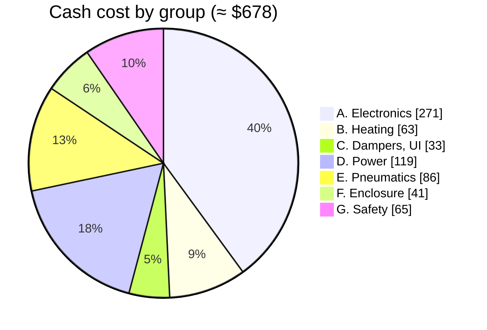

# 03 - Bill of Materials

> System-level BOM for an **example fleet**: three printers, two of them node-heat (each with a recirculation blower and a door reed from its pack) and one node-lite on an external-port USB link, plus the hub. Built bottom-up for the approved design (Full tier with the D8 sensor choices and the cost-reduction pass in [design_decisions.md](design_decisions.md#cost-reduction-pass-c1c9)). §1.1 gives the cost per role, §1.2 how it scales to other fleets. Prices are typical US street / AliExpress / JLCPCB prices in late 2026, **[E] ±20 %**. The board-level JLCPCB BOM (part numbers and LCSC codes) is a Phase 2 deliverable.
>
> **Not in the total** (add them if you don't have them): the exhaust fan (doc 02 §6; ≈ $25–60 for a board-powered 120 mm PWM fan with its printed adapter, ≈ $80–150 for a 4″ EC inline fan, ≈ $270 for a 6″ mains EC fan), and for larger fleets the 6″ duct kit (5–15 printers) and a second fan (≈ $30 for a 120 mm PWM fan, its own ≈ 60 W 24 V brick and a passive adapter; 9–15 printers; D95, doc 06 §2), the printers' enclosures or enclosure kits, a room smoke alarm (mandatory, doc 05), and an optional CO alarm.

---

## 1. Cost summary

| Group | Est. cost |
|---|---|
| A. Electronics (boards, ESP32 modules, sensors) | $271 |
| B. Chamber heating and recirculation (2 node-heat) | $63 |
| C. Dampers and user interface | $33 |
| D. Power distribution and cabling | $119 |
| E. Pneumatics and filtration | $86 |
| F. Enclosure modifications | $41 |
| G. Safety and smart home | $65 |
| **Total (cash)**, node-heat printers' own supplies reused | **≈ $678** |
| If a node-heat printer's supply fails the sizing rule (doc 02 §3.1): an upgraded internal 24 V supply | ≈ $40 each |
| …or instead an external DIN-4 heater brick (Mean Well GST160A24-R7B, D22) + HEATER DIN jack, hand-soldered (≈ $1.15, D64) + 2-outlet adapter on its smart plug | ≈ $56 each (no mains work in the printer) |
| …or a 24 V barrel brick (5.5 × 2.5 mm, ≥ 160 W for full power, D66) in the HEATER barrel jack + 2-outlet adapter; or Mean Well GST120A24-P1M at `heater_power` ≤ 95 W (D22, D64) | ≈ $40 each for the 120 W brick [U: a listed ≥ 160 W barrel brick] |
| Optional 24 V brick per extra injection point (larger fleets, D13) or per **wireless-only node** (D16; saves that node's CAT6 cable) | ≈ $8 each |
| Filament for printed parts (~2 kg ASA/ABS + 0.3 kg TPU), if not already on hand | ≈ $40 |

### 1.1 Cost per role

The same line items, grouped by what each role adds [E ±20 %]. Board lines are a share of a 5-board order (§1.2); pack items are whatever the printer pack lists.

| Role or block | Adds | ≈ Cost |
|---|---|---|
| **Node-lite** (per printer) | Carrier with its ESP32 module and on-board chamber XGZP, sensor head (S), encoder board (E), damper servo and magnet, LED strip share, CAT6 segment, sensor cables, ΔP tubing, USB lead, smart plug | ≈ $85 |
| **Node-heat** (per heated printer) | Node-lite plus the PTC heater, two KSD301s, TCO, fuses and holder, two NTCs, heater shroud, XT60 pairs, 14 AWG lead, enclosure sealing and insulation | ≈ $135 |
| **Hub** (once) | Carrier, filter-ΔP XGZP, two P boards, LAN module, OLED, room sensor head, buzzer, hub brick (≈ $43) | ≈ $125 |
| **Exhaust path** (once) | Duct, Ys, clamps, tape, hood, filter cartridge and housing, anemometer parts | ≈ $85 on 4″ duct, plus the exhaust fan (doc 02 §6); the 6″ kit for 5–15 printers ≈ $85–125 plus ≈ $20–35 per metal 6 × 4″ wye (D95) |
| **Combined role** (one printer, D84) | One carrier does the node and the hub: drops the hub's separate board, supply, LAN module, CAT6 and duct-vacuum sensor | Node cost + exhaust path + a ≥ 2 A brick (≈ $15–25) |
| **Pack items** | Port adapter (printed), recirculation blower, door reed, pass-throughs, heater-supply upgrade or external brick | Per pack, typically $0–60 |
| **Services** | Pushover licence | $5 |

An **N-printer fleet** with H node-heat printers costs roughly 125 + 85 + 5 + 85·N + 50·H plus pack items and the fan. The example fleet below (N = 3, H = 2) comes to ≈ $678 with its pack items.

### 1.2 Scaling to another fleet

The line items in §2 fall into three kinds. Re-count each against your own fleet:

| Kind | Scales with | Examples |
|---|---|---|
| Per printer | Every printer | Carrier board (with its ESP32 module), sensor board (S), damper and encoder (E), CAT6 segment, USB lead, smart plug, LED strip |
| Per heated printer (node-heat) | Printers that get the PTC heater | Group B, the heater lead and XT60 pair, the enclosure sealing in group F |
| Per pack | Whatever the printer pack lists | Port adapter, recirculation blower, door reed, pass-throughs, heater-supply upgrade or brick |
| Per fleet | Once | Hub carrier and its W5500 LAN module, trunk sensors (P), filter housing and cartridge, trunk ducting, outlet hood, hub supply, the JLC order minimums (5 boards per design) |

JLCPCB builds 5 of each board per order, so a fleet of up to 4 printers plus the hub uses one carrier order; more printers need a second.

**One printer (D84):** a single carrier in a combined role does the hub's and the node's work (doc 04 §7a). Against a two-carrier build it drops the hub supply and inlet (a ≥ 24 V barrel brick instead: 2 A, or 4 A with a board-powered fan on 24V; D85, D91), the CAT6 cables, the LAN module, the hub housing, the damper with its encoder board, the duct-vacuum sensor and the anemometer: ≈ $35–50 less [E]. JLC assembles at least 2 carriers per order, so a self-ordered build's carrier cost is unchanged and the second board is a spare or a later hub; anyone buying assembled carriers needs one board instead of two. Printer packs ([doc 12](12_porting_guide.md)) list their own parts.

## 2. Line items

### A. Electronics

| Item | Qty | Unit | Total | Notes |
|---|---|---|---|---|
| Universal carrier PCB, JLC fab + SMT/THT assembly (2-layer, 1 oz since D59), incl. setup, extended-part fees and shipping share | 5 | — | $114 | 3 nodes, hub, spare; components per doc 02 §2.2 **except the connectors, which are the next line (D43)**. **One population on all 5 (D47)**: heater stage, fan A, B1/B2, NTC inputs, door input and IN protection on every board, so it's one assembly order and the spare fits any role. +$3 over the role-specific populations. Includes the AUX level shifters (2 × 2N7002 + 4 resistors, ≈ $0.05, D48) and the on-board acknowledge switch (TS-1187A-B-A-B, C318884, Basic, ≈ $0.02, D49). Heater current sense: LM2904 (C18229, Preferred) + LRAM25EJER005 5 mΩ shunt (C5121086), D50; one extended-part fee less than the INA180 (−$4). D51: XL1509-ADJ-class 40 V buck (C53403867; extended, but the fee is offset by the LED shifter becoming a 2N7002), XC6206 sensor LDO (C5446, Basic), 60 V HL2309/HL2310A switches on the 24 V side, SP40N05GNJ low-side heater FET, H5VL10B single-line ESD, 60 V polyfuse (2920L200/60GR, C49326266); net ≈ −$2. **D56:** three XL1509 bucks (two XL1509-5.0E1, C61063, Basic; one XL1509-ADJE1, C74192, Preferred) with one 47 µH 2.5 A inductor part (GXDR1207-470MT, C52196367) and SS36 catch diodes (C7420367, Preferred, since D58; were SS56, C18199169), replacing the single buck and the XC6206; two SY6280AAAC current-limit switches (C207620, one extended-part fee), for the LED chain and the header group; IN protection: SMBJ58CA (C19077592, Preferred), SS510B 100 V reverse clamp (C7420368, Preferred), two XR15P06D P-FETs (C42457005; the injection guard uses the same part, so the RC3P06 fee goes away), SMBJ33A bus-side TVS (C19077586, Preferred), CJ431 guard with a 33 V cathode zener (BZT52C33, C19077419, Preferred, since D59; was MMSZ5257B); ≈ +$2 per board [E]. **D57:** heater high-side P-FET 60 V (XR60P06F class, C53069574, ≈ $0.40, replacing the 40 V part) with a 12 V gate zener, a heater-rail over-voltage comparator (CJ431 + BZT52C33 + MMBT3906, C7420354, Preferred), an SMBJ58CA on the OUT jack and HL2310A switch FETs, and one shared 60 V resettable fuse on the fan A / B1 / B2 feed (2018L075/60GR, C33977642, ≈ $0.09 plus one extended-part fee); ≈ +$1.10 per board [E]. **D59:** 1 oz copper instead of 2 oz (≈ −$0.5 per board [E]); heater high-side P-FET XR30P06F (C42457008, ≈ $0.22, −$0.18). **D60:** the three bucks are LMR14030SDDAR (C182078, ≈ $0.43, one extended-part fee) at 500 kHz with 15 µH inductors (HCMA-0630-150-M-K, C54431704, ≈ $0.06, replacing the GXDR1207-470MT), and the two IN-guard P-FETs are XR20P10D (100 V, C50314136, ≈ $0.20, replacing the XR15P06D); ≈ +$0.24 per board plus the fee, $84 → $88 [E]. **D62:** the port-live LED's extended-part fee (≈ $3 per order) is in this line, $88 → $91 [E]. **D78:** the fan power selector: a second 2920L200/60GR on the heater leg (no new part type), 2 × SS36, an HL2309 P-FET, 2 × 2N7002, three 12 V zeners and resistors, plus two 2N7002s that hold fan A and B1 off on heater-rail over-voltage. That is ≈ +$0.45 per board [V: LCSC price breaks, 2026-10-29; zeners and resistors E], $88 → $90. **D80:** an ideal diode on the heater-rail INJECT leg (MX74700T + SP60N12GNJ), SP60N12GNJ (C22466779) for all five HL2310A, SS56 (C18199169, Preferred) for the six remaining SS36, the 2920L100/60GRL heater-leg fuse (C18198350) and two XR20P10D for the two HL2309; ≈ +$1.08 per board plus two extended-part fees, $90 → $101 [V: JLC listings, 2026-10-30]. **D82:** HL S40P06F (C41406794) for the heater high-side XR30P06F and for fan A's XR20P10D; ≈ +$0.03 per board, no new extended-part fee, $101 unchanged [V: JLC listings, 2026-11-07]. **D84:** a 2 × 5 identity header in place of the 2 × 3 with two 1 % resistors, a 4-pin B2 header, and a 1N4148WS (C2128) for the B2 tach; ≈ +$0.02 per board, all basic, no new extended-part fee, $101 unchanged [V: JLC listings, 2026-11-07]. **D85:** the fan tap and a third LMR14030 at 12 V: a 2920L200/60GR, the buck, an HCMA-0630-150, an SS56, a 4.7 µF 50 V input capacitor (C29823), a 22 µF 25 V output capacitor (C12891) and the divider, all part types already on the board or basic; ≈ +$1.02 per board, no new extended-part fee, $101 → $106 [V: JLC listings, 2026-11-07; capacitor counts E]. **D86:** the 12 V fan buck dropped and FAN V a 1 × 3 header; the fan tap and its polyfuse stay, ≈ +$0.25 over D84, $106 → $102 [E]. **D87:** a second MX26631DL as the fan-tap eFuse in place of its 2920L200/60GR; ≈ +$0.55 per board, no new extended-part fee, $102 → $105 [V: JLC listings, 2026-11-07]. **D91:** BAR's SS56 becomes an ideal diode (MX74700T + SP60N12GNJ) and the tap limit ≈ 2.7 A; ≈ +$0.47 per board, no new extended-part fee, $105 → $107 [V: JLC listings]. **D94:** a jack ideal diode (MX74700T + SP40N05GNJ) and the POWER IN preference switch (S40P06F, CJ431, MMBT3906, a 12 V zener, resistors) added; the INJECT header and shunts, the XT60-side SS56, the tap-diode disable 2N7002 and D78's two-leg fan feed (the 2920L100/60GRL, two SS56, the XR20P10D, four 2N7002s, three zeners) removed; ≈ +$0.06 per board, and one extended-part fee less as the 2920L100/60GRL leaves the board, $107 → $104 [V: JLC listings, 2026-11-07]. **D95:** the 6-pin fan ports (four 2N7002 in place of fan A's bare open drain and B2's 0–10 V footprint, a 1N4148WS for fan A's tach, pull-ups, the DC filters) and > 10 V ESD diodes on B2's jack lines; ≈ +$0.2 per board, plus three extended-part fees for the USB-C, TRRS and terminal-header jacks (≈ +$9 per order; the jacks themselves are in schedule A.1), $104 → $114 [E] |
| Carrier connectors (schedule A.1) | 5 | $3.83 | $19 | D43. Board-mount connectors, THT (the JST-SH sensor headers are SMD, D69). The barrel jack is in the eFuse line; the USB-C receptacle in the ESP32 support line. |
| Universal sensor board, variant S: SHT40 + ENS160 + 1.8 V LDO, JLC fab + SMT | 5 | $6.40 | $32 | D20, D42. A room-side head can take the AHT20 alternate instead of the SHT40 (D55, ≈ $0.80; never in a chamber). Its own JLC order: parts ≈ $4 each plus setup and shipping share ≈ $12 (R9) [E]. |
| ESP32-S3-WROOM-1-N8R2 module (C2913204, 85 °C), assembled on the carrier | 5 | $4.60 | $23 | D72; JLC-stocked extended part, $4.00 at 10+, $3.57 at 30+, $3.16 at 100+ [V: JLC parts page, 2026-10-29]. Was a plug-in DevKitC-1-format board, 6 × $6 with a spare. The spare carrier is now the spare ESP32. Its extended-part fee is in the carrier line. |
| XGZP6897D differential pressure sensor (I²C 0x6D), on the carrier | 4 | $4 | $16 | 3 chamber (lowest range) + 1 filter on the hub board (±1 kPa class, so a loaded filter stays in range). Assembled by JLC if stocked, otherwise hand-soldered; the hub's range variant is fitted by hand. |
| Universal sensor board, variant P: XGZP6897D ±500 Pa class, trunk vacuum + trunk flow + 1 spare | 3 | $6 | $18 | D42. Trunk vacuum (D11, replaces the SDP810). ±1 % FS ≈ ±5 Pa at a −80 Pa setpoint is enough for a fan-speed loop; static auto-zero (doc 06 §4.1) removes the offset. |
| (second P board) | – | – | – | Trunk flow across the venturi (D30, D33; doc 06 §4.3). Same board and part as the trunk sensor. Upgrade if M4 shows > ~1 Pa residual after auto-zero: Sensirion SDP31, ~$20, same header. |
| Universal sensor board, variant E: AS5600 | 4 | $2 | $8 | D30, D42: one per damper, 1 spare. A 5-board JLC order (or bare boards with hand-soldered AS5600). |
| Sensor-header I/O: 8-channel I²C switch (FCA9548T, C55562906, TCA9548A-compatible) + carrier I/O controller (PY32F030K28T6, C3018720, LQFP32 since D83; the QFN32 K28U6TR, C3018718, before) + 8 P-FETs (HL3401, C22469449, Preferred) + per-header SDA/SCL pull-ups and ESD (H5VL10B) + expansion port protection (7 × H5VL10B, 7 × 1 kΩ, 2 × 100 kΩ, D77, ≈ $0.17) | 5 | $2.07 | $10 | D45, D54, doc 09 §6. Populated on every carrier for one assembly BOM. One I²C segment per header (fixed XGZP6897D addresses, bus capacitance); per-header power and interrupts, and the slow carrier I/O. D54: one PY32F030 replaces the two CH32V003s, programmed through its ROM bootloader; eight external headers. D83: LQFP32 for probing and rework, ≈ +$0.20 per board, no new extended-part fee; revisit the QFN32 in a cost-down pass. |
| 0.96″ I²C OLED | 1 | $3 | $3 | Hub panel, optional, on its own sensor header (D48). A node OLED is the same part, optional and not in the total. |
| Bus-injection eFuse (MX26631DL, C18197523, ≈ $0.76) + 60 V reverse-blocking N-FET (SP60N12GNJ since D80, priced in the carrier line; HL2310A before) + input guard (XR20P10D 100 V P-FET, C50314136, shared with the IN guard since D56, this part since D60, + CJ431 + MMBT3906 + 12 V gate zener + 33 V cathode zener) + IMON resistor and filter capacitor (D61, ≈ $0) + POWER IN barrel jack (5.5 × 2.1 mm, XKB DC-005-5A-2.0, C381116, ≈ $0.26, D66) + the two board-supply ideal diodes and the POWER IN preference switch (D94; the INJECT header and its three diodes before, the differences priced in the carrier line), on the carrier | 5 | $1.18 | $9 | D13, D22, D52; the HEAT header and shunts went in D64; one per board, including the guard FET's extended-part fee. D52: was $3.80 with the TPS26632, whose fixed 35 V clamp doesn't give the 30 V cut-off. |
| Detect-before-power OUT-port circuit (window comparator, latch, back-to-back N-FETs, current limit, pair-3 presence loop) + blue side-view port-live LED (XL-1606UBC, C965865, ≈ $0.014, extended; D62) with its 2N7002 and 1 kΩ + the IN link LED (same LED, NPN, 3 resistors) and the hardware CAN activity LED (same LED, PNP, N-FET, 2 NPNs, diode, 2 × 100 nF, 5 resistors, with the minimum-off timer) (D63) + the automatic termination switch (2N7002DW-class dual N-FET, 12 V zener, NPN, 2N7002, 2 × 59 Ω 1 %, 4 resistors; D96) | 5 | $0.80 | $4 | D17, D52 (the presence loop replaces the D35 INA190 two-way sense and its extended-part fee); one per board. The TJA1051T/3 transceiver costs about the same as the SN65HVD230 it replaces. |
| ESP32 support: data-only USB-C receptacle (C2765186) + 2 × 5.1 kΩ CC + 2 × H5VL10B ESD + EN RC + BOOT / service tact switch (TS-1187A, C318884) | 5 | $0.20 | $1 | D72; replaces the D36 reset hold and the D37 ideal diode with its extended-part fee ($4 before). The UART0 header is in A.1. |
| W5500 LAN module (common 2 × 5 pin module), plugged into the carrier's LAN socket | 1 | $7 | $7 | D18, D72: the hub only; a node takes one for a wired link. ≈ $3–7 in current listings [V: retail listings]; priced high. The CH390D, MagJack and crystal on every carrier (D47–D72, $12) are gone. |
| Tap ideal diode (MX74700T + SP40N05GNJ 40 V N-FET, D64; always on since D94, its 2N7002 disable gone, the jack ideal diode priced in the carrier line) + tap-side, jack-side and bus-voltage dividers + POWER IN divider and GPIO 7 selector (3 × 2N7002, D93) | 5 | $0.75 | $7 | D64, D93; one per board. Includes the ~$3 JLCPCB extended-part fee for the MX74700T. |
| | | | **$271** | |

**A.1 Carrier connectors, per board (D43).** Populated on all 5 boards for one assembly BOM; JLC THT assembly or hand-soldered. Prices are JLC stock prices for clone parts at a 5-board order (D51); JLC's THT soldering charge is not included [E].

| Connector | Per board | Unit | Per board $ | Where (doc 04) |
|---|---|---|---|---|
| RJ45 jack (shielded where stocked; HC-WK88-H18-BC, C48618186, or an unshielded HC-RJ45-058-1-6, C3000197) | 2 | $0.16 | $0.32 | IN and OUT, fleet bus (both fitted on every board, D47) |
| XT60PW-M 90° PCB socket (C98732, 30 A class, takes 12–14 AWG [E]; the XT30PW-M, C431092, takes only 16–20 AWG) | 2 | $0.60 | $1.21 | Internal heater supply and heater output, both inside the housing (D64) |
| HEATER barrel jack, right-angle mid-mount 5.5 × 2.5 mm, 15 A (G-Switch DC-S007B-D025-15A, C7464909; was the 5 A XKB DC-005-5A-2.5 until D66) | 1 | $0.80 | $0.80 | HEATER barrel on the outside face (D64), full-power barrel brick (D66). The HEATER DIN jack has a footprint on every board but is an accessory (below) |
| JST-XH 2.54 mm THT header, 2/3/5/6-pin (XH-5A class, e.g. C2318) | 9 | $0.015 | $0.14 | Fan A and B2 (6-pin fan ports since D95; B2 4-pin from D84), LED 1, NTC ×2, KSD301 loop, door, B1, AUX (5-pin, D48; replaces the two spare-input headers). The sensor headers are JST-SH since D69 (next row) |
| JST-SH 1.0 mm 4-pin SMD header, right angle (Megastar ZX-SH1.0-4PWT, C7430446) | 8 | $0.068 | $0.54 | Sensor headers 1–8 in the Qwiic / STEMMA QT pinout (D69; JST-XH 4 before) |
| 2.54 mm pin header + shunt (shunt C100114) | 5 | ≈ $0.02 | $0.10 | Servo, board-identity 2 × 5 (D46; 2 × 3 until D84); ILIM went in D81, RANGE 1 and RANGE 2 (D47) in D97; FAN V (D85, D86) went in D92; TERM went in D96; spare shunts |
| 2.54 mm pin header, 1 × 5, no shunt | 1 | ≈ $0.02 | $0.02 | SWD debug header for the carrier I/O controller (D65, doc 09 §4.5) |
| 2.54 mm pin header, 1 × 6, no shunt | 1 | ≈ $0.02 | $0.02 | ESP32 JTAG header on GPIOs 39–42 (D68, doc 07 §11.8) |
| 1.27 mm SMD male header, 2 × 10 (HCTL PZ127-2-10-S, C3975193; extended part) | 0 | $0.17 | – | ESP32 probe header (D99, doc 04 §4a): footprint only in production; fitted on bring-up boards, with a female socket (PM127-2-10-S-4.3, C3975136, ≈ $0.37, or a through-hole 2 × 10, C22438134, ≈ $0.26) on the builder's breakout |
| 2 × 5 2.54 mm female socket | 1 | ≈ $0.05 | $0.05 | LAN module socket on GPIOs 10–13 (D72; replaces the two 1 × 22 dev-board sockets, $0.45) |
| 2.54 mm pin header, 1 × 3, no shunt | 1 | ≈ $0.01 | $0.01 | ESP32 UART0 console header on GPIOs 43/44 (D72, doc 02 §2.1) |
| 2.54 mm pin header, 2 × 5, no shunt | 1 | ≈ $0.03 | $0.03 | Carrier I/O controller expansion port (D77, doc 09 §2.5) |
| 2.54 mm pin header, 1 × 2, + shunt | 2 | ≈ $0.02 | $0.04 | DC jumpers on fan A and B2 (D95, doc 04 §7a); STRONG went in D97, replaced by a CTRL buffer per port (MMBT3904 ×2, MMBT3906, 22 kΩ, 68 Ω, ≈ $0.01, priced in the carrier line) |
| USB-C receptacle, 16-pin (TYPE-C-31-M-12, C165948, 20 V) | 1 | $0.187 | $0.19 | B2 "FAN 10 V" jack (D95) [V: JLC listing, 2026-11-08] |
| 3.5 mm TRRS jack (PJ-320A class, C2884926; C3038674 $0.07 is thinly stocked) | 1 | $0.145 | $0.15 | B2 TRRS jack (D95) [V: JLC listing, 2026-11-08] |
| 3.5 mm pluggable terminal header, 4-pole (15EDGRC class, MX15EDGRC-3.5-04P, C5188297) | 1 | $0.078 | $0.08 | B2 terminal-header jack; its push-in plug (15EDGKNH class) goes with the fan's cable (D95) [V: JLC listing, 2026-11-08] |
| 2.54 mm pin header 2 × 3 + 2 shunts | 1 | ≈ $0.04 | $0.04 | B2 USB-C SWAP jumper (D95) |
| | | | **$3.83** | × 5 boards ≈ $19.15 (D95 adds B2's three jacks, four jumpers and the SWAP jumper, +$0.52); before D95 $3.31, × 5 ≈ $16.55 (D51; was $5.31 at generic prices; D54 adds two sensor headers; D64 adds the HEATER barrel and moves the two power sockets from XT30 to XT60; D65 adds the SWD header; D66 makes the HEATER barrel 15 A; D68 adds the JTAG header; D69 the JST-SH sensor headers; D72 drops the dev-board sockets and adds the LAN socket and UART header; D85 adds the FAN V header, D92 removes it) |

Not in this table, because they are priced elsewhere: the POWER IN barrel jack (eFuse line), the USB-C receptacle (ESP32 support line), the sensor boards' own JST-SH (their lines), the HEATER DIN jack (accessory), and the mating plugs (group D).

**Accessory (not in the total):** the **HEATER DIN jack** for a DIN-4 heater brick (D52, D64): a board-mount right-angle 4-pin power DIN jack, *GlobTek JACKPWRDIN4LS* (≈ $1.15 at DigiKey, ≈ $0.84 at 500) or *Kycon KPJX-4S-S* (C2875467, ≈ $4.11, not stocked at JLC), hand-soldered on the nodes that use a DIN brick. Every carrier has its footprint. The GlobTek part is rated −20 to 50 °C operating and the Kycon −40 to 75 °C [V]; use the Kycon where the housing runs hotter than 50 °C (doc 02 §2.2).

### B. Chamber heating and recirculation (2 node-heat)

| Item | Qty | Unit | Total | Notes |
|---|---|---|---|---|
| 24 V 150 W PTC heater, integrated fan, aluminium housing | 2 | $18 | $36 | C8, conditional on the bench stall test (R8). Fallback: bare PTC + 3-wire 5015 blower, +$8. |
| KSD301 normally-closed thermostat | 5 | $1 | $5 | Per node-heat: one on the heater housing (rating per O7) and one in chamber air (≈ 70 °C, D12, D26). 1 spare. |
| Thermal cut-off (TCO), rated per O7, DC-capable | 4 | $0.75 | $3 | 2 spares (one-shot). |
| ATO blade fuses 10 A | 5 | $0.40 | $2 | Printer supply taps and node inputs, plus spares. |
| NTC 100k (3950) with leads | 4 | $1 | $4 | Chamber air + heater housing per node-heat. |
| Sheet aluminium (0.5–1 mm) for heater shrouds | 1 | $5 | $5 | |
| 24 V 5015 blower (4-wire) | 2 | $4 | $8 | Pack item: a recirculation duct where the printer's pack calls for one. PWM lead left open runs it at full speed; node output B1 switches it. |
| | | | **$63** | |

### C. Dampers and user interface

| Item | Qty | Unit | Total | Notes |
|---|---|---|---|---|
| MG90S metal-gear servo | 4 | $3 | $12 | 3 + 1 spare. |
| Reed switch + magnets | 2 | $2 | $4 | Pack item: door switch on printers that don't report their doors over the link. |
| Addressable RGB LED strip, WS2812-protocol, 5 V, ~160 LED/m, with a frosted or milky silicone diffuser, 1 m | 1 | $12 | $12 | D44. Bed-lip indicator strips (~0.3 m each × 3, ~48 LEDs each). SK6812 RGB and WS2812B-type parts both work. Prefer RGB over RGBW unless the firmware driver adds it. |
| 5 V active buzzer module (3-pin, active high, D85), momentary button | 1 | $2 | $2 | Hub panel; the buzzer plugs into the servo header. |
| Diametric magnet (6 × 2.5 mm) | 4 | $0.75 | $3 | D30: one per damper, on the blade shaft (doc 06 §3); 1 spare. The AS5600 is on sensor board variant E (group A). |
| | | | **$33** | |

### D. Power distribution and cabling

| Item | Qty | Unit | Total | Notes |
|---|---|---|---|---|
| Mean Well GST120A24-P1M (hub, logic only: 24 V, 5 A, 5.5 × 2.5 mm plug, D92) | 1 | $43 | $43 | In the hub's HEATER barrel, or a 5.5 × 2.1 mm-plug version on POWER IN (D93); no mains work. ≥ 2 A is enough when the exhaust fan has its own supply. Alternative: an LRS-100-24 ($17) with an IEC C14 inlet ($5) on the internal XT60, or a printer's stock supply freed by an upgrade (doc 02 §3.1) [V: US distributor listings, 2026-11-07] |
| Node-heat printers' internal supplies | 2 | — | $0 | **Reused** in the baseline. Upgrade or brick cost is in §1. |
| Inline ATO fuse holders | 2 | $1.50 | $3 | At each printer supply's heater tap. |
| XT60 connector pairs (plug side; XT60-F C98734 ≈ $0.42 with an XT60-M ≈ $0.35, D64) | 5 | $0.80 | $4 | D43. Mate with the carrier sockets: internal 24 V input on each node-heat (2), heater output on each node-heat (2), plus 1 spare; the hub's went with its internal PSU (D92). |
| CAT6 patch cables, **distinct colour** (1 × 3 m hub→node 1, 2 × 1.5 m node→node, 1 spare) | 4 | $3.75 | $15 | Daisy chain; labelled "24 V – not Ethernet" (R10). |
| 14 AWG 2-conductor cable | 3 m | $1.20 | $4 | Two short heater leads from each printer's supply tap (≤ 1.5 m). 14 AWG keeps the heater return share in the USB-link ground low (R11, doc 04 §6). |
| JST-XH pre-crimped pigtail kit (2/3/4-pin) + housings | 1 | $10 | $10 | No crimp tool needed. |
| JST-SH 4-pin pre-made cables, Qwiic / STEMMA QT class, 500 mm (the longest stock length; a generic 1 m cable where a hub run needs it) | 10 | $1.50 | $15 | D69. One per sensor-board link (3 sensor heads, 3 encoders, the hub room head, 2 trunk sensors) plus 1 spare. Bought, no crimping. |
| Silicone tubing 2 × 4 mm | 5 m | $1.20 | $6 | ΔP sensor taps. |
| USB-C plug → 4-pin header lead, **VBUS not connected** | 2 | $3 | $6 | Link to a printer's internal USB header, where its pack uses one (doc 04 §5). |
| USB-C plug → USB-A plug lead, **VBUS not connected** | 1 | $3 | $3 | Link through a printer's external USB port (D24). A small USB 2.0 hub (~$8) keeps the port usable for a thumb drive. |
| M3 standoffs, screws, heat-set inserts, heat shrink, zip ties | 1 | $10 | $10 | |
| | | | **$119** | |

### E. Pneumatics and filtration

| Item | Qty | Unit | Total | Notes |
|---|---|---|---|---|
| 4″ semi-rigid aluminium duct, 25 ft | 1 | $20 | $20 | Trunk and branches. |
| 4″ wye | 2 | $8 | $16 | Fallback only: the default is two printed ModulAir 2:1 Ys (D34), filament only. Kept in the total until O13 clears the ModulAir licence. |
| 4″ worm-drive clamps | 12 | $0.85 | $10 | |
| Aluminium foil HVAC tape | 1 | $8 | $8 | |
| 4″ through-wall dryer vent hood with gravity flap | 1 | $15 | $15 | Backdraft protection. |
| HEPA + carbon combo cartridge (Levoit Core 300 class) | 1 | $15 | $15 | O2; consumable, ~6–12 months of carbon life. |
| Thermistor anemometer parts: 2 × 100k glass-bead NTC, 2.2 kΩ ½ W metal-film heater resistor, thermal epoxy, leads | 1 | $2 | $2 | D32, doc 06 §4.4. The printed probe is C18; the hub's NTC inputs and B1 output are already on the carrier. |
| | | | **$86** | |

### F. Enclosure sealing (2 node-heat)

| Item | Qty | Unit | Total | Notes |
|---|---|---|---|---|
| EPDM D-profile gasket + closed-cell foam tape | 1 | $12 | $12 | Doors, lids, seams. |
| Insulation: foil-faced foam board or reflective bubble | 1 | $20 | $20 | Rear, sides, top. |
| PTFE couplers (PC4-M10) + grommets | 1 | $6 | $6 | Pack item: filament pass-throughs where a pack seals an external feeder's window. |
| C2 makeup-flap hardware: preloaded torsion spring (≈ 0.35 mm music wire, ≈ 10 coils), small NdFeB disc magnet, steel washer, steel hinge pin | 3 | $1 | $3 | D90: one set per node-heat + 1 spare. Fixed values, no adjustment [E: spring and magnet chosen on samples]. |
| | | | **$41** | |

### G. Safety and smart home

| Item | Qty | Unit | Total | Notes |
|---|---|---|---|---|
| Shelly Gen2+ metering plug (e.g. Plus Plug US) | 3 | $20 | $60 | Mains cut + metering (`shelly_node` backend recommended, or `shelly`). **Alternative: a metering plug sold with Tasmota** (`tasmota_node` or `tasmota` backend, D73), e.g. Athom's Tasmota US plug V2 or V3 with a relay, ≈ $10–15 on sale, $18.40 list [V: vendor listings]; not a metering-only "no relay" model. **$0 if you use plugs you already own via the `ha` backend** (D14), e.g. Matter plugs, at the robustness cost in doc 05 §3.5. |
| Pushover licence (one platform) | 1 | $5 | $5 | |
| | | | **$65** | |

## 3. Consumables and running cost

| Item | Interval | Cost |
|---|---|---|
| HEPA + carbon combo cartridge | ~6–12 months (carbon odour life), or sooner when the filter-ΔP alert fires | ~$15 each |
| Heater intake pads (carbon/HEPA, cut to size) | ~6 months | ~$5/yr |
| TCO | Only after a trip | <$1 |
| Electricity | Heaters ~100–130 W while holding temperature; fan ~5–27 W | — |
