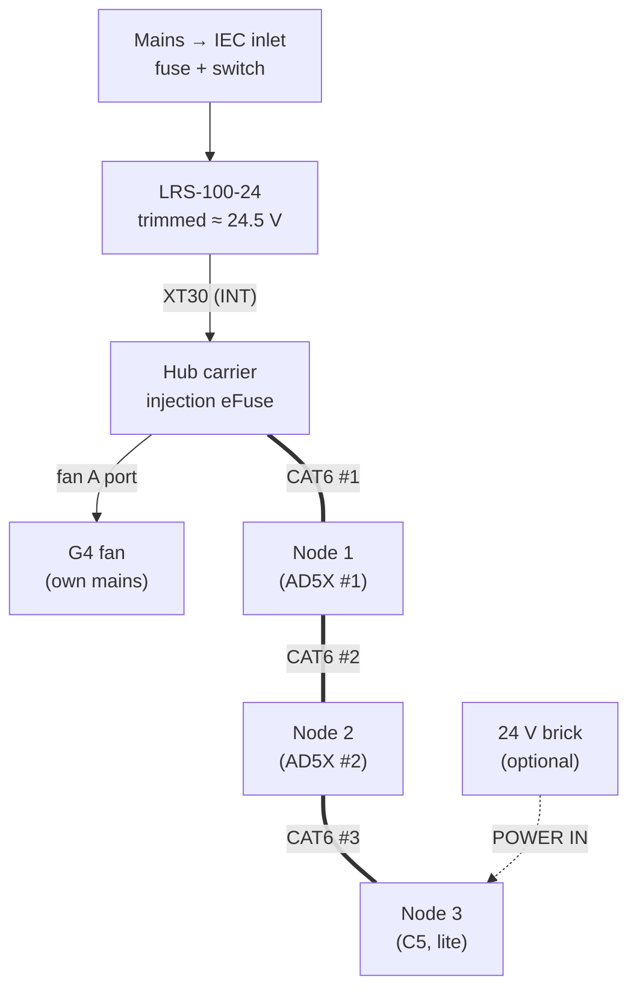
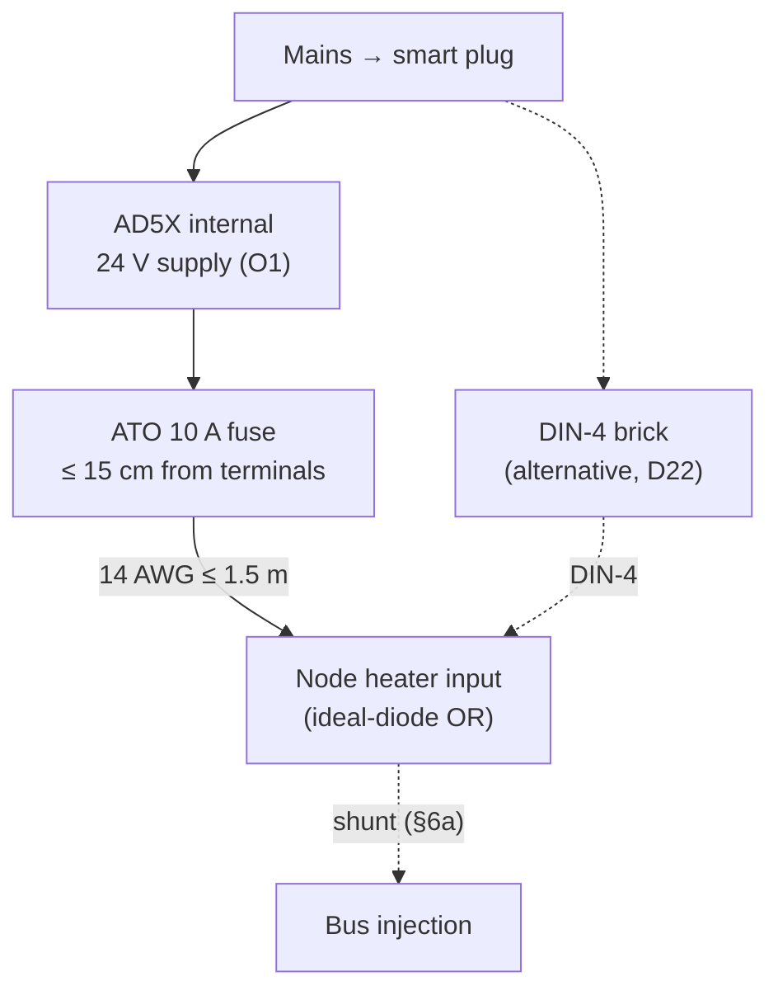
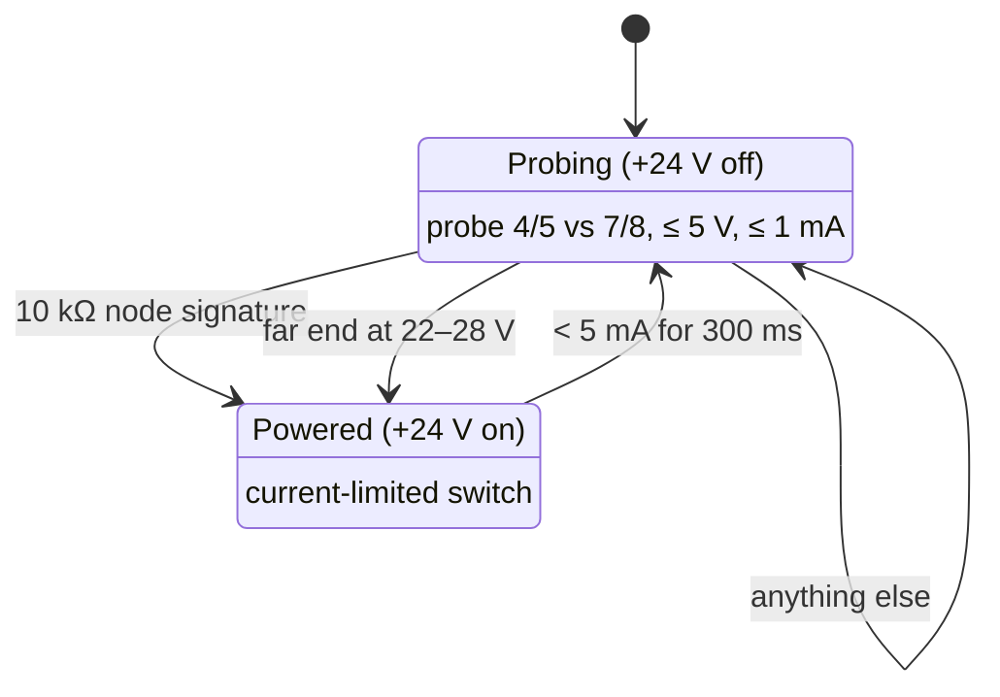

# 04 - Wiring, Cables and Pinouts

> Design baseline, 2026-10-25. Connector reference designators (J-numbers) and exact connector part numbers are assigned in the Phase 2 schematic. This document fixes the **signals, cable types, pin assignments and grounding rules** the schematic must follow.

---

## 1. Power and signal distribution

Each AD5X also feeds its own node's heater input:

RJ45 IN/OUT on every carrier; a TERM jumper on every carrier, fitted at the two ends of the chain (§3). Every carrier can inject 24 V onto the bus through its eFuse, from whichever inputs its INJECT jumpers select (§6a).

- **The hub PSU powers node logic only**, over CAT6.
- **Each AD5X's heater runs from that printer's own 24 V supply** (D12, doc 02 §3.1). The printer's Shelly plug removes both.
- **The G4 fan runs on its own mains power.** The hub only drives its control port (R1).

## 2. Cables

| Cable | From → to | Type | Conductors | Connectors | Length |
|---|---|---|---|---|---|
| **Local injection** (optional) | 24 V brick or PoE splitter → any node's POWER IN barrel, INJECT BAR fitted | Brick lead | +24 V, GND | 5.5 × 2.5 mm barrel | as needed |
| **Wireless-only node** (optional, no CAT6) | 24 V brick on an ordinary outlet (not the printer's plug) → node POWER IN, INJECT BAR fitted, **HEAT jumper open** (§6b) | Brick lead | +24 V, GND | 5.5 × 2.5 mm barrel | as needed |
| **Bus** | Hub → node 1 → node 2 → node 3 | CAT6 patch, **distinct colour, labelled "24 V – NOT ETHERNET"** (R10) | 4 pairs (§3) | RJ45 | ~3 m, 1.5 m, 1.5 m |
| **Heater feed** | AD5X supply terminals → inline ATO 10 A (≤ 15 cm from the terminals) → node-heat XT30 in | 14 AWG 2-conductor | 24V_HEAT, GND | Supply terminal / XT30 | ≤ 1.5 m |
| **External heater feed** (optional, D22) | 24 V DIN-4 brick, **plugged in on the printer's own smart plug** → node-heat DIN-4 in (jack fitted as a population option) | Brick lead | +24 V, GND (2 pins each) | 4-pin DIN | brick lead |
| **Reduced-power heater feed** (optional, D22) | 24 V barrel brick ≤ 5 A, **on the printer's own smart plug** → POWER IN, HEAT jumper fitted (heater capped ~100 W) | Brick lead | +24 V, GND | 5.5 × 2.5 mm barrel | brick lead |
| **Heater element** | Node XT30 out → PTC (via TCO) | Element leads + TCO in series on the + lead | 2 | XT30 | ≤0.5 m |
| **Heater fan** (separate leads, C8) or 5015 blower (fallback) | Node fan A → fan | 22–24 AWG | 24 V, GND, (tach), (PWM) | JST-XH 4 | ≤0.5 m |
| **Recirculation-duct blower** (AD5X, O3) | Node B1 → 5015 blower | 22–24 AWG | 24 V, switched GND (PWM and tach leads unused) | JST-XH 2 | ≤1 m |
| **KSD301 loop** | Node → heater-housing KSD301 → chamber-air KSD301 (in series) → node | 22–24 AWG, high-temp silicone | 2 | JST-XH 2 | ≤1 m |
| **NTCs** | Node → chamber air NTC, heater housing NTC | NTC leads | 2 each | JST-XH 2 | ≤0.5 m |
| **Sensor head** | Node sensor header 1 (switch channel 0) → sensor board S in chamber | 5-core, ≤0.5 m (I²C at 100 kHz) | 3.3 V, GND, SDA, SCL, INT/SWIO | JST-XH 5 | ≤0.5 m |
| **ΔP tubes** | Carrier XGZP barbs → chamber / room | Silicone 2 × 4 mm | — | barbs | ≤0.5 m |
| **Servo** | Node → damper | Servo lead (extend if needed) | 5 V, GND, signal | 3-pin servo | ≤0.5 m |
| **Damper encoder** (D30) | Node sensor header 2 (switch channel 1) → sensor board E (AS5600) on the damper's shaft end | 5-core | 3.3 V, GND, SDA, SCL, INT/SWIO | JST-XH 5 | ≤0.5 m |
| **Door** | Node → reed switch | 2-core | 2 | JST-XH 2 | ≤1 m |
| **Bed LED strip** | Node LED1 → WS2812 strip | 3-core 22 AWG | 5 V, DATA, GND | JST-XH 3 | ≤1 m |
| **AD5X USB link** | Node dev-board native USB-C → AD5X bottom internal USB header (pack) | USB 2.0, **VBUS not connected** (§5) | D+, D−, GND, shield | USB-C plug / 4-pin housing | ~0.5–1 m |
| **C5 USB link** (D24) | Node dev-board native USB-C → C5 external USB port (fallback: J34 via a hub board, §5) | USB 2.0, **VBUS not connected** (§5) | D+, D−, GND, shield | USB-C plug / USB-A plug | ≤ 1.5 m |
| **Trunk ΔP** | Hub sensor header 2 (switch channel 1) → sensor board P (XGZP6897D) at trunk | 5-core | 3.3 V, GND, SDA, SCL, INT/SWIO | JST-XH 5 | ≤1 m |
| **Filter ΔP** | Hub on-board XGZP → filter housing taps | Silicone tube | — | barbs | ≤1 m |
| **Trunk flow** (D30) | Hub sensor header 3 (switch channel 2) → sensor board P (XGZP6897D) at the venturi (D33) | 5-core; silicone 2 × 4 mm from the venturi taps | 3.3 V, GND, SDA, SCL, INT/SWIO | JST-XH 5 | ≤1 m |
| **Low-flow anemometer** (D32) | Hub NTC 1, NTC 2 and B1 → C18 probe in the venturi | 2-core each | NTC leads; heater 24 V switched | JST-XH 2 ×3 | ≤1 m |

**Cable route:** the bus and heater cables follow the trunk duct along the wall, clipped to it with printed duct clips (doc 08), then drop to each printer with its branch.

## 3. RJ45 bus pinout (T568B wiring)

| RJ45 pin | T568B colour | Signal | Pair |
|---|---|---|---|
| 1 | white/orange | **CAN_H** | pair 2 (twisted) |
| 2 | orange | **CAN_L** | pair 2 |
| 3 | white/green | GND | pair 3 |
| 6 | green | GND | pair 3 |
| 4 | blue | +24 V logic | pair 1 |
| 5 | white/blue | +24 V logic | pair 1 |
| 7 | white/brown | GND | pair 4 |
| 8 | brown | GND | pair 4 |

**Rule (D17): both wires of every pair carry the same potential.** An Ethernet port has a transformer winding across each pair, so DC between the two wires of one pair (as on pins 3 and 6 in the earlier pinout) would drive amps through it. With equal potential per pair, any DC only appears *between* pairs, which a port's magnetics and coupling capacitors block. That's the same way PoE mode B carries power on pairs 4/5 (+) and 7/8 (−), with the same polarity as here.

- **Capacity:** two conductors for +24 V (≤ 0.75 A each, **≈ 1.5 A per segment, ~36 W**) and four for GND. **Kept at 1.5 A on purpose (D21):** a cheap copper-clad-aluminium or Cat5 patch cable swapped in later still runs inside its rating. Injection at the nodes (§6a) covers more load.
- **Load:** each bed strip is ~48 LEDs (D44), about 2.9 A at full white, so the firmware limits LED brightness by estimated current to **≤ 0.5 A at 5 V per node** (a few percent of the bus, ~0.1 A at 24 V). Status colours at a diffused, low brightness stay well under that. Three nodes then stay ≤ 1.2 A from the hub alone. Bus power injection (§6a) covers anything more.
- **Jacks are directional:** each node has an **IN** jack (toward the hub) and an **OUT** jack (away from it). The hub has one OUT jack. Pins 1, 2, 3, 6, 7, 8 pass straight through; +24 V reaches the OUT jack only through the detect-before-power switch (§3a). CAN stubs on the board are ≤ 50 mm.
- **Termination (D27):** every carrier has a **TERM jumper**: a 2-pin 2.54 mm header in series with a **120 Ω 1 % resistor** (1206, 0.25 W) across CAN_H and CAN_L, beside the OUT jack. Fit the shunt at the **two physical ends** only: the hub, and the node with nothing in its OUT jack. Two 120 Ω in parallel give the **60 Ω** that ISO 11898 and Klipper's CAN guide require, so the bus also meets Klipper's rules if someone reuses it. Adding a node at the end means moving one shunt.
- **Termination check (commissioning):** with the bus powered off, meter CAN_H to CAN_L (pins 1–2) at any spare jack or a breakout: **54–66 Ω passes**; ~120 Ω means one end is missing, ~40 Ω means three are fitted. The firmware can't measure termination, but a node whose OUT jack detects nothing shows a dashboard reminder to confirm its TERM shunt.

**Bus parameters:** CAN 2.0A at **125 kbit/s**. The total bus length (~6 m) is far inside the limit.

### 3a. Safe if plugged into network gear (R10, D17)

| Protection | What it does |
|---|---|
| **Same potential per pair** (above) | No DC across any Ethernet transformer winding |
| **Detect-before-power on every OUT jack** (hub and nodes) | +24 V is off until a fleet node is detected. The port probes pins 4/5 vs 7/8 with ≤ 5 V at ≤ 1 mA and powers up only if it sees **a node's 10 kΩ ±5 % signature**, or **an already-powered fleet segment (22–28 V)** from a node with local injection. It refuses an open port, an Ethernet port's ~150 Ω DC-coupled termination, a PoE device's 25 kΩ signature, a short, or anything else. Once on, power stays on only while **more than 5 mA flows in either direction** (every node draws more); an unplug drops it within ~300 ms and the port returns to probing. Hardware window comparator + latch driving a **bidirectional current-limited switch** (back-to-back N-FETs, so injected power can flow both ways; off, their body diodes block both ways). The current sense is **bidirectional** (D35): a zero-drift sense amplifier *(candidate: INA190 class [V])*, since 5 mA across a shunt sized for 1.5 A is only ~0.25 mV. Reverse current is normal (a node's injection feeding upstream, D13, or the whole chain feeding the hub when its supply fails); a forward-only sense would drop a reverse-fed port every 300 ms, then re-close it on the 22–28 V test, over and over. Firmware can read the port state **and current direction** but isn't needed to keep it safe [U: circuit in Phase 2] |
| **Node IN jack** | 10 kΩ signature, reverse-polarity protection (a **P-FET, which conducts both ways**, never a series diode, so a node can feed power upstream, D35), input parts rated 60 V, and the injection eFuse's **over-voltage cut-off at ~30 V**. A passive 48 V PoE injector just leaves the node off. A PoE switch sees an invalid signature (10 kΩ is outside PoE's 19–26.5 kΩ window), so it never powers the node |
| **Fault-tolerant CAN transceiver** (±58 V bus pins, TJA1051T/3 class) | Ethernet signals or stray PoE voltage on pins 1/2 can't damage it. A CAN driver feeding an Ethernet winding is short-circuit current-limited by the transceiver [E] |
| Distinct cable colour, "24 V – NOT ETHERNET" cable labels, and **port names embossed on the node housing and hub enclosure** (R10) | Kept as the first line of defence |

OUT-jack power logic:

"Anything else" covers an open jack, an Ethernet port (~150 Ω), a PoE device (25 kΩ) and a short. 22–28 V at the far end means a fleet segment that is already powered.

**Result:** plugging any fleet jack into a switch, laptop or PoE port puts no voltage on it and damages neither side. A fleet jack **can't carry real Ethernet data**, because CAN uses pair 1/2, which 10/100 Ethernet needs. Wired LAN is a separate, standard jack on the hub instead (D18).

## 4. ESP32-S3 GPIO map (carrier, all roles)

Rules applied:
- The dev board's **BOOT button (GPIO 0)** is read after boot as the node's **CLEAR button** (doc 05 §4.1); nothing on the carrier connects to GPIO 0. Holding it through a reset only enters the bootloader, with every output off and the latches kept in NVS.
- Strapping pins: **GPIO 0** is read only as the service button and **GPIO 3** only as the board-identity input (D46); avoid 45 and 46. Also avoid native USB (19, 20), UART0 console (43, 44), flash/PSRAM (26–37), and the DevKitC onboard RGB pins (38, 48).
- Analog inputs use **ADC1 only** (ADC2 is unusable while Wi-Fi is active).

| GPIO | Node-heat | Node-lite | Hub | Notes |
|---|---|---|---|---|
| 0 | **Service button** (the dev board's BOOT button, D46) | Same | Same | Input only; nothing on the carrier connects to it. Held at power-up, it enters download mode as usual |
| 1 | Chamber-air NTC (ADC) | – (fitted, spare) | **Anemometer reference NTC** (D32) | ADC1_CH0. 47 kΩ pull-up, ≈ 4.6 kΩ with the RANGE 1 shunt on (node-heat, D47) |
| 2 | Heater-housing NTC (ADC) | – (fitted, spare) | **Anemometer heated NTC** (D32) | ADC1_CH1. RANGE 2 shunt as for GPIO 1 |
| 3 | **Board identity** (role shunt divider, D46) | Same | Same | ADC1_CH2, read once at boot. Strapping pin for the JTAG source, which only matters if an eFuse selects it |
| 4 | Heater current, INA180 out (ADC) | – | – | ADC1_CH3; sampled at a fixed rate by ADC1 continuous mode with DMA (below) |
| 5 | Spare input 1 | Spare input 1 | **Panel button** (edge interrupt, debounced) | ADC1_CH4 if a builder needs an analog input. The heater-rail voltage moved to the carrier I/O expander's ADC (D47) |
| 6 | Spare input 2 | Spare input 2 | **Smoke dry-contact input** (edge interrupt) | ADC1_CH5 if needed. The external heater-input sense (D22) moved to the carrier I/O expander's ADC (D47) |
| 7 | Heater low-side PWM | – | – | 10 kΩ pull-down |
| 8 | I²C SDA | I²C SDA | I²C SDA | On-board XGZP, carrier CH32 (I²C target), 8-channel I²C switch; behind it, one channel per external sensor header 1–6 and one for the on-carrier I/O expander in slot 7 (header 1 = sensor head; header 2 = node damper encoder, or hub trunk XGZP + OLED; header 3 = hub trunk-flow XGZP, D30/D33; D45, doc 09 §3) |
| 9 | I²C SCL | I²C SCL | I²C SCL | |
| 10 | **LAN CS** (D45) | LAN CS | LAN CS | SPI2 IO MUX pin (no GPIO matrix). The LAN parts are fitted on every carrier (D47); a node without a LAN cable leaves the chip idle |
| 11 | **LAN MOSI** (D45) | LAN MOSI | LAN MOSI | SPI2 IO MUX pin |
| 12 | **LAN SCK** (D45) | LAN SCK | LAN SCK | SPI2 IO MUX pin |
| 13 | **LAN MISO** (D45) | LAN MISO | LAN MISO | SPI2 IO MUX pin. The door input is read through the carrier I/O expander (doc 02 §2.4) |
| 14 | LED chain 1 (bed strip, LED 0 = status) | LED chain 1 | **Panel RGB** | RMT TX with DMA, via 74AHCT1G125 |
| 15 | Heater enable charge-pump drive (square wave) | – | – | No wave → high-side off. **A plain GPIO toggled by the safety task, deliberately not a PWM peripheral** (doc 07 §2): a peripheral would keep the wave running if the safety task hung |
| 16 | Fan A PWM (open-drain) | – | **G4 fan control** (per R1) | |
| 17 | Fan A tach in | – | **G4 tach/health** (per R1) | Pull-up + clamp |
| 18 | Fan A high-side enable | – | Fan A enable (if used) | Pull-down |
| 21 | **Servo PWM** (50 Hz) | Servo PWM | – | Pull-down, held low at boot (was GPIO 12). LED chain 2 was dropped from the fixed map (D45) |
| 39 | Output B1: AD5X recirculation-duct blower (O3) | – | Output B1: **anemometer heater** (PWM, D32) | Pull-down; JTAG pin, used as GPIO |
| 40 | Output B2: spare | – | **Buzzer** | Pull-down |
| 41 | **CAN TX** | CAN TX | CAN TX | TWAI, routed through the GPIO matrix; pull-up on the transceiver's TXD so the bus stays recessive while the pin floats at reset. The KSD301 loop sense moved to the carrier I/O expander |
| 42 | **CAN RX** | CAN RX | CAN RX | TWAI. The 24V_HEAT switched-output sense moved to the carrier I/O expander |
| 47 | **Carrier CH32 SWIO/INT** (D45, doc 09 §4.1) | Same | Same | Open-drain, **2.2 kΩ** pull-up; RMT TX + RX on the one pin (doc 09 §4.1a). Programs the carrier CH32 and carries its interrupt. The board status LED moved to the carrier I/O expander |

**Board identity (D46).** A 2 × 3 pin header with one shunt (the same 2.54 mm header and shunt as TERM) selects the board's role. GPIO 3 has 100 kΩ to 3.3 V, plus 100 nF to GND so the ADC sees a low source impedance. The shunt adds a resistor to GND (1 % parts) [E]:

| Shunt position | Resistor to GND | GPIO 3 voltage | Read as |
|---|---|---|---|
| HEAT | 10 kΩ | ≈ 0.30 V | `node-heat` (below 0.65 V) |
| LITE | 47 kΩ | ≈ 1.06 V | `node-lite` (0.65–1.6 V) |
| HUB | 220 kΩ | ≈ 2.27 V | `hub` (1.6–2.8 V) |
| No shunt | — | 3.3 V | **unset** (above 2.8 V) |

The firmware reads GPIO 3 once at boot, before ADC1 starts its continuous scan. If the shunt and the role stored in NVS disagree (doc 07 §2), or the shunt is unset, the board starts in a **safe hold**. In safe hold, the heater enable stays off, the outputs stay off and the LEDs work, and a "role mismatch" fault is raised. Since D47 every carrier carries the same parts, so the shunt is what makes a board a given role. The firmware also checks the **RANGE shunts** against it: at boot, after the heater has been off, each NTC must agree with the sensor head's SHT40 to within a few °C. A RANGE shunt left in the wrong position reads tens of degrees off, and raises the same mismatch fault and safe hold. The **ILIM shunt** (eFuse limit, doc 02 §2.2) can't be read by the firmware; commissioning checks it, and a missing one gives the lower, safe limit.

**Service button (D46).** The dev board's BOOT button (GPIO 0), read after boot:
- **Short press:** opens Wi-Fi provisioning for 10 minutes.
- **Hold ≥ 10 s:** factory reset of NVS (Wi-Fi credentials, node ID, calibration), refused while the heater is on. After the reset, the role comes back from the shunt.

It is reached with the node housing open. Holding it at power-up still enters download mode, as on any dev board.

**Peripheral use: no bit-banged interfaces.** Every interface runs on an ESP32-S3 peripheral:

| Interface | Peripheral | Notes |
|---|---|---|
| CAN | TWAI | |
| I²C | I²C 0 | Sensor headers, on-board XGZP, carrier CH32, I/O expander |
| LAN | SPI2 on the IO MUX pins | GPIOs 10–13 |
| LED chain 1 (bed strip, or the hub panel) | **RMT TX channel with DMA** | A ~48-LED strip is ~1150 RMT symbols. That is more than one 48-symbol block, so it streams by DMA rather than refill interrupts, which Wi-Fi load could delay into visible glitches. The S3 supports DMA on one RMT TX channel |
| Carrier CH32 SWIO | **RMT TX + RX channels** on GPIO 47 | One frame fits a channel's block, so no DMA is needed (doc 09 §4.1a) |
| Servo, fan PWM, heater PWM, B1 PWM | LEDC | At most four frequencies, which fits LEDC's four timers |
| Heater-enable charge pump | **Plain GPIO, toggled by the safety task** | Deliberately not a peripheral. A hardware PWM keeps running if the safety task hangs, which would defeat layer L5 (doc 05 §3.1, doc 07 §2) |
| Analog inputs (GPIOs 1, 2, 4, 5, 6 on node-heat) | **ADC1 continuous mode with DMA** | Scans every ADC1 input at a fixed rate, so the heater-current samples (GPIO 4) are evenly spaced without the CPU timing each read. ESP-IDF doesn't mix one-shot and continuous mode on one ADC unit [E], so all ADC1 inputs move to continuous mode together |
| Hub panel button, hub smoke dry contact (GPIOs 5, 6) | **GPIO edge interrupts** | A press or an alarm is seen at once, not at the next poll. The button is debounced in software |
| Fan tach | PCNT | |

**RMT budget:** 2 of the 4 TX channels and 1 of the 4 RX channels, leaving room for a second LED chain later.

**LAN jack (D18; fitted on any role, D45):** the SPI Ethernet chip needs four GPIOs (SCK, MOSI, MISO, CS; polling mode, no interrupt). They are **GPIOs 10–13 on every carrier**, the S3's IO MUX pins for SPI2, so the SPI runs on the peripheral directly (up to 80 MHz) and not through the GPIO matrix (40 MHz, with extra delay on MISO) [E: confirm in the S3 technical reference manual]. CAN and the servo output use the matrix and moved to GPIOs 41, 42 and 21 to make room. There are no 0 Ω links, and the same map applies to all roles. The default SPI clock is 20 MHz; the Ethernet chip's own limit is higher, and the bring-up test (O15) checks 20 and 40 MHz.

The KSD301 and charge-pump chain works in **hardware**. The I/O expander only *reports* its state; the firmware can't override it.

## 5. Printer USB link (D3, D24)

Every Tier 2 printer (doc 12 §3.2) uses the same link; only the printer end differs, and that's in its printer pack.

| Item | Specification |
|---|---|
| Node end | The dev board's **native USB-C** port (labelled "USB"), not the UART port. |
| Lead | USB 2.0, **D+, D−, GND and shield only. VBUS is left unconnected and insulated at both ends**, so the printer never powers the node and the node never back-feeds the printer (ARG-08). |
| Enumeration | The node appears as a USB CDC-ACM device, so the printer's kernel needs `cdc_acm`. The plugin opens `/dev/serial/by-id/usb-fleet_exhaust_node_<serial>-if00`, or finds the node by VID/PID when `serial:` is unset (doc 07 §3.1). |
| Carrier off, USB powered (D36) | If a lead with VBUS is used anyway, the dev board's 5 V can't reach the carrier rails (the ideal diode, D37), and the carrier holds the ESP32 in reset until its own 5 V is up (doc 02 §2.1), so nothing on the carrier is back-powered. The no-VBUS lead stays the first layer |
| VBUS-less enumeration | The ESP32-S3 USB device works with the board powered from its 5 V pin and no VBUS on the cable [U: confirm on the prototype]. |
| Printer end rules | Prefer an **external** USB port. Internally, plug into a header (solder pins into a footprint's holes if needed), never wires onto pads (P-5). An internal hub board is a fallback only. |
| Ground | Shield connects at the printer end only. When the node heater runs from the printer's supply, part of the heater return shares this lead's ground (R11, §6). |

| Printer | Printer end |
|---|---|
| AD5X | Bottom internal USB header ([pack §4](../printers/flashforge_ad5x/README.md#4-usb-link)) |
| C5 Pro | External USB port, J34 fallback ([pack §4](../printers/flashforge_c5pro/README.md#4-usb-link)) |

## 6. Grounding rules

1. **The hub PSU's −V stays floating** (not bonded to earth), so the fleet logic ground has no path to mains earth of its own.
2. **Heater current stays in its printer cell.** It leaves the AD5X supply on the 14 AWG lead and returns on it. **No heater current flows in the CAT6** any more.
3. **USB-link ground share (R11):** each node's ground reaches its printer twice, via the heater return lead and via the USB GND, so part of the heater return can flow in the USB lead. With a 14 AWG return ≤ 1.5 m the share is ≲ 0.3 A [E], within a USB lead's rating, with a ground offset of ~50 mV. Measure it at commissioning; if it's higher or the link misbehaves, fit a USB isolator (ADuM3160-class) on the link.
4. **Between printers:** if the stock AD5X supplies bond −V to earth, the two printers' grounds also meet through mains earth and through the CAT6 chain. Only a small share of heater current can take that long path [E]. The offset stays far inside CAN's common-mode range (−2 to +7 V). The USB isolator fallback breaks this path too.
5. Each carrier joins logic GND and power GND at **one star point** near the input connectors. The heater current-sense shunt sits on the power side of that point.
6. Shields: CAT6 is unshielded (UTP). The USB lead's shield connects at the AD5X end only.
7. **Injected current** (§6a) returns over the CAT6 GND conductors (four of them since D17) to the loads it feeds. Each source is limited by its eFuse, which keeps every conductor inside the ~0.75 A allowance.

## 6a. Bus power injection (D13)

| Item | Rule |
|---|---|
| Sources | Selected per board by the **INJECT jumpers** (INT, BAR, DIN), each through its own Schottky into the eFuse. Hub: INT (its PSU on the internal XT30, always). Node-heat: INT (the AD5X supply tap or an upgraded internal supply), or DIN with an external brick. Any node: BAR with a 24 V brick or PoE splitter. |
| Protection | Each source enters the bus through an eFuse with reverse-current blocking, so no supply is back-fed by another, and a short is current-limited at the source. |
| Load sharing | Diode-OR by voltage. The hub is trimmed to ≈ 24.5 V and local sources sit at their nominal 24.0 V, so the hub carries the bus until cable drop under load pulls a node's local bus voltage below its local source. That source then supplies its stretch of the chain. No sharing controller is needed. |
| Printer supply protection | If a printer's rail sags (bed + heater load), it falls below the bus voltage and its injection stops by itself, so the bus never takes power from a printer that needs it (R12). The ~1 A limit caps the most it can ever add to the printer supply at ~24 W. |
| Printers off | Their injection disappears. Idle nodes draw ~1–2 W each, which the hub covers alone, so nodes can still purge powered-off printers. |
| Sizing rule (D35) | Size for the worst moment: **every printer off (a power cut, or all cut in a fire) with the busiest node at its alarm peak** (servo moving, LEDs flashing). Hub PSU ≥ idle load of the whole chain + that peak + the peak of nodes on their own bricks only if they share the hub's outlet. Any single CAT6 segment ≤ ~1.5 A (two +24 V conductors, D17; deliberately not raised, D21). Three nodes: ~2 W idle each plus ~10 W for one alarm peak [E], well inside both. Checked by commissioning test 16 (doc 05 §9). |
| Hub supply lost (D35) | The hub's injection eFuse blocks reverse current, so its dead supply is never back-fed. The nodes whose printers are on carry the whole chain and the hub through the OUT switches (§3a); the hub enters back-fed mode (doc 07 §11.7). Load then: ~0.35 A idle, up to ~0.85 A in an alarm [E], against ~1 A per injecting node. |

## 6b. Power configurations (D35)

Jumpers only choose what **feeds** the bus; every board's logic runs from the bus. The rule that matters: **a node must have some source that survives its own printer's cut**: the CAT6 bus from the hub, or a brick on an ordinary outlet.

| Setup | INJECT | HEAT | Outlet rules |
|---|---|---|---|
| Hub | INT (its PSU) | – | Hub PSU and the fan on ordinary outlets, **never on a printer's plug** |
| Wired node-heat, printer supply | INT | open | Logic survives the cut through the bus |
| Wired node-heat, external heater brick | DIN (or BAR) | fitted for BAR | Heater brick **on that printer's plug** (doc 05 §9 test 23) |
| Wired node-lite | none, or BAR with a brick | open | Any brick on an ordinary outlet |
| Wireless-only node-heat (AD5X) | BAR (logic brick) + INT | **open** | **Two supplies:** logic brick on an ordinary outlet, heater from the printer's own supply (INT XT30). The logic brick is never on the printer's plug |
| Wireless-only node-lite | BAR | open | Logic brick on an ordinary outlet |

Checked at commissioning (doc 05 §9 test 29) and continuously by the hub: when a printer's plug reads off in normal use, its node must stay online, or the hub alerts (doc 05 §4).

## 7. Hub wiring summary

| Connection | From | To |
|---|---|---|
| Mains | IEC inlet (fused, switched) | LRS-100-24 L/N/PE (PE to the PSU case and the inlet earth only) |
| 24 V logic | PSU +V/−V, lead with an XT30 | Carrier internal XT30 (INJECT INT fitted), CAT6 power via carrier |
| Buzzer | Carrier B2 | Active 24 V buzzer |
| Panel | LED1 → WS2812 ×2; GPIO 5 ← button; I²C 2 → OLED | Panel |
| Trunk ΔP | Sensor header 2 (switch channel 1) | Sensor board P (XGZP6897D), tubes to the trunk tap and room |
| Trunk flow (D30) | Sensor header 3 (switch channel 2) | Sensor board P (D33), tubes to the venturi inlet and throat taps |
| Low-flow anemometer (D32) | NTC 1 (GPIO 1), NTC 2 (GPIO 2), B1 (GPIO 39) | C18 probe: reference NTC at the venturi inlet, heated NTC + heater resistor in the throat |
| Filter ΔP | On-board XGZP barbs | Filter housing inlet and outlet taps |
| Room sensor | Sensor header 1 (switch channel 0) | Sensor head |
| Fan | Fan A (+ adapter per R1) | G4 control port |
| Smoke | GPIO 6 | Optional relay-output smoke detector (dry contact) |
