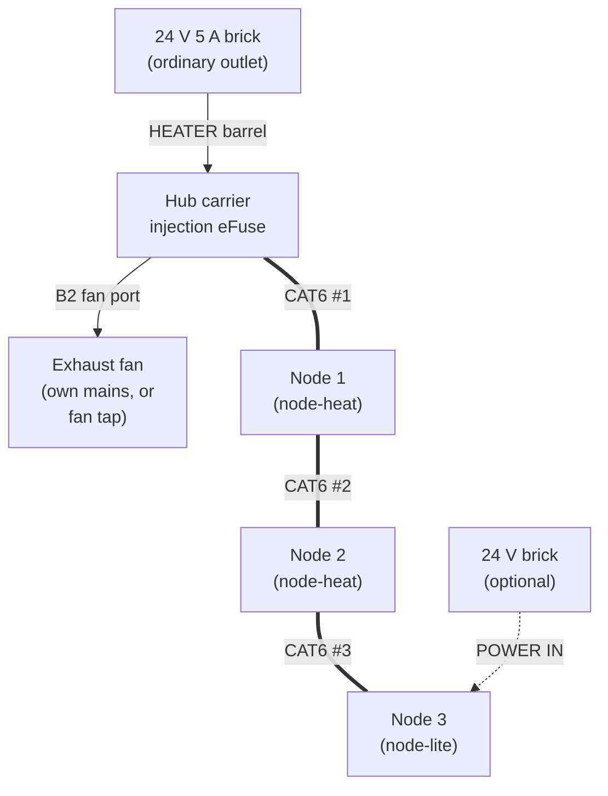
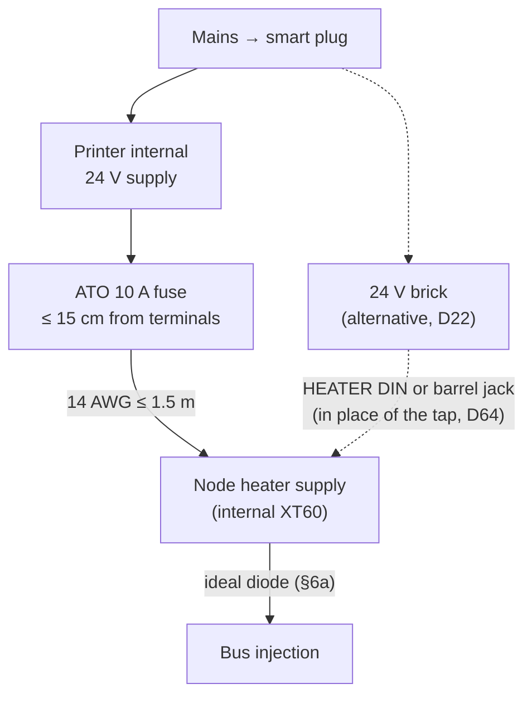
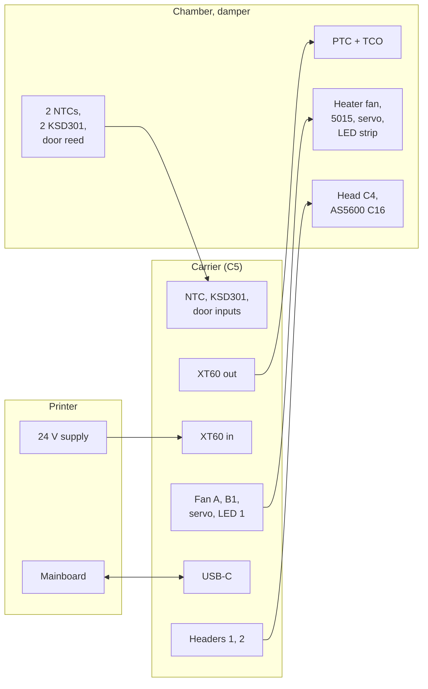
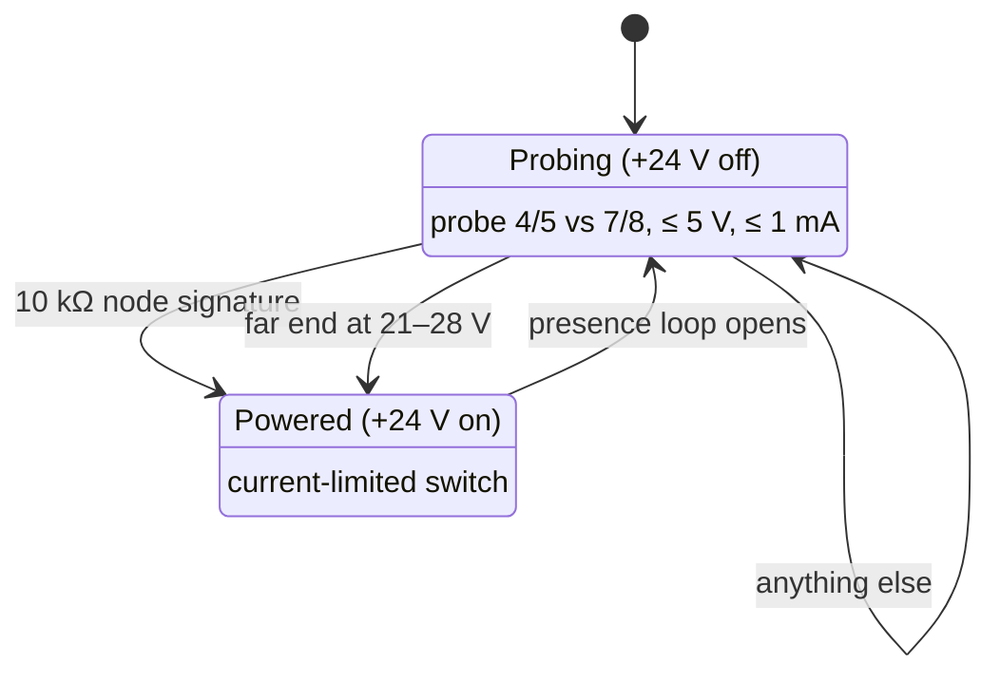
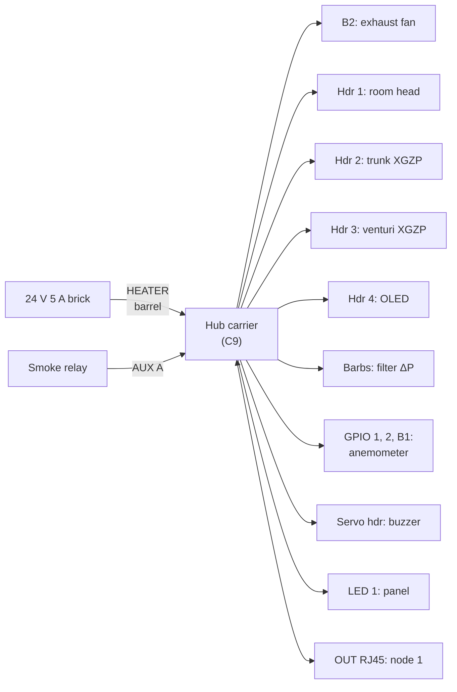
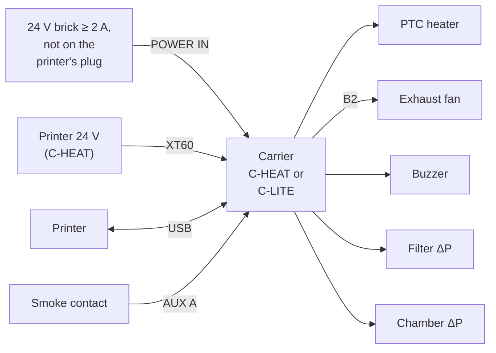

# 04 - Wiring, Cables and Pinouts

> Design baseline, 2026-10-25. Connector reference designators (J-numbers) and exact connector part numbers are assigned in the Phase 2 schematic. This document fixes the **signals, cable types, pin assignments and grounding rules** the schematic must follow.

---

## 1. Power and signal distribution

Each node-heat printer also feeds its own node's heater input:

RJ45 IN/OUT on every carrier; CAN termination switches itself on at the two ends of the chain (§3, D96). Every carrier injects 24 V onto the bus through its eFuse from whatever supply it has, with nothing to set (§6a, D94).

- **The hub supply powers node logic only**, over CAT6.
- **Each node heater runs from its printer's own 24 V supply or a brick on that printer's plug** (D12, doc 02 §3.1). The printer's smart plug removes both.
- **The exhaust fan is on the hub's B2 fan port** (D85, §7a). A fan on its own mains takes only the control signals. A board-powered fan takes 24 V from the hub's fan tap (doc 02 §2.2, D92) and stops if the hub supply fails.

**Node-heat field wiring**: what plugs into the carrier in its housing on the damper. Pins are in §4 and doc 02 §2.2.

## 2. Cables

| Cable | From → to | Type | Conductors | Connectors | Length |
|---|---|---|---|---|---|
| **Local injection** (optional) | 24 V brick or PoE splitter → any node's POWER IN barrel | Brick lead | +24 V, GND | 5.5 × 2.1 mm barrel (D66) | as needed |
| **Wireless-only node** (optional, no CAT6) | 24 V brick on an ordinary outlet (not the printer's plug) → node POWER IN (§6b) | Brick lead | +24 V, GND | 5.5 × 2.1 mm barrel (D66) | as needed |
| **Bus** | Hub → node 1 → node 2 → node 3 | CAT6 patch, **distinct colour, labelled "24 V – NOT ETHERNET"** (R10) | 4 pairs (§3) | RJ45 | ~3 m, 1.5 m, 1.5 m |
| **Heater feed** | Printer supply terminals → inline ATO 10 A (≤ 15 cm from the terminals) → strain relief → node-heat internal XT60 (inside the housing, D64) | 14 AWG 2-conductor | 24V_HEAT, GND | Supply terminal / XT60 | ≤ 1.5 m |
| **External heater feed** (optional, D22) | 24 V DIN-4 brick, **plugged in on the printer's own smart plug** → node-heat **HEATER DIN** jack, in place of the printer tap (D52, D64) | Brick lead | +24 V, GND (2 pins each) | 4-pin DIN | brick lead |
| **Barrel heater feed** (optional, D22, D64, D66) | 24 V barrel brick, ≥ 160 W and ≤ 10 A for full power (a 120 W brick at `heater_power` ≤ 95 W), **on the printer's own smart plug** → node-heat **HEATER barrel** jack (15 A), in place of the printer tap | Brick lead | +24 V, GND | 5.5 × 2.5 mm barrel | brick lead |
| **Heater element** | Node XT60 out (inside the housing, through a strain relief, D64) → PTC (via TCO) | Element leads + TCO in series on the + lead | 2 | XT60 | ≤0.5 m |
| **Heater fan** (separate leads, C8) or 5015 blower (fallback) | Node fan A → fan | 22–24 AWG | 24 V, GND, (tach), (PWM) | JST-XH 6, pins 1–4 (D95) | ≤0.5 m |
| **Recirculation-duct blower** (where the pack fits one) | Node B1 → 5015 blower | 22–24 AWG | 24 V, switched GND (PWM and tach leads unused) | JST-XH 2 | ≤1 m |
| **Fan on B2** (D84, D95) | Carrier B2 fan port → a spare fan, or the exhaust fan on the hub or a combined board (§7a) | 22–24 AWG, or the fan's own control cable | GND, 24 V, tach, B2 (switched GND or open-drain PWM), REF, CTRL | JST-XH 6, or B2's USB-C, TRRS or terminal-header jack (§7a) | as needed |
| **Second exhaust fan** (D95, 9–15 printers) | Hub fan A → passive adapter (barrel jack + fan header) ← its own 24 V brick → 4-wire fan | 22–24 AWG | GND, tach, PWM to the hub; 24 V from the brick (pin 2 not connected; a Mean Well GST-class brick's −V is not tied to mains earth, so no ground loop) | JST-XH 6 / fan plug | as needed |
| **KSD301 loop** | Node → heater-housing KSD301 → chamber-air KSD301 (in series) → node | 22–24 AWG, high-temp silicone | 2 | JST-XH 2 | ≤1 m |
| **NTCs** | Node → chamber air NTC, heater housing NTC | NTC leads | 2 each | JST-XH 2 | ≤0.5 m |
| **Sensor head** | Node sensor header 1 (switch channel 0) → sensor board S in chamber | Pre-made Qwiic cable (4-core 28 AWG, D69), ≤0.5 m (I²C at 100 kHz) | GND, 3.3 V, SDA, SCL | JST-SH 4, Qwiic pinout (D69) | ≤0.5 m |
| **ΔP tubes** | Carrier XGZP barbs → chamber / room | Silicone 2 × 4 mm | — | barbs | ≤0.5 m |
| **Servo** | Node → damper | Servo lead (extend if needed) | 5 V, GND, signal | 3-pin servo | ≤0.5 m |
| **Damper encoder** (D30) | Node sensor header 2 (switch channel 1) → sensor board E (AS5600) on the damper's shaft end | Qwiic cable | GND, 3.3 V, SDA, SCL | JST-SH 4, Qwiic pinout (D69) | ≤0.5 m |
| **Door** | Node → reed switch | 2-core | 2 | JST-XH 2 | ≤1 m |
| **Bed LED strip** | Node LED1 → WS2812 strip | 3-core 22 AWG | 5 V, DATA, GND | JST-XH 3 | ≤1 m |
| **USB link, internal header** | Carrier USB-C → a printer's internal USB header (the pack names it) | USB 2.0, **VBUS not connected** (§5) | D+, D−, GND, shield | USB-C plug / 4-pin housing | ~0.5–1 m |
| **USB link, external port** (D24) | Carrier USB-C → a printer's external USB-A port | USB 2.0, **VBUS not connected** (§5) | D+, D−, GND, shield | USB-C plug / USB-A plug | ≤ 1.5 m |
| **Trunk ΔP** | Hub sensor header 2 (switch channel 1) → sensor board P (XGZP6897D) at trunk | Qwiic cable, 500 mm stock (a generic 1 m cable if needed) | GND, 3.3 V, SDA, SCL | JST-SH 4, Qwiic pinout (D69) | ≤1 m |
| **Filter ΔP** | Hub on-board XGZP → filter housing taps | Silicone tube | — | barbs | ≤1 m |
| **Trunk flow** (D30) | Hub sensor header 3 (switch channel 2) → sensor board P (XGZP6897D) at the venturi (D33) | Qwiic cable, 500 mm stock (a generic 1 m cable if needed); silicone 2 × 4 mm from the venturi taps | GND, 3.3 V, SDA, SCL | JST-SH 4, Qwiic pinout (D69) | ≤1 m |
| **Low-flow anemometer** (D32) | Hub NTC 1, NTC 2 and B1 → C18 probe in the venturi | 2-core each | NTC leads; heater 24 V switched | JST-XH 2 ×3 | ≤1 m |

**Cable route:** the bus and heater cables follow the trunk duct along the wall, clipped to it with printed duct clips (doc 08), then drop to each printer with its branch.

## 3. RJ45 bus pinout (T568B wiring)

| RJ45 pin | T568B colour | Signal | Pair |
|---|---|---|---|
| 1 | white/orange | **CAN_H** | pair 2 (twisted) |
| 2 | orange | **CAN_L** | pair 2 |
| 3 | white/green | **Presence loop** (D52): GND at the IN jack, sensed at the OUT jack | pair 3 |
| 6 | green | **Presence loop** (D52): GND at the IN jack, sensed at the OUT jack | pair 3 |
| 4 | blue | +24 V logic | pair 1 |
| 5 | white/blue | +24 V logic | pair 1 |
| 7 | white/brown | GND | pair 4 |
| 8 | brown | GND | pair 4 |

**Rule (D17): both wires of every pair carry the same potential.** An Ethernet port has a transformer winding across each pair, so DC between the two wires of one pair (as on pins 3 and 6 in the earlier pinout) would drive amps through it. With equal potential per pair, any DC only appears *between* pairs, which a port's magnetics and coupling capacitors block. That's the same way PoE mode B carries power on pairs 4/5 (+) and 7/8 (−), with the same polarity as here.

- **Capacity:** two conductors for +24 V (≤ 0.75 A each, **≈ 1.5 A per segment, ~36 W**) and two for GND (pins 7/8, the same 0.75 A each). Pair 3 carries only the presence loop's sense current since D52; the two extra GND wires it used to be only lowered the ground drop, not the segment limit. **Kept at 1.5 A on purpose (D21):** a cheap copper-clad-aluminium or Cat5 patch cable swapped in later still runs inside its rating. Injection at the nodes (§6a) covers more load.
- **Load:** each bed strip is ~48 LEDs (D44), about 2.9 A at full white, so the firmware limits LED brightness by estimated current to **≤ 0.5 A at 5 V per node** (a few percent of the bus, ~0.1 A at 24 V). A current-limit switch on the LED chain (≈ 0.75 A, D56, doc 02 §2.2) backs that up in hardware. Status colours at a diffused, low brightness stay well under that. Three nodes then stay ≤ 1.2 A from the hub alone. Bus power injection (§6a) covers anything more.
- **Jacks are directional:** each node has an **IN** jack (toward the hub) and an **OUT** jack (away from it). The hub has one OUT jack. Pins 1, 2, 7, 8 pass straight through. Pins 3 and 6 don't: the IN jack ties them to GND through a resistor (D63), and the OUT jack senses them as the presence loop (§3a, D52); +24 V reaches the OUT jack only through the detect-before-power switch (§3a). CAN stubs on the board are ≤ 50 mm.
- **Termination (D27, D96):** every carrier switches its own **120 Ω** across CAN_H and CAN_L (2 × 59 Ω 1 % around back-to-back 60 V N-FETs, beside the OUT jack) whenever **either jack has no link**: the IN jack sees no OUT on its far end, or the OUT jack's presence loop is open. So the **hub** (IN never used) and the **node with nothing in its OUT jack** terminate, and every node in between doesn't. Two 120 Ω in parallel give the **60 Ω** that ISO 11898 requires (54–66 Ω with the switches' on-resistance, D96). Each board reports its switch state, and the hub alerts unless exactly two are on (D96), so no meter check is needed; a meter across CAN_H and CAN_L with the power off reads open, because an unpowered board leaves its resistor off. Adding a node at the end moves the termination by itself. A board with no power leaves its resistor off. Before D96 this was a TERM jumper, a 2-pin header in series with the 120 Ω, fitted by hand at the two ends.
- **Termination check (commissioning):** each board reports its termination state in its heartbeat, and the hub alerts unless **exactly two** are on; the CAN error counters should stay at zero over the commissioning run. The old meter check (bus powered off, CAN_H to CAN_L, 54–66 Ω) no longer works, because an unpowered board is unterminated; on a bench, one powered board with an empty OUT jack should show ≈ 120 Ω switched in [U: bench check in Phase 2].

**Bus parameters:** CAN 2.0A at **125 kbit/s**. The total bus length (~6 m) is far inside the limit.

### 3a. Safe if plugged into network gear (R10, D17)

| Protection | What it does |
|---|---|
| **Same potential per pair** (above) | No DC across any Ethernet transformer winding |
| **Detect-before-power on every OUT jack** (hub and nodes) | +24 V is off until a fleet node is detected. The port probes pins 4/5 vs 7/8 with ≤ 5 V at ≤ 1 mA and powers up only if it sees **a node's 10 kΩ ±5 % signature**, or **an already-powered fleet segment (21–28 V; 22 V before D64, which left a segment fed from a node several hops away, at ≈ 22.4–23 V, almost no margin)** from a node with local injection. It refuses an open port, an Ethernet port's ~150 Ω DC-coupled termination, a PoE device's 25 kΩ signature, a short, or anything else. Once on, power stays on only while the **presence loop** is closed (D52). On the OUT jack, pins 3 and 6 are tied together and pulled up weakly to 3.3 V, through a series resistor and clamp rated for 60 V on the pins. Every node's IN jack ties pins 3 and 6 to GND through a resistor equal to the OUT pull-up (D63), so the pair reads ≈ 1.6 V with an OUT on the far end (the OUT's loop reads that as closed, and the IN jack's blue link LED lights) and ≈ 0 V with another IN, a LAN or Ethernet jack or nothing. Both wires of the pair always sit at the same potential, so the D17 rule holds. Unplugging either end of the cable opens the loop: the port drops +24 V after a short debounce (~10 ms) and returns to probing. The loop doesn't depend on current, so it works the same in both directions: a node's injection feeding upstream (D13), or the whole chain feeding the hub when its supply fails (D35). An Ethernet port reads as open, because its pair-3 winding has no DC path to GND. The pull-up and clamp must not form a 19–26.5 kΩ PoE signature between pairs 1/2 and 3/6 [U]. Hardware window comparator + latch driving a **bidirectional current-limited switch** (back-to-back N-FETs, so injected power can flow both ways; off, their body diodes block both ways). The D35 zero-drift current sense (INA190 class) is dropped. Firmware can read the port state but isn't needed to keep it safe [U: circuit in Phase 2]. **Ratings (D57):** an SMBJ58CA on the OUT jack's +24 V pins, 60 V switch FETs, and a prober input rated for 60 V, so a 48–57 V injector plugged into OUT is refused and damages nothing |
| **Node IN jack** | 10 kΩ signature, an SMBJ58CA TVS and a 100 V reverse clamp on the jack side, and the **IN guard** (D56): two P-FETs back to back, which conduct both ways when on (never a series diode, so a node can feed power upstream, D35), block both ways when off, and turn off above **≈ 34 V**. Polyfuse and FETs rated 60 V. A passive PoE injector of 48–57 V, of either polarity, leaves the node off and damages nothing (the TVS's 58 V stand-off covers it); above 58 V is not covered [E]. Before D56 the IN path had no over-voltage cut-off (the eFuse's ~30 V cut-off guards only the injection inputs). A PoE switch sees an invalid signature (10 kΩ is outside PoE's 19–26.5 kΩ window), so it never powers the node |
| **Fault-tolerant CAN transceiver** (±58 V bus pins, TJA1051T/3 class) | Ethernet signals or stray PoE voltage on pins 1/2 can't damage it. A CAN driver feeding an Ethernet winding is short-circuit current-limited by the transceiver [E] |
| Distinct cable colour, "24 V – NOT ETHERNET" cable labels, **port names embossed on the node housing and hub enclosure** (R10), a **blue port-live LED** beside each OUT jack (D62), a **blue link LED** beside each IN jack (lit when the far end is an OUT, D63), a **hardware CAN activity LED** that blinks on other units' frames (D63; doc 02 §2.2), and an optional **bus-colour port bezel** (C20, doc 08) | Kept as the first line of defence. The OUT LED is lit exactly when +24 V is on that jack, which no Ethernet port shows; with the IN LED, an IN–IN, OUT–OUT or Ethernet mis-plug leaves at least one end dark |

OUT-jack power logic:

"Anything else" covers an open jack, an Ethernet port (~150 Ω), a PoE device (25 kΩ) and a short. 21–28 V at the far end means a fleet segment that is already powered; 21 V still rejects a 19–20 V laptop or USB-C supply [E].

**Result:** plugging any fleet jack into a switch, laptop or PoE port puts no voltage on it and damages neither side. A fleet jack **can't carry real Ethernet data**, because CAN uses pair 1/2, which 10/100 Ethernet needs. Wired LAN is a separate, standard jack on the hub instead (D18).

## 4. ESP32-S3 GPIO map (carrier, all roles)

Rules applied:
- The carrier's **BOOT button (GPIO 0)** is read after boot as the node's **CLEAR button** (doc 05 §4.1); nothing else on the carrier connects to GPIO 0. Holding it through a reset only enters the bootloader, with every output off and the latches kept in NVS.
- Strapping pins: **GPIO 0** is read only as the service button. **GPIO 3** (fan A enable) and **GPIO 45** (output B2) are outputs with pull-downs, so both are low at reset (D68): GPIO 45 low selects the 3.3 V flash supply the WROOM-1 modules use [V: ESP32-S3 datasheet strapping table], and GPIO 3 low selects pad JTAG on a board whose `STRAP_JTAG_SEL` eFuse is burned (doc 07 §11.8). Nothing may pull either pin high at reset. **GPIO 46 is used as an input only** (the `24V_HEAT` sense, D64): it is low whenever the high side is off, including at reset, and a normal boot (GPIO 0 high) ignores it, and it matters only when download mode is entered, where it must be low or floating, which it is because the high side is off in hardware [V: Espressif esptool boot-mode documentation]. Also avoid native USB (19, 20, the USB-C receptacle) and flash/PSRAM (26–34). **GPIOs 35–37** are free only on the quad-PSRAM N8R2 module (the octal-PSRAM R8 modules use them), and all three are used (GPIO 37 by D74, GPIO 35 and 36 by D75). **GPIOs 43 and 44** are UART0, brought out to the 1 × 3 console header (D72). **GPIO 38** is the LAN module's interrupt (D72) and **GPIO 48** the KSD301 loop sense (D74); a DevKitC's RGB LED used one of them. **GPIOs 39–42 are the JTAG pins** (D68) and carry nothing else. The ESP32 probe header (§4a, D99) brings out 17 of the other pins for a logic analyser.
- Analog inputs use **ADC1 only** (ADC2 is unusable while Wi-Fi is active).

| GPIO | Node-heat | Node-lite | Hub | Notes |
|---|---|---|---|---|
| 0 | **Service button** (the carrier's BOOT tact switch, D46, D72) | Same | Same | Input; 10 kΩ pull-up per Espressif's module reference. Held at power-up, it enters download mode as usual |
| 1 | Chamber-air NTC (ADC) | – (fitted, spare) | **Anemometer reference NTC** (D32) | ADC1_CH0. 22 kΩ pull-up for every use (D97; RANGE shunts until then) |
| 2 | Heater-housing NTC (ADC) | – (fitted, spare) | **Anemometer heated NTC** (D32) | ADC1_CH1. 22 kΩ pull-up, as GPIO 1 |
| 3 | **Fan A high-side enable** (D68, was GPIO 18) | – | – (held off: the second exhaust fan on fan A takes 24 V from its own brick, D95) | 10 kΩ pull-down, low at reset (strapping pin, above). The board identity moved to the carrier I/O controller (D68, below) |
| 4 | Heater current, LM2904 out (ADC, D50) | – | – | ADC1_CH3; sampled at a fixed rate by ADC1 continuous mode with DMA (below) |
| 5 | **Jack-side heater voltage** (ADC, D75, D94) | Same | Same; **hub supply** (D78) | ADC1_CH4. 100 kΩ / 9.1 kΩ divider, 100 nF at the pin, on the HEATER jacks' side of the jack ideal diode (the heater rail until D94). Back from the controller's PB0 (D75); AUX A moved to GPIO 36 |
| 6 | AUX B: spare, or **UART1 RX** from the printer (D48) | Same | **Acknowledge button** (edge interrupt, debounced; D49, was GPIO 5): the on-board tact switch, or a remote button on AUX B | Level shifter as GPIO 36; 5 V-tolerant at the connector. The on-board tact switch is on this line (D49). The external heater-input sense (D22) moved to the carrier I/O controller's ADC (D47) |
| 7 | **Tap-side heater voltage or POWER IN voltage** (ADC, D64, D75, D93) | Same | Same | ADC1_CH6. The internal XT60's side of the tap ideal diode while GPIO 37 is low, POWER IN while it is high (D93): two 100 kΩ / 27 kΩ dividers with 100 nF, each through 47 kΩ, the unselected one grounded by a 2N7002. Back from the controller's PB1 (D75); the heater PWM moved to GPIO 35 |
| 8 | I²C SDA | I²C SDA | I²C SDA | On-board XGZP, carrier I/O controller (I²C target), 8-channel I²C switch; behind it, one channel per external sensor header 1–8 (header 1 = sensor head; header 2 = node damper encoder, or hub trunk XGZP; header 3 = hub trunk-flow XGZP, D30/D33; header 4 = optional OLED on any role, on its own channel, D48; D45, D54, doc 09 §3). While the ESP32 programs an MCU, GPIO 8 carries UART2 RX instead (doc 09 §4.1) |
| 9 | I²C SCL | I²C SCL | I²C SCL | UART2 TX while programming (doc 09 §4.1) |
| 10 | **LAN CS** (D45) | LAN CS | LAN CS | SPI2 IO MUX pin (no GPIO matrix), to the 2 × 5 LAN module socket (D72). Only a board with a W5500 module plugged in uses it |
| 11 | **LAN MOSI** (D45) | LAN MOSI | LAN MOSI | SPI2 IO MUX pin |
| 12 | **LAN SCK** (D45) | LAN SCK | LAN SCK | SPI2 IO MUX pin |
| 13 | **LAN MISO** (D45) | LAN MISO | LAN MISO | SPI2 IO MUX pin. The door input is read through the carrier I/O controller (doc 02 §2.4) |
| 14 | **Fan A PWM** (D70, D95) | – | **Second exhaust fan PWM** when fitted (D95) | LEDC, ≈ 25 kHz, inverted: drives the gates of two 2N7002s (fan port pins 4 and 6, §7a), each with a gate pull-down, so the pin never sees the fan's 5–10 V and both float to full speed while the ESP32 is in reset (D95; a bare open drain from D70). LED chain 1 moved to the carrier I/O controller (PA5, D70, D71) |
| 15 | Heater enable charge-pump drive (square wave) | – | – | No wave → high-side off. **A plain GPIO toggled by the safety task, deliberately not a PWM peripheral** (doc 07 §2): a peripheral would keep the wave running if the safety task hung |
| 16 | **CAN TX** (D68, was GPIO 41) | CAN TX | CAN TX | TWAI, routed through the GPIO matrix; pull-up on the transceiver's TXD so the bus stays recessive while the pin floats at reset. Fan A's PWM moved to GPIO 14 (D70) |
| 17 | Fan A tach in | – | Second exhaust fan tach (D95) | Through a 1N4148WS (cathode at the connector) with a 100 kΩ pull-up to 3.3 V, as B2's (D95; a pull-up and clamp before) |
| 18 | **CAN RX** (D68, was GPIO 42) | CAN RX | CAN RX | TWAI. Fan A enable moved to GPIO 3 |
| 21 | **Servo PWM** (50 Hz) | Servo PWM | **Buzzer** (D85): 5 V active buzzer module on the servo header | Pull-down, held low at boot (was GPIO 12), so the buzzer is silent through a reset. LED chain 2 was dropped from the fixed map (D45) |
| 35 | Heater low-side PWM (D75, was GPIO 7) | – | – | LEDC. 10 kΩ pull-down. N8R2 module only (rules above) |
| 36 | AUX A: spare, or **UART1 TX** to the printer (D48, D75, was GPIO 5) | Same | **Smoke dry-contact input** (edge interrupt; D49) | Through a 2N7002 level shifter to the AUX header (below), so digital only. N8R2 module only |
| 37 | **GPIO 7 selector** (D93, D94; the tap ideal-diode disable from D74 to D94, the controller's PF1 before) | Same | Same | Output to the GPIO 7 selector (high: GPIO 7 reads POWER IN); a 4.7 kΩ pull-down keeps the tap side selected while the pin floats at reset. Driven by ≈ 1 ms POWER IN samples (D93). It no longer switches the tap ideal diode, which is always on (D94). N8R2 module only (rules above) |
| 38 | **LAN interrupt** (W5500 INTn, D72) | Same | Same | Input, 10 kΩ pull-up, active low, falling-edge interrupt; idle high with no module fitted. Was a DevKitC RGB LED pin |
| 39 | **JTAG TCK** (MTCK, D68) | Same | Same | To the 1 × 6 JTAG header only. Output B1 moved to the carrier I/O controller (PA8) |
| 40 | **JTAG TDO** (MTDO, D68) | Same | Same | JTAG header only. Output B2 moved to GPIO 45 |
| 41 | **JTAG TDI** (MTDI, D68) | Same | Same | JTAG header only. CAN TX moved to GPIO 16 |
| 42 | **JTAG TMS** (MTMS, D68) | Same | Same | JTAG header only. CAN RX moved to GPIO 18 |
| 45 | Output B2: spare (D68, was GPIO 40) | – | **Exhaust fan** (D85) | Pull-down, low at reset (strapping pin, above). LEDC when B2 drives a fan; it drives the B2 N-FET (pin 4) and the CTRL 2N7002 (pin 6) together. The fan port and its tach (through the carrier I/O controller's PA9) are in §7a (D84, D95). On the hub and the combined boards B2 is the exhaust fan (D85, §7a) |
| 46 | **High-side output sense** (`24V_HEAT` through a divider and clamp, D64) | Same | Same | Digital input, strapping pin used as an input only (above). Low whenever the high side is off. Moved here from the carrier I/O controller by D64 so a welded high-side FET is seen directly by the safety task |
| 43 | **UART0 TX** (console header, D72) | Same | Same | 1 × 3 header with GPIO 44 and GND; the ROM bootloader and the ESP-IDF console use it |
| 44 | **UART0 RX** (console header, D72) | Same | Same | |
| 47 | **Carrier I/O controller interrupt** (D45, D54, doc 09 §2.3) | Same | Same | Falling-edge interrupt input, 10 kΩ pull-up; the controller pulses it low for ≤ 20 µs (open-drain) when any of its own inputs changes (door, group rail; doc 09 §2.3). The same net reaches the controller's reset pin through 2.2 kΩ with 470 nF to ground (D76): the ESP32 resets the controller by driving this pin low (open-drain) for 1 s, then releasing it, and never drives it high. The board status LED moved to the carrier I/O controller |
| 48 | **KSD301 loop sense** (D74, was the controller's PA10) | – (loop not wired) | – (loop not wired) | Digital input with a falling- and rising-edge interrupt, through the sense divider and clamp. Read directly by the safety task, so it doesn't depend on the controller. Was a DevKitC RGB LED pin |

**Heater current sense (D50).** The 5 mΩ low-side shunt feeds one half of an LM2904 (LCSC C18229, Preferred) as a non-inverting amplifier, gain 40 (39 kΩ / 1 kΩ, 1 %), powered from `+5V_PWR` through 10 Ω and 10 µF (D72; `+5V_LOGIC` before):
- **Input:** shunt → 1 kΩ → + input. A **330 kΩ from 3.3 V** to the + input adds a pedestal of ≈ 10 mV, so the output never sits on the 0 V rail when the amplifier's offset (up to ±7 mV) is negative. With the pedestal, zero current reads ≈ 0.4 V, away from the ADC's poor region near 0 V. A 10 nF at the + input filters PWM edges.
- **Output:** 1 kΩ in series into GPIO 4, because the output can reach ≈ 3.5 V when saturated; the resistor limits the current into the pin's clamp. The output clips at ≈ 12 A, so cold-PTC inrush peaks read as full scale.
- The unused half is tied off as a follower to GND.
- **Zero at boot:** before the safety task starts the charge pump, the high side is off in hardware (the gate driver has no enable) and the low side is off, so current is zero unless both switches have failed. The firmware averages GPIO 4 for ~100 ms and stores that as the zero. The zero also cancels the ADC's own offset. A zero outside the window that pedestal and offset can explain (≈ 0.12–0.68 V) is a fault: the heater stays locked out and the node alerts, since it means both switches or the amplifier have failed.
- **Re-zero:** only while both switches are commanded off, and an update that moves more than 50 mA from the boot zero is refused (and counted), so a slowly rising leak can't hide in the zero.
- After zeroing, the error left is drift (≈ 7 µV/°C, about 60 mA over a 40 °C swing) and ±6 % gain (shunt and resistors), against the 0.3 A L4 threshold (doc 05 §3.1) [E].

**Board identity (D46, D84).** A 2 × 5 pin header with one shunt (2 × 3 until D84) (the same 2.54 mm header and shunt as the DC jumpers) selects the board's role. It is read by the carrier I/O controller on **PA0** (ADC_IN0, D68; GPIO 3 before), which has 100 kΩ to 3.3 V, plus 100 nF to GND so the ADC sees a low source impedance. The shunt adds a resistor to GND (1 % parts) [E]:

| Shunt position | Resistor to GND | PA0 voltage | Read as |
|---|---|---|---|
| HEAT | 10 kΩ | ≈ 0.30 V | `node-heat` (below 0.45 V) |
| C-HEAT | 22 kΩ | ≈ 0.60 V | `combined-heat` (0.45–0.80 V, D84) |
| LITE | 47 kΩ | ≈ 1.06 V | `node-lite` (0.80–1.35 V) |
| C-LITE | 100 kΩ | ≈ 1.65 V | `combined-lite` (1.35–1.95 V, D84) |
| HUB | 220 kΩ | ≈ 2.27 V | `hub` (1.95–2.8 V) |
| No shunt | — | 3.3 V | **unset** (above 2.8 V) |

The ESP32 reads it from the controller once at boot, after the controller starts (doc 09 §4.2). If the shunt and the role stored in NVS disagree (doc 07 §2), or the shunt is unset, the board starts in a **safe hold**. If the controller can't be reached, the board runs the stored role with an "identity unchecked" alert, and the heater stays off until the identity has been read once since boot (D75). In safe hold, the heater enable stays off, the outputs stay off and the LEDs work, and a "role mismatch" fault is raised. Since D47 every carrier carries the same parts, so the shunt is what makes a board a given role. At boot, after the heater has been off, each NTC must also agree with the sensor head's SHT40 to within a few °C, which catches a faulty or misplaced NTC; there are no RANGE shunts since D97. The eFuse limit is one fixed resistor since D81 (doc 02 §2.2), so there is no shunt to set; the injected-current monitor (D61) reads it back.

**Service button (D46).** The carrier's BOOT tact switch (GPIO 0, D72), read after boot:
- **Short press:** opens Wi-Fi provisioning for 10 minutes.
- **Hold ≥ 10 s:** factory reset of NVS (Wi-Fi credentials, node ID, calibration), refused while the heater is on. After the reset, the role comes back from the shunt.

**AUX header (D48).** One JST-XH 5 replaces the two spare-input headers. Each contact has its own GND pin, so two pre-crimped pigtails can share one housing with no splice:

| Pin | Signal | Hub | UART printer link (`marlin_serial`, doc 12) |
|---|---|---|---|
| 1 | 3.3 V (header group rail, ≈ 1 A limit, D57) | – | not connected |
| 2 | GND | Smoke contact return | Printer GND |
| 3 | A: GPIO 36 | Smoke dry contact | **TX**, node → printer RX |
| 4 | B: GPIO 6 | Remote acknowledge button (optional; the on-board switch is in parallel) | **RX**, printer TX → node |
| 5 | GND | Remote button return | – |

- **Levels:** each line runs through a 2N7002 shifter (gate to 3.3 V, 10 kΩ pull-up to 3.3 V on the ESP32 side, 4.7 kΩ to 3.3 V on the connector side). **The printer link supports 3.3 V printer boards only** (D100). The lines are 5 V-tolerant, so a 5 V board does no damage: its TX is blocked by the FET and ≈ 0.4 mA flows back into the 3.3 V rail through the pull-up. But the node's TX reaches it at 3.3 V against a 5 V AVR's 3.0 V threshold, too little margin to rely on [E], so 5 V boards are not supported on either link port.
- **Speed:** ≈ 0.5 µs rise on a 1 m cable [E], fine at 115200 and 250000 baud.
- **Peripheral:** UART1 through the GPIO matrix. UART0 (GPIOs 43, 44) stays the console.
- A and B are digital only: the shifter doesn't pass an analog level.
- **On-board button (D49):** a TS-1187A-B-A-B SMD tact switch (C318884, Basic, 1.5 mm actuator) from B's connector side to GND, on every carrier. It sits on the RX line on purpose: pressing it can't short the TX output. Its position on the board is fixed at layout so the ACK plungers line up: in the hub enclosure (C9), and in the node housing (C5) on a combined board, which is its own hub (D84, D101). On a node role, C5's ACK opening takes a C15 blanking plug.

It is reached with the node housing open. Holding it at power-up still enters download mode, as on any ESP32 board.

**Expansion port (D77).** A 2 × 5 2.54 mm pin header on the carrier I/O controller's spare pins, for an odd SPI or UART sensor or analog voltages. Pin 1 is 3.3 V from the header group rail, pins 2 and 10 are GND, and pins 3–9 are P1 = PA1, P2 = PA4, P3 = PA6, P4 = PA7, P5 = PF0, D1 = PA9 and D2 = PA10 (functions, modes and commands in doc 09 §2.5). SPI uses P1 (SCK), P3 (MISO) and P4 (MOSI); the UART uses P2 (TX) and P5 (RX); P1–P4 read as analog inputs whenever their peripheral is off. Each signal has 1 kΩ in series and an ESD diode. The ESP32 reaches it over I²C, so it is for slow sensors only.

**Peripheral use: no bit-banged interfaces.** Every interface runs on an ESP32-S3 peripheral:

| Interface | Peripheral | Notes |
|---|---|---|
| CAN | TWAI | |
| I²C | I²C 0 | Sensor headers, on-board XGZP, carrier I/O controller |
| LAN | SPI2 on the IO MUX pins | GPIOs 10–13, to the W5500 module socket, and the module's interrupt on GPIO 38 (D72) |
| LED chain 1 (bed strip, or the hub panel) | **Carrier I/O controller TIM3 PWM with DMA** (PA5, D70, D71) | The controller renders the stream from colour and pattern commands sent over I²C (doc 09 §2.1). The ESP32's RMT drove it with DMA before D70 |
| MCU programming (carrier I/O controller, sensor-board MCUs) | **UART2** on GPIO 8/9 through the GPIO matrix, open-drain, 115200 8E1 | Only while programming; the I²C driver is detached for that time (doc 09 §4) |
| Servo, heater PWM, fan A PWM | LEDC | Three frequencies, inside LEDC's four timers. B1 PWM is a timer on the carrier I/O controller (D68) |
| Heater-enable charge pump | **Plain GPIO, toggled by the safety task** | Deliberately not a peripheral. A hardware PWM keeps running if the safety task hangs, which would defeat layer L5 (doc 05 §3.1, doc 07 §2) |
| Analog inputs (GPIOs 1, 2, 4, 5, 7 on node-heat; 1, 2, 5, 7 on the other roles) | **ADC1 continuous mode with DMA** | Scans every ADC1 input at a fixed rate, so the heater-current samples (GPIO 4) are evenly spaced without the CPU timing each read. ESP-IDF doesn't mix one-shot and continuous mode on one ADC unit [E], so all ADC1 inputs move to continuous mode together |
| Hub smoke dry contact (GPIO 36), hub acknowledge button (GPIO 6) (AUX) | **GPIO edge interrupts** | A press or an alarm is seen at once, not at the next poll. The button is debounced in software. Neither depends on I²C |
| UART printer link on a node (GPIOs 36, 6, AUX; D48) | **UART1** | Only with `link: marlin_serial`, `link_port: uart` (doc 12 §3.2) |
| Fan tach | PCNT | |

**RMT budget:** none since D70 (LED chain 1 is on the carrier I/O controller); all 4 TX channels are free for a second LED chain later.

**LAN module socket (D18, D45, D72):** the W5500 module needs four SPI GPIOs (SCK, MOSI, MISO, CS) and its interrupt on GPIO 38. They are **GPIOs 10–13 on every carrier**, the S3's IO MUX pins for SPI2, so the SPI runs on the peripheral directly (up to 80 MHz) and not through the GPIO matrix (40 MHz, with extra delay on MISO) [E: confirm in the S3 technical reference manual]. CAN and the servo output use the matrix and moved to make room (CAN to GPIOs 16 and 18 since D68, the servo to GPIO 21). There are no 0 Ω links, and the same map applies to all roles. The default SPI clock is 20 MHz; the W5500's own limit is higher, and bring-up checks 20 and 40 MHz with the module on the socket [E: a plug-in module adds lead length]. The interrupt keeps the driver from polling the chip; the module's own RC resets it.

The KSD301 and charge-pump chain works in **hardware**. The carrier I/O controller only *reports* its state; the firmware can't override it.

## 4a. ESP32 probe header (D99)

A **2 × 10, 1.27 mm SMD male header** footprint (example: HCTL PZ127-2-10-S, C3975193) brings the ESP32 signals that no other header reaches to a logic analyser. It is **unpopulated in production** and fitted on bring-up boards. A breakout carries the mating female socket underneath and 2.54 mm pins on top; the carrier marks the breakout's outline on the fab layer, and parts under it stay below ≈ 5 mm (mated height ≈ 5.8 mm with the example pair) [E]. Odd pins are one row, even pins the other.

| Pin | Signal | Pin | Signal |
|---|---|---|---|
| 1 | GND | 2 | EN |
| 3 | GPIO 15, charge-pump drive | 4 | GPIO 35, heater low-side PWM |
| 5 | GPIO 4, heater current | 6 | GPIO 46, high-side sense |
| 7 | GPIO 48, KSD301 loop sense | 8 | GPIO 16, CAN TX |
| 9 | GPIO 18, CAN RX | 10 | GND |
| 11 | GPIO 8, I²C SDA | 12 | GPIO 9, I²C SCL |
| 13 | GPIO 5, jack-side heater voltage | 14 | GPIO 7, tap-side heater / POWER IN voltage |
| 15 | GPIO 37, GPIO 7 selector | 16 | GPIO 14, fan A PWM |
| 17 | GPIO 17, fan A tach | 18 | GPIO 3, fan A enable |
| 19 | GPIO 45, output B2 | 20 | GND |

- **No power pin**, so a slipped probe or a reversed breakout can't short a supply. Driving GPIO 15 high from a probe can't enable the heater: the charge pump needs a wave (doc 02 §2.2).
- **Strapping pins** (GPIO 3, 45, 46) and EN: a logic analyser's high-impedance inputs (≈ 100 kΩ–1 MΩ, a few pF) don't change their reset levels. Don't drive them from the breakout.
- **Analog pins** (GPIO 4, 5, 7): an analyser input or a scope probe adds a few pF beside their 100 nF / amplifier source, so readings don't change [E].
- **Routing:** the recommended pads are 0.74 mm wide at 1.27 mm pitch, leaving ≈ 0.53 mm, so one 0.127 mm trace at 0.2 mm clearance passes between pads on the top layer [V: HCTL datasheet].
- **Already on other headers:** JTAG (GPIO 39–42, D68), UART0 (43, 44, D72), the LAN socket (10–13, 38), AUX (6, 36), servo (21), NTC (1, 2); the carrier I/O controller's pins take micro-grabbers on its LQFP leads (D99, doc 09 §2).

## 5. Printer USB link (D3, D24)

Every Tier 2 printer (doc 12 §3.2) uses the same link; only the printer end differs, and that's in its printer pack.

| Item | Specification |
|---|---|
| Node end | The carrier's **USB-C** receptacle, wired to the module's native USB (D72). |
| Lead | USB 2.0, **D+, D−, GND and shield only. VBUS is left unconnected and insulated at both ends**, so the printer never powers the node and the node never back-feeds the printer (ARG-08). |
| Enumeration | The node appears as a USB CDC-ACM device, so the printer's kernel needs `cdc_acm`. The plugin opens `/dev/serial/by-id/usb-fleet_exhaust_node_<serial>-if00`, or finds the node by VID/PID when `serial:` is unset (doc 07 §3.1). |
| Carrier off, USB powered | The carrier's USB-C has no VBUS connection (D72), so a lead with VBUS can't power or back-feed anything; the ESP32 runs only from the carrier's own supply. The no-VBUS lead stays the first layer |
| VBUS-less enumeration | The ESP32-S3 USB device works with the board powered by the carrier and no VBUS on the cable [U: confirm on the prototype]. |
| Printer end rules | Prefer an **external** USB port. Internally, plug into a header (solder pins into a footprint's holes if needed), never wires onto pads (P-5). An internal hub board is a fallback only. |
| Ground | Shield connects at the printer end only. When the node heater runs from the printer's supply, part of the heater return shares this lead's ground (R11, §6). |

Each printer pack names its printer end and any fallback (doc 12 §3.2).

## 6. Grounding rules

1. **The fleet logic ground has no earth bond of its own:** the hub supply's −V floats (a desktop brick's output does; an internal supply's is left unbonded). It can still reach earth through a printer whose supply bonds −V (rule 4). One bond is harmless; floating the hub means it never adds a second one.
2. **Heater current stays in its printer cell.** It leaves the heater supply (the printer's supply through the tap, or a heater brick) on the 14 AWG lead and returns on it; no CAT6 conductor is meant to carry it. **The same supply can also feed the bus:** without a live POWER IN, the heater rail powers the board and injects through the eFuse (≤ ≈ 1.5 A, D81, D94; §6a). That current leaves on the CAT6's +24 V pair and returns on its GND pins 7/8 (rule 7). Parallel ground paths can also carry a share of the heater current itself: the USB lead (rule 3), and the CAT6 when printers are earth-bonded (rule 4). A heater on its own floating brick has neither.
3. **USB-link ground share (R11):** each node's ground reaches its printer twice, via the heater return lead and via the USB GND, so part of the heater return can flow in the USB lead. With a 14 AWG return ≤ 1.5 m the share is ≲ 0.3 A [E], within a USB lead's rating, with a ground offset of ~50 mV. Measure it at commissioning; if it's higher or the link misbehaves, fit a USB isolator (ADuM3160-class) on the link.
4. **Between printers:** if two or more printers' supplies bond −V to earth, their grounds also meet through mains earth and the CAT6 chain. For a heater fed from its printer's supply, ≈ 2–5 % of its current can take that path (≈ 12 mΩ of return lead against ≈ 0.3–1 Ω through CAT6 GND, the next printer and mains earth) [E]: ≈ 0.2–0.4 A at 8 A, which counts against the CAT6 GND allowance together with rule 7's injection current. The offset stays far inside CAN's common-mode range (−2 to +7 V). The USB isolator fallback breaks this path too.
5. Each carrier joins logic GND and power GND at **one star point** near the input connectors. The heater current-sense shunt sits on the power side of that point.
6. Shields: CAT6 is unshielded (UTP). The USB lead's shield connects at the printer end only.
7. **Injected current** (§6a) returns over the CAT6 GND conductors (pins 7/8; pair 3 is the presence loop since D52) to the loads it feeds. Each source is limited by its eFuse, which keeps every conductor inside the ~0.75 A allowance.

## 6a. Bus power injection (D13)

| Item | Rule |
|---|---|
| Sources | Whatever the board has, with nothing to set (D94): the **heater rail** (the internal XT60 or a brick in a HEATER jack) and **POWER IN**, each through its own ideal diode, then the input guard, into the eFuse. While POWER IN is above ≈ 20 V, a P-FET takes the heater rail out, so **a live POWER IN powers the board and otherwise the heater rail does** (doc 02 §2.2). Hub: a brick in either barrel or a supply on the internal XT60 (D92, D93). Node-heat: the printer supply tap or an upgraded internal supply, or a DIN-4 or barrel heater brick (D52, D64), or a logic brick on POWER IN if one is fitted. Any node: a 24 V brick or PoE splitter on POWER IN. (Until D94 the INJECT INT and BAR jumpers chose the sources.) |
| Protection | Each source enters the bus through an eFuse with reverse-current blocking, so no supply is back-fed by another, and a short is current-limited at the source. |
| Load sharing | Diode-OR by voltage. Every source runs at its factory 24 V (no trim, D79), so at each point the highest one carries its stretch of the chain, up to its eFuse limit, and cable drop under load shifts load toward local sources. No sharing controller is needed. |
| Printer supply protection | If a printer's rail sags (bed + heater load), it falls below the bus voltage and its injection stops by itself, so the bus never takes power from a printer that needs it (R12). The ~1.5 A limit caps the most it can ever add to the printer supply at ~36 W (D81). |
| Printers off | Their injection disappears. Idle nodes draw ~1–2 W each, which the hub covers alone, so nodes can still purge powered-off printers. |
| Sizing rule (D35) | Size for the worst moment: **every printer off (a power cut, or all cut in a fire) with the busiest node at its alarm peak** (servo moving, LEDs flashing). Hub supply ≥ idle load of the whole chain + that peak + the peak of nodes on their own bricks only if they share the hub's outlet. Any single CAT6 segment ≤ ~1.5 A (two +24 V conductors, D17; deliberately not raised, D21). Three nodes: ~2 W idle each plus ~10 W for one alarm peak [E], well inside both. Checked by commissioning test 16 (doc 05 §9). |
| Bus voltage (D64) [E] | Since D80 the heater-rail injection path drops ≈ 0.15–0.2 V at 1 A and ≈ 0.3 V at 1.5 A (ideal diode ≈ 0.02–0.03 V, the D94 preference P-FET ≈ 0.03 V, guard, eFuse and its blocking FET; ≈ 0.7 V and ≈ 0.95 V with the Schottky before), and POWER IN about the same through its ideal diode (D91; ≈ 0.4 V more through an SS56 before). So the bus sits at ≈ 23.5–24.1 V at the hub on a ±1 % supply (LRS-100-24 class; wider on a ±2–5 % brick), ≈ 23.75–23.9 V at a node injecting from its own 24.0 V heater supply, and ≥ ≈ 22.7 V at a far node fed by the hub alone at an alarm peak (≥ ≈ 22.2 V on a ±3 % brick, ≥ ≈ 21.75 V on ±5 %), after ≈ 0.8 V of cable and per-node IN/OUT losses (≈ 1.1 V before D80's OUT switch FETs). Every board's source loses about the same drop, so sharing along the chain follows the supplies' own voltages (D91); on one board POWER IN wins outright (D94). Every board measures its own bus voltage (doc 02 §2.2) and reports it with its injected current. The bucks run down to 4 V and the eFuse and buck turn-on points sit at ≤ ≈ 18 V, so only the bus-fed fans notice (fan A and B1, D94): they run ≈ 1–9 % slower than at 24 V, which the characterise run measures as installed (doc 05 §3.2). |
| Hub supply lost (D35) | The hub's injection eFuse blocks reverse current, so its dead supply is never back-fed. The nodes whose printers are on carry the whole chain and the hub through the OUT switches (§3a); the hub enters back-fed mode (doc 07 §11.7). Load then: ~0.35 A idle, up to ~0.85 A in an alarm [E], against ~1.5 A per injecting node (D81). A board-powered exhaust fan (on the fan tap, D85, D92) stops with the hub supply: the fan tap is on the supply's side of the eFuse, and back-fed power reaches only the bus. A fan on its own mains keeps running (FAN V's BUS position, which kept a ≤ 0.75 A fan running, went in D92). |
| Fan tap (D85, D87) | A second branch after the input ideal diodes and the input guard, ahead of the bus eFuse, through its own tap eFuse limited to ≈ 2.7 A (D91), to B2's pin 2 (D92). It carries only the board's own exhaust fan, so that current never counts against the eFuse limit or the CAT6 segment limit. |

## 6b. Power configurations (D35)

There are no power jumpers (D94): every board's logic runs from the bus, and whatever supply a board has feeds it. Only the heater inputs (internal XT60, HEATER DIN, HEATER barrel; one at a time) feed the heater; the POWER IN barrel never does (D64). A live POWER IN powers the board in place of the heater rail, so a logic brick, where there is one, carries the logic and any board-powered exhaust fan, and the heater supply only heats. Fan A and B1 run from the bus (D94). The rule that matters: **a node must have some source that survives its own printer's cut**: the CAT6 bus from the hub, or a brick on an ordinary outlet.

| Setup | Supplies | Outlet rules |
|---|---|---|
| Hub | One 24 V brick in the HEATER barrel (D92) or on POWER IN (D93), or a PSU on the internal XT60. ≥ 4 A with a board-powered exhaust fan, ≥ 2 A without | Hub supply and the fan on ordinary outlets, **never on a printer's plug** |
| Wired node-heat, printer supply | The tap on the internal XT60 | Logic survives the cut through the bus |
| Wired node-heat, heater brick (HEATER DIN or HEATER barrel jack) | The brick | Heater brick **on that printer's plug** (doc 05 §9 test 23) |
| Wired node-lite | None, or a brick on POWER IN | Any brick on an ordinary outlet |
| Wireless-only node-heat | Logic brick on POWER IN + the heater supply | **Two supplies:** the logic brick on an ordinary outlet, the heater supply on the printer's plug or tap. The logic brick is never on the printer's plug |
| Wireless-only node-lite | Logic brick on POWER IN | Logic brick on an ordinary outlet |
| Combined-heat or combined-lite (D84, D85, D91) | A **≥ 24 V, 2 A brick on POWER IN** (≥ 4 A with a board-powered exhaust fan), plus the heater supply on combined-heat | Brick on an ordinary outlet, **never on the printer's plug**. While it is live it carries the logic and the exhaust fan, so the fan never loads the printer's supply and keeps running through its cut (D94). The heater still runs from the heater rail |

A node that stays up when its heater supply drops out (on the bus or a barrel logic brick) sees the drop directly and doesn't reset with it (doc 05 §3.3).

Bricks: hub and combined boards ≥ 4 A with a board-powered exhaust fan, ≥ 2 A without. Every logic brick goes on an ordinary outlet, never on a printer's plug; only a node-heat's heater brick goes on its printer's plug.

Checked at commissioning (doc 05 §9 test 29) and continuously by the hub: when a printer's plug reads off in normal use, its node must stay online, or the hub alerts (doc 05 §4).

## 7. Hub wiring summary

| Connection | From | To |
|---|---|---|
| 24 V logic | 24 V brick on an ordinary outlet (D92, D93): ≥ 4 A with a board-powered exhaust fan, ≥ 2 A without | Carrier HEATER barrel or POWER IN, CAT6 power via carrier |
| Mains (alternative) | With an internal PSU instead: IEC inlet (fused, switched) → LRS-100-24 L/N/PE (PE to the PSU case and the inlet earth only), PSU +V/−V by an XT60 lead | Carrier internal XT60 |
| Buzzer | Carrier servo header (GPIO 21, D85) | 5 V active buzzer module (3-pin, active high) |
| Panel | LED1 → WS2812 ×2; acknowledge = the carrier's on-board tact switch (GPIO 6, AUX B) through the C9 ACK plunger, SERVICE plunger over the carrier's BOOT button (D49); sensor header 4 (switch channel 3) → optional OLED (D48) | Panel |
| Trunk ΔP | Sensor header 2 (switch channel 1) | Sensor board P (XGZP6897D), tubes to the trunk tap and room |
| Trunk flow (D30) | Sensor header 3 (switch channel 2) | Sensor board P (D33), tubes to the venturi inlet and throat taps |
| Low-flow anemometer (D32) | NTC 1 (GPIO 1), NTC 2 (GPIO 2), B1 (carrier I/O controller PA8, D68) | C18 probe: reference NTC at the venturi inlet, heated NTC + heater resistor in the throat |
| Filter ΔP | On-board XGZP barbs | Filter housing inlet and outlet taps |
| Room sensor | Sensor header 1 (switch channel 0) | Sensor head |
| Fan | B2 fan port (D85, §7a) | Exhaust fan: a supported fan (doc 02 §6) |
| Smoke | AUX A (GPIO 36) | Optional relay-output smoke detector (dry contact) |

**Hub field wiring** (a hub on a brick in the HEATER barrel):

## 7a. Combined roles: one printer, one carrier (D84)

A one-printer system can run its hub and its node on one carrier: the role shunt's **C-HEAT** (`combined-heat`) or **C-LITE** (`combined-lite`) position. There is no CAN chain, no duct-vacuum loop and no branch damper: the exhaust fan's speed holds the chamber ΔP directly (doc 06 §4), and the purge token has one holder. A second printer later turns the board back into a node (HEAT or LITE) and adds a hub carrier.

| Function | Combined-heat | Combined-lite | Same as |
|---|---|---|---|
| Heater, fan A (heater fan), B1 (recirculation blower), NTCs, KSD301 loop, door, LED chain 1 (bed strip), USB link | Node-heat | Node-lite (fan A free) | Node |
| **Exhaust fan** | **B2 fan port** (below) | **B2 fan port** | – |
| Buzzer (5 V active module) | **Servo header** (GPIO 21, D85) | Same | Hub |
| Smoke dry contact, acknowledge button | AUX A (GPIO 36), AUX B (GPIO 6) and the on-board tact switch | Same | Hub |
| Panel LEDs | Ahead of the bed strip on LED chain 1, or left out | Same | Hub |
| Chamber ΔP | On-board XGZP | Same | Node |
| Filter ΔP | Sensor board P on a free sensor header (≤ 1 m Qwiic cable, or tubes run back to the board) | Same | Hub (on-board XGZP) |
| Duct vacuum, low-flow anemometer | Not fitted (the chamber ΔP takes their place) | Same | – |
| Venturi trunk flow, room head, OLED | Optional, each on a free sensor header | Same | Hub |
| Logic power | **≥ 24 V, 2 A barrel brick on POWER IN** (D85; ≥ 4 A with a board-powered exhaust fan, D91), **on an outlet that is not the printer's smart plug** (§6b), so the board and a board-powered exhaust fan outlive a mains cut. While it is live the printer's supply only heats (D94) | Same | – |
| RJ45 IN/OUT | Unused; OUT stays dark (§3a), and the board terminates itself (D96), which does no harm | Same | – |

- **Printer link:** combined roles need a printer on the USB link, because AUX carries the smoke contact and the button. A printer on the UART link (`marlin_serial`, doc 12) keeps the two-board layout.
- **Exhaust fan:** it must be a 4-wire PWM fan, or an EC fan whose 0–10 V or 10 V PWM input is pulled up from its own +10 V reference (CTRL, D95), so that it runs at full speed while the board is silent (F3, doc 02 §6). A plain on/off fan on B2 stops with the board and is not allowed as the exhaust, on a combined board or on the hub. A fan with a proprietary control port uses one of B2's jacks, or an adapter, once its pinout and F3 are proven on the bench (doc 02 §6). Supported fans are in doc 02 §6 (D85).

**Fan ports, fan A and B2 (D84, D85, D95).** JST-XH 6 on every carrier, the same pinout on both. B2 is the exhaust fan port on the hub too (D85); fan A carries the hub's second exhaust fan from ≈ 9 printers (D95):

| Pin | Signal | 2- or 3-wire 24 V fan, switched (B2) | 4-wire PWM fan | EC fan, 0–10 V or 10 V PWM input |
|---|---|---|---|---|
| 1 | GND | – | Fan GND | Control GND |
| 2 | V+: B2 the **fan tap**, 24 V (D92, doc 02 §2.2; ≤ ≈ 2.2 A at full speed, D91); fan A the bus through its high-side switch (0.75 A fuse) | Fan + | Fan + of a 24 V fan; not connected for a fan on its own supply | Not connected |
| 3 | Tach | Tach (valid only while B2 is fully on) | Tach | Tach, where the fan has one |
| 4 | PWM: B2 the N-FET's drain; fan A a 2N7002's drain (D95) | Fan − (low-side switched, B2 only) | PWM input, pulled low as an open-drain output, so the firmware inverts the duty; ≈ 25 kHz on LEDC | Not connected |
| 5 | REF: the fan's own +10 V, in | – | – | Fan +10 V reference out |
| 6 | CTRL: push-pull buffer powered from REF (D97), switched low by a 2N7002 on the same GPIO as pin 4 | – | – | Fan speed input |

- **Jumpers (D95, D97):** **DC** (RC filter in the CTRL line, for a fan that reads 0–10 V but not PWM; off by default). STRONG went in D97: the CTRL buffer drives a stiff input (≈ 7.9 V at 5 mA) and draws ≈ 0.45 mA from REF while low, so it can't overload a ≈ 1 mA reference. B2 also has **SWAP** (2 × 3, two shunts) on its USB-C jack: straight by default (D+ → CTRL, D− → TACH), crossed where the fan's row in doc 02 §6.2 says so. The setting is found once per fan model when it is validated (D98). A wrong setting damages nothing; it leaves the fan at its own no-signal speed with no tach, which raises "B2 fan not under control" (doc 05 §4).
- **At reset or unpowered:** both FETs are off, so pin 4 floats to a 4-wire fan's own pull-up and CTRL sits at the fan's 10 V: either fan runs at full speed (Intel 4-wire behaviour [E]; the CTRL buffer at ≈ 9.4 V, D95, D97).
- **B2 external jacks (D95, doc 02 §2.2.7):** in parallel with pins 1, 3, 5 and 6, one fan at a time:

| Jack | GND | REF | CTRL | TACH |
|---|---|---|---|---|
| USB-C "FAN 10 V" (5.1 kΩ on CC1 and CC2) | GND | VBUS | D+ (D− with SWAP fitted crossed) | D− (D+ when crossed) |
| 3.5 mm TRRS | GND | +10 V | 0–10 V/PWM | tach (contact positions [U]) |
| 4-pole pluggable terminal header | GND | REF | CTRL | TACH |

- **Tach (B2):** pin 3 runs through a **1N4148WS** (C2128, basic; cathode at the connector) to the expansion port's **D1** net (PA9, 100 kΩ pull-up, 1 kΩ series and ESD, doc 09 §2.5). The fan's open collector pulls D1 to ≈ 0.4 V through the diode; a fan ground floating at 24 V while B2 is off only reverse-biases it. The carrier I/O controller counts edges on EXTI 9 and reports RPM over I²C. PA9 is a bootloader transmit pin, so tach edges after a controller reset can't be taken for a sync byte (doc 09 §2.1). A builder who uses D1 on the expansion port can't also use the B2 tach.
- **Pin 2 (D92):** the fan tap's 24 V, live whenever the board injects; no jumper (FAN V, D85, D86, went in D92). A 12 V fan needs an inline 24 → 12 V adapter (doc 02 §6). A fan or adapter on its own supply (an EC inline fan, a proprietary-port fan) leaves pin 2 unconnected.
- **Fan A:** pin 3 reaches GPIO 17 through its own 1N4148WS and 100 kΩ pull-up (§4); pins 4 and 6 are GPIO 14's two 2N7002s (D95). For the second exhaust fan, pin 2 is left unconnected and the fan takes 24 V from its own brick through a passive adapter (doc 02 §6, FN-10).

