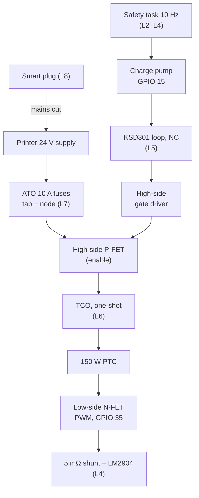
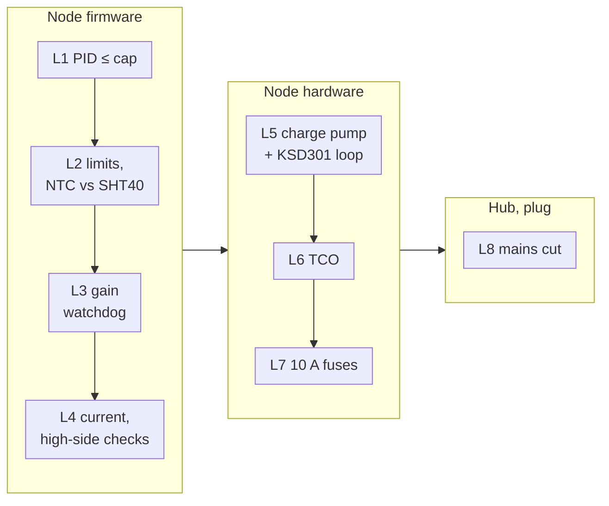
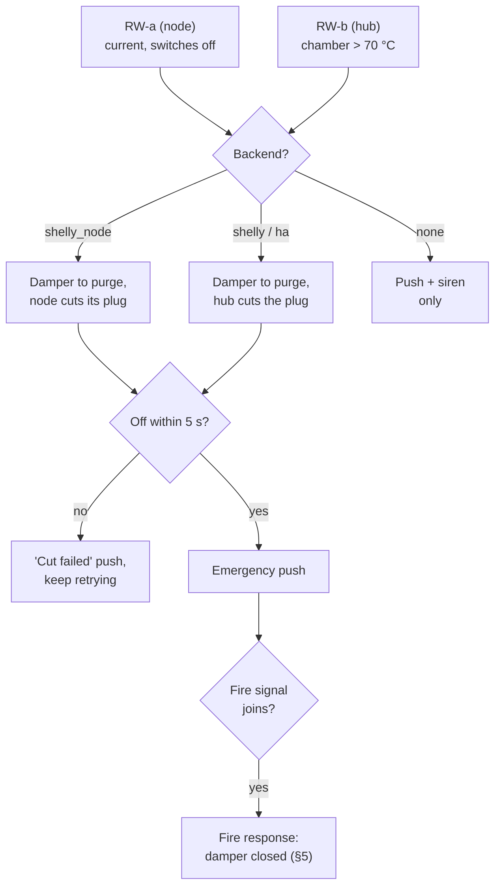
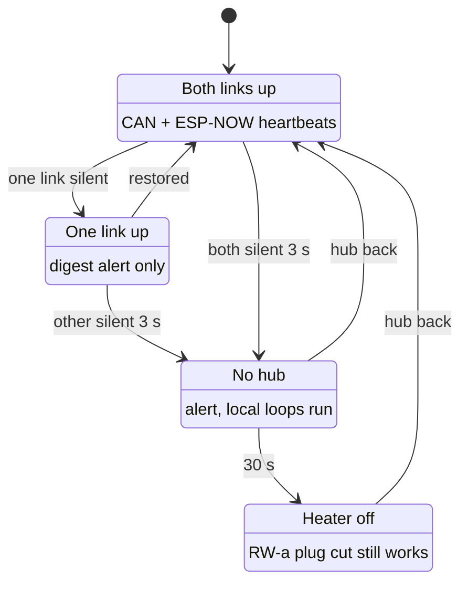
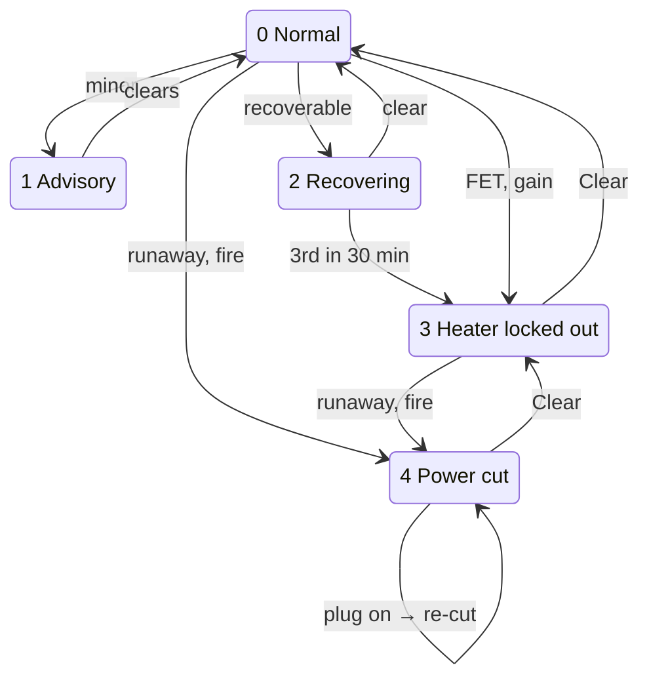
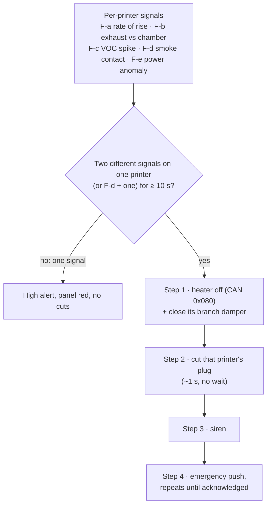
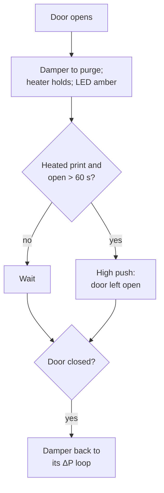

# 05 - Safety Design and Failsafes

> Design baseline, 2026-11-09. Earlier versions of this design had safety inversions: door-open closed the damper, the fire response didn't cut power, a dead hub stopped the fan, and the fin cutoffs sat inside normal PTC temperatures. This document replaces that logic.

---

## 1. Principles

| # | Principle | Source |
|---|---|---|
| S-1 | **Nothing in this system shuts down Klipper or cancels a print.** Faults degrade chamber heat or exhaust and raise alerts. The only exceptions are a **corroborated fire** or a **verified heater runaway** (both two-signal), where that printer's mains is cut. | P-2 |
| S-2 | **Each safety layer works without the layers above it.** Hardware without firmware, the node without the hub, all of it without Home Assistant. The mains-cut layer is the one exception: it needs Wi-Fi to reach the plug (and the HA server with the `ha` backend, D14), so it sits on top of hardware layers that need nothing. | P-3 |
| S-3 | **Unpowered or crashed means a safe state:** heater off, damper holding its last position, fan running (subject to the fan's own behaviour, R1). | F3 |
| S-4 | **Drastic actions need two independent signals.** Single signals only alert. | P-4 |
| S-5 | **Containment logic follows fume-hood practice:** an opening (door) gets *more* extraction, not less. | F1 |
| S-6 | **A standard, independent smoke alarm in the room is mandatory.** This system supplements it and doesn't replace it. | — |
| S-7 | **Monitoring features never feed a safety layer.** The trunk-flow venturi, low-flow anemometer, thermal model, leak-drift trend and heater step test only alert, log or refine estimates (such as purge air changes). The system stays safe with any of them missing, faulty or not yet built (doc 01 §8, stage 3). | D41 |

## 2. Fail-safe state of every component

| Component | If it loses power or crashes |
|---|---|
| Node heater stage | **Off.** The charge-pump enable needs a live square wave, and both FETs have gate pull-downs. |
| Node damper (MG90S) | Holds its last position (not spring-return). The hub and the other nodes are told over CAN, or by heartbeat timeout. |
| Node itself (logic) | Powered from the hub bus (or, on a wireless-only node, a 24 V brick that isn't on the printer's plug), so it survives the printer being switched off. |
| Heater power | Comes from the printer's own supply (D12) or from a heater brick on the same smart plug (D22, D64): printer off, or its plug cut, means no heater power. |
| Hub firmware | Hardware watchdog (ESP32 task WDT + RTC WDT) resets it. Nodes detect the missing hub heartbeat within 3 s. |
| Exhaust fan | **Must keep running** when the hub goes silent (F3). This is a gate on the fan choice (R1): a fan that can't do it isn't a supported exhaust fan (doc 02 §6). A board-powered 4-wire PWM fan on B2 (D85) keeps running while the firmware is silent, but stops if the hub's own supply fails (§4). A mains EC fan on B2's CTRL line (D95) runs at full speed from its own +10 V reference in both cases. |
| Hub supply failure (D35) | **The hub keeps running on printer power.** Every node whose printer is on feeds the bus (D13), and the hub's OUT switch passes that power back to the hub (doc 04 §3a). The hub sees its own supply input drop (D52), sends a **High "hub supply lost, running on printer power"** push and enters back-fed mode (doc 07 §11.7). It goes down only when the last printer feeding the bus is switched off or cut; then the nodes still fed from elsewhere keep their local loops (heater off after 30 s), dampers hold, and the fan (on its own mains) keeps running per R1. A printer that is still on but whose node went down with the bus (e.g. a node-lite on a printer that stays powered) sees its USB link drop, and its **klippy extra sends `_NOTIFY`** through the printer's own notifier over its Wi-Fi, so you're still told. When the hub supply returns, the hub boots, finds the powered segment and reconnects by itself. If no printer is on, the hub and every node without its own brick are off, so every heater stage is off (no enable). |

## 3. Chamber-heater protection (node-heat)

### 3.1 Layers

| Layer | Mechanism | Trip | Independent of |
|---|---|---|---|
| L1 | Node PID on chamber-air NTC | Setpoint ≤ `chamber.cap_c` (≤ 60 °C with a node heater) | — |
| L2 | **Firmware limits:** chamber > cap + 5 °C (≤ 65 °C); housing NTC > (measured normal max + 10 °C); NTC vs SHT40 disagree by > 5 °C; NTC open or short | Heater off, alert | L1 tuning |
| L3 | **Gain watchdog** (`verify_heater` equivalent): heater ≥ 50 % for `check_gain_time` 600–900 s with < 1 °C rise, or a drop > 5 °C below target while heating (hysteresis) | Heater off, alert | Sensor plausibility |
| L4 | **Current-sense checks:** current > 0.3 A while commanded off with one switch still working (welded FET) → the other switch off, heater **locked out** until reset, alert. **High-side output sense (GPIO 46, D64):** with the charge pump stopped (the high side off in hardware), a high reading for > 50 ms [E] means a high-side FET stuck on, which current sensing can't see while the low side is off → the low side off, heater **locked out** until reset, alert. The node checks it at boot and whenever the heater has been off for a second; it also reads low for the first 100 ms after each charge-pump start, so a normal turn-on isn't flagged. Current flowing with **both** switches commanded off → **runaway report** to the hub (§3.4). Current < 30 % of expected while on → open element, tripped TCO, or (C8) fan stall. Currents are measured from a zero taken at boot with both switches off; a zero outside its window locks the heater out (D50, doc 04 §4) | Heater off or runaway report, alert | Temperature sensors |
| L5 | **Hardware enable chain:** charge-pump (needs a toggling GPIO) in series with the **KSD301 loop** (heater-housing KSD301 + **chamber-air KSD301 ≈ 70 °C**) drives the high-side switch | MCU hang, housing over-temperature, or chamber air over-temperature | **All firmware** |
| L6 | **TCO** (one-shot) in series with the element | Rated per §3.2 | Everything electronic |
| L7 | **10 A fuses** at the printer supply tap and on the node's ORed heater rail | Short circuit | Everything |
| L8 | **Hub-commanded mains cut** of that printer through its smart plug (Shelly direct, or any plug via HA; §3.5) (removes printer and heater power) | Verified runaway (§3.4) or corroborated fire (§5) | The node's switches |

Heater power path and the hardware enable chain (layer tags from the table):

The KSD301 loop is the heater-housing and chamber-air thermostats in series. The smart plug's mains cut removes printer and heater power together.

How the layers stack: each one catches what the layer before it misses, and the hardware layers keep working with every task hung.

**Why the KSD301 sits in the enable chain rather than the load path:** it then switches milliamps instead of 6–15 A DC, so its AC-only contact rating (P5) no longer matters. The TCO is the one device in the load path. Pick one with a DC rating at ≥ 10 A, 32 V [U: confirm datasheet DC rating].

### 3.2 Setting the trip temperatures (open item O7)

PTC elements run their fins at roughly 150–250 °C by design (P4), so fixed numbers from earlier docs (72–75 °C fin trips) are wrong. Procedure on the bench, with the chosen heater module in its aluminium shroud:

1. Run at 100 % with normal airflow until steady. Record the **housing/bracket temperature at the KSD301 mounting point** (T_normal).
2. Repeat with the fan **blocked** (also the C8 stall test: record the PTC current drop). Record T_stall.
3. **KSD301 rating** = T_normal + ~15 °C, and **below the HDT of the nearest printed part** (ASA ≈ 95 °C). If T_normal is too high for that, move the KSD301 to a bracket point that's cooler but still rises sharply on stall.
4. **TCO rating** = KSD301 + ~20 °C, mounted on the same shroud.
5. **Firmware housing limit** = T_normal + 10 °C.

These numbers get recorded in doc 02 §3 after the bench test.

**Auto-characterisation (adapted from FLOOK32, D23).** The fixed ratings above (KSD301, TCO, 65 °C chamber limit) are set by hand and never changed by firmware. The firmware thresholds are measured per install instead of guessed. A **characterise run**, started from the dashboard in test mode with an empty, closed chamber:
- heats at 100 % to steady state, recording the heater-housing rise rate and T_normal, the chamber rise rate and the steady heater current;
- logs every temperature and pressure sensor at idle to measure its noise;
- cools with the damper at purge to measure the cooldown rate.

From these it **proposes** the L2 housing limit (T_normal + 10 °C), the L3 gain-watchdog window and minimum rise, the sensor-disagreement band, and the starting thermal-model parameters (doc 07 §11.5). Nothing is applied until you accept the proposal on the dashboard; accepted values go to NVS with the run's date. Re-run after changing the heater, insulation or enclosure, and after changing the hub supply or the chain length: fan A runs from the bus, whose voltage moves with both (doc 04 §6a). The blocked-fan stall test (step 2 above) stays manual, in validation (VAL-H6).

### 3.3 Inrush and printer-supply sharing

PTC cold current is 2–3× rated [E], and where the heater shares the printer's own supply (D12) the printer sees that surge; a heater brick (D22, D64) sees it alone. Mitigations:
- Firmware ramps the duty from 0 to 100 % over ~30 s.
- **Bed-heat interlock (D64):** on every supply, the node holds the heater off until the bed has reached its target (bed state from the USB link), then soft-starts it. This covers the bed's warm-up, when it draws full power for minutes. It doesn't cover the bed at temperature: it then switches full current on and off, so heater plus a bed on-pulse can still trip a supply that is too small; the learned supply cap below covers that. The board can't warn before a trip from the rail: a regulated supply holds its voltage until its over-current protection trips, so there is no droop to warn first.
- **Rail-voltage throttle (always active, D53, D64):** while the tap is live, the node reduces heater duty if the tap-side voltage drops below 23.0 V, so the printer's mainboard never sees a sag (R12). On a brick it backs off only below ≈ 21.5 V [E], just before the brick's own protection would trip: a brick's ±2 % tolerance, its cord (≈ 0.3 V at 6.25 A) and the DIN contacts can put a healthy brick's rail at ≈ 22.8–23.3 V, which a 23.0 V threshold would throttle. The rail is read on ESP32 GPIO 5 and 7 (D75), so the throttle doesn't depend on the carrier I/O controller; if a reading stops, the heater turns off.
- **`heater_power` and the learned supply cap (D64):** the installer picks a heater and a supply that suit each other and sets the node's `heater_power` (W) at installation, from the pack's qualified value (INS-8); the heater won't run until it is set. The heater runs at most at the lowest of the pack's `heater.max_w`, `heater_power` and the learned cap. The node keeps in NVS the highest heater power that has held for 60 s (the proven level) and a "heater on" flag, each written only when it changes. While the heater rail is live, fan A and B1 also draw from it (D78), so `heater_power` must leave room for them (≈ 4.3 W per 24 V 5015 blower [V: Mechatronics B5015E24B-BSR], plus the PTC module's fan [U], D78).
  - A **supply drop** is the heater rail falling below ≈ 18 V for > 20 ms [E] while the heater is on and the printer's plug reads on. A node that stays up (on the bus or a barrel logic brick) sees it directly and turns the heater off. A node that went down with the supply infers it at boot from the "heater on" flag, unless the hub cut the plug or commanded the restart; if the hub can't say, the drop counts (the safe direction).
  - On a drop the cap becomes **90 % of the proven level** (half of `heater_power` if nothing is proven yet), the proven level resets to it, and the node alerts "heater supply dropped out at X W, capped at Y W". Each further drop steps the cap down. It holds until cleared on the dashboard, e.g. after fitting a larger supply.
  - The first drop on a shared supply also resets the printer, so a printer model's supply limit is found in its pack's qualification (PQ-6), not mid-print, and an installation starts from the pack's qualified `heater_power`.
- The fuse is a slow-blow ATO 10 A; the FETs are rated ≥ 30 A with heatsinking copper.

**External heater brick (D22, D52, D64).** A DIN-4 brick plugs into the HEATER DIN jack, or a barrel brick into the HEATER barrel jack, in place of the printer tap. A printed shutter leaves only one of the two jacks open and covers both when the tap is used (doc 08 C21). If a tap and a brick are connected anyway, the **tap ideal diode** stops the brick back-feeding the printer's 24 V rail after its plug is cut, which would keep the mainboard and bed powered past the mains cut, and the **two-supply check** (doc 02 §2.2, D94: the tap side and the jacks' side of their ideal diodes each read directly, all the time) finds the brick at any voltage, refuses to heat, or stops, and alerts "two heater supplies connected, remove one". Otherwise the bed interlock and learned cap act the same on every supply, and the rail throttle differs only in its threshold (above). The soft-start ramp stays: a brick's over-current protection would otherwise hiccup on the cold inrush.
- **The brick must be on the printer's own smart plug.** If the plug reports off (Shelly read-back, or a cut the hub just made) while the heater rail is still live, the node **locks the heater out** and alerts "heater supply not on the printer's plug". Validation proves the check (VAL-H10), and the installation's plug check confirms each printer's heater rail drops with its plug before first use (INS-6).
- A logic brick on an ordinary outlet goes into the POWER IN barrel, which never reaches the heater rail (D64). A brick in the wrong barrel is safe: a heater brick in POWER IN leaves the heater rail dead (the node alerts "no heater supply"), and a logic brick's 5.5 × 2.1 mm plug doesn't fit the 5.5 × 2.5 mm HEATER barrel (D66). A heater plug does go onto the POWER IN pin, loosely, and that case is the safe one.

### 3.4 Heater runaway → mains cut

A runaway means heat the node can't stop, which needs a double fault (both switches, or the enable chain and a switch). Two independent physical measurements must agree, which satisfies S-4:

| # | Trigger | Signals |
|---|---|---|
| RW-a | Node reports **current > 0.3 A for ≥ 10 s with both switches commanded off**, and housing or chamber temperature rising | Heater current + NTC trend |
| RW-b | Hub sees **chamber > cap + 10 °C (≤ 70 °C) on both the NTC and the SHT40** for ≥ 60 s. Node-heat only: a printer that heats its own chamber relies on its own firmware for that heater | Two separate temperature sensors |

**Response:** the damper is commanded to purge to shed heat, then that printer's plug is cut at once without waiting for the damper (by the node directly with the `shelly_node` backend, otherwise by the hub) (printer and heater power go together), and an emergency push is sent. The damper goes first because a node that wrongly runs from that printer's plug would die at the cut (D35, §2). If any fire signal (§5) joins in, the fire response takes over and closes the damper. The print is lost either way, so there's no grace period. If the node is too dead to report, the TCO in the load path is the last layer and needs no electronics.

- **RW-a:** heater current > 0.3 A for ≥ 10 s with both switches off, and temperature rising.
- **RW-b:** chamber > cap + 10 °C (≤ 70 °C) on both the NTC and the SHT40 for ≥ 60 s.
- With `shelly_node`, RW-b reaches the node as the hub's `MAINS_CUT` (0x140+n); the node cuts and confirms.

**RW-a response decided (D40, closes O8):** the immediate cut above. A pause-and-stall alternative (pause the print with the bed hot, stop the heater fan so the PTC self-limits until the TCO opens, and escalate to the cut) was considered and not adopted. It depended on the host's `PAUSE` holding the bed, on the TCO reliably tripping in a fan stall, and on leaving a proven double-faulted heater powered while you're away. The print is a small loss next to that.

### 3.5 Mains-cut backends (D14)

"Shelly cut" in this document means the printer's configured mains-cut plug (doc 07 §10).

| Backend | What it adds or loses vs `shelly` |
|---|---|
| `shelly_node` (recommended) | Each node hosts a private access point for its own Shelly (doc 07 §10.1). The node→plug path needs **no router, hub or HA**: the node cuts on RW-a by itself, and executes the hub's cut for RW-b or fire over CAN or ESP-NOW. If the node dies, the plug falls back to the hub's own network (or home Wi-Fi) and the hub cuts it directly. With `ble_backup` (D102), the node falls back to Bluetooth when the plug isn't on its AP or a Wi-Fi cut fails, so a plug with a Wi-Fi fault can still be cut without the hub. |
| `shelly` | Hub → plug over the home LAN. Depends on the router. |
| `tasmota_node`, `tasmota` (D73) | The same as `shelly_node` and `shelly`, for metering plugs sold with Tasmota (doc 07 §10.3). One difference: after a fallback the plug stays on the hub's network until the hub moves it back to the node's AP, so for that time a `tasmota_node` cut takes the hub path. Wherever this document says `shelly_node` or `shelly`, the Tasmota backend of the same kind applies too. |
| `ha` | Works with any plug HA can switch, including Matter plugs you already own. It **also depends on the HA server being up and the plug's integration working**, so it adds a few hundred ms of latency and one more point of failure. Metering (F-e) only if the plug exposes a power sensor. **Cloud-only integrations are not acceptable** for this role, since an internet outage would block the cut. |
| `none` | No mains cut. RW-a/RW-b and corroborated fire raise emergency pushes and the siren only. The hardware layers L5–L7 still apply. |

The hub reads the plug back after every cut command and treats "still on after 5 s" as a failed cut. The 1-minute health poll covers all backends.

**Plug-local power limit (D16):** Shelly plugs also get their own over-power limit (printer peak × 1.3, doc 07 §10.5), and Tasmota plugs `MaxPower` (doc 07 §10.3). That is a gross-overload trip inside the plug that works with the hub, node and Wi-Fi all down.

**If the plug (or HA) is unreachable** when a cut is needed, the hub sends an emergency push ("mains cut failed, act now") and keeps retrying. The hub also polls every plug once a minute and raises a high alert if one stops answering.

**BLE backup (D102, Shelly only):** before the hub declares a failed cut, a node with `ble_backup` has also tried the cut over Bluetooth. A node that can't reach its plug over either path reports it, and the hub then tries the plug's fallback network.

## 4. Fault-response matrix

**Print** = what happens to the print. **Push** = notification priority (doc 07 §7). Each fault's level, and how it's cleared, is in §4.1.

| Fault | Detected by | Automatic action | Print | Push |
|---|---|---|---|---|
| Heater over-temp / runaway (L2–L4) | Node | Heater off; damper stays in bleed; fan keeps running | Continues (chamber cools) | **High** |
| Heater fan stall | Tach, or C8 current signature + housing NTC | Heater off | Continues | **High** |
| Fan A and B1 with no heater supply (D78, D94) | Tap side and jack side < 20 V on a node-heat | Fan A and B1 off (B1 at full duty only while the controller is absent); not a stall | Continues | Log only |
| Welded heater FET (one switch) | Node current sense; high-side output sense (GPIO 46) for the high side | The other switch off; heater locked out until reset | Continues (chamber cools) | **High** |
| **Heater runaway** (both switches failed, RW-a/RW-b) | Node current sense; hub temperature check | Damper to purge, then **Shelly cut of that printer** (D35) | **Stopped (power cut)** | **Emergency** |
| Mains-cut plug unreachable (Shelly, HA server or HA entity unavailable) | Hub poll (1 min) | None | Continues | High |
| Chamber NTC / SHT40 fault | Node | Heater off | Continues | High |
| Node firmware hang | Hardware charge-pump; hub heartbeat timeout | Heater off (hardware); hub alerts after 10 s | Continues | High (from hub) |
| **Combined board firmware hang** (D84, doc 04 §7a) | Hardware charge pump; carrier I/O controller (no I²C poll for 10 s) | Heater off (hardware); the exhaust fan runs at full speed (B2 floats); red alarm on LED chain 1. **No remote alert from the board itself**: no other carrier watches it, so set up a "board offline" alert in Home Assistant or on the plug | Continues | Local only, unless HA or the plug alerts |
| Node unplugged from CAN (cable) | CAN heartbeat timeout | Traffic continues on ESP-NOW (doc 07 §6.4); nothing else changes | Continues | Digest |
| **Both hub links lost** (CAN and ESP-NOW) | Hub and node heartbeat timeouts | Hub alerts; node keeps its local loops, heater off after 30 s (no mains-cut backstop from the hub; the `shelly_node` cut still works for RW-a) | Continues | High |
| **Hub supply lost** (D35) | Hub: current flowing back into it through its OUT switch | Back-fed mode (doc 07 §11.7): LED cap, one servo at a time, siren and push before any cut. A board-powered exhaust fan (on the fan tap, D85) stops with the supply, and the push says so; a fan on its own mains keeps running, at full speed on CTRL (D95); a second fan on its own brick (D95) keeps running at full speed | Continues | **High** |
| **Node lost when its plug is switched off** (D35) | Hub: a node drops offline within 10 s of its printer's plug reading off (Shelly read-back) | Alert "node powered from the printer's plug": its purge and fire response would fail at a cut | Continues | **High** |
| CAN degraded (error-passive, repeated bus-off) | Error counters (doc 07 §6.2) | Auto-recovery; traffic on ESP-NOW; faulty segment named | Continues | Digest |
| **Printer USB link lost** (Tier 2 links) | Klippy extra; node | Extra reconnects. Node keeps going on Moonraker state if Wi-Fi is up; with no confirmation of an active print from either path for 30 s → heater off, damper bleed | Continues; an active `M191` wait ends on its timeout (doc 07 §4) | Normal (link restored) / High (both paths lost) |
| Wi-Fi lost | Everything | No safety impact. CAN and USB carry on; alerts queue until it's back; panel LED shows amber | Continues | Panel only, then push when restored |
| Hub crash / reboot | Nodes (CAN heartbeat) | Nodes turn heaters off after 30 s without the hub (no mains-cut backstop from the hub; the `shelly_node` / `tasmota_node` cut still works for RW-a) and resume when it's back; each node keeps its chamber loop running while its own chamber ΔP shows the trunk still drawing, and holds its last angle otherwise (O14, D106; doc 06 §4); the fan keeps running (F3, R1) | Continues | High via printer `_NOTIFY` if > 60 s |
| **Exhaust lost** (fan fault: trunk ΔP not reached with fan commanded) | Hub | Alert. Dampers stay open (passive venting via the backdraft flap path). After the print, nodes hold dampers closed and the message says "vent manually" | **Finishes** | **High** |
| **Exhaust fan not under control** (D98): tach and trunk ΔP don't follow the commanded duty (no response to a ≥ 50 % change for 30 s [E]) | Hub | Alert naming the likely causes: SWAP or DC set against the fan's pack (doc 13), the control cable, or a fan running at its own no-signal speed. The trunk loop carries on with whatever flow the fan gives; if the setpoint is not reached, the Exhaust lost row applies | Continues | High |
| Filter loading high | Hub filter ΔP vs fan-speed curve | — | — | Daily digest + panel amber |
| Filter blocked (severe) | Hub | — | Continues | **High** + panel red/buzzer if unacknowledged 15 min |
| Damper stuck or slipped | Node: **encoder angle doesn't follow the command** (> 5° for 5 s, D30), fan on or off; backed by the ΔP check (commanded change with no ΔP response) | Stop the servo pulses, so a jam can't hold the servo at stall current on the power buck (D56); try a gentle re-seat (≤ 1 s drive, ≥ 30 s apart) | Continues | High if stuck closed during a print, normal otherwise |
| Damper not closed when it should be (idle, fire, heat hold) | Node encoder (D30) | Retry close; on a fire the hub treats that branch as open | Continues | High on a fire, normal otherwise |
| Damper encoder lost or implausible (no magnet, I²C error) | Node | Falls back to ΔP-only stuck detection and the commanded angle; purge air changes from time only | Continues | Digest |
| Makeup flap out of window (D90): crack-test opening point < ≈ 6 Pa or > ≈ 30 Pa, or the hold angle at −3 Pa not back at baseline after a purge | Node chamber ΔP and encoder | Heated-print setpoint −2 Pa if the opening point is low | Continues | Digest ("check makeup flap") |
| Chamber leakier than its baseline (D32): bleed flow up > 50 % or angle at −3 Pa drifting open | Node encoder trend; hub anemometer when the printer runs alone; heater step test | — | Continues | Digest ("check door seal and pass-throughs") |
| Low-flow anemometer fault (open or shorted NTC, no temperature rise with heat on, element over 80 °C) | Hub | Heater off; low-flow readings marked invalid; venturi only | Continues | Digest |
| Chamber positive pressure sustained (> 0 Pa for 60 s while printing) | Node | Open damper toward purge; check trunk | Continues | High |
| **Door open** | Node reed, or the printer's door objects over its link (`door.source`), with the network link as backup | **Damper to purge**; heater holds its setpoint; LED amber | Continues | High if open > 60 s during a heated print; otherwise none |
| Klipper shutdown / error / print cancelled | Node via USB or Moonraker | Heater off, normal purge | (already stopped) | Normal (the printer's own notifications usually report print errors already) |
| Printer powered off mid-print | Node: USB and Moonraker both lost, then heartbeat logic | Heater off after 30 s; purge with defaults | — | High |
| Room VOC elevated (leak trend) | Hub room sensor | Log on dashboard | — | Daily digest |
| **Thermal-model anomaly** (chamber off its predicted curve, doc 07 §11.5) | Node | None (alert only, names likely causes) | Continues | Normal; High if heating and > 5 °C under prediction for 10 min |
| **Plug switched on while a cut is latched** (Moonraker, HA, Shelly app, power restore) | Hub or node plug poll | Cut again within 5 s (§4.1) | (no print) | **Emergency** |
| **Fire: single signal** | §5 | Alert, panel red, **no cuts** | Continues | **High** |
| **Fire: corroborated** | §5 | **Heater off command; Shelly cut of that printer (printer + heater power); that branch's damper closed; siren** | **Stopped (power cut)** | **Emergency** (repeats until acknowledged) |

**Escalation for recoverable faults (adapted from FLOOK32, D23).** Faults that a loose connector, a noisy reading or a brief transient can cause don't lock the heater out on the first trip:
1. **Stage 1:** heater off, normal-priority log entry. Once the fault has cleared and stayed clear for a hold time (default 2 min), the node re-checks and resumes heating.
2. **Stage 2:** the same fault again within the window (default 30 min): heater off, longer hold (default 10 min), **High** push.
3. **Stage 3:** the third occurrence within the window: **latched heater lockout** (doc 07 §11.1) until you clear it.

This applies to: chamber NTC or SHT40 read errors, NTC vs SHT40 disagreement, NTC open/short, a KSD301 loop opening (it re-closes once cool), and heater fan stall (not counted on a node-heat while no heater supply is live, D78, D94). Counters are kept in NVS, so a reboot doesn't reset them. **Never retried**, always an immediate latched lockout or cut: welded FET, heater runaway (RW-a/RW-b), gain-watchdog trip, chamber over 60 °C, and corroborated fire. The print continues through every stage, as before.

**Hub-link loss, as each node sees it** (doc 07 §6.2):

When the hub comes back, the heater resumes.

### 4.1 Fault levels, print holds and recovery (D27)

Every fault in the matrix falls into one of five levels. The level decides what stops, what you see and what ends it. Two actions are kept apart everywhere (dashboard, hub panel button, Pushover, printer macros):
- **Acknowledge** silences an alert's repeats and buzzer escalation. It never changes a safety state.
- **Clear** ends a latched state, after the checks below. A heater lockout (level 3) can be cleared either on the dashboard with the PIN or with `FLEET_CLEAR` on the printer (touchscreen or its web UI). A power cut (level 4) also needs you **at the printer** (O12, decided).

| Level | Examples | Heater | Print | Plug | You see | Ends by |
|---|---|---|---|---|---|---|
| **0 Normal** | — | Runs | Runs | On | Green | — |
| **1 Advisory** | Filter loading, thermal-model anomaly, a link degraded, a single fire signal, door open | Unchanged | Continues | On | Amber; push per doc 07 §7 | The condition clearing |
| **2 Recovering** | Escalation stages 1–2 (§4), hub links lost, printer link lost | Off for the hold time | Continues unheated | On | Amber, "retrying in m:ss" | Automatic, once the condition stays clear |
| **3 Heater locked out** (latched) | Escalation stage 3, welded FET, gain-watchdog trip | Locked out | Continues unheated; the **next heated job is held** | On | Red on that printer; High push | **Clear**, once the node's self-check passes |
| **4 Power cut** (latched) | Runaway (RW-a, RW-b), corroborated fire | Locked out | Stopped | **Off, and held off** | Red; Emergency push; siren for fire | **Clear** with the inspection checklist, then you switch the plug on |

**Print hold (the all-clear gate).** A job that asks for chamber heat (`M191`, a heated `FLEET_EXHAUST` mode, or a heated material policy) is **held** while its printer is at level 3, which includes the first heated job after a level-4 Clear. The extra issues `PAUSE` during the chamber wait, before the first layer, shows the reason on the printer screen and sends a High push. You then pick one:
- **Clear** the lockout (dashboard or `FLEET_CLEAR`), then `RESUME`: the job heats normally.
- `RESUME` without clearing: the job runs **unheated**, and the log says so.
- `CANCEL_PRINT`.

Jobs that don't ask for heat are never held. `PAUSE` is an ordinary Klipper command, so the hold keeps the rule that the extra never shuts down or errors the printer's firmware (doc 12 §6 item 8). On a printer with no host plugin (Tier 0 or 1), there's no hold: the job runs unheated and the dashboard shows why.

**Why a hold isn't enough at level 4.** A hold works when the hazard is the node's own heater, because the node can keep that locked out. Level 4 means the node has already failed to stop the heat (RW-a: both switches failed) or there's a fire, so the hazard is **the power itself**: switching the plug back on re-powers a heater the node can't turn off. There's also no running print left to hold. So level 4 holds the plug off:
- The hub (or the node, with `shelly_node`) keeps polling the plug. If it comes back on while latched, from Moonraker's `on_when_job_queued`, a Home Assistant automation, the Shelly app or the plug's power-restore default, it's **cut again within 5 s**, and an Emergency push names the source when it's known. Safety doesn't depend on finding every such setting. The installation wizard sets the plug's power-on behaviour to **restore last state** (doc 07 §10.5, D38), so a cut plug comes back off after a mains outage while a power blip doesn't leave running printers off, and leaves `on_when_job_queued` off, so you don't get nuisance re-cuts (INS-6; proven in VAL-F7).
- **Clear at level 4** is two steps, so it can't be done remotely:
  1. On the dashboard, you confirm you've inspected the printer, heater and wiring (a short checklist, logged with your note). The printer is off, so `FLEET_CLEAR` can't start this.
  2. Within 2 minutes, **at the printer**, you press and hold the node's **CLEAR button for 3 s** (the carrier's BOOT switch, D72, through a plunger in the node housing; doc 08 C5). The node LED confirms.

  The hub then lets you switch the plug on; it never does that itself.

  The node boots with the heater locked out and runs its self-check (both switches off with no current, KSD301 loop closed, sensors plausible), and the printer comes back at **level 3**. A timed inspection window, ending in `FLEET_CLEAR` on the powered printer, was considered and not adopted (O12, D106): `FLEET_CLEAR` can be sent through Moonraker from anywhere, so it doesn't prove someone is at the printer the way the button does.
- After a **runaway**, a hardware fault is proven, so the level-3 Clear also needs the installation self-check (INS-4) to pass on that node, which tests both switches, the high-side sense, the KSD301 loop and the charge pump (D106). If it fails, the heater stays locked out until the carrier is replaced or repaired. Either way the node keeps a **fault report** (doc 07 §8): its configuration, profile, firmware version, the event log and the sensor history around the runaway, which the dashboard offers to send as a prefilled GitHub issue, so every runaway in the field reaches the project. After a **fire**, it needs the inspection only.

## 5. Fire detection and response

**Signals.** Each is evaluated per printer:

| # | Signal | Threshold (initial; tuned in validation, VAL-F8 and VAL-A4) |
|---|---|---|
| F-a | Chamber temperature rate of rise not explained by the heater | > 3 °C/min with heater < 20 %, or > 6 °C/min any time |
| F-b | Branch exhaust minus chamber delta (relative over-temp, P8), from the sensor head at the exhaust port vs the chamber NTC | Head > chamber + 15 °C |
| F-c | Chamber VOC/NOx raw signal spike | Step > N σ of the print's running baseline |
| F-d | Smoke detector dry contact (optional, hub input; applies to the whole room) | Contact closed |
| F-e | Printer power draw anomaly (plug metering: Shelly `apower` or the HA power sensor; unavailable on plugs without metering) | > 1.5× the printer's rated draw for 10 s |

**Sources on a printer that heats its own chamber** (node-lite with `chamber.native_heater: true`; D39). The node has no chamber NTC or heater there, so:
- **F-a** uses the printer's own chamber sensor over the printer link (USB, or Moonraker), and "heater" means the printer's chamber-heater duty from the same link. With the link down, F-a falls back to the sensor head's SHT40 and the 6 °C/min any-time threshold only.
- **F-b** compares the sensor head at the exhaust port with the printer's chamber sensor; it needs the link.
- **F-c, F-d and F-e** are unchanged.

So these printers keep two-signal corroboration with or without the link (F-a, F-c, F-e, plus F-d). A runaway of the printer's own chamber heater is left to the printer's firmware; RW-b covers node heaters only (§3.4).

**Corroboration rule (S-4):** **two different signals on the same printer** (or F-d plus any one signal) sustained for ≥ 10 s → fire response. One signal → high-priority alert only.

**Response order (D35):**
1. Command the node's heater off (CAN 0x080) **and** close that branch's damper, in the same instant. Closing starves the duct of the fire's draught and protects the shared carbon cartridge and the other chambers.
2. Cut the affected printer's Shelly plug ~1 s later, **without waiting** for the damper to confirm. This also removes heater power (D12). The damper is commanded first because the node may not survive the cut (a misconfigured wireless-only node, or the whole bus in back-fed mode, §2).
3. Siren (panel buzzer pattern).
4. Emergency push, repeated until acknowledged.

In **back-fed mode** (hub supply lost, doc 07 §11.7) the siren and push go **before** the cut, because that printer may be the hub's only power.

The other printers keep running. The **room smoke alarm** remains the primary life-safety device.

**Why close the damper rather than open it:**
- An enclosure fire is mostly fuelled by the material inside it. Extraction would pull flame and smoke into the filter, and the carbon is a fire load.
- Power removal is what actually stops an electrical or hotend fire (F2).

## 6. Door logic (F1)

- Door open → damper to purge, heater holds. Pulling extra air through the opening keeps fumes inside the enclosure, as in a fume hood.
- Door open longer than 60 s during a heated print → high-priority push ("door left open, chamber losing heat").
- No auto-pause. Peeking at a print is normal.
- Door state shows on the bed LED (amber) and the dashboard.

## 7. Electrical safety

| Item | Rule |
|---|---|
| Mains | In the hub enclosure only with an internal PSU (a hub on a brick has none, D92), and inside a printer's base only if its supply is upgraded (below). Hub with an internal PSU: IEC inlet with fuse and switch, PE to the PSU case and inlet earth, strain relief, PSU terminal cover. **No mains on the carrier PCB.** |
| 24 V protection | Polyfuse, TVS and ≈ 34 V over-voltage guard on the IN jack (D56); TVS and 60 V-rated detect-before-power parts on the OUT jack, and a ≈ 34 V over-voltage cut on the heater rail through the hardware enable chain and a resettable fuse on the fan A / B1 feed (D57, D94); no USB power path into the carrier (D72; the D36 reset hold before); reverse-blocking, current-limited eFuse on every bus injection point (D13); 10 A ATO within 15 cm of each printer supply's heater tap and on each node's heater rail; one heater supply at a time behind a shutter, with tap and jack ideal diodes and a passive two-supply check (D64, D94), and an ideal diode on each board-supply input with POWER IN preferred (D94); reverse-polarity P-FET; SMBJ33A TVS. |
| Conductor sizing | 14 AWG heater leads ≤ 1.5 m (doc 04 §6); CAT6 ≤ 0.75 A per conductor (logic only; ≈ 1.5 A per segment, kept low so CCA or Cat5 patch cables are safe, D21); 1 oz copper with ≥ 4 mm stitched pours on both layers along the carrier heater path (D59). |
| Inside a printer | Reuse: 24 V DC work at the supply terminals only. Upgrade: mains work in the printer base to the original standard (same terminals, earth bond restored, cover refitted). |
| Hot parts | Heater element in a sheet-aluminium shroud; printed parts near heat in ASA; no PETG inside heated chambers (ARG-12). |
| Connectors | Locking or friction-latched (RJ45, XT60, DIN-4, JST-XH); the JST-SH sensor plugs are friction-held, so each sensor cable is tied down near both ends (D69); the barrel jacks are friction-only, so each is rated ≥ 1.5 × the current through it (HEATER barrel 15 A for ≤ ≈ 7.8 A, D66); THT for power. |

## 8. Room safety

| Item | Decision |
|---|---|
| Smoke alarm | **Mandatory**, standard household unit in the room (S-6). A relay-output model can also feed F-d. |
| CO alarm | Optional when there are no combustion appliances in the room; required if there are. |
| Makeup air | Peak purge ~50 CFM. A typical, not airtight, house supplies that through its own leakage; check a tight or mechanically ventilated house. No backdraft hazard without combustion appliances in the room. |
| Noise | Bleed at low fan speed, near-silent; purge at higher speed for a few minutes (P-6). |

## 9. Safety tests and where they run

Until 2026-11-09 this section held one list of commissioning tests (1–36), run by every builder. They are now split by who runs them and with what (D104):

| Step | Who | Equipment | Home |
|---|---|---|---|
| **Validation** (`VAL-…`) | The project, on prototype boards | Lab bench | [`validation/procedures.md`](../validation/procedures.md) |
| **Qualification** (`PQ-…`, `FQ-…`) | The author of a printer or fan pack | Dashboard, test modes and a multimeter | [Doc 12 §7](12_porting_guide.md#7-porting-checklist-and-printer-qualification), [doc 13 §4](13_fan_packs.md#4-fan-qualification) |
| **Installation** (`INS-…`) | The builder | None | [Doc 14 §4](14_build_your_own.md#4-install-and-commission) |

**No unattended heated printing** until the boards' revision has passed validation, the printer's pack is `qualified`, and that fleet's installation checks have passed. The table below keeps the old numbers so older references still resolve.

| Old | Test | Now |
|---|---|---|
| 1 | ESP32 in reset stops the heater (L5) | VAL-H1 |
| 2 | Static charge-pump pin stops the heater (L5) | VAL-H2; per board automatically in INS-4 |
| 3 | KSD301 loop opens the chain | VAL-H3; loop closed checked in INS-4 |
| 4 | Welded FETs, shunt zero (L4) | VAL-H4; high-side sense checked in INS-4 |
| 5 | Runaway → mains cut | VAL-H5; each plug's cut in INS-6 |
| 6 | CAN loss | VAL-F1 |
| 7 | Hub loss: heaters off, fan keeps running | VAL-F2 (heaters, notify); FQ-6 per fan model (fan) |
| 8 | Supply load test | PQ-6 per printer model; VAL-H8 (rail reading, throttle, learned cap) |
| 9 | USB ground share | VAL-H9 on the reference printer; PQ-6 checks link errors |
| 10 | USB unplug mid-print | PQ-3 |
| 11 | Heater fan stall | VAL-H6 |
| 12 | Door open during a heated print | VAL-F9; PQ-5 per door source |
| 13 | Fire corroboration | VAL-F8; PQ-9 for a printer's own heater |
| 14 | Gain watchdog (L3) | VAL-H7 |
| 15 | Plug unreachable, test cut, node-direct cut | VAL-S1; INS-6 per plug |
| 16 | Bus power sharing | VAL-P2; INS-5 (automatic bus load check) |
| 17 | ESP-NOW failover | VAL-F3 |
| 18 | Plug power limit | VAL-S2; INS-6 sets and reads it back |
| 19 | Latches survive a reboot | VAL-F4 |
| 20 | OTA | VAL-F5 |
| 21 | RJ45 into network gear | VAL-P3 |
| 22 | Router off | VAL-F6 |
| 23 | External heater brick, two-supply check | VAL-H10; INS-6 (heater rail drops with the plug) |
| 24 | Characterise run | PQ-7 (pack ranges); INS-8 per node |
| 25 | Latched cut holds, level-4 Clear | VAL-F7; INS-6 (re-cut from the plug's app) |
| 26 | Print hold | VAL-F10; PQ-8 per printer's Klipper |
| 27 | Damper encoder | VAL-A3; INS-4 damper sweep |
| 28 | Anemometer protection | VAL-A5 |
| 29 | Plug-off survival | VAL-P5; INS-6 per printer |
| 30 | Hub supply loss | VAL-P6 |
| 31 | USB back-power | VAL-P4 |
| 32 | Controller hang | VAL-C2 |
| 33 | Controller reset line | VAL-C3 |
| 34 | Expansion port | VAL-C4 |
| 35 | Board supply and fan feed | VAL-P1 |
| 36 | BLE backup cut | VAL-S3 |

A safety change to the design needs a matching validation test, and a per-printer or per-installation check where the change depends on the printer or the installation (CONTRIBUTING.md).
