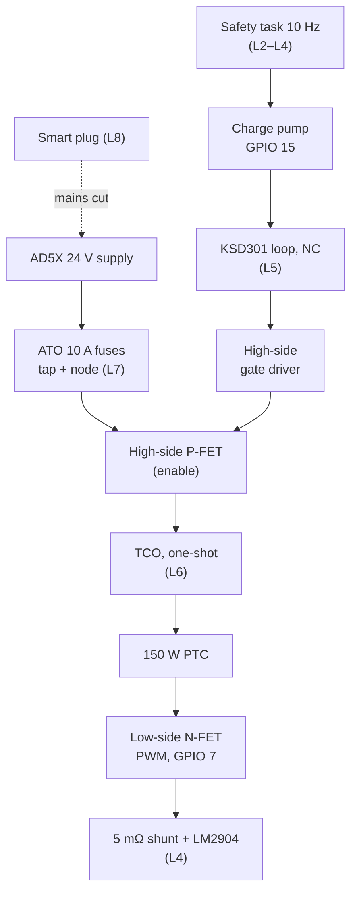
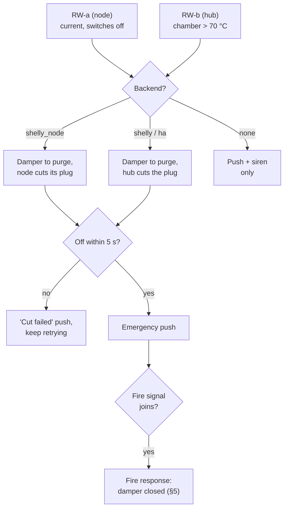
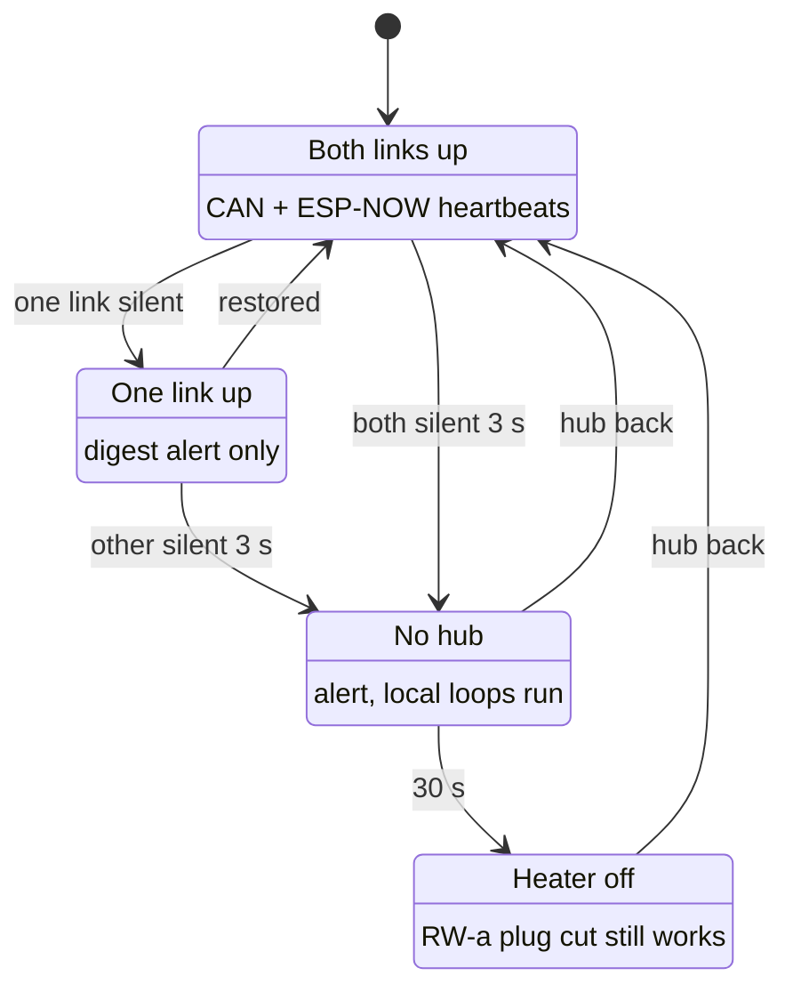
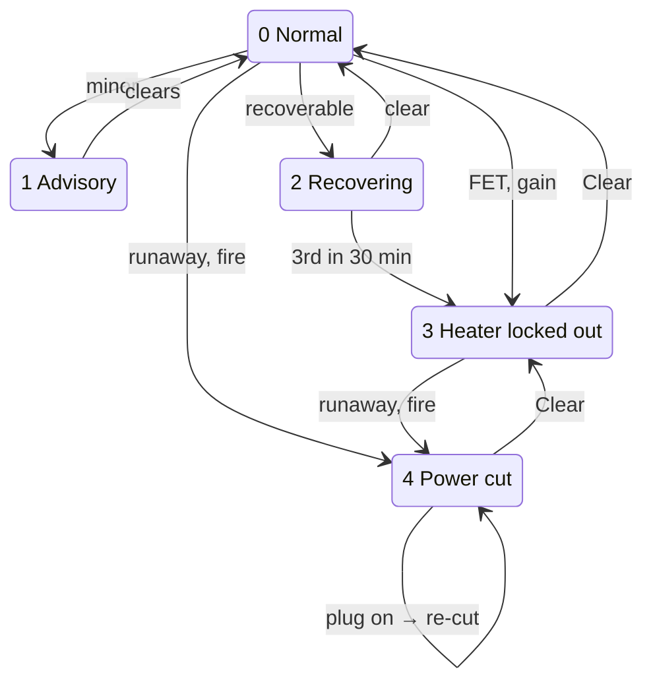
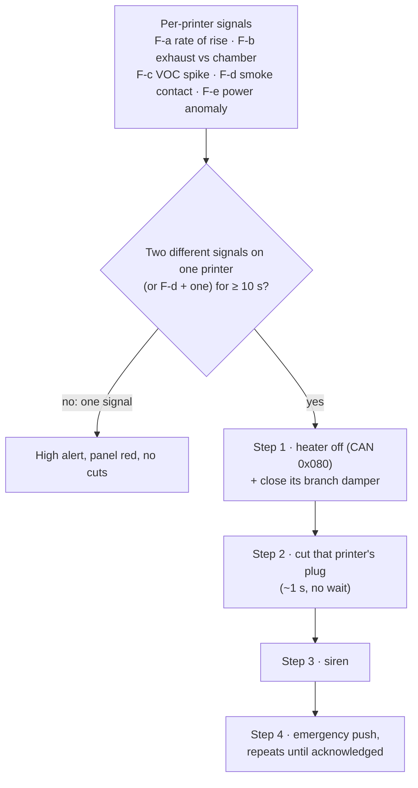

# 05 - Safety Design and Failsafes

> Design baseline, 2026-10-25. Earlier versions of this design had safety inversions: door-open closed the damper, the fire response didn't cut power, a dead hub stopped the fan, and the fin cutoffs sat inside normal PTC temperatures. This document replaces that logic.

---

## 1. Principles

| # | Principle | Source |
|---|---|---|
| S-1 | **Nothing in this system shuts down Klipper or cancels a print.** Faults degrade chamber heat or exhaust and raise alerts. The only exceptions are a **corroborated fire** or a **verified heater runaway** (both two-signal), where that printer's mains is cut. | P-2, Q37 |
| S-2 | **Each safety layer works without the layers above it.** Hardware without firmware, the node without the hub, all of it without Home Assistant. The mains-cut layer is the one exception: it needs Wi-Fi to reach the plug (and the HA server with the `ha` backend, D14), so it sits on top of hardware layers that need nothing. | P-3 |
| S-3 | **Unpowered or crashed means a safe state:** heater off, damper holding its last position, fan running (subject to R1). | F3 |
| S-4 | **Drastic actions need two independent signals.** Single signals only alert. | P-4, Q32 |
| S-5 | **Containment logic follows fume-hood practice:** an opening (door) gets *more* extraction, not less. | F1 |
| S-6 | **A standard, independent smoke alarm in the room is mandatory.** This system supplements it and doesn't replace it. | — |
| S-7 | **Monitoring features never feed a safety layer.** The trunk-flow venturi, low-flow anemometer, thermal model, leak-drift trend and heater step test only alert, log or refine estimates (such as purge air changes). The system stays safe with any of them missing, faulty or not yet built (doc 01 §8, stage 3). | D41 |

## 2. Fail-safe state of every component

| Component | If it loses power or crashes |
|---|---|
| Node heater stage | **Off.** The charge-pump enable needs a live square wave, and both FETs have gate pull-downs. |
| Node damper (MG90S) | Holds its last position (not spring-return). The hub and the other nodes are told over CAN, or by heartbeat timeout. |
| Node itself (logic) | Powered from the hub bus (or, on a wireless-only node, a 24 V brick that isn't on the printer's plug), so it survives the printer being switched off. |
| Heater power | Comes from the printer's own supply (D12): printer off, or its Shelly cut, means no heater power. |
| Hub firmware | Hardware watchdog (ESP32 task WDT + RTC WDT) resets it. Nodes detect the missing hub heartbeat within 3 s. |
| Exhaust fan (G4) | **Must keep running** when the hub goes silent. This is a gate on R1: if the G4 can't be made to do this, switch to the fallback fan. |
| Hub PSU failure (D35) | **The hub keeps running on printer power.** Every node whose printer is on feeds the bus (D13), and the hub's OUT switch passes that power back to the hub (doc 04 §3a). The hub sees its own supply input drop (D52), sends a **High "hub supply lost, running on printer power"** push and enters back-fed mode (doc 07 §11.7). It goes down only when the last printer feeding the bus is switched off or cut; then the nodes still fed from elsewhere keep their local loops (heater off after 30 s), dampers hold, and the fan (on its own mains) keeps running per R1. A printer that is still on but whose node went down with the bus (e.g. the C5's node-lite) sees its USB link drop, and its **klippy extra sends `_NOTIFY`** through zmod notify (printer Wi-Fi), so you're still told. When the hub supply returns, the hub boots, finds the powered segment and reconnects by itself. If no printer is on, the hub and every node without its own brick are off, so every heater stage is off (no enable). |

## 3. Chamber-heater protection (node-heat)

### 3.1 Layers

| Layer | Mechanism | Trip | Independent of |
|---|---|---|---|
| L1 | Node PID on chamber-air NTC | Setpoint ≤ `chamber.cap_c` (AD5X: 60 °C) | — |
| L2 | **Firmware limits:** chamber > cap + 5 °C (AD5X: 65 °C); housing NTC > (measured normal max + 10 °C); NTC vs SHT40 disagree by > 5 °C; NTC open or short | Heater off, alert | L1 tuning |
| L3 | **Gain watchdog** (`verify_heater` equivalent): heater ≥ 50 % for `check_gain_time` 600–900 s with < 1 °C rise, or a drop > 5 °C below target while heating (hysteresis) | Heater off, alert | Sensor plausibility |
| L4 | **Current-sense checks:** current > 0.3 A while commanded off with one switch still working (welded FET) → the other switch off, heater **locked out** until reset, alert. Current flowing with **both** switches commanded off → **runaway report** to the hub (§3.4). Current < 30 % of expected while on → open element, tripped TCO, or (C8) fan stall. Currents are measured from a zero taken at boot with both switches off; a zero outside its window locks the heater out (D50, doc 04 §4) | Heater off or runaway report, alert | Temperature sensors |
| L5 | **Hardware enable chain:** charge-pump (needs a toggling GPIO) in series with the **KSD301 loop** (heater-housing KSD301 + **chamber-air KSD301 ≈ 70 °C**) drives the high-side switch | MCU hang, housing over-temperature, or chamber air over-temperature | **All firmware** |
| L6 | **TCO** (one-shot) in series with the element | Rated per §3.2 | Everything electronic |
| L7 | **10 A fuses** at the printer supply tap and on the node's ORed heater rail | Short circuit | Everything |
| L8 | **Hub-commanded mains cut** of that printer through its smart plug (Shelly direct, or any plug via HA; §3.5) (removes printer and heater power) | Verified runaway (§3.4) or corroborated fire (§5) | The node's switches |

Heater power path and the hardware enable chain (layer tags from the table):

The KSD301 loop is the heater-housing and chamber-air thermostats in series. The smart plug's mains cut removes printer and heater power together.

**Why the KSD301 sits in the enable chain rather than the load path:** it then switches milliamps instead of 6–15 A DC, so its AC-only contact rating (P5) no longer matters. The TCO is the one device in the load path. Pick one with a DC rating at ≥ 10 A, 32 V [U: confirm datasheet DC rating].

### 3.2 Setting the trip temperatures (open item O7)

PTC elements run their fins at roughly 150–250 °C by design (P4), so fixed numbers from earlier docs (72–75 °C fin trips) are wrong. Procedure on the bench, with the chosen heater module in its aluminium shroud:

1. Run at 100 % with normal airflow until steady. Record the **housing/bracket temperature at the KSD301 mounting point** (T_normal).
2. Repeat with the fan **blocked** (also the C8 stall test: record the PTC current drop). Record T_stall.
3. **KSD301 rating** = T_normal + ~15 °C, and **below the HDT of the nearest printed part** (ASA ≈ 95 °C). If T_normal is too high for that, move the KSD301 to a bracket point that's cooler but still rises sharply on stall.
4. **TCO rating** = KSD301 + ~20 °C, mounted on the same shroud.
5. **Firmware housing limit** = T_normal + 10 °C.

These numbers get recorded in doc 02 §3 after the bench test.

**Auto-characterisation (adapted from FLOOK32, D23).** The fixed ratings above (KSD301, TCO, 65 °C chamber limit) are set by hand and never changed by firmware. The firmware thresholds are measured per install instead of guessed. A **characterise run**, started from the dashboard in test mode with an empty, closed chamber:
- heats at 100 % to steady state, recording the heater-housing rise rate and T_normal, the chamber rise rate and the steady heater current;
- logs every temperature and pressure sensor at idle to measure its noise;
- cools with the damper at purge to measure the cooldown rate.

From these it **proposes** the L2 housing limit (T_normal + 10 °C), the L3 gain-watchdog window and minimum rise, the sensor-disagreement band, and the starting thermal-model parameters (doc 07 §11.5). Nothing is applied until you accept the proposal on the dashboard; accepted values go to NVS with the run's date. Re-run after changing the heater, insulation or enclosure. The blocked-fan stall test (step 2 above) stays manual.

### 3.3 Inrush and printer-supply sharing

PTC cold current is 2–3× rated [E], and the heater shares the printer's own supply (D12). Mitigations:
- Firmware ramps the duty from 0 to 100 % over ~30 s.
- **Bed-heat interlock:** when the heater shares the printer's supply, the node holds the heater off while the bed is ramping (bed state from the USB link). It follows the printer pack's `heater.supply`, which defaults to `printer_tap` (D53). The board can't detect a shared supply from the rail: a regulated supply holds its voltage until its over-current protection trips, so there is no droop to warn first.
- **Rail-voltage throttle (always active, D53):** the node reduces heater duty if the heater rail drops below 23.0 V, whatever the supply (a separate brick holds its voltage, so it never acts there), so the printer's mainboard never sees a sag (R12). The rail is read through the carrier I/O controller (D47, D54); if that reading stops, the heater turns off.
- The fuse is a slow-blow ATO 10 A; the FETs are rated ≥ 30 A with heatsinking copper.

**External heater brick (D22, D52).** A DIN-4 brick connects to the internal XT30 through its pigtail, in place of the printer tap, and the printer pack's `heater.supply` tells the firmware it is there (doc 12 §4). A barrel brick reaches the heater rail through the HEAT jumper and its own ideal diode, so it and the internal input never back-feed each other; the firmware reads it through the carrier I/O controller's ADC (doc 02 §2.4, D47). No reading, with the controller missing or not yet programmed, holds the heater off:
- With `heater.supply: din_brick` or `barrel_brick`, the bed interlock is skipped, since the printer's supply carries no heater load; the rail throttle stays on (D53). A missing or wrong setting leaves the interlock on, which only slows warm-up. The soft-start ramp stays: a brick's over-current protection would otherwise hiccup on the cold inrush.
- Whenever the HEAT-jumpered barrel is live, the heater is capped at ~100 W, inside a 5 A jack and a 120 W brick.
- **The brick must be on the printer's own smart plug.** If the plug reports off (Shelly read-back, or a cut the hub just made) while the heater rail or the barrel heater input is still live, the node **locks the heater out** and alerts "heater supply not on the printer's plug". Reading the rail covers a DIN brick on the pigtail too (D52). Commissioning test 23 checks this before first use.
- A logic brick on an ordinary outlet (wireless-only node) goes into the barrel with the **HEAT jumper open**, so it can never feed the heater.

### 3.4 Heater runaway → mains cut

A runaway means heat the node can't stop, which needs a double fault (both switches, or the enable chain and a switch). Two independent physical measurements must agree, which satisfies S-4:

| # | Trigger | Signals |
|---|---|---|
| RW-a | Node reports **current > 0.3 A for ≥ 10 s with both switches commanded off**, and housing or chamber temperature rising | Heater current + NTC trend |
| RW-b | Hub sees **chamber > cap + 10 °C (AD5X: 70 °C) on both the NTC and the SHT40** for ≥ 60 s. Node-heat only: a printer that heats its own chamber relies on its own firmware for that heater | Two separate temperature sensors |

**Response:** the damper is commanded to purge to shed heat, then that printer's plug is cut at once without waiting for the damper (by the node directly with the `shelly_node` backend, otherwise by the hub) (printer and heater power go together), and an emergency push is sent. The damper goes first because a node that wrongly runs from that printer's plug would die at the cut (D35, §2). If any fire signal (§5) joins in, the fire response takes over and closes the damper. The print is lost either way, so there's no grace period. If the node is too dead to report, the TCO in the load path is the last layer and needs no electronics.

- **RW-a:** heater current > 0.3 A for ≥ 10 s with both switches off, and temperature rising.
- **RW-b:** chamber > 70 °C (AD5X; cap + 10 °C) on both the NTC and the SHT40 for ≥ 60 s.
- With `shelly_node`, RW-b reaches the node as the hub's `MAINS_CUT` (0x140+n); the node cuts and confirms.

**RW-a response decided (D40, closes O8):** the immediate cut above. A pause-and-stall alternative (pause the print with the bed hot, stop the heater fan so the PTC self-limits until the TCO opens, and escalate to the cut) was considered and not adopted. It depended on zmod's `PAUSE` holding the bed, on the TCO reliably tripping in a fan stall, and on leaving a proven double-faulted heater powered while you're away. The print is a small loss next to that.

### 3.5 Mains-cut backends (D14)

"Shelly cut" in this document means the printer's configured mains-cut plug (doc 07 §10).

| Backend | What it adds or loses vs `shelly` |
|---|---|
| `shelly_node` (recommended) | Each node hosts a private access point for its own Shelly (doc 07 §10.1). The node→plug path needs **no router, hub or HA**: the node cuts on RW-a by itself, and executes the hub's cut for RW-b or fire over CAN or ESP-NOW. If the node dies, the plug falls back to the hub's own network (or home Wi-Fi) and the hub cuts it directly. |
| `shelly` | Hub → plug over the home LAN. Depends on the router. |
| `ha` | Works with any plug HA can switch, including Matter plugs you already own. It **also depends on the HA server being up and the plug's integration working**, so it adds a few hundred ms of latency and one more point of failure. Metering (F-e) only if the plug exposes a power sensor. **Cloud-only integrations are not acceptable** for this role, since an internet outage would block the cut. |
| `none` | No mains cut. RW-a/RW-b and corroborated fire raise emergency pushes and the siren only. The hardware layers L5–L7 still apply. |

The hub reads the plug back after every cut command and treats "still on after 5 s" as a failed cut. The 1-minute health poll covers all backends.

**Plug-local power limit (D16):** Shelly plugs also get their own over-power limit (printer peak × 1.3, doc 07 §10.4). That is a gross-overload trip inside the plug that works with the hub, node and Wi-Fi all down.

**If the plug (or HA) is unreachable** when a cut is needed, the hub sends an emergency push ("mains cut failed, act now") and keeps retrying. The hub also polls every plug once a minute and raises a high alert if one stops answering.

## 4. Fault-response matrix

**Print** = what happens to the print. **Push** = notification priority (doc 07 §7). Each fault's level, and how it's cleared, is in §4.1.

| Fault | Detected by | Automatic action | Print | Push |
|---|---|---|---|---|
| Heater over-temp / runaway (L2–L4) | Node | Heater off; damper stays in bleed; fan keeps running | Continues (chamber cools) | **High** |
| Heater fan stall | Tach, or C8 current signature + housing NTC | Heater off | Continues | **High** |
| Welded heater FET (one switch) | Node current sense | The other switch off; heater locked out until reset | Continues (chamber cools) | **High** |
| **Heater runaway** (both switches failed, RW-a/RW-b) | Node current sense; hub temperature check | Damper to purge, then **Shelly cut of that printer** (D35) | **Stopped (power cut)** | **Emergency** |
| Mains-cut plug unreachable (Shelly, HA server or HA entity unavailable) | Hub poll (1 min) | None | Continues | High |
| Chamber NTC / SHT40 fault | Node | Heater off | Continues | High |
| Node firmware hang | Hardware charge-pump; hub heartbeat timeout | Heater off (hardware); hub alerts after 10 s | Continues | High (from hub) |
| Node unplugged from CAN (cable) | CAN heartbeat timeout | Traffic continues on ESP-NOW (doc 07 §6.4); nothing else changes | Continues | Digest |
| **Both hub links lost** (CAN and ESP-NOW) | Hub and node heartbeat timeouts | Hub alerts; node keeps its local loops, heater off after 30 s (no mains-cut backstop from the hub; the `shelly_node` cut still works for RW-a) | Continues | High |
| **Hub supply lost** (D35) | Hub: current flowing back into it through its OUT switch | Back-fed mode (doc 07 §11.7): LED cap, one servo at a time, siren and push before any cut | Continues | **High** |
| **Node lost when its plug is switched off** (D35) | Hub: a node drops offline within 10 s of its printer's plug reading off (Shelly read-back) | Alert "node powered from the printer's plug": its purge and fire response would fail at a cut | Continues | **High** |
| CAN degraded (error-passive, repeated bus-off) | Error counters (doc 07 §6.2) | Auto-recovery; traffic on ESP-NOW; faulty segment named | Continues | Digest |
| **Printer USB link lost** (AD5X, or C5 per D24) | Klippy extra; node | Extra reconnects. Node keeps going on Moonraker state if Wi-Fi is up; with no confirmation of an active print from either path for 30 s → heater off, damper bleed | Continues; an active `M191` wait ends on its timeout (doc 07 §4) | Normal (link restored) / High (both paths lost) |
| Wi-Fi lost | Everything | No safety impact. CAN and USB carry on; alerts queue until it's back; panel LED shows amber | Continues | Panel only, then push when restored |
| Hub crash / reboot | Nodes (CAN heartbeat) | Nodes turn heaters off after 30 s without the hub (no mains-cut backstop) and resume when it's back; dampers hold their last angle or keep their chamber loops running (open item O14, doc 01 §7); the fan keeps running (R1) | Continues | High via printer `_NOTIFY` if > 60 s |
| **Exhaust lost** (fan fault: trunk ΔP not reached with fan commanded) | Hub | Alert. Dampers stay open (passive venting via the backdraft flap path). After the print, nodes hold dampers closed and the message says "vent manually" | **Finishes** | **High** |
| Filter loading high | Hub filter ΔP vs fan-speed curve | — | — | Daily digest + panel amber |
| Filter blocked (severe) | Hub | — | Continues | **High** + panel red/buzzer if unacknowledged 15 min |
| Damper stuck or slipped | Node: **encoder angle doesn't follow the command** (> 5° for 5 s, D30), fan on or off; backed by the ΔP check (commanded change with no ΔP response) | Hold; try a gentle re-seat | Continues | High if stuck closed during a print, normal otherwise |
| Damper not closed when it should be (idle, fire, heat hold) | Node encoder (D30) | Retry close; on a fire the hub treats that branch as open | Continues | High on a fire, normal otherwise |
| Damper encoder lost or implausible (no magnet, I²C error) | Node | Falls back to ΔP-only stuck detection and the commanded angle; purge air changes from time only | Continues | Digest |
| Chamber leakier than its baseline (D32): bleed flow up > 50 % or angle at −3 Pa drifting open | Node encoder trend; hub anemometer when the printer runs alone; heater step test | — | Continues | Digest ("check door seal / IFS window gap") |
| Low-flow anemometer fault (open or shorted NTC, no temperature rise with heat on, element over 80 °C) | Hub | Heater off; low-flow readings marked invalid; venturi only | Continues | Digest |
| Chamber positive pressure sustained (> 0 Pa for 60 s while printing) | Node | Open damper toward purge; check trunk | Continues | High |
| **Door open** | Node reed (AD5X) / C5 door buttons, sent over the USB link (Moonraker as backup) | **Damper to purge**; heater holds its setpoint; LED amber | Continues | High if open > 60 s during a heated print; otherwise none |
| Klipper shutdown / error / print cancelled | Node via USB or Moonraker | Heater off, normal purge | (already stopped) | Normal (zmod notify already reports print errors) |
| Printer powered off mid-print | Node: USB and Moonraker both lost, then heartbeat logic | Heater off after 30 s; purge with defaults | — | High |
| Room VOC elevated (leak trend) | Hub room sensor | Log on dashboard | — | Daily digest |
| **Thermal-model anomaly** (chamber off its predicted curve, doc 07 §11.5) | Node | None (alert only, names likely causes) | Continues | Normal; High if heating and > 5 °C under prediction for 10 min |
| **Plug switched on while a cut is latched** (Moonraker, HA, Shelly app, power restore) | Hub or node plug poll | Cut again within 5 s (§4.1) | (no print) | **Emergency** |
| **Fire: single signal** | §5 | Alert, panel red, **no cuts** | Continues | **High** |
| **Fire: corroborated** | §5 | **Heater off command; Shelly cut of that printer (printer + heater power); that branch's damper closed; siren** | **Stopped (power cut)** | **Emergency** (repeats until acknowledged) |

**Escalation for recoverable faults (adapted from FLOOK32, D23).** Faults that a loose connector, a noisy reading or a brief transient can cause don't lock the heater out on the first trip:
1. **Stage 1:** heater off, normal-priority log entry. Once the fault has cleared and stayed clear for a hold time (default 2 min), the node re-checks and resumes heating.
2. **Stage 2:** the same fault again within the window (default 30 min): heater off, longer hold (default 10 min), **High** push.
3. **Stage 3:** the third occurrence within the window: **latched heater lockout** (doc 07 §11.1) until you clear it.

This applies to: chamber NTC or SHT40 read errors, NTC vs SHT40 disagreement, NTC open/short, a KSD301 loop opening (it re-closes once cool), and heater fan stall. Counters are kept in NVS, so a reboot doesn't reset them. **Never retried**, always an immediate latched lockout or cut: welded FET, heater runaway (RW-a/RW-b), gain-watchdog trip, chamber over 60 °C, and corroborated fire. The print continues through every stage, as before.

**Hub-link loss, as each node sees it** (doc 07 §6.2):

When the hub comes back, the heater resumes.

### 4.1 Fault levels, print holds and recovery (D27)

Every fault in the matrix falls into one of five levels. The level decides what stops, what you see and what ends it. Two actions are kept apart everywhere (dashboard, hub panel button, Pushover, printer macros):
- **Acknowledge** silences an alert's repeats and buzzer escalation. It never changes a safety state.
- **Clear** ends a latched state, after the checks below. A heater lockout (level 3) can be cleared either on the dashboard with the PIN or with `FLEET_CLEAR` on the printer (touchscreen or its web UI). A power cut (level 4) also needs you **at the printer** (O12, decided).

| Level | Examples | Heater | Print | Plug | You see | Ends by |
|---|---|---|---|---|---|---|
| **0 Normal** | — | Runs | Runs | On | Green | — |
| **1 Advisory** | Filter loading, thermal-model anomaly, a link degraded, a single fire signal, door open | Unchanged | Continues | On | Amber; push per doc 07 §7 | The condition clearing |
| **2 Recovering** | Escalation stages 1–2 (§4), hub links lost, printer link lost | Off for the hold time | Continues unheated | On | Amber, "retrying in m:ss" | Automatic, once the condition stays clear |
| **3 Heater locked out** (latched) | Escalation stage 3, welded FET, gain-watchdog trip | Locked out | Continues unheated; the **next heated job is held** | On | Red on that printer; High push | **Clear**, once the node's self-check passes |
| **4 Power cut** (latched) | Runaway (RW-a, RW-b), corroborated fire | Locked out | Stopped | **Off, and held off** | Red; Emergency push; siren for fire | **Clear** with the inspection checklist, then you switch the plug on |

**Print hold (the all-clear gate).** A job that asks for chamber heat (`M191`, a heated `FLEET_EXHAUST` mode, or a heated material policy) is **held** while its printer is at level 3, which includes the first heated job after a level-4 Clear. The extra issues `PAUSE` during the chamber wait, before the first layer, shows the reason on the printer screen and sends a High push. You then pick one:
- **Clear** the lockout (dashboard or `FLEET_CLEAR`), then `RESUME`: the job heats normally.
- `RESUME` without clearing: the job runs **unheated**, and the log says so.
- `CANCEL_PRINT`.

Jobs that don't ask for heat are never held. `PAUSE` is an ordinary Klipper command, so the hold keeps the rule that the extra never shuts down or errors the printer's firmware (doc 12 §6 item 8). On a printer with no host plugin (Tier 0 or 1), there's no hold: the job runs unheated and the dashboard shows why.

**Why a hold isn't enough at level 4.** A hold works when the hazard is the node's own heater, because the node can keep that locked out. Level 4 means the node has already failed to stop the heat (RW-a: both switches failed) or there's a fire, so the hazard is **the power itself**: switching the plug back on re-powers a heater the node can't turn off. There's also no running print left to hold. So level 4 holds the plug off:
- The hub (or the node, with `shelly_node`) keeps polling the plug. If it comes back on while latched, from Moonraker's `on_when_job_queued`, a Home Assistant automation, the Shelly app or the plug's power-restore default, it's **cut again within 5 s**, and an Emergency push names the source when it's known. Safety doesn't depend on finding every such setting. The commissioning checklist sets the plug's power-on behaviour to **restore last state** (doc 07 §10.4, D38), so a cut plug comes back off after a mains outage while a power blip doesn't leave running printers off, and leaves `on_when_job_queued` off, so you don't get nuisance re-cuts (test 25).
- **Clear at level 4** is two steps, so it can't be done remotely:
  1. On the dashboard, you confirm you've inspected the printer, heater and wiring (a short checklist, logged with your note). The printer is off, so `FLEET_CLEAR` can't start this.
  2. Within 2 minutes, **at the printer**, you press and hold the node's **CLEAR button for 3 s** (the dev board's BOOT button, through a plunger in the node housing; doc 08 C5). The node LED confirms.

  The hub then lets you switch the plug on; it never does that itself.

  > **Option under consideration (O12, TBD): clear at the printer during an inspection window.** Starting the dashboard checklist would open a timed **inspection window**: the plug may be switched on, the re-cut is paused, and the printer boots with the node heater locked out, so you can inspect it powered and then run `FLEET_CLEAR` on the printer itself as the on-site step. If no Clear arrives before the window ends (length TBD), or any runaway or fire signal appears, the plug is cut again and the latch stays. This would replace or sit alongside the CLEAR button. The node boots with the heater locked out and runs its self-check (both switches off with no current, KSD301 loop closed, sensors plausible), and the printer comes back at **level 3**.
- After a **runaway**, a hardware fault is proven, so the level-3 Clear also needs commissioning tests 1–5 to pass on that node. After a **fire**, it needs the inspection only.

## 5. Fire detection and response

**Signals.** Each is evaluated per printer:

| # | Signal | Threshold (initial; tune at commissioning) |
|---|---|---|
| F-a | Chamber temperature rate of rise not explained by the heater | > 3 °C/min with heater < 20 %, or > 6 °C/min any time |
| F-b | Branch exhaust minus chamber delta (relative over-temp, P8), from the sensor head at the exhaust port vs the chamber NTC | Head > chamber + 15 °C |
| F-c | Chamber VOC/NOx raw signal spike | Step > N σ of the print's running baseline |
| F-d | Smoke detector dry contact (optional, hub input; applies to the whole room) | Contact closed |
| F-e | Printer power draw anomaly (plug metering: Shelly `apower` or the HA power sensor; unavailable on plugs without metering) | > 1.5× the printer's rated draw for 10 s |

**Sources on a printer that heats its own chamber** (node-lite with `chamber.native_heater: true`, e.g. the C5 Pro; D39). The node has no chamber NTC or heater there, so:
- **F-a** uses the printer's own chamber sensor over the printer link (USB, or Moonraker), and "heater" means the printer's chamber-heater duty from the same link. With the link down, F-a falls back to the sensor head's SHT40 and the 6 °C/min any-time threshold only.
- **F-b** compares the sensor head at the exhaust port with the printer's chamber sensor; it needs the link.
- **F-c, F-d and F-e** are unchanged.

So these printers keep two-signal corroboration with or without the link (F-a, F-c, F-e, plus F-d). A runaway of the printer's own chamber heater is left to the printer's firmware; RW-b covers node heaters only (§3.4).

**Corroboration rule (S-4):** **two different signals on the same printer** (or F-d plus any one signal) sustained for ≥ 10 s → fire response. One signal → high-priority alert only.

**Response order (D35):**
1. Command the node's heater off (CAN 0x080) **and** close that branch's damper, in the same instant. Closing starves the duct of the fire's draught and protects the shared carbon cartridge and the other chambers.
2. Cut the affected printer's Shelly plug ~1 s later, **without waiting** for the damper to confirm. This also removes heater power (D12). The damper is commanded first because the node may not survive the cut (a misconfigured wireless-only node, or the whole bus in back-fed mode, §2).
3. Siren (panel buzzer pattern).
4. Emergency push, repeated until acknowledged.

In **back-fed mode** (hub supply lost, doc 07 §11.7) the siren and push go **before** the cut, because that printer may be the hub's only power.

The other printers keep running. The **room smoke alarm** remains the primary life-safety device.

**Why close the damper rather than open it:**
- An enclosure fire is mostly fuelled by the material inside it. Extraction would pull flame and smoke into the filter, and the carbon is a fire load.
- Power removal is what actually stops an electrical or hotend fire (F2).

## 6. Door logic (F1)

- Door open → damper to purge, heater holds. Pulling extra air through the opening keeps fumes inside the enclosure, as in a fume hood.
- Door open longer than 60 s during a heated print → high-priority push ("door left open, chamber losing heat").
- No auto-pause. Peeking at a print is normal.
- Door state shows on the bed LED (amber) and the dashboard.

## 7. Electrical safety

| Item | Rule |
|---|---|
| Mains | In the hub enclosure, and inside the AD5X base only if its supply is upgraded (below). Hub: IEC inlet with fuse and switch, PE to the PSU case and inlet earth, strain relief, PSU terminal cover. **No mains on the carrier PCB.** |
| 24 V protection | Polyfuse on logic input; carrier-power reset hold on the dev board EN pin (D36); reverse-blocking, current-limited eFuse on every bus injection point (D13); 10 A ATO within 15 cm of each AD5X supply's heater tap and on each node's ORed heater rail; ideal-diode OR between the heater inputs and a Schottky per INJECT jumper (D22); reverse-polarity P-FET; SMBJ33A TVS. |
| Conductor sizing | 14 AWG heater leads ≤ 1.5 m (doc 04 §6); CAT6 ≤ 0.75 A per conductor (logic only; ≈ 1.5 A per segment, kept low so CCA or Cat5 patch cables are safe, D21); 2 oz copper on the carrier heater path. |
| Inside the AD5X | Reuse: 24 V DC work at the supply terminals only. Upgrade: mains work in the printer base to the original standard (same terminals, earth bond restored, cover refitted). |
| Hot parts | Heater element in a sheet-aluminium shroud; printed parts near heat in ASA; no PETG inside heated chambers (ARG-12). |
| Connectors | Locking or friction-latched (RJ45, XT30, DIN-4, JST-XH); the barrel jack is friction-only, so it carries ≤ 5 A; THT for power. |

## 8. Room safety

| Item | Decision |
|---|---|
| Smoke alarm | **Mandatory**, standard household unit in the room (S-6). A relay-output model can also feed F-d. |
| CO alarm | Optional when there are no combustion appliances in the room; required if there are. |
| Makeup air | Peak purge ~50 CFM. A typical, not airtight, house supplies that through its own leakage; check a tight or mechanically ventilated house. No backdraft hazard without combustion appliances in the room. |
| Noise | Bleed at low fan speed, near-silent; purge at higher speed for a few minutes (P-6). |

## 9. Commissioning safety tests (must pass before unattended heated printing)

1. Pull each node's ESP32 board while heating: the heater must stop (L5).
2. Hold GPIO 15 static (test firmware build): the heater must stop (L5).
3. Open the KSD301 loop at the housing thermostat, then at the chamber-air thermostat: the heater must stop each time; the carrier I/O controller reports it (doc 02 §2.4). Heat the chamber-air KSD301 with a hot-air gun and confirm it opens near its rating.
4. Command the heater off with a jumper simulating a welded low-side FET: the node turns the high side off and locks the heater out (L4). Then reboot with a bench supply injecting 3 A through the shunt (beyond the ±1.4 A the offset can explain) (heater unplugged): the boot zero is refused and the heater stays locked out (D50). With nothing injected, the zeroed reading is within ±0.1 A.
5. Runaway (test mode): inject "current with both switches off" plus a rising temperature: that printer's plug is cut within ~10 s, by the node with `shelly_node`, otherwise by the hub (RW-a). Repeat with two chamber sensors over 70 °C (RW-b).
6. Unplug CAN to a heating node: the hub alerts within 10 s; the node turns its heater off at 30 s.
7. Kill the hub (pull its ESP32): heaters off at 30 s, the **fan keeps running** (R1 gate), and the printer `_NOTIFY` fires.
8. **Supply load test** (reused stock supply): heater at 100 % while the bed heats and the printer runs a fast motion test. The printer's 24 V rail stays above 23 V and the mainboard doesn't reset (R12). Confirm the bed interlock and rail throttle act.
9. **USB ground share:** measure the current in the USB lead's ground with the heater at 100 % (clamp meter or shunt). ≤ 0.3 A, else fit the USB isolator (R11).
10. Unplug each printer's USB lead (AD5X and C5) mid-print: the print continues, the extra reconnects on replug, and alerts behave as in §4.
11. Block the heater fan: stall detected within 30 s (R8).
12. Open the door during a heated print: damper to purge, alert at 60 s.
13. Fire corroboration: inject two signals (test mode) and confirm the full response order, including the Shelly cut. Inject one signal and confirm it only alerts. On a printer that heats its own chamber (C5), repeat with the printer link unplugged: F-a falls back to the SHT40 (D39).
14. Gain watchdog: disconnect the element (heater commanded with no rise) and confirm the L3 trip.
15. Unplug a mains-cut plug from Wi-Fi (and, with the `ha` backend, stop HA): the hub raises the "plug unreachable" alert within ~1 min. Issue a test cut on each plug and confirm the read-back. With `shelly_node`: switch the router off and confirm the node still cuts its plug (RW-a test mode); then pull the node's ESP32 and time how long the plug takes to rejoin its fallback network and accept a hub cut.
16. **Bus power sharing (D13):** with all LEDs at full brightness and servos moving, measure bus voltage at each node and current from each source. No source exceeds its limit, and no supply is back-fed. Switch a printer off: its node stays up from the hub. **Then switch every printer's plug off and repeat the full-load step with one node in an alarm pattern (D35):** the hub supply alone holds every node above its brown-out and no segment exceeds ~1.5 A. Short the bus at the far node through a 1 Ω load: every eFuse limits.
17. **ESP-NOW failover:** unplug CAN from a heating node mid-print. Traffic continues on ESP-NOW, the heater keeps running, and a digest alert is raised. Then disable ESP-NOW too (test mode): the heater goes off at 30 s.
18. **Plug power limit:** on each Shelly, temporarily lower the limit below a known test load and confirm the plug trips by itself; restore the limit and confirm the hub's read-back.
19. **Latches:** reboot a node during a heater lockout (it must stay locked out) and during a purge (it must resume).
20. **OTA:** push a deliberately bad image (rollback within 60 s) and try an update during a print (refused).
21. **RJ45 into network gear (D17):** plug the hub's jack and a node's OUT jack into a laptop or switch port, metering pins 4/5 vs 7/8 first: **0 V**. Repeat on a PoE switch port: neither side powers the other. Plug a node's IN jack into a passive 48 V PoE injector: the node stays off undamaged (over-voltage cut-off).
22. **Router off:** the dashboard is reachable on `fleet-hub`, Shelly plugs rejoin the hub network, ESP-NOW carries on, and alarms show on the panel and LEDs.
23. **External heater brick (D22), per node that uses one (DIN brick on its pigtail, or barrel with the HEAT jumper):** with the brick on the printer's plug, switch the plug off: the heater rail and the external input both drop to 0 V. Then move the brick to another outlet (test only) and switch the plug off again: the node locks the heater out and alerts. With the brick and the internal supply both connected, confirm neither back-feeds the other (meter the unused input with its source unplugged).
24. **Characterise run (D23):** run it on each node-heat, check the proposed thresholds against the bench numbers above, and accept them. Then re-run test 14 with the accepted gain-watchdog values.
25. **Latched cut holds (D27):** with a cut latched in test mode, switch the plug on from the Shelly app, then from Moonraker: it's cut again within 5 s each time with an Emergency push. Confirm the plug's power-on behaviour is restore last state (D38) and Moonraker's `on_when_job_queued` is off. Then do a level-4 Clear: the dashboard step alone doesn't release the plug, the button step after 2 minutes doesn't either, and both in time do; the printer comes back at level 3 with the heater locked out.
26. **Print hold (D27):** lock a node-heat out, start a job with `M191`: the print pauses during the chamber wait with the reason on screen. `RESUME` runs it unheated (logged); `FLEET_CLEAR` then `RESUME` on a second job heats normally. A job without `M191` isn't held.
27. **Damper encoder (D30):** with the fan off, hold each damper blade while the servo is commanded to move: the node raises "damper stuck" within 10 s. Loosen the horn screw so the horn slips: the node raises it too. Unplug the encoder: the node falls back to ΔP-only detection and posts a digest item.
28. **Anemometer (D32):** with the fan off, block the probe airflow and command full heater duty in test mode: the firmware holds the element at ≤ 80 °C and ΔT ≤ 30 K. Unplug the heated NTC: the heater turns off and a digest item is posted.
29. **Plug-off survival (D35), per node:** with the hub and every other printer on, switch that printer's plug off from the Shelly app. The node stays online and moves its damper to a commanded angle (encoder confirms). Repeat for a wireless-only node. Then move that node's logic brick to the printer's plug (test only) and switch it off: the hub raises "node powered from the printer's plug" within 10 s.
30. **Hub supply loss (D35):** with one AD5X on and idle, unplug the hub supply's mains. The hub stays up, the "hub supply lost" push arrives, and the dashboard shows back-fed mode. Trigger a fire test (test mode) on another printer: siren and push come before its cut. Then switch the feeding AD5X off: the hub goes down, its klippy extra reports the link drop, and on restoring hub mains the hub boots and reconnects with no action. Meter the hub supply's output meanwhile: it is never back-fed.
31. **USB back-power (D36, D37), per board on the bench:** first the **dev board incoming check**: before fitting it, feed 5 V into its 5 V pin with no USB cable and meter VBUS on each USB socket: < ~0.5 V passes (Schottky leakage); ~5 V means no VBUS diode, so reject the board. Then, fitted: with the carrier unpowered, plug an ordinary USB cable (with VBUS) into the dev board's USB socket. The ESP32 stays in reset (no USB device appears) and the carrier's `+5V_LOGIC`, `+5V_PWR` and 3.3 V sensor rail read < 0.3 V. Power the carrier: the ESP32 starts normally; lower the carrier's 5 V below ~4.3 V (bench supply on the bus): it resets.
