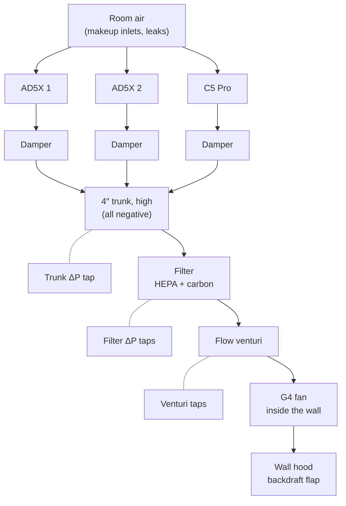
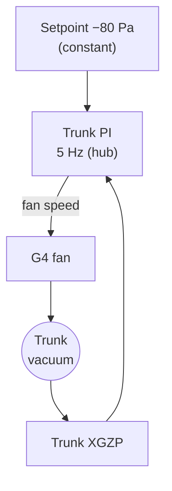
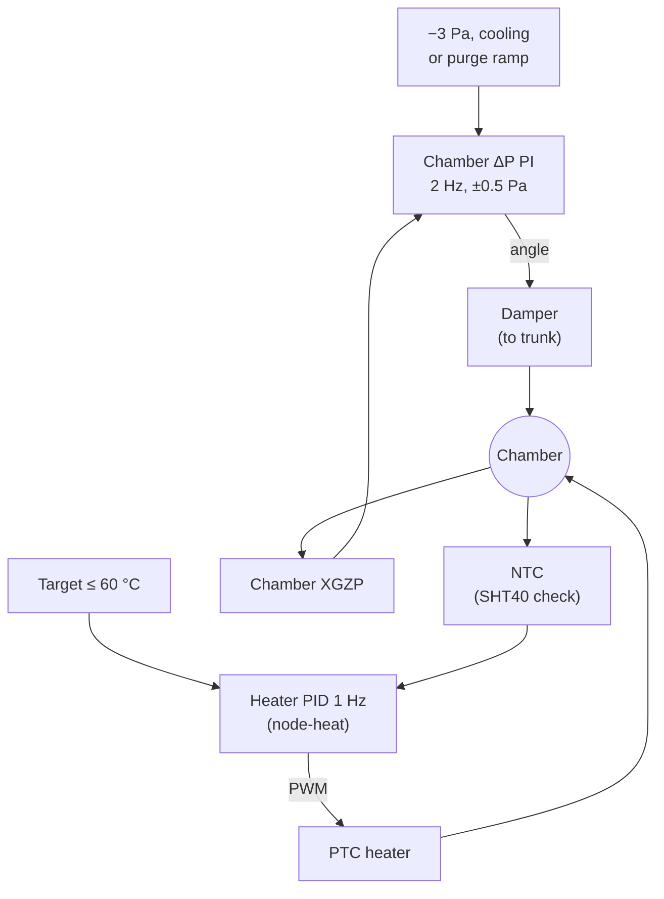
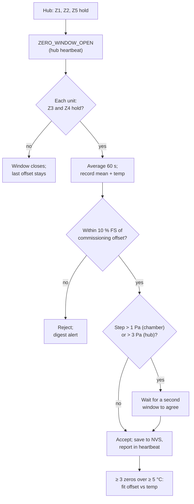
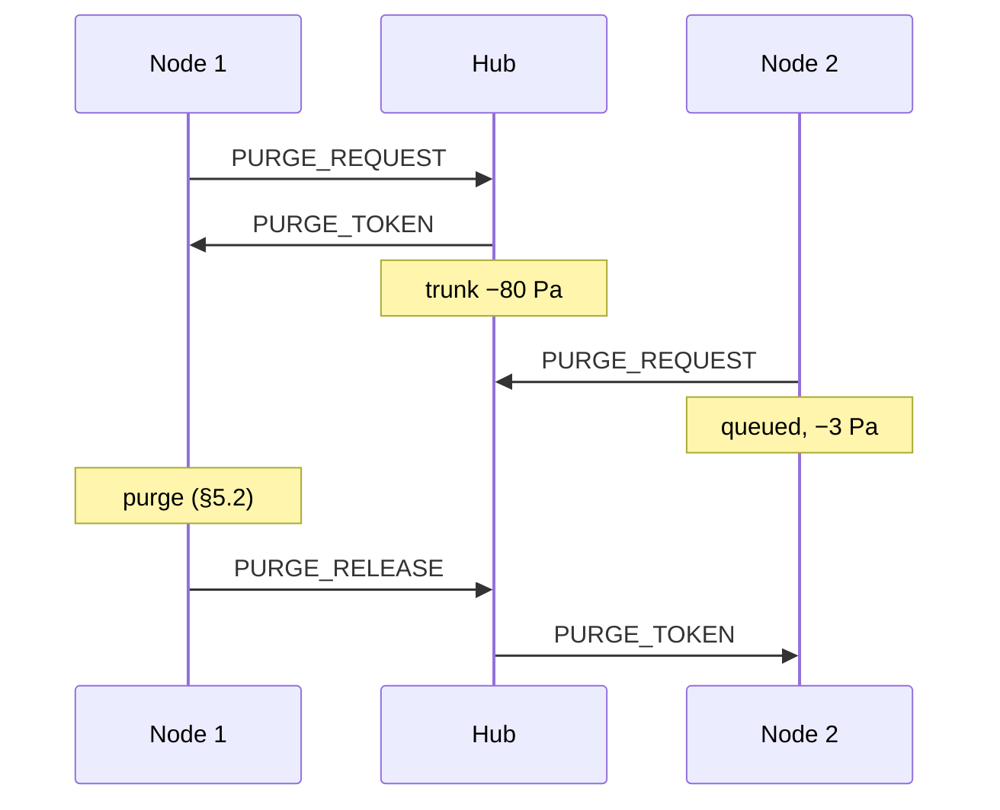

# 06 - Pneumatics, Ducting, Filtration and Control

> Design baseline, 2026-10-25. Numbers marked [E] are first-principles estimates. Setpoints marked *(commission)* are set from measurements on the real system (§10).

---

## 1. Layout

All three sets of taps go to pressure sensors on the hub. The trunk tap is upstream of the filter; the venturi (D30) is between the filter and the fan, in filtered air, so its taps stay clean.

| Principle | Why |
|---|---|
| **Fan at the outlet end** | Every metre of indoor duct is below room pressure, so duct leaks flow *in* (P7). |
| **Filter upstream of the fan**, on the wall within reach | Protects the fan, and the cartridge is easy to change. |
| **Branches leave each enclosure high** (AD5X port module at the rear; C5 shroud over the side exhaust fan) | Hot fumes rise; a high exit with a low makeup inlet gives clean displacement. |
| **Idle: fan off, dampers closed, hood flap closed** | No winter heat loss, no back-flow into chambers. |
| **No reserved space for a deep-carbon canister** | D6. |

### 1.1 Joints and leaks (D34)

All indoor duct is below room pressure, so a leak pulls room air in and **no fumes escape** (P7). Leaks still matter, because air that leaks in upstream of the venturi is counted by the hub but sent by no branch. Estimated inflow through a 0.1 mm average gap around one 100 mm joint [E]:

| Joint location | Suction | Unsealed | Gasketed |
|---|---|---|---|
| Port adapter to damper | ~3 Pa | ~0.1 CFM | negligible |
| Damper to trunk, Ys | ~80 Pa | ~0.5 CFM | ~0.05 CFM |
| Filter, spool, venturi | up to ~300 Pa | ~0.9 CFM | ~0.1 CFM |

One unsealed trunk joint leaks about as much as one printer's bleed, so:
- **Bayonet joints** (ModulAir L, doc 08 §3c) always carry their gasket. A radial gasket seals regardless of how flat the printed faces are; magnet-only couplers were considered and not used.
- **Flex-duct runs** are clamped onto hose adapters and foil-taped.
- **Duct leak test (M10):** all dampers closed, trunk at its setpoint; the low-flow anemometer (§4.4) reads the total duct leakage directly. Target **< 0.5 CFM**. Because the trunk vacuum is constant, the leakage is too: it is recorded and subtracted from each branch's angle–flow curve (M8).

## 2. Duct sizing

4″ (100 mm) throughout.

| Flow | Velocity in 4″ [E] | Comment |
|---|---|---|
| Bleed, 1–3 CFM per printer | < 35 fpm | Negligible loss and noise |
| Purge, ~40–60 CFM (one branch) | ~460–690 fpm | Quiet range for residential duct |
| G4 free air, 195 CFM | ~2 200 fpm | Never reached in practice; the filter and duct restrict it |

Three branches join the trunk through **two chained ModulAir 2:1 Ys** (D34, doc 08 §3c; two metal 4″ wyes as the fallback, P13). Purges are serialised (§5), so the trunk never has to carry three purge flows at once.

**Materials:**
- Semi-rigid aluminium duct (not plastic flex) for low resistance and fire resistance.
- Flex-duct runs clamped onto ModulAir hose adapters and foil-taped; every bayonet joint carries its gasket (§1.1, D34).
- Printed parts: the ModulAir junctions and adapters, dampers, port adapters, filter housing and the hub instrument spool (doc 08 §3c).

## 3. Dampers

- 100 mm butterfly, ASA, **TPU blade-edge seal**, MG90S servo (doc 02 §4).
- **Flow vs angle is very non-linear** near closed (P11). That's why the chamber loop uses *measured* chamber ΔP rather than fixed angles; control needs no per-branch angle calibration.
- **Angle encoder (D30):** an **AS5600** magnetic encoder on a printed bracket reads a diametric magnet on the blade shaft's free end (doc 08 C16), so it measures the blade itself, not the servo. It's on the node's I²C header 2.
  - **Closed is confirmed**, not assumed, including with the fan off (idle, heat hold, fire), when ΔP can't show anything.
  - **Stuck or slipped:** measured angle more than 5° from the command for 5 s → fault. This catches a stripped horn or a slipping blade, which the ΔP check misses or finds late. The same check bounds a **servo stall** (D56): when it fires, the node stops sending servo pulses, so a jammed blade can't hold the servo at stall current (≈ 1 A+ [E]) on `+5V_PWR`. A re-seat attempt drives it for ≤ 1 s, then stops for ≥ 30 s.
  - **Angle–flow curve per branch:** measured once at commissioning with the trunk venturi (§4.3, M8). Because the trunk vacuum is held constant (§4), the curve stays valid in service, and gives each branch's purge flow (§5.2).
  - The closed angle is learned at commissioning (blade on its seal) and rechecked in each static window.
  - **Leak drift (D32):** at a steady −3 Pa the damper only exhausts what leaks in, so the angle needed to hold it tracks the chamber's leakiness. The node logs the median angle per heated print and compares it with its commissioning baseline; when the printer runs alone, the hub's low-flow reading (§4.4) gives the bleed in CFM directly. A sustained rise raises a digest item (doc 05).
- **Stuck detection, second check:** the commanded angle changes by > 10° but chamber ΔP doesn't respond within 10 s (with the trunk active) → fault. It is the only check if the encoder is missing or faulty, and it stops the servo pulses the same way.

## 4. Control loops (cascaded, D5)

| Loop | Runs on | Measures | Moves | Setpoint |
|---|---|---|---|---|
| **Trunk vacuum** | Hub | XGZP6897D ±500 Pa class, trunk tap upstream of the filter vs room | Fan speed | **Constant while any branch is active**: start at **−80 Pa** *(commission)*, chosen so a fully open branch reaches purge flow while two others hold their bleed. **Never changed by mode** (P3). Fan off when no branch is active. |
| **Chamber pressure** | Each node | XGZP6897D, chamber vs room | Damper angle | **Heated print: −3 Pa** (band −2 to −5). **Cooling mode:** chamber temperature target, with −3 Pa as a floor. **Purge:** §5. |
| **Chamber temperature** | Node-heat | Chamber-air NTC (SHT40 plausibility) | Heater PWM | `M141`/`FLEET_EXHAUST` value, capped at `chamber.cap_c` (AD5X: 60 °C) |
| **Filter monitor** | Hub | XGZP across the filter; venturi flow (§4.3) | — | Filter resistance (ΔP at the measured flow) when flow is in the venturi's range; otherwise alert thresholds vs fan speed *(commission)* |

**Hub:**

**Each node:**

The hub's trunk loop and each node's loops are linked only by the **trunk-active flag** the hub sends over CAN.

**Chamber-loop details (node):**
- **PI with deadband ±0.5 Pa**, servo rate limit ~2°/s, and the minimum change held off until the error persists > 5 s. The servo doesn't hunt or hum.
- **Auto-zero:** every pressure sensor is re-zeroed in the system-wide static window (§4.1).
- The **trunk-active flag** comes from the hub over CAN. The node doesn't run its ΔP loop when the trunk is off. What a node does when the hub, and so the flag, is lost is open item O14 (doc 01 §7).

### 4.1 Static auto-zero (all pressure sensors)

All six sensors are XGZP6897D parts (D11, D30, D33), and their main error is offset drift with time and temperature (R4). When nothing is moving air, every sensor's true reading is 0 Pa. The system uses those moments to measure each offset.

| Sensor | Where | Measures | True value in the static window |
|---|---|---|---|
| Chamber ×3 | Each node | Chamber vs room | 0 Pa |
| Trunk | Hub | Trunk tap (upstream of the filter) vs room | 0 Pa |
| Filter | Hub | Across the cartridge | 0 Pa |
| Trunk flow (D30) | Hub | Venturi inlet vs throat | 0 Pa |
| Low-flow anemometer (D32) | Hub | Heated-element conductance | Still-air baseline G₀ (§4.4) |

**Static window: conditions (all must hold).** The hub decides and coordinates the window because it is the only unit that sees the fan and every node.

| # | Condition | Why |
|---|---|---|
| Z1 | G4 fan commanded off **and** tach reads 0 for ≥ 10 min | Duct air has stopped moving |
| Z2 | Every node reports idle: no print running (`print_stats` standby/complete/cancelled), no purge, heater off, damper at 0° for ≥ 10 min | No branch flow and no damper motion |
| Z3 | Every chamber within 3 °C of its room reading | A warm chamber creates a stack pressure of ~0.4 Pa (Δp ≈ ρ·g·h·ΔT/T), comparable to the chamber deadband |
| Z4 | Each sensor's own reading is steady over the 60 s sample: σ < 0.3 Pa for chamber sensors and < 1 Pa for hub sensors, with a slope under 0.1 Pa/min | Rejects wind gusts at the outlet hood, a door being opened, or HVAC cycling |
| Z5 | No zero accepted for this sensor in the last 60 min | Limits NVS writes and avoids chasing noise |

**Procedure**
1. The hub sends `ZERO_WINDOW_OPEN` (flag in the hub heartbeat, doc 07 §6.2) when Z1, Z2 and Z5 hold.
2. Each unit checks Z3 and Z4 for its own sensors, then averages 60 s of samples. It records the mean and also the sensor's built-in temperature reading.
3. **Acceptance:**
   - Reject the result if the offset is beyond the plausible limit: > 10 % of full scale from the commissioning value. That points to a leak, a blocked or kinked tube, or a failed sensor, and it raises a digest alert instead of being absorbed into the offset.
   - A step of more than 1 Pa (chamber) or 3 Pa (hub) from the last accepted offset needs a second window that agrees before it is applied.
4. **Store:** the unit writes `{offset, sensor temperature, timestamp}` to NVS and reports "zero accepted" in its heartbeat. The hub logs every sensor's result on the dashboard.
5. **Temperature compensation:** once a sensor has ≥ 3 accepted zeros spanning ≥ 5 °C, the firmware fits a linear offset-versus-temperature line and applies it in operation. This matters because a node enclosure warms next to a heated chamber during a print, long after the last idle zero.
6. The window closes at once if any condition fails. If no zero completes, the last accepted offset stays in use.

A rejected zero usually means a leak, a kinked tube or a failed sensor. Z1–Z5 are the conditions in the table above.

**Cross-checks the window enables**
- **Agreement:** in the static window all six sensors should read ~0 after correction. A sensor that disagrees while the others agree is flagged on its own.
- **Tube integrity:** when the fan stops, trunk and filter ΔP should decay to ~0 within ~10 s. A slow decay means a kinked or blocked tube, and raises an alert.
- **Staleness:** if a sensor has no accepted zero for 24 h of system use, it raises a digest warning. Normal idle time between prints makes that rare.

### 4.2 Loop coupling

**Coupling:** when one printer purges, the trunk loop holds vacuum. Any small disturbance at the other branches is corrected by their own chamber loops. This is what keeps *every* chamber negative during another printer's purge (your Q20).

### 4.3 Trunk flow (D30)

A printed **venturi** between the filter and the fan measures total exhaust flow. It is a monitor, not part of any control loop.

| Item | Value |
|---|---|
| Geometry | 100 mm inlet, **50 mm throat** (β = 0.5), ~21° included converging cone, 7–15° included diffuser, ~350 mm long; a ring of 4 taps at the inlet and at the throat (doc 08 C17). An ISA-style nozzle is the fallback if the wall run is too short; it loses more pressure. |
| Sensor | **XGZP6897D ±500 Pa class** on the hub's I²C header 3 (D33). Auto-zeroed in the static window (§4.1); assumed ~1 Pa residual plus ~2 % of the reading after that [E: M4]. Readings averaged over 10 s. **Upgrade:** a Sensirion SDP31 (~0.2 Pa zero error, ~$20) on the same header if M4 shows more than ~1 Pa residual. |
| Signal [E] | ΔP ≈ ½ρ(Q/A_throat)²(1 − β⁴)/C², with C ≈ 0.97 for a smooth print: **~8 Pa at 15 CFM, ~14 Pa at 20 CFM, ~87 Pa at 50 CFM, ~350 Pa at 100 CFM**. |
| Useful range [E] | **~15–100+ CFM**: about ±7 % at 15 CFM, ±5 % at 20 CFM, ±3 % at 30 CFM, ~±2 % at purge flows. Flow goes as √ΔP, so bleed flows (< 1 Pa here) are **below range**; the low-flow anemometer (§4.4) covers them. |
| Pressure cost [E] | ~10–15 % of the venturi ΔP is lost for good: ~10–13 Pa at 50 CFM, against ~100–250 Pa for the filter. Check in M1. |
| Calibration | C from the printed geometry; spot-check at commissioning with a handheld vane anemometer at the outlet if one is available (M8). |

**What it's used for:**
- **Per-branch angle–flow curves** at commissioning (M8): one branch open, the others closed, sweep its damper angle at the trunk setpoint. With the encoder angle (§3), each node then knows its own flow at runtime, even though the hub only sees the total.
- **Purge air changes** from the branch's curve (§5.2), instead of a guess from the commanded angle.
- **Filter resistance** = filter ΔP at a measured flow, so loading is tracked independently of fan speed (§8).
- **Exhaust confirmation at purge flows:** trunk vacuum reached but venturi flow missing points to a blocked outlet or hood flap.

### 4.4 Low-flow anemometer (D32)

Bleed flows (≈ 0.5–9 CFM in total) are too small for any pressure-based meter in a 4″ duct, and heat-loss sensors are most sensitive exactly there. A printed **constant-temperature thermistor anemometer** in the venturi throat covers that range. The throat runs 4× faster than the duct, which keeps forced convection ahead of the element's own rising plume down to ~0.5 CFM.

| Item | Value |
|---|---|
| Probe (doc 08 C18) | **Heated element:** a 2.2 kΩ ½ W metal-film resistor with a 100k glass-bead NTC bonded to its body (thermal epoxy), held across the throat centreline on its leads, axis horizontal and across the flow, downstream of the throat taps. **Reference:** a second 100k bead at the venturi inlet, upstream and out of the heated wake. |
| Drive | Hub output B1 (24 V, PWM). Up to ~0.27 W; ~0.1–0.2 W in use [E]. |
| Loop | Firmware holds the element at air + **20 K** (reference NTC). Heater power P = duty × V²/R; conductance **G = P/ΔT** rises with flow, roughly G = G₀ + B·Q^n with n ≈ 0.4–0.5 (King's law). |
| Temperature compensation | Air conductivity rises ~0.3 %/K; G is corrected to 25 °C using the reference NTC, and the residual is fitted against temperature from the overlap points (calibration 2). |
| Limits | Element ≤ 80 °C and ΔT ≤ 30 K in firmware; a heater with no rise, or an open or shorted NTC, turns B1 off (doc 05). Even at full duty in still air the element stays below ~140 °C, far below any fume ignition point, and the probe holds it on its leads clear of the plastic. |
| Readings | 10 s averages, reported as CFM with its validity band. Above ~20 CFM the venturi takes over, with a blend between 10 and 20 CFM. |

**Estimated accuracy vs the venturi** [E: model; confirm in M9]:

| Total flow | 0.5 CFM | 1 CFM | 2 CFM | 3 CFM | 5 CFM | 9 CFM | 15 CFM |
|---|---|---|---|---|---|---|---|
| Thermistor anemometer | ±12 % | ±7 % | ±7 % | ±6 % | ±6 % | ±6 % | ±6 % |
| Venturi + XGZP | – | – | – | – | ±59 % | ±19 % | ±7 % |

The anemometer's figures assume calibration 3 below; without it, the gap between the static zero and the overlap points is interpolated, and 1–5 CFM is good to about ±15 %.

**Calibration:**

1. **Static zero (automatic).** In every static window (§4.1) the hub records G₀ at the working ΔT: still air, the element's own plume, and conduction down its leads. A baseline more than 10 % from its commissioning value means dust on the element or a bent probe, and raises a digest item.
2. **Overlap with the venturi (automatic, continuous).** Whenever the venturi reads 20–40 CFM steadily for 60 s (±5 % or better), the hub adds a point and refits B and n over a rolling set. Purges and cooling mode supply these points in normal use.
3. **Low-flow reference venturis (commissioning, M9; repeat yearly or after a probe change).** Two printed venturis go into the hub spool's **calibration slot** (doc 08 §3c), one at a time, just ahead of the main venturi, with that joint foil-taped, with the trunk-flow sensor's tubes moved to their taps. With the XGZP [E]:

   | Reference | Range | Signal | Flow error |
   |---|---|---|---|
   | **10 mm throat** | 0.5–2 CFM | ~6 Pa at 0.5 CFM, ~23 Pa at 1 CFM, ~90 Pa at 2 CFM | ±10 % at 0.5, ±3 % at 1, ±2 % at 2 CFM |
   | **15 mm throat** | 2–5 CFM | ~18 Pa at 2 CFM, ~110 Pa at 5 CFM | ±4 % at 2, ±1–2 % at 3–5 CFM |

   Step the fan through its lowest speeds with one branch open and record both. The 10 mm one drops a few hundred pascals near 3–4 CFM, which the fan may not reach at low speed, so it's used only up to where it holds a steady flow. Remove each afterwards: at purge flow they would choke the trunk.
4. **Plausibility.** When a single printer bleeds alone, its anemometer reading should agree with the damper angle–flow curve (§3) and the heater step test (doc 07 §11.6) to within their bands. Persistent disagreement flags a recalibration.

## 5. Purge

### 5.1 Token (one purge at a time)

1. The node sends `PURGE_REQUEST` over CAN.
2. The hub grants `PURGE_TOKEN` to one node at a time, first come first served.
3. Waiting nodes hold their chamber at the heated-print setpoint (−3 Pa), so fumes stay contained while they queue.
4. A purge typically takes 10–30 min for ABS (ramp-limited) and 3–5 min for PLA/PETG [E].

CAN IDs: node 1 requests and releases on 0x131 and gets its token on 0x141; node 2 uses 0x132 and 0x142. While it holds the token, node 1 ramps, opens its damper and checks the end criteria.

### 5.2 Algorithm (node)

| Step | Behaviour |
|---|---|
| Trigger | `FLEET_PURGE …` from end G-code, **or** `print_stats` → `complete` / `cancelled` / `error` (whichever comes first) |
| Parameters | `RAMP` (°C/min), `MIN_TIME` (min), `SAFE_TEMP` (°C), `VOC_MARGIN`, from G-code or the material defaults (§6) |
| Ramp | The damper opens progressively. If the chamber falls faster than `RAMP`, the damper eases off and, for heated materials, the heater holds a falling floor (target = start − RAMP × t) |
| End condition | **All of:** chamber ≤ `SAFE_TEMP`; elapsed ≥ `MIN_TIME`; ≥ 5 chamber air changes (from the branch's angle–flow curve and encoder angle, D30; time-based estimate if the encoder is unavailable); chamber VOC within `VOC_MARGIN` of the hub room VOC (R3) |
| Done | Bed LED **green breathing** ("safe to open"); push notification; damper closes; token released |
| Door opened mid-purge | Purge continues at full damper; you've already opened it |

**Physical check [E]:**
- An AD5X kit chamber is ~0.1 m³, so 5 air changes at 20 CFM (0.57 m³/min) take **about 1 minute**.
- For heated materials the **cooldown ramp sets the purge length**, not the air exchange. ABS cooling at 1 °C/min from 55 °C to 35 °C takes 20 min.

### 5.3 VOC criterion (R3)

- Every sensor head uses an **ENS160**, rated −40 to 85 °C, so the chamber sensor reads through the whole purge, including ~60 °C air at the start (D20).
- Node and hub sensors are **cross-calibrated on raw element resistances** at idle in equal air (both reading room air through an open door before a session), not on the chip's self-baselining AQI/TVOC outputs. Each ENS160 gets its own head's SHT40 temperature and humidity for compensation, and the comparison is like-for-like because both ends use the same part. **Baseline learning is frozen while printing, during purges, and whenever a reading is well above its baseline** (Nevermore gates its VOC calibration the same way, D27), so a long ABS print can't teach the sensors that dirty air is normal.
- **Fallback** if this doesn't validate: end on temperature + time + air changes, with VOC logged only.

## 6. Material policy (defaults; the slicer overrides)

| Material | Chamber target | Mode | Purge `RAMP` / `SAFE_TEMP` / `MIN_TIME` | Notes |
|---|---|---|---|---|
| ABS | 50 °C | Heated bleed | 1.0 °C/min / 35 °C / 10 min | Slow ramp limits warping and cracking |
| ASA | 50 °C | Heated bleed | 1.0 / 35 / 10 | |
| PC | 60 °C | Heated bleed | 1.0 / 40 / 10 | The AD5X reaches 60 °C only at its cap; the C5 Pro (65 °C) is preferred |
| PA / PA-CF | 45 °C | Heated bleed | 2.0 / 35 / 5 | Filament must be dry |
| PETG / PETG-CF | ≤ 35 °C | Cooling | none / 35 / 3 | |
| PLA | ≤ 30 °C | Cooling | none / 30 / 3 | |
| TPU | ≤ 30 °C | Cooling | none / 30 / 3 | |
| Unknown (default policy, doc 07 §5) | No heat | Bleed at −3 Pa | 2.0 / 35 / 5 | Under-heating degrades; mis-heating PLA ruins it |

**AD5X limits:** operating cap 60 °C, hard limit 65 °C (doc 01 §4.5, D26). **C5 Pro:** 65 °C, its own rating. The C5 uses its stock chamber heater and fans; the plugin selects `AIR_CIRCULATION_INTERNAL` during heated prints (with the node's bleed handling containment) and `AIR_CIRCULATION_EXTERNAL` for cooling and purge (O4).

## 7. Heat budget (AD5X, why insulation and sealing)

Assumptions [E]: enclosure surface ~1.7 m²; worst case room 15.5 °C (60 °F) and chamber at the 60 °C cap, so ΔT ≈ 45 K.

| Loss path | Uninsulated, unsealed | **Insulated (rear/sides/top), sealed** |
|---|---|---|
| Panel conduction (U ≈ 5 vs ≈ 1.3–1.5 W/m²K) | ~380 W | **~105 W** |
| Leakage at −3 Pa: 10 cm² open IFS window vs ~2 cm² after sealing (Q = C_d·A·√(2ΔP/ρ)) | ~2.8 CFM → ~75 W | **~0.6 CFM → ~15 W** |
| Total | ~455 W | **~120 W** |
| Available | 150 W PTC + steady bed heat (~60–100 W) | Margin |

**Conclusion:** sealing and insulation turn a heater that can't reach temperature into one with margin. That's why both are in scope (D7).

**Leakage rule of thumb:** every cm² of gap at −3 Pa costs ~7 W at ΔT 45 K. At the old −35 Pa it cost ~20 W (P1/P2). Holding the **chamber** at only −3 Pa is what makes bleed affordable.

## 8. Filtration (O2, D6)

| Item | Specification |
|---|---|
| Cartridge | Standard cylindrical **HEPA (H13) + thin activated-carbon combo**, Levoit Core 300 class (~$15) |
| Housing | Printed airtight canister with ModulAir L bayonet ports (D34), bayonet lid and TPU gasket; two barbed taps for the filter ΔP sensor (doc 08) |
| Purpose | Odour courtesy for neighbours (carbon, ~6–12 months of life for styrene), particles out of the outdoor air, and a clean duct and fan (HEPA) |
| Outlet concentration [E] | Bleed: ~0.5 ppm styrene, smellable within ~1 m until the carbon saturates. Purge: below the odour threshold. Doc 11 / T2 |
| Loading alert | Filter ΔP vs fan-speed curve recorded new at commissioning; digest alert at +60 %, high at +120 % *(commission)* |
| Static pressure | Combo cartridge ~100–250 Pa at 100 CFM [E]. If the G4 can't make purge flow through it (R2), use a HEPA-only cartridge in the same housing |

## 9. Outlet

- **4″ through-wall dryer-vent hood with a gravity backdraft flap**.
- Locate it away from windows, doors, patios and neighbours' openings.
- The fan sits indoors, immediately inside the wall sleeve.
- Winter: the system is idle (fan off, flap closed) except while printing.

## 10. Commissioning measurements

| # | Measurement | Sets |
|---|---|---|
| M1 | Fan speed vs trunk ΔP with all dampers closed, then with each damper fully open | Trunk setpoint; purge flow achievable (R2) |
| M1a | Damper bleed resolution (D29): step each damper 1° at a time from closed while holding trunk ΔP; record **encoder angle** (D30) and chamber ΔP per step, and closed leakage | Whether E3 can hold −3 Pa smoothly or the design needs a finer mechanism (doc 08 §3b) |
| M2 | Filter ΔP vs fan speed with a new cartridge | Loading thresholds |
| M3 | Chamber leakage: damper angle sweep vs chamber ΔP at the trunk setpoint, per printer | Damper limits; air-change estimate per angle |
| M4 | All six XGZP sensors: offset and noise in the static window; auto-zero stability over a day; offset vs temperature (§4.1) | Deadband (R4), Z4 limits, plausibility limit |
| M5 | Heated hold: chamber at 50 °C, heater duty and chamber ΔP stability during an ABS print | Confirms the heat budget (§7) |
| M6 | Purge: timing, VOC behaviour, cross-calibration of node and hub ENS160 | VOC margin (R3) |
| M7 | Noise at bleed and purge speeds at the nearest workspace | Maximum fan speed (P-6) |
| M8 | Per-branch angle–flow curve (D30): one branch open, others closed, sweep its damper at the trunk setpoint and record venturi flow vs encoder angle; spot-check the venturi with a vane anemometer if available | Purge air-change estimate (§5.2); filter resistance baseline |
| M9 | Low-flow anemometer (D32): static zero, then the 10 mm and 15 mm reference venturis in turn, fan stepped through its lowest speeds with one branch open; record reference flow vs element conductance from ~0.5 to 5 CFM. M4's residual decides whether the venturi keeps the XGZP or gets an SDP31 | Low end of the anemometer curve (§4.4) |
| M10 | Duct leak test (D34): all dampers closed, trunk at its setpoint, read the low-flow anemometer; repeat after any joint is disturbed | Leakage baseline (< 0.5 CFM target), subtracted in M8 (§1.1) |
