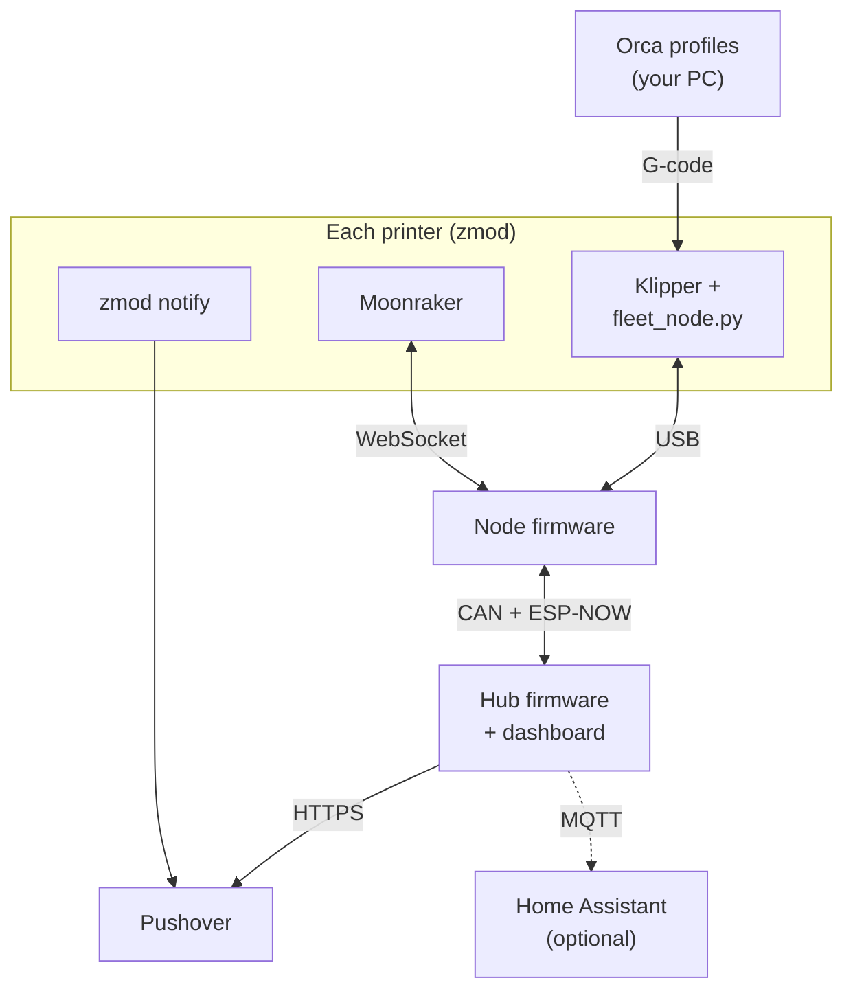
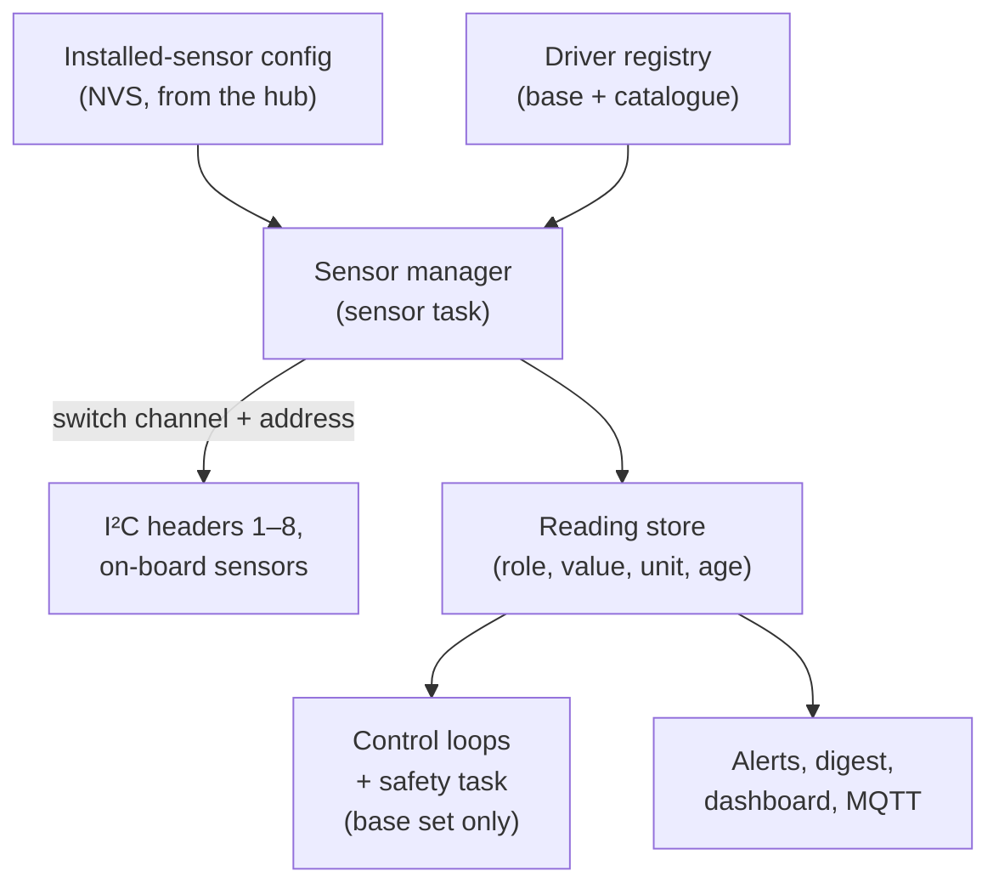
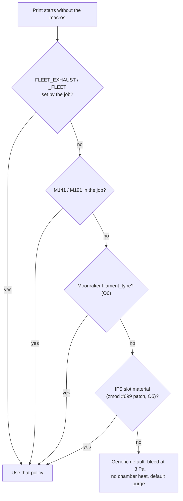
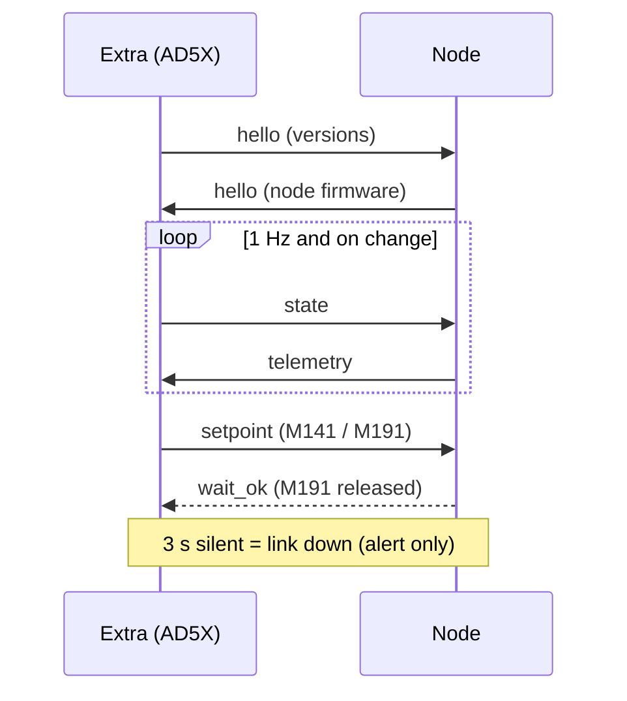
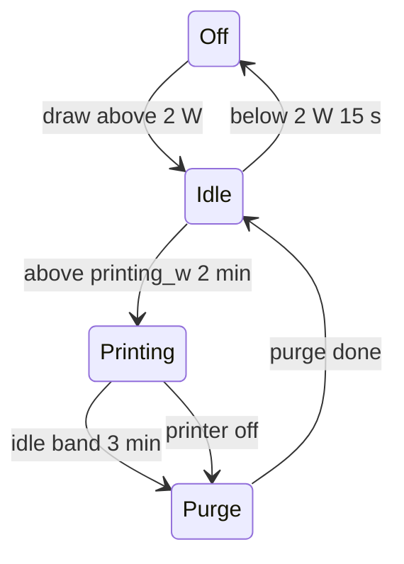
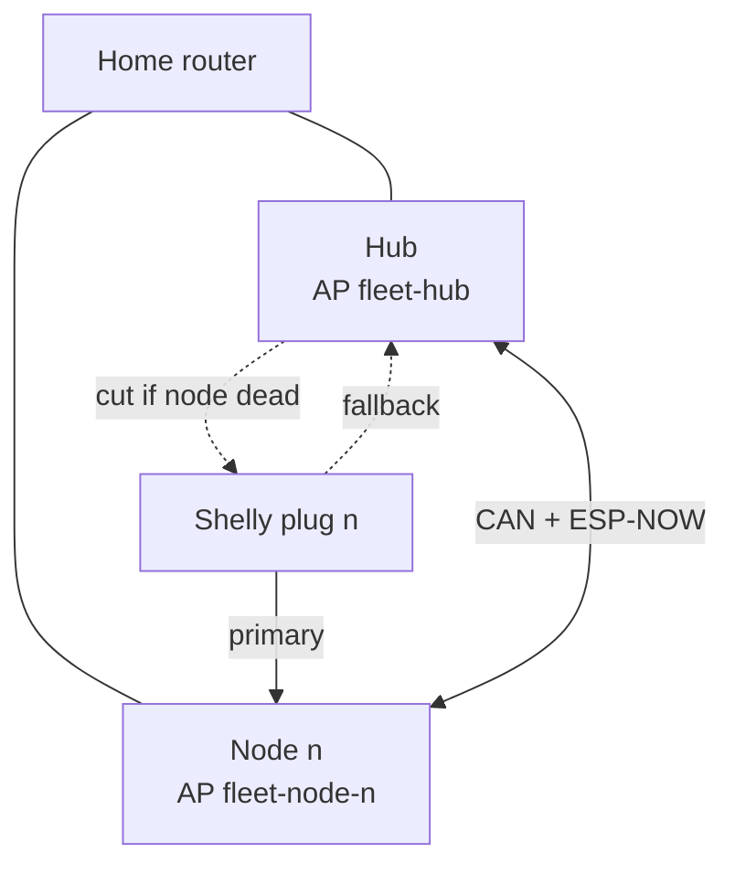
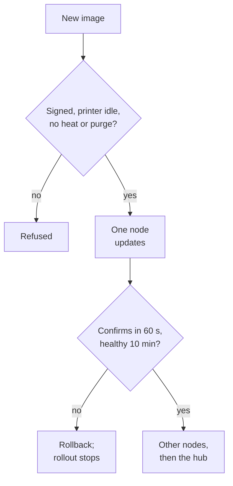

# 07 - Firmware, zmod Plugin, Protocols and Notifications

> Design baseline, 2026-10-25. This defines the software architecture and interfaces. The code is written in Phase 2.

---

## 1. Software components

| Component | Runs on | Stack | Repo path (Phase 2) |
|---|---|---|---|
| **Node firmware** | Carrier ESP32-S3, roles node-heat / node-lite | **ESP-IDF 5.x** (FreeRTOS), C++, `idf.py` and the IDF component manager (D52) | `firmware/fleet_node/` |
| **Hub firmware** | Carrier ESP32-S3, hub role | Same toolchain; same shared library | `firmware/fleet_node/` (one codebase, role from config) |
| **Shared library** | — | CAN messages, USB protocol, control loops, the sensor interface and manager (§2.1) | `firmware/components/fleet_common/` |
| **Sensor drivers** | — | One component per sensor family, base set and catalogue (§2.1, doc 09 §8) | `firmware/components/sensors/` |
| **`fleet_exhaust` zmod plugin** | Each printer | Klipper config macros + klippy extra (Python) + `install.sh`, `uninstall.sh`, `update.sh` | Separate repo `fleet-exhaust-klipper` (D27) |
| **Orca profiles** | Your PC | Printer and filament G-code snippets | `slicer_profiles/orca/` |
| Dashboard | Hub | Static web page served from LittleFS + JSON/WebSocket API | `firmware/fleet_node/data/` |



- **USB link (every printer, D24):** NDJSON frames with a CRC between the klippy extra and the node.
- **Moonraker WebSocket:** the backup link on every printer (the C5's only link if O10 finds no `cdc_acm`).
- **Other printer links:** one `PrinterLink` implementation per link type (doc 12 §3.3). `marlin_serial` (D48: UART on the AUX header or USB host, with a fixed read-and-display command allowlist) is specified but not built.
- Node and hub firmware share the `fleet_common` component; the dashboard is served from LittleFS. Home Assistant uses MQTT discovery.

**Why ESP-IDF C++ rather than ESPHome:** the node and hub need a CAN protocol, a USB-serial protocol, a Moonraker WebSocket client, cascaded control loops, the G4 fan protocol (R1) and hardware-coupled safety logic. In ESPHome nearly all of that would be custom components. Home Assistant integration stays available through MQTT discovery (§9).

**Why plain ESP-IDF rather than Arduino-ESP32 (D52):** the design already uses ESP-IDF drivers directly: RMT with DMA for the LED chain, a UART in open-drain mode on the I²C pins for the MCU bootloaders (doc 09 §4), continuous ADC with DMA, TWAI, ESP-NOW, the task and RTC watchdogs and NVS. Arduino would only add a layer on top. Vendor drivers come from the component manager: `espressif/ch390` (LAN), `esp_websocket_client` (Moonraker), `mqtt`, `esp_http_server`, `led_strip` and LittleFS.

## 2. Firmware architecture (node and hub)

| Aspect | Design |
|---|---|
| Role selection | Stored in NVS at provisioning (`node-heat`, `node-lite`, `hub`), plus node ID 1–15 (D25). The same binary runs every role. At boot the firmware checks the stored role against the board-identity shunt (D46, doc 04 §4). A mismatch or an unset shunt means a safe hold with a fault raised: no heater enable and no outputs. |
| Task priorities (FreeRTOS) | 1. **Safety task** (heater limits, current checks, charge-pump toggle, 10 Hz). 2. Control loops (heater PID 1 Hz, chamber ΔP 2 Hz, trunk 5 Hz). 3. CAN. 4. USB link. 5. Wi-Fi (Moonraker, Pushover, web, MQTT). |
| Charge-pump toggle | Driven **only** by the safety task after every check passes. If any task hangs, starves or crashes, the square wave stops and the hardware cuts the heater. |
| Watchdogs | ESP-IDF task watchdog on the safety and control tasks; RTC watchdog for a full hang. |
| Updates | **OTA** over Wi-Fi to dual app partitions with **automatic rollback** if the new image doesn't confirm itself within 60 s, plus the staging and signature rules in §11.2. The heater is held off during an update. First flash is over USB-C. The carrier I/O controller's image ships inside the ESP32 image, and the ESP32 rewrites the controller whenever its checksum differs (doc 09 §4.2). |
| Configuration | NVS: Wi-Fi credentials, notification URLs (hub), Moonraker host (nodes), Shelly IPs (hub), tuning values. Set from the hub web page; nodes receive theirs over CAN. |
| Secrets | Never in the repo. `secrets.example.h` documents the fields. |
| Logging | Ring buffer of events in RAM, flushed to LittleFS hourly; shown on the dashboard. |
| Debugging | JTAG over the dev board's own USB port in a debug USB mode, core dumps, and a hold on the carrier I/O controller for its SWD header; no probe or pin change on the ESP32 (§11.8, D65) |
| Sensors | Drivers are plugins behind one interface, and the installed sensors come from a config, not from code (§2.1, D55). |

### 2.1 Sensor drivers and the installed-sensor config (D55)

The firmware never names a sensor part in its control, safety or alert code. Those consume **roles** (`chamber.temp`, `trunk.dp`, `room.pm2_5` …). A per-carrier config says which driver on which header provides each role. Adding a sensor means adding a driver; using a different one means changing the config.



**Driver interface (plugin).** One `SensorDriver` interface in `fleet_common`, the same pattern as `PrinterLink` (doc 12 §3.3). Each driver declares:

| Field | Meaning |
|---|---|
| `id`, `family` | e.g. `sht4x`, family `sensirion_th`; one driver can cover a family of parts |
| `addresses` | The I²C addresses it can answer on, plus a `probe()` that confirms the part (ID register, serial number or CRC) rather than trusting an ACK |
| `channels` | Typed outputs with SI units: `temperature_c`, `rh_pct`, `pressure_pa`, `dp_pa`, `angle_deg`, `voc_raw`, `co2_ppm`, `pm2_5_ugm3`, `co_ppm`, `current_a`, … |
| `tier` | `base` or `catalogue` (doc 09 §8). Only `base` channels may feed a control loop or the safety task |
| `limits` | Rated operating temperature, supply current and warm-up time, so the dashboard can warn about a misplaced or overloaded sensor (doc 09 §8.1) |
| `poll` | Sample interval (every header sensor is polled; the headers have no INT line, D68) |
| `needs` | Inputs from other roles, e.g. the ENS160 driver takes T/RH from the co-located SHT40 for compensation |
| `init()`, `read()`, `reset()` | Non-blocking; each call has a time budget, and a driver that overruns is marked failed |

**Packaging.** Drivers are ESP-IDF components under `firmware/components/sensors/<family>/` that register themselves in a static registry at link time. The base set is always built in. Catalogue families are on by default and can be turned off in Kconfig to save flash. There is no runtime loading of native code: the image stays signed and OTA-updatable as one unit (§11.2), and a new driver arrives with a firmware update. A contributed driver goes into the core, so every build can use it, as with link types.

**Installed-sensor config.** Each carrier holds a list of entries in NVS, edited on the hub dashboard and pushed to nodes over CAN like the rest of their config. Each entry has a `header` (1–8, or `onboard`), a `driver`, an `address` if the part has more than one, the `role` each channel provides, and a free-text `location`. Example entry: header 1, driver `sht4x`, address 0x44, roles `chamber.temp` and `chamber.rh`.

- **Role defaults:** each firmware role (`node-heat`, `node-lite`, `hub`) ships a default list matching the reference wiring (board S on header 1, and so on), so a standard build needs no editing.
- **Required roles:** `node-heat` needs `chamber.temp` from a base driver before it enables the heater, on top of the on-board NTCs (doc 05). A required role that is missing, fails its probe or goes stale (no good reading for 3 intervals) raises a fault and takes that role's safe action. A catalogue role that fails only raises an info alert.
- **Discovery:** at boot and every 10 s [E] (D68), the manager probes each powered channel against the registry's known addresses. A configured sensor that is missing raises a fault. A known sensor that is found but not configured appears on the dashboard as "found, unassigned", one click from being added. Nothing found is ever used without a config entry.
- **Fault recovery:** a driver that keeps failing gets its header power-cycled through the carrier I/O controller (doc 09 §2.2), at most once per 10 min [E], and the event is logged.
- **Alerts:** catalogue roles take generic threshold rules from the config (role, threshold, hold time, severity: digest, alert or info), so `room.pm2_5` above a level for 10 min, for example, needs no new code.
- **Outputs:** every configured channel appears on the dashboard and in MQTT discovery (§9) under its role name, with units from the driver.

## 3. zmod plugin `fleet_exhaust`

### 3.1 Packaging

The plugin follows zmod's plugin rules: no edits to zmod or stock files, and all user config lives in `mod_data` [V: zmod docs/Plugin.md].

| Item | Detail |
|---|---|
| Install | Copy to `/root/printer_data/config/mod_data/plugins/fleet_exhaust/`, then `ENABLE_PLUGIN name=fleet_exhaust` |
| Repository (D27) | The Klipper side lives in its **own small repo, `fleet-exhaust-klipper`** (extra, macros, installers, printer-pack profiles copied in at release), not in this one: Moonraker clones the whole repo onto the printer, and the AD5X's storage is small. Same pattern as Beacon, Shake&Tune and klipper_z_calibration |
| Update | Moonraker `[update_manager fleet_exhaust]` with `type: git_repo`, `channel: stable` and `managed_services: klipper`, in `mod_data/user.moonraker.conf`. Releases are tagged `vX.Y.Z`, which the stable channel needs |
| Files | `fleet_exhaust.cfg` (macros, `[fleet_node]` section), `fleet_node.py` (klippy extra), `install.sh` (safe to re-run; symlinks the extra into the Klipper extras directory, adds the symlink to Klipper's `.git/info/exclude` where Klipper is a git checkout so it isn't flagged "dirty", detects the printer model, and detects Kalico, which needs add-ons reinstalled after a switch), `uninstall.sh`, `update.sh` |
| Extras path | Stock FF Klipper `/usr/prog/klipper/klippy/extras`, or zmod Klipper 13 `/usr/data/zmod/klipper/klippy/extras` [U: confirm per printer (R5)] |
| Printer model | `install.sh` installs the printer pack's profile and config for the detected model (§3.4, doc 12). Packaged once for any Klipper: zmod is one install variant, stock Klipper with Moonraker `update_manager` the other (doc 12 §3.3) |
| Config convention | Same pattern as ghzserg's `flook32_plugin`: the shipped `fleet_exhaust.cfg` is headed **"DO NOT EDIT – copy the parameters you need into mod_data/user.cfg"** and lists every option, commented, with its default. Your overrides live only in `mod_data/user.cfg`, so updates never clash with your settings |
| Settings sent to the node | Only parameters you set explicitly in `user.cfg` are pushed to the node at connect. Everything else keeps the node's own value (its defaults, or what you set on the dashboard), so the two never fight |
| Device discovery | AD5X: if `serial:` is unset, the extra finds the node by its USB VID/PID under `/dev/serial/by-id/`, so a re-enumerated port doesn't need a config edit |

### 3.2 Klippy extra `fleet_node.py`

| Function | Detail |
|---|---|
| Config | `[fleet_node]` with `serial:` (`/dev/serial/by-id/…`, or unset for auto-discovery; C5: unset if O10 fails, Moonraker only), `wait_timeout`, `on_timeout` (`continue` or `pause`) |
| Sensor type | Registers `sensor_type: fleet_node`, used by `[temperature_sensor chamber]`. Fed ~1 Hz from the node. **It never calls Klipper's shutdown and never reports a value that could trip a `min_temp`/`max_temp` check.** When stale, it keeps the last value and flags `stale` in its status. |
| Status object | `printer.fleet_node`: `connected`, `link` (`usb`/`none`), `chamber_temp`, `chamber_target`, `rh`, `voc`, `chamber_dp`, `damper` (commanded), `damper_meas` (encoder, D30), `branch_cfm`, `heater_pct`, `mode`, `purge_state`, `faults[]`, `node_fw` |
| Link I/O | Non-blocking serial driven by Klipper's reactor (`register_fd`, like `serialhdl`), using `pyserial`, which Klippy already depends on [V]. It reconnects every 5 s when the device is absent. **A link fault only logs, notifies and flags status.** |
| Print state to node | Every second it sends `print_stats.state`, the filename, `_FLEET` variables and `idle_timeout` state, read in-process from Klipper objects. |
| Commands | Registers `FLEET_WAIT_CHAMBER`, `FLEET_CLEAR` (clears a level-3 heater lockout on this printer's node, with the same checks as the dashboard; doc 05 §4.1) and `_FLEET_LINK_SEND` (internal) |

**Why in-process:** while a wait (`M191`) runs, Klipper holds the G-code lock. Values injected through Moonraker G-code would queue behind the wait and deadlock it. The temperature must reach Klipper by a non-G-code path.

### 3.3 G-code API

| Command | Parameters | Effect |
|---|---|---|
| `FLEET_EXHAUST` | `MODE=abs\|asa\|pc\|pa\|petg\|pla\|tpu\|cool\|heat` `CHAMBER=<°C>` (optional, overrides the material default; capped at `chamber.cap_c`, 60 on AD5X, D26) | Sets the print policy (doc 06 §6). Starts bleed, and heat if applicable. Doesn't wait. |
| `M141 S<°C>` | — | AD5X: chamber setpoint to the node, no wait. C5: **stock** command (not overridden). |
| `M191 S<°C>` | — | AD5X: setpoint, then `FLEET_WAIT_CHAMBER`. C5: stock. |
| `FLEET_WAIT_CHAMBER` | `TARGET=<°C>` `TIMEOUT=<s>` (default 1800) `ON_TIMEOUT=continue\|pause` | Blocks G-code until the chamber reaches TARGET − 1 °C, **or** the timeout, **or** the node goes offline for > 30 s. On timeout or offline it sends `_NOTIFY` and continues or pauses per policy. |
| `FLEET_PURGE` | `RAMP=<°C/min>` `MIN_TIME=<min>` `SAFE_TEMP=<°C>` `VOC_MARGIN=<n>` | Sets the purge parameters, which apply when the print ends. Called in end G-code. |
| `FLEET_STATUS` | — | Prints node, link and hub state to the console |
| `_FLEET` | (variables) | Holds mode, chamber target and purge parameters, so the node can also read them through Moonraker (backup path) |

**Name collision check (R5):** if the stock or zmod AD5X config already defines `M141`/`M191`, the plugin wraps them with `rename_existing` instead of redefining them [U: check at install; a duplicate definition would be a Klipper config error].

### 3.4 Printer-specific behaviour

Comes from the printer's `profile.yaml` (doc 12 §4), not from code: link type, whether the extra provides `[temperature_sensor chamber]` or the printer has its own, whether `M141`/`M191` are the plugin's or native, which macros to call per fleet mode, and the door source. Each printer pack lists the result:
- [AD5X](../printers/flashforge_ad5x/README.md#5-klipper-integration)
- [C5 Pro](../printers/flashforge_c5pro/README.md#5-klipper-integration)

### 3.5 Orca G-code snippets (to finalise in Phase 2)

Filament start G-code (per filament profile; ABS example):

```gcode
FLEET_EXHAUST MODE=abs CHAMBER=50
M191 S50          ; AD5X: waits for the node; C5: stock chamber heater wait
```

Filament end G-code (ABS):

```gcode
FLEET_PURGE RAMP=1.0 MIN_TIME=10 SAFE_TEMP=35
```

Orca's own per-filament chamber-temperature option can emit `M141`/`M191` instead; both paths reach the same node logic. Placeholder names such as `{chamber_temperature[0]}` are checked against mainline Orca during Phase 2 [U].

## 4. `M191` wait: failure handling

| Situation | Result |
|---|---|
| Chamber reaches target | Wait ends; print starts. Same as a native heater. |
| Heater too weak (enclosure open, cold room) | Timeout (default 30 min) → `_NOTIFY` → continue (default) or pause |
| USB link drops during the wait | The extra keeps waiting while it reconnects. If the node stays offline > 30 s, the wait ends → notify → continue or pause |
| Node faults (heater off) | The node reports the fault → wait ends → notify |
| Klipper restarts | The wait is gone; the node sees the link drop and the print state is no longer printing, so the heater goes off |

## 5. Default policy for prints without the macros

For prints started from the touchscreen, Flashforge app or FlashPrint (or any print on a printer whose link gives no job details), the node determines the policy in this order:

1. `FLEET_EXHAUST` / `_FLEET` variables set by the job's G-code
2. `M141`/`M191` in the job
3. Moonraker file metadata `filament_type` for the current file [U: O6]
4. IFS slot material from `zmod_ifs`/`zmod_color`, only if zmod #699's `get_status()` patch is present [U: O5]
5. **Generic default: bleed at −3 Pa, no chamber heat, default purge** (doc 06 §6)

A Tier 0 printer (`link: power_only`, doc 12 §3.2) has none of steps 1–4, so it always gets the generic default, started and ended by plug power (§6.5).



## 6. Protocols

### 6.1 USB-serial link (extra ↔ node, AD5X and C5)

| Aspect | Design |
|---|---|
| Transport | USB CDC-ACM, full speed |
| Framing | **Newline-delimited JSON, each line carrying a CRC-16 field** (easy to debug with a terminal; 1–2 lines/s is negligible load) |
| USB interfaces (D27) | Composite device: **CDC 0 (`-if00`) carries the protocol**; CDC 1 (`-if02`) is a read-only text log console. Fixed now because configs and docs name the `-if00` path [U: dual CDC through TinyUSB on the ESP32-S3] |
| Handshake | `hello` with protocol version and node firmware version. A version mismatch is reported in `FLEET_STATUS` and notified; the link still runs at the lowest common version |
| Extra → node (1 Hz + on change) | `state` {print_state, filename, fleet vars, idle, **bed {target, temp, power}**} (bed-heat interlock, doc 02 §3.1; on the C5 also `chamber_heater` state and the door buttons); `setpoint` {chamber}; `cmd` {purge_params, test} |
| Node → extra (1 Hz + on event) | `telemetry` {chamber_temp, target, rh, voc, dp, damper, damper_meas, heater_pct, mode, purge_state, faults}; `event` {door, fault, purge_done, wait_ok} |
| Liveness | 3 s without a frame = link down on either side |



- **state:** print state, filename, fleet variables, idle, bed.
- **telemetry:** chamber temperature and target, ΔP, damper, heater %, faults.
- A dead link only raises an alert; it never shuts Klipper down.

### 6.2 CAN (hub ↔ nodes)

CAN 2.0A, 125 kbit/s. `n` = node ID 1–15: each message type has a block of 16 IDs, so the fleet can grow to 15 nodes with no ID changes (D25).

| ID | Direction | Rate | Content |
|---|---|---|---|
| 0x080 | Hub → all | On event | **Fire / emergency**: affected node, action (close damper, heater off) |
| 0x100 | Hub → all | 1 Hz | Hub heartbeat: trunk-active flag, trunk ΔP, fan state, purge-token holder, **`ZERO_WINDOW_OPEN` flag** (doc 06 §4.1), hub fault flags |
| 0x110+n | Node → hub | 1 Hz | Node heartbeat: role, state, chamber temp, ΔP, damper (commanded and measured), heater %, door, zero status (accepted / rejected / stale), fault flags |
| 0x120+n | Node → hub | On change | Detail: RH, VOC raw, mode, purge state, link state, **plug state / power / health** (`shelly_node` backend) |
| 0x130+n | Node → hub | On event | Requests: trunk on/off, `PURGE_REQUEST`/`PURGE_RELEASE`, **`HEATER_RUNAWAY`** (RW-a, doc 05 §3.4: the hub cuts that printer's Shelly) |
| 0x140+n | Hub → node | On event | Grants: purge token, config push, acknowledge, **`MAINS_CUT`** (`shelly_node` backend: the node switches its plug off and confirms) |

**Error handling (D16):**
- The TWAI controller **recovers automatically from bus-off** (after the standard 128 × 11 recessive bits), with back-off if it keeps recurring.
- Every unit reports its transmit/receive error counters in its heartbeat. The hub raises a digest alert when any unit goes error-passive or recovers from bus-off more than 3 times an hour. Which units see errors points to the faulty segment ("check the cable near node 2").
- While CAN is degraded, all traffic continues on ESP-NOW (§6.4).

**Timeouts:**
- Hub heartbeat missing **on both CAN and ESP-NOW** for 3 s → nodes alert and keep their local loops; heater off after 30 s. Losing only one link raises a digest alert and changes nothing else.
- Node heartbeat missing for 10 s → the hub alerts (it has no heater switch; the node's hardware chain covers a dead node).
- The hub also runs **RW-b** on every node heartbeat: chamber > cap + 10 °C (AD5X: 70 °C) on both NTC and SHT40 for ≥ 60 s → Shelly cut (doc 05 §3.4).

### 6.3 Moonraker usage

| Who | Use |
|---|---|
| Nodes (backup on every printer; the C5's primary only if O10 fails) | WebSocket `printer.objects.subscribe`: `print_stats`, `idle_timeout`, `extruder` (target), `gcode_macro _FLEET`, `virtual_sdcard`. C5 adds `chamber_heater`/`heater_generic` objects and door `gcode_button`s. `printer.gcode.script` for `_NOTIFY`, `AIR_CIRCULATION_*` and pause (only where the policy calls for it) |
| Nodes | `server.files.metadata` for `filament_type` (policy level 3) |
| Hub | Nothing directly; printer state reaches it from the nodes over CAN |
| **Moonraker `[sensor]`** (any Moonraker printer, needs the MQTT broker of §9; D27) | The hub publishes each node's readings to `fleet/<printer>/state`, and each pack ships a Moonraker `[sensor fleet_exhaust]` block (`type: mqtt`, `parameter_chamber_temp: units=°C`, …). Mainsail and Fluidd then show the readings, and `history_field_*` records per job: peak chamber temperature and VOC (`maximum`), purge time, and energy from plug power (`accumulate`). Works on Tier 1 printers with no extra installed |

**No MQTT broker is needed on the printers** (`paho-mqtt` presence is irrelevant).

### 6.4 ESP-NOW link (D16)

ESP-NOW is ESP32 peer-to-peer radio. It runs on every carrier alongside the normal Wi-Fi connection, on the same channel, and needs **no router**.

| Aspect | Design |
|---|---|
| Role | **Backup** for CAN on wired nodes (default `link: can+espnow`), or the **only** hub link on a wireless node (`link: espnow`) |
| Messages | The same IDs and payloads as CAN (§6.2), sent on both links and de-duplicated by sequence number. Events (fire, runaway, `MAINS_CUT`, purge token) are acknowledged and retried 3× |
| Security | Each frame carries a fleet ID, source, sequence number and a truncated HMAC-SHA256 with a fleet key from NVS. Replays are rejected by sequence number. This uses no ESP-NOW encrypted-peer slots, so it scales to any number of nodes |
| Channel | Everything follows the home access point's channel. The hub announces it; a node that loses the hub rescans. Without home Wi-Fi, the hub's own network (§11.4) sets the channel |
| Health | Each unit reports link quality (RSSI, loss) per link. The dashboard shows both links for every node |

**Wireless-only nodes (no CAT6).** Supported, for installs where running a cable isn't wanted:

| Requirement | Why |
|---|---|
| A **24 V supply into the node's POWER IN barrel** with INJECT BAR fitted (the barrel never feeds the heater, doc 02 §2.2, D64), e.g. a 24 V brick on an ordinary outlet, **not** on that printer's mains-cut plug. A wireless-only AD5X node-heat therefore has **two supplies**: this logic brick, and heater power from the printer (doc 04 §6b) | The node must stay up when its printer is off or cut, to purge it and report. The hub checks this every time the plug is switched off (§11.7) |
| Node-heat: the heater still runs from the printer's own supply (doc 02 §3.1) | Unchanged |
| Accept that the hub link is radio only | Interference or a router channel change can drop it for a few seconds. The 30 s heater rule rides through that; a longer outage costs chamber heat, not safety |
| The node-local safety layers and the `shelly_node` cut don't depend on the hub link | A wireless node keeps its full local protection |

Wired is still preferred where it's easy: it's immune to radio interference and carries power.

### 6.5 Print detection from plug power (Tier 0, D25)

Every printer is already on a metering smart plug (§10), so its power reading gives print state with no printer link at all. That makes **any** printer usable at Tier 0 (`link: power_only`, doc 12 §3.2), and gives every node a cross-check whatever its link.

| Item | Design |
|---|---|
| Source | The printer's plug: Shelly `Switch.GetStatus` → `apower` every 5 s (§10), or a Home Assistant power entity. A plug without power metering can't support Tier 0 |
| Thresholds | `power.idle_w` and `power.printing_w` from the profile (doc 12 §4), measured at commissioning: idle with the printer on and cold, and the lowest steady draw mid-print |
| Print start | Mean over a 60 s window above `printing_w` for **2 min** (rides through the heat-up spike and short pauses) |
| Print end | Mean below `idle_w` + 30 % of the gap to `printing_w` for **3 min**; then purge as for a finished print |
| Hysteresis | Start and end bands don't overlap; a draw between them holds the current state |
| Printer off | Below 2 W for 15 s (or the plug reports off): "printer off", purge if a print was active, no alarm |
| Policy | The generic default (§5): bleed during the print, default purge after |
| Heater | **Never on Tier 0.** Power can't tell a print from a preheat, a stuck bed heater or a paused job, so it can't grant heater permission (doc 12 §3.2) |
| Nozzle target (Klipper, Tier 1 and 2; D27) | Any extruder target above 0 counts as "printer active" for bleed and is a second cross-check of print state, as Nevermore detects prints. It never grants heater permission |
| Cross-check on Tier 1 and 2 | A link reporting "printing" while the plug reads off, or "idle" for 10 min while the draw stays in the printing band, raises an info alert (link or profile wrong). It never overrides the link and never stops a print |
| Learning | On every node, commissioning logs the plug's power trace over one idle period and one print and proposes `idle_w` and `printing_w` for you to accept, in the same way as the characterise run (doc 05 §3.2) |



## 7. Notifications

| Item | Design |
|---|---|
| Service | **Notification URLs in Apprise format** (D27), the format zmod's notify plugin and Moonraker's `[notifier]` already use. The hub implements `pover://` (**Pushover**, the default: private, emergency priority repeats until acknowledged; $5 one-time per platform) and `ntfy://`/`ntfys://` (self-hosted ntfy). Other services go through a printer's Apprise or Home Assistant |
| Hub | Sends directly over HTTPS to each configured URL |
| Printers | **zmod notify plugin** (Apprise) with the same keys: `mod_data/notify.txt` → `pover://<user>@<token>`, then `UPDATE_NOTIFY`. The plugin calls `_NOTIFY MSG="…"` |
| Mirroring | The hub mirrors critical alerts to each printer's `_NOTIFY` (shown in Fluidd/screen); the printer path keeps working when the hub is down |
| Klipper console (adapted from FLOOK32, D23) | The AD5X extra echoes node faults and state changes to the Klipper console as info lines (never errors, so nothing in Klipper reacts). Each fault line carries a short **trend**: how many times it has occurred in the last hour and its escalation stage (doc 05 §4). `FLEET_STATUS` prints the full recent list. `console: quiet` in `user.cfg` limits it to High and above |
| Alternative | ntfy, self-hosted on a home server: add its `ntfys://` URL; nothing else changes |

**Paging policy** (page only when action can help, plus print complete):

| Priority | Events |
|---|---|
| Normal | Print complete + "safe to open"; link restored |
| **High** | Heater or fan fault, exhaust lost, door left open on a heated print, node or hub offline during a print, damper stuck closed, single fire signal |
| **Emergency** | Corroborated fire |
| Digest (daily, normal) | Filter loading, room VOC trend, maintenance due |
| **Panel only, escalating to the buzzer** | Any unacknowledged critical alert after 15 min, or Wi-Fi/Pushover unreachable |

## 8. Dashboard (hub web page)

- Served on the LAN (Wi-Fi, or the hub's wired LAN jack, D18) at `http://fleet-hub.local`, and on the hub's own network `fleet-hub` at `http://192.168.4.1` when the router is down (§11.4).
- **Live view:** per-printer chamber temperature/target, RH, VOC, ΔP, damper, heater %, door, mode, purge progress; trunk ΔP, **trunk flow** (venturi above ~20 CFM, anemometer below, D30–D33), each printer's bleed trend, fan speed, filter ΔP and life estimate, room T/RH/VOC; Shelly power per printer; purge queue.
- **Event log** and fault history.
- **Settings:** Wi-Fi, notification URLs, Shelly IPs, Moonraker hosts, tuning, test modes (commissioning, doc 05 §9).
- **Acknowledge** (same as the panel button and Pushover's acknowledge) silences an alert. **Clear** (PIN) ends a latched lockout or, together with the node's CLEAR button at the printer, a cut (doc 05 §4.1). They are separate buttons on purpose.
- Read-only without a PIN; settings and test modes need a PIN stored in NVS.

## 9. Home Assistant (optional)

When a broker exists (Mosquitto on a home server or a Pi), the hub publishes **MQTT discovery** entities: chamber sensors per printer, trunk/filter/fan, room air, purge state, and fault binary sensors. HA is display and automation only, **except** that printers configured with the `ha` mains-cut backend (§10) use HA to reach their plug. The hardware safety layers never depend on HA.

## 10. Mains-cut plug integration (D14)

Each printer has a `cut` config in the hub (dashboard, stored in NVS):

```json
{"backend": "shelly_node", "fallback_host": "shellyplusplugus-a1b2c3.local"}
{"backend": "shelly", "host": "192.168.1.51"}
{"backend": "ha", "switch": "switch.ad5x_1_plug", "power": "sensor.ad5x_1_plug_power"}
{"backend": "none"}
```

The firmware has a small `MainsCut` interface with `cut()`, `state()`, `power_w()` and `healthy()`, implemented once per backend. The safety logic (doc 05) only calls the interface.

### 10.1 `shelly_node` backend (recommended): each node hosts its plug's network

The node runs a small Wi-Fi access point of its own **alongside** its normal home-Wi-Fi connection (ESP32 AP+STA; the AP shares the home network's channel). Its printer's Shelly joins it directly, so the cut path from node to plug doesn't need the router.

| Item | Design |
|---|---|
| Node AP | SSID `fleet-node<n>`, WPA2, random passphrase generated at setup and stored in NVS. Hidden SSID, at most 2 stations. DHCP lease reserved for the plug |
| Shelly Wi-Fi | **Primary network (`sta`) = the node's AP; fallback (`sta1`) = the hub's own network** (§11.4; recommended, no router dependency) **or home Wi-Fi** (if you want the plug visible in HA or the Shelly app directly). Set with Gen2 `Wifi.SetConfig`. Shelly HTTP authentication enabled |
| Who talks to the plug | **The node.** It polls `Switch.GetStatus` every 5 s and reports plug state, power and health to the hub (CAN 0x120+n) |
| Cut on a node decision | RW-a (doc 05 §3.4): the node cuts its own plug directly, then tells the hub. **No hub, router or HA needed** |
| Cut on a hub decision | RW-b or corroborated fire: the hub sends `MAINS_CUT` over CAN (0x140+n); the node executes it and confirms with a read-back |
| Node dead or AP gone | The plug falls back to `sta1`, and the hub reaches it directly at `fallback_host` (reserved IP on the hub network, or mDNS on home Wi-Fi) [U: measure the Shelly's fallback time at commissioning] |
| Setup | The hub dashboard pushes the node's AP credentials to the plug once, while the plug is on home Wi-Fi (or on the plug's own setup AP) |
| Limits | Shelly plugs only. HA-controlled plugs (Matter, Zigbee, etc.) can't join an arbitrary AP; they use the `ha` backend |

Networks around one printer with the `shelly_node` backend (plus the hub's fallback network, §11.4):



The plug's primary Wi-Fi (`sta`) is the node's access point; its fallback (`sta1`) is the hub's. Hub and node also join the home router, and ESP-NOW shares its channel. The hub's dashed cut uses the plug's `fallback_host` path.

### 10.2 `shelly` backend (hub → plug over the home LAN)

Plug Wi-Fi: `sta` = home Wi-Fi, `sta1` = the hub's own network (§11.4), so the hub still reaches it if the router fails.

| Use | Call |
|---|---|
| Mains cut | `POST http://<shelly>/rpc/Switch.Set {"id":0,"on":false}` |
| Metering (dashboard, F-e) and read-back | `GET http://<shelly>/rpc/Switch.GetStatus?id=0` → `output`, `apower` (W), polled every 5 s |
| Health | No answer for 1 min → plug-unreachable alert |

### 10.3 `ha` backend (Home Assistant REST API)

| Use | Call |
|---|---|
| Mains cut | `POST http://<ha>:8123/api/services/switch/turn_off {"entity_id": "<switch>"}` |
| Read-back | `GET /api/states/<switch>` → `"off"` within 5 s |
| Metering (optional) | `GET /api/states/<power>` every 5 s |
| Health | HA unreachable, or entity `unavailable`/`unknown`, for 1 min → plug-unreachable alert |
| Auth | HA long-lived access token, entered on the hub dashboard and stored in NVS (never in a URL) |

The REST call goes straight to the plug's entity, so no HA automation is needed and nothing breaks if automations are edited. For this role, use plugs whose integration is **local** (Matter, Zigbee, Z-Wave, ESPHome, Tasmota, Shelly). Avoid cloud-polled integrations.

### 10.4 Configuration rules (all backends)

- **Auto-on after power loss: "restore last state"** (or the plug's equivalent), so a power blip doesn't leave printers off. A plug that was cut was off, so it comes back off; the latched re-cut (doc 05 §4.1) covers anything else (D38).
- Shelly cloud disabled with the `shelly` backend.
- **The hub never switches a printer back on automatically** after a cut.
- **The hub PSU and the exhaust fan are never on a printer's plug** (doc 04 §6b).
- **Plug-local power limit (D16):** on Shelly plugs, set the switch's own over-power limit (Gen2 `Switch.SetConfig` `power_limit`, plus `current_limit` where available) to the printer's measured peak draw × 1.3 [U: confirm the fields on the device]. The plug then trips by itself on a gross overload, even with the hub, node and Wi-Fi all down. The hub reads the setting back at startup and alerts if it's missing. On HA-backend plugs, use the plug's own overload setting if it has one.
- Under the `ha` backend, **require a confirmation in HA before the plug can be switched** (for example `tap_action` with `confirmation:` on its dashboard card, and the same on any voice or automation exposure), so it can't be turned back on or off by accident. Hiding it isn't enough: it would also hide its state.

## 11. Robustness features (D16)

### 11.1 Latched state that survives a reboot

Written to NVS on change only (low wear), restored at boot before any output is enabled:

| State | Cleared by |
|---|---|
| Heater lockout (welded FET, runaway, repeated KSD trips, gain-watchdog trip) | You, with **Clear** on the dashboard or `FLEET_CLEAR` on the printer (doc 05 §4.1). Acknowledge only silences it |
| Mains-cut latch ("cut by fleet at hh:mm, reason") | You, with **Clear**: the inspection checklist on the dashboard, then the node's CLEAR button held 3 s at the printer within 2 min (doc 05 §4.1). The hub never re-enables a plug itself, and cuts one that something else turns on |
| Fire state | You, with **Clear** |
| Purge in progress (material, ramp, elapsed time) | Completion: after a reboot the node re-requests the token and resumes the purge |
| Pressure zero offsets (doc 06 §4.1), fault counters | — |

A reset or brown-out therefore can't quietly clear a lockout or abandon a purge.

### 11.2 Safe updates

- Dual partitions with automatic rollback (§2).
- **Image signature checked before switching** (ECDSA, project signing key; ESP32 Secure Boot v2 optional).
- **Refused** while that printer is printing or its node is heating or purging. The hub refuses while any purge or heater is active.
- **Staged:** one node first. The rest follow after it has reported healthy for 10 min. The hub goes last.
- Mixed versions keep working at the lowest common protocol version (`hello` on USB, version field on CAN and ESP-NOW).



### 11.3 CAN fault handling

See §6.2: automatic bus-off recovery, error-counter reporting, segment localisation, and ESP-NOW carrying the traffic meanwhile.

### 11.4 Hub fallback network

- The hub runs its own WPA2 access point `fleet-hub` permanently, alongside its home-Wi-Fi connection.
- If the router is down:
  - the dashboard is still reachable at `http://192.168.4.1`
  - Shelly plugs use the hub network as their fallback (§10.1, §10.2)
  - ESP-NOW keeps running on the same channel
- Notifications (Pushover) still need the internet; while it's down they queue, and the panel buzzer and bed LEDs carry the alarms.

### 11.5 Thermal model (alerts only; adapted from FLOOK32, D23)

Each node-heat keeps a small first-order model of its chamber: predicted temperature from heater power, damper position, bed temperature (USB link) and room temperature (hub). Its parameters start from the characterise run (doc 05 §3.2) and are refined slowly from each print's data, within bounds.

| Item | Rule |
|---|---|
| Check | Measured vs predicted, once a minute. An anomaly is a residual larger than k × the model's own recent error (default k = 4) held for 5 min |
| Alert | Names the likely causes from the sign and context: under prediction while heating → door ajar, heater weak, intake blocked, damper stuck open; over prediction → damper stuck closed, an extra heat source |
| Never | Trips the heater, changes a setpoint, or feeds any safety layer. The hard layers (doc 05 §3.1) do that. A model that's still learning, or that's been reset, raises nothing |
| Shown | Predicted curve beside the measured one on the dashboard |

### 11.6 Bleed checks (D32; alerts only)

| Check | How |
|---|---|
| **Leak drift** | The node logs the median damper angle that holds −3 Pa on each heated print and compares it with its commissioning baseline (doc 06 §3). When it's the only printer exhausting, the hub's low-flow anemometer reading is logged as that printer's bleed in CFM. |
| **Heater step test** | Once per heated print longer than 2 h, after the chamber has held its setpoint for 30 min with the door closed: the node moves the chamber setpoint from −3 to −5 Pa (still inside the normal band) for 15 min and back. At a steady temperature the extra heater power is the heat carried by the extra bleed, ΔP_heater = ρ·cₚ·ΔQ·(T_chamber − T_room), and ΔQ follows from the leak law (Q ∝ ΔP^n, n from the commissioning data, ≈ 0.5–0.65). That gives the bleed at −3 Pa to roughly ±20–30 % [E]. The step is skipped or abandoned if the door opens, the bed or chamber setpoint changes, or any fault is active. |
| Output | Bleed in CFM and heat loss per CFM, trended per printer on the dashboard. A sustained rise is a digest item (doc 05); nothing here changes a setpoint outside the test window or feeds a safety layer. |

### 11.7 Power supervision (D35)

| Check | How |
|---|---|
| **Plug-off survival** | Whenever a printer's plug reads off in normal use (a user switch-off, not a cut), its node must still be online 10 s later. If it drops, the hub raises a **High** alert "node powered from the printer's plug": its purge and fire response would fail at a real cut. Costs nothing: the plug read-back and node heartbeat already exist |
| **Hub supply lost** | The hub reads its own supply input: the internal XT60's voltage on the tap side of its ideal diode (D64), through the carrier I/O controller (doc 02 §2.4). If it drops below ~20 V while the hub stays up on the bus, its supply has failed and the chain is feeding it (D52; the OUT-port current direction this used is gone with the INA190). The hub sends a **High** "hub supply lost, running on printer power" push and enters back-fed mode. **A controller that stops answering counts as back-fed** (D64): the reading is missing, and in a fire the siren and push must go before the cut, so the hub assumes the safe order and raises a "carrier I/O controller silent" alert. Back-fed mode ends only when the controller reads the supply again |
| **Back-fed mode** | While back-fed: LED brightness capped and **one damper servo moving at a time**, so a single injecting node's ~1 A limit carries the whole chain even in an alarm; in a fire or runaway, **siren and push go before the cut** (doc 05 §3.4, §5), since the cut printer may be the hub's only power; the dashboard shows the mode and the hub's measured bus voltage (D64), and anemometer readings are flagged as degraded (doc 06 §4.4). It ends when the hub's supply input returns |

### 11.8 Debugging (D65, D68)

**ESP32: JTAG over the dev board's USB port.** The ESP32-S3's built-in **USB-Serial-JTAG** controller gives full OpenOCD and GDB debugging (breakpoints, hardware watchpoints, both cores, peripheral registers, flashing and a console) on the native "USB" port, with no probe and no carrier pins [V: ESP-IDF USB device documentation]. It shares that port's internal PHY with the USB device stack that carries the printer link (§6.1), and only one can run at a time; starting the device stack takes the PHY away from USB-Serial-JTAG [V: same]. So:

| Item | Design |
|---|---|
| **Debug USB mode** | A console command (UART0, or the dashboard with the PIN) sets an NVS flag, and on the next boot the firmware doesn't start the USB device stack, so the port stays USB-Serial-JTAG. The laptop cable replaces the printer lead: `idf.py flash`, `idf.py monitor`, `idf.py openocd` and `idf.py gdb` all use it. The flag clears on the next power-on reset, so a forgotten flag can't leave the printer link dead [E] |
| Printer link meanwhile | Falls back to Moonraker over Wi-Fi (§1). A UART printer link on the AUX header (D48) is unaffected |
| Heating | Allowed. Between halts the safety task runs as normal; at a breakpoint the charge-pump wave stops, so the high side switches off in hardware (§2), and the hub sees the node silent and alerts as for any dropout |
| Power | The carrier must be on its own 24 V supply, or the reset hold keeps the ESP32 in reset (D36) |
| Never | Burn `USB_PHY_SEL`: it moves the PHY permanently. The JTAG eFuses are only for pad JTAG (below) |

**ESP32: pad JTAG while the printer link runs (D68).** GPIOs 39–42 go only to a **1 × 6 2.54 mm JTAG header** (3.3 V, TMS, TCK, TDO, TDI, GND) for an ESP-Prog-class FT2232H probe with OpenOCD. The printer link keeps the USB port, so a fault that only shows while printing can be debugged live. It needs the `STRAP_JTAG_SEL` eFuse burned once on that board (GPIO 3, held low at reset by the fan A enable pull-down, then selects pad JTAG), or `DIS_USB_JTAG`. A burned board can no longer use JTAG over USB (the USB serial console still works); an unburned board uses the debug USB mode above [E: ESP-IDF JTAG documentation]. Breakpoints behave as in the table: heating is safe at a halt.

**ESP32: without a laptop.** A crash writes an ESP-IDF **core dump** to its flash partition, and the dashboard offers it for download, for `idf.py coredump-info` (backtrace, tasks, variables). The optional **runtime GDB stub** on UART0 (the dev board's UART port) lets GDB stop and inspect a running node while the printer link stays up, with fewer breakpoints than JTAG [E].

**Carrier I/O controller (PY32).** Its SWD header is free for a probe at any time in the normal build (D68); the pin rules are in doc 09 §4.5. On the ESP32 side, the **`IOC_HOLD`** console command stops the ESP32 from resetting and reprogramming the controller when it stops answering at a breakpoint (doc 09 §4.2), until the next power cycle. While the controller is silent the heater is held off, as for any mid-run reset of the controller, and heating resumes when its readings return.
