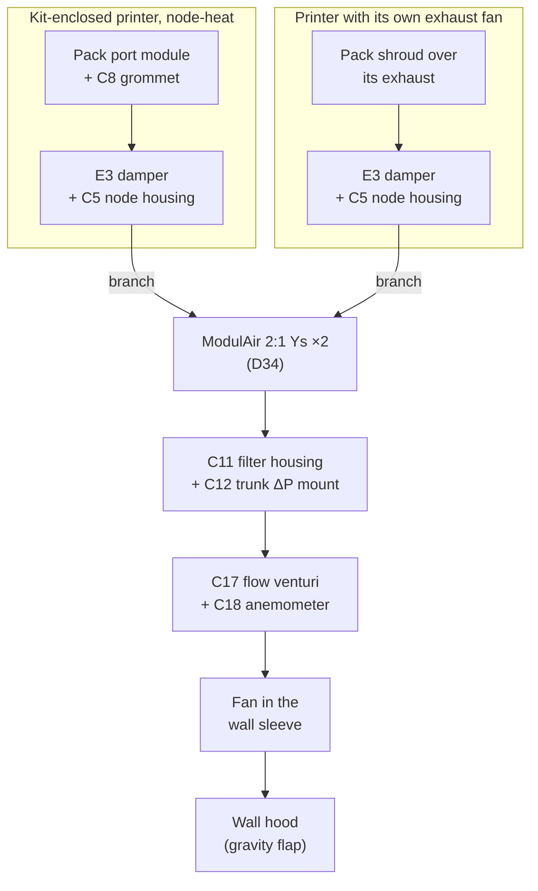
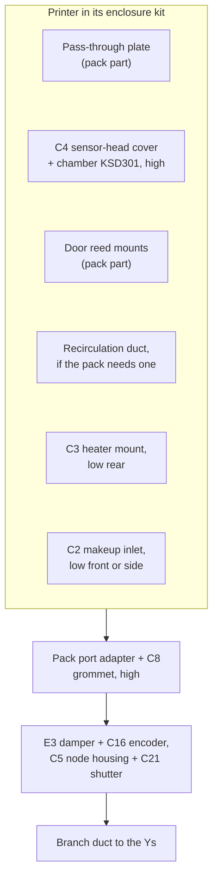
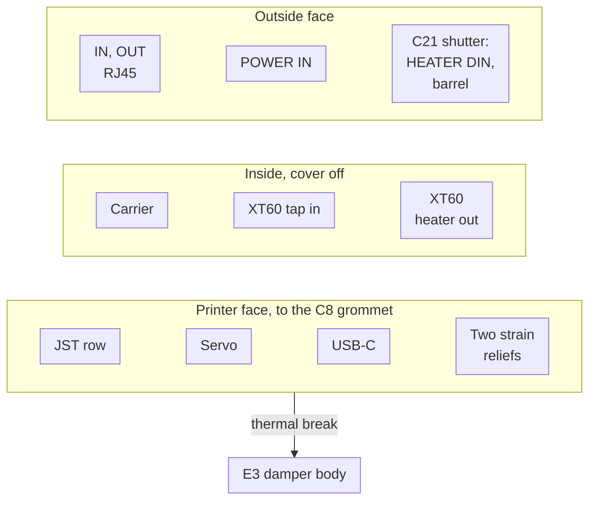
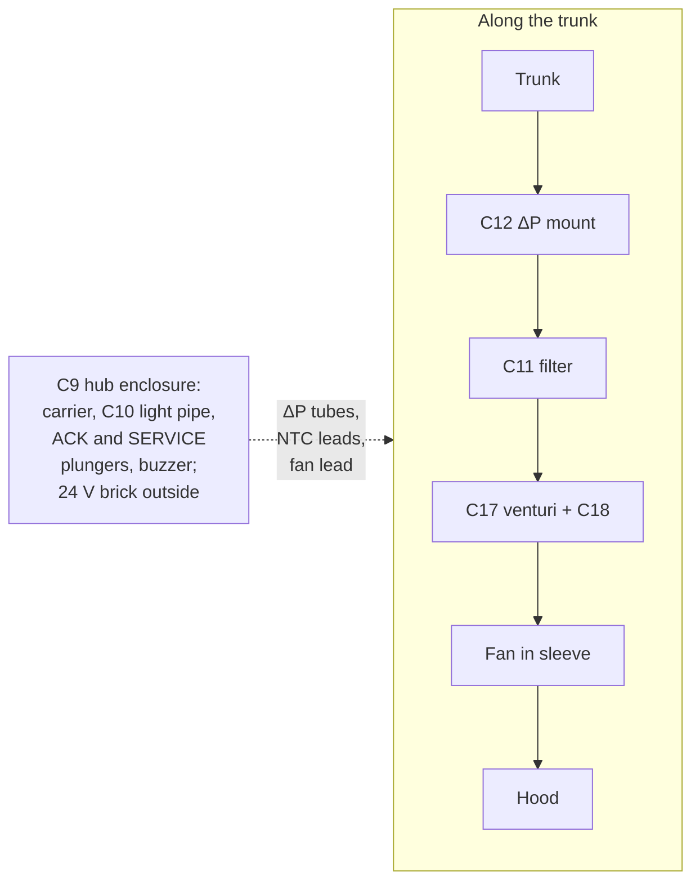

# 08 - Printable Parts Catalogue

> Design baseline, 2026-11-09. Phase 2 work: verify each existing model (link, licence, fit to the real parts), then design the custom parts. **Policy:** existing models first; custom parts only where they're genuinely better.

---

## 1. Material rules

| Location / duty | Material | Why |
|---|---|---|
| Inside a heated chamber, on the heater module, or in exhaust air ≥ 50 °C | **ASA or ABS** (PC acceptable) | HDT ≈ 95–100 °C; PETG (HDT ≈ 65–70 °C) creeps at 55 °C (ARG-12) |
| Outside the chamber, near the warm enclosure wall (node enclosure, flange outer face) | ASA preferred; **PETG-CF acceptable** if it's a brand with a stated HDT ≥ 75 °C | Surface may reach ~40–45 °C |
| Room temperature (hub enclosure, filter housing, duct clips) | **PETG** or PETG-CF | Cheap, tough |
| Seals and gaskets | **TPU 95A** | |
| Light pipe | Clear PETG | |

Print hot parts on an enclosed printer, ideally one with its own filtration, and on this system's exhaust once it's installed.

**CAD deliverables for custom parts:** parametric source (CadQuery) + **STEP** (imports into Fusion) + STL, in `hardware/cad/<part>/`. Remixes keep the original licence and attribution.

## 2. Assembly map

Where the printed parts sit on a kit-enclosed node-heat printer (an example; each pack shows its own layout):

**Node housing (C5)**, the three faces a builder handles:

**Hub on the wall** (C9 and the instrument spool):

- **Also in each node-heat printer:** C2 makeup inlet, C3 heater mount, C4 sensor-head cover, plus its pack's parts (enclosure-kit parts, pass-throughs, recirculation, door reed mounts).
- **Also on each node-lite printer:** C4 sensor-head cover, plus its pack's parts.
- **On every damper:** C16 encoder mount (D30).
- **On the wall:** E5 duct clips with cable channel, C9 hub enclosure with C10 light pipe.

## 3. Existing models to use (core; verify in Phase 2)

| # | Part | Candidate source | Material | Verify |
|---|---|---|---|---|
| E3 | 100 mm motorised butterfly damper | Printables [#1023387](https://www.printables.com/model/1023387) (Tinkerer4000) | ASA, TPU edge seal | MG90S fit; blade clearance with a TPU edge seal; add one if missing (remix) |
| E5 | 4″ duct clips / raceway | Printables/MakerWorld "4 inch duct clip" (choose one with a cable channel) | PETG | Holds the bus cable alongside the duct |
| E6 | 5015 heater shroud (**only if C8 fails**) | Printables [#1472826](https://www.printables.com/model/1472826), [#1471103](https://www.printables.com/model/1471103) | ASA + aluminium liner | Element size; metal liner around the PTC |

**Removed from the old catalogue:**

| Old part | Why removed |
|---|---|
| Window sash plate (#151240) | The outlet is a through-wall vent hood (doc 06) |
| Drybox optical motion block | Drybox sensors deferred |
| ESP32 DIN shield enclosures (#1556383, #258431) | The hub enclosure holds the carrier (and, with an internal supply, the supply and inlet); replaced by C9 |

## 3a. Printer-pack parts

Parts that belong to one printer are defined in its printer pack (doc 12 §2). IDs stay as listed here.

| # | Part | Pack |
|---|---|---|
| E1 | AD5X enclosure kit printed parts | [AD5X §8](../printers/flashforge_ad5x/README.md#8-printed-parts) |
| E2 | IFS/Bowden pass-through plate | [AD5X §8](../printers/flashforge_ad5x/README.md#8-printed-parts) |
| E4 | AD5X exhaust flange (base for C1) | [AD5X §8](../printers/flashforge_ad5x/README.md#8-printed-parts) |
| E7 | AD5X recirculation duct + 5015 blower | [AD5X §8](../printers/flashforge_ad5x/README.md#8-printed-parts) |
| C1 | AD5X exhaust port module (port adapter) | [AD5X §8](../printers/flashforge_ad5x/README.md#8-printed-parts) |
| C6 | Door reed + magnet mounts | [AD5X §8](../printers/flashforge_ad5x/README.md#8-printed-parts) |
| E8 | C5 Pro exhaust-port adaptor (base for C7) | [C5 Pro §8](../printers/flashforge_c5pro/README.md#8-printed-parts) |
| C7 | C5 Pro side-port shroud (port adapter) | [C5 Pro §8](../printers/flashforge_c5pro/README.md#8-printed-parts) |

## 3b. Damper reference designs (D29; final choice at Phase 2 design)

E3 stays the baseline branch damper. These are recorded for comparison; the damper's mechanism, model and remix are decided at Phase 2 design time, after the bleed-resolution test in validation (VAL-A2, was M1a).

| Ref | Design | What it is | Fit to our needs | Licence | Recommendation |
|---|---|---|---|---|---|
| E3 (baseline) | Printables [#1023387](https://www.printables.com/model/1023387) | 100 mm butterfly, MG90S | Native 100 mm and MG90S, so the C5 node housing and servo lead work as specified. Weak points: a butterfly passes most of its flow in the first ~20–30° of opening, so the −3 Pa bleed lives in a few degrees of an MG90S with ~1° deadband; a TPU edge seal may need adding for a tight close | [U: not yet checked] | **Keep as baseline.** Check the licence, and check bleed resolution in validation (VAL-A2); if it's too coarse, look at a sleeve-type design (below) or a smaller bleed blade |
| R1 | Nerdiy **PrintAirPipe servo valve** ([Hackaday project](https://hackaday.io/project/195522-printairpipe-3d-printable-air-duct-system), [servo valve log](https://hackaday.io/project/195522/log/229135-printairpipe-servo-valve), [160 mm on Printables](https://www.printables.com/model/1280629-printairpipe-160mm-servo-ventil-by-nerdiyde), [125 mm on Cults3D](https://cults3d.com/en/3d-model/tool/printairpipe-125mm-servo-valve-3d-druckbar-stl-dateien)) | Servo valve segment for Nerdiy's printable duct system: MG90 servo, its own ESP32 running ESPHome, touch button and open/closed LED. Sold as STL files | 125 mm and 160 mm (80 mm and 50 mm systems, with adapters to 100 mm); no native 100 mm valve found. The built-in ESP32 duplicates our node. Blade type and closed leakage not documented | Hardware **CC BY-NC-SA 4.0**, code **AGPL-3.0**; the Cults3D listing uses a personal-use licence | **Reference only; don't adopt.** NC and AGPL mean link-only under our licence policy (doc 12 §8), and we'd strip out half of it. Ideas worth taking: a local open/closed indicator on the damper, and their airflow-sensor segment as a design reference |
| R2 | MakerWorld **"Three way air diverter valve – 4 inch / 100 mm"** (Marcus_yallow, [#2528476](https://makerworld.com/en/models/2528476-three-way-air-diverter-valve-4inch-100mm)) | Manual rotary-core diverter: turning the inner core moves flow between two outlets, and part-turns throttle it continuously | Native 100 mm. A rotating sleeve uncovers port area roughly in proportion to rotation, which would give finer control near closed than a butterfly. Manual as published; a servo drive, the higher friction of a sliding seal (MG90S torque), and closed leakage are unknown | [U: not readable; MakerWorld blocked the request] | **Reference for an alternative mechanism** if E3's bleed resolution falls short. Check the licence before any remix |
| R3 | MakerWorld damper tee ([#2954045](https://makerworld.com/models/2954045)) | Described in search results as a three-way tee with built-in damper markings and a stepless manual cutoff | Possibly 100 mm; not confirmed | [U: page not readable] | **Unverified lead.** Open it at design time; treat like R2 |

## 3c. Duct interface: ModulAir (D34; extend at Phase 2 design)

The duct system builds on **[ModulAir](https://makerworld.com/en/collections/7342813-modulair-modular-air-system)**, a printed modular air system for 3D-printer exhaust. Its **Large (L)** size is 4″ / 100 mm and joins parts with a **QuickLock bayonet** (a 1/10 turn) sealed by a printed gasket. Every joint that is swapped, holds a sensor or sits at the printer end uses this interface; the long runs stay semi-rigid aluminium duct on ModulAir hose adapters.

**Existing ModulAir parts to use** [U: confirm sizes, print settings and licence, O13]:

| Part | ModulAir item | Use here |
|---|---|---|
| 2:1 Y | MA-L-Y-2L ([MakerWorld #2523640](https://makerworld.com/models/2523640)) | **Branch junction:** two in a chain for three printers (replaces the 4″ wyes and C14). 3:1 and larger don't fit a 256 mm plate |
| Gasket | MA-L-SEAL | On every joint (TPU) |
| 100 mm hose adapters | [MakerWorld #2376673](https://makerworld.com/models/2376673) (clockwise and counter-clockwise, match the duct spiral) | Ends of every flex-duct run |
| Inline fan / rigid pipe adapter | MA-L-PIPE-102 | Hub spool to an inline fan, or to a wall-sleeve fan's adapter |
| Printer-specific adapters | ModulAir's own printer adapters | A pack may use one as its port adapter (doc 12 §9) |

**Extensions to design for this project** (ModulAir-L compatible, published as remixes under ModulAir's licence if it allows, otherwise on the PB100 fallback interface below, D108):

| Extension | Replaces or extends | Notes |
|---|---|---|
| Port adapters with an L bayonet | One per printer pack (§3a) | The printer-pack interface (doc 12 §5) |
| E3 damper with L bayonet ends | E3 | Remix; the C5 node housing and AS5600 mount (C16) stay on the damper body |
| Filter housing ports | C11 | L bayonets on inlet and outlet; the bayonet lid stays. The **trunk ΔP tap (C12)** sits on the inlet side, upstream of the cartridge, so the trunk loop never sees filter loading (doc 06 §4) |
| **Hub instrument spool** | C17, C18 | A straight run of L-bayonet sections between the filter and the fan: **calibration slot** (a plain spacer the length of a reference venturi), **venturi** with the anemometer and reference-NTC ports (C17, C18), then the fan adapter. Sensor boards (variant P, doc 02 §2.3) clip onto their sections |
| Reference venturis (10 mm, 15 mm) | C18 | Same length as the calibration spacer, so they swap in without re-cutting duct (doc 06 §4.4) |
| Blank cap | — | Closes an unused Y leg or port |

**Fallback: PB100 (D108).** If O13 is not cleared before the Printables track starts (doc 15 §3, track E), every part the project draws gets the **PB100** bayonet instead: a 100 mm quarter-turn joint, male spigot (two lugs) into female socket (L-shaped slots), sealed by a printed TPU ring in a groove on the spigot. It is derived from the Apache-2.0 parametric connector in [`jhermann/things`](https://github.com/jhermann/things) (`models/ac-bayonet-connectors`; `hose_diameter` = 100, lug size and wall thickness retuned for 100 mm) [U: fit, lug size, seal compression]. PB100 and ModulAir do not mate, so a fleet uses one interface. A part has a **socket at its inlet and a spigot at its outlet**, so a chain from a printer to the fan joins end to end with no adapter:

| Part | Inlet | Outlet |
|---|---|---|
| Port adapter (one per pack, §3a) | the printer's port | spigot |
| E3 damper (the C5 node housing and AS5600 mount stay on its body) | socket | spigot |
| 2:1 Y (C14; a new design, two chained, must fit a 256 mm plate [U]) | 2 × socket | spigot |
| Filter housing (C11) and hub instrument spool (C17, C18) | socket | spigot |
| Reference venturis | socket | spigot |
| Hose end (a printed end under a worm-drive clamp) | clamp | spigot or socket |
| Blank cap | — | spigot |

ModulAir's printer and fan adapters would then be shape references only. Parametric source (OpenSCAD for PB100, CadQuery elsewhere) goes in `hardware/cad/pb100/`; derived files stay Apache-2.0 with a statement of changes, and the project's additions are CC BY 4.0 (`REUSE.toml`, with `LICENSES/Apache-2.0.txt`, added with the first PB100 file).

**Joint rules** (doc 06 §1.1): every bayonet joint gets its gasket; joints in the hub spool are checked in the duct leak test (M10); the joint between a reference venturi and the main venturi is foil-taped during calibration.

## 4. Custom parts (core)

| # | Part | Material | Key requirements |
|---|---|---|---|
| C2 | **Makeup inlet with a spring-and-magnet flap** (D90) | ASA, steel pin hinge | Low on the front or side panel; slotted grille with **≥ ≈ 80 cm² open area** (the 4″ duct's area, D89) behind **one 120 × 120 mm top-hinged flap**. A preloaded torsion spring on the hinge pin closes it (reclose ≈ 5 Pa); a small NdFeB disc in the frame ≈ 15 mm from the hinge and a steel washer in the flap hold it to ≈ 12 Pa. **No adjustment:** the spring's preload is a fixed slot and the catch gap a printed pocket floor. Overlap lip (≈ 3 mm), no compressed seal. Checked in each pack's qualification (PQ-5, was M11) and by each purge's crack test (doc 06 §5) |
| C3 | **Heater module mount + intake filter cap** | ASA; sheet-aluminium shroud (DXF template) | Holds the integrated-fan PTC module (or the bare PTC + 5015 per E6) low at the rear, blowing along the floor away from the bed. ≥ 10 mm air gap between the aluminium shroud and any plastic. KSD301 + TCO clamp points on the shroud (doc 05 §3.2). The filter cap takes a cut carbon/HEPA pad on the intake side |
| C4 | **Sensor-head cover** | ASA | Vented, snap-on, M2 mount; places the sensor head at the exhaust port out of the heater jet, a short cable run from the node housing. **Also holds the chamber-air KSD301** in free air beside the head (D12) |
| C5 | **Node housing** | ASA | **Attaches to the E3 damper body** at the exhaust port, on every printer (D19), with a thermal break (air gap or standoffs) from the duct wall. Carrier with its ESP32 module (D72). **Outside face:** 2 × RJ45, POWER IN barrel, and the **HEATER DIN** and **HEATER barrel** openings side by side under the C21 shutter (D64). **Printer face, toward the C8 grommet:** JST row, servo, USB-C, and two **strain reliefs** for the tap lead and the heater lead, whose XT60s plug in inside the housing with the cover off (D64). **Port names embossed beside each opening** (IN, OUT, LOGIC 24 V (POWER IN), HEATER 24 V over the shutter pair, TAP and HEATER OUT by the strain reliefs, USB, and "FLEET BUS – NOT ETHERNET" by the RJ45s; R10); **2.5–3 mm windows in the wall** in front of the carrier's side-view LEDs (the port-live LED beside the OUT jack, D62; the link LED beside the IN jack and the CAN activity LED, D63), so they show with no light pipe (a short clear or white printed pipe is optional). **Suggested order on the outside face, left to right: IN link LED, IN jack, CAN activity LED, OUT jack, OUT port-live LED** (the activity LED between the two jacks, a solid link LED on each outer side; doc 02 §2.2); optional C20 bezels; every opening takes a C15 blanking plug when unused; a captive printed **CLEAR plunger** over the carrier's BOOT switch (D72), recessed so it can't be pressed by accident and labelled CLEAR (doc 05 §4.1); a captive printed **ACK plunger** over the carrier's acknowledge switch on AUX B, fitted on combined roles, which are their own hub (D84, D101), its opening closed by a C15 plug on node roles; ΔP barb routed through; vents; ESP32 antenna end facing away from the printer frame (R6) |
| C8 | **Cable grommet** | TPU | Split grommet in the C1 port module for the heater feed from the printer's supply tap, the heater lead, sensor cable, NTC leads, USB lead and ΔP tube; seals |
| C9 | **Hub enclosure** | PETG | Wall-mount; holds the carrier; a brick supply sits outside it (D92). With an internal PSU it also holds the LRS-100-24 (or a printer's stock supply freed by an upgrade; vented per its spacing) and an IEC inlet module. Front panel: light pipe (C10), captive **ACK plunger** over the carrier's on-board acknowledge switch (D49), a recessed **SERVICE plunger** over the carrier's BOOT switch (D72) (Wi-Fi provisioning and NVS reset, D46), labelled and recessed like the node's CLEAR plunger, buzzer grille, OLED window. The carrier mounts behind the front panel so both plungers land on their switches. Cutouts for the fleet RJ45 with a window for its port-live LED (D62) and the CAN activity LED (D63), the W5500 module's RJ45 (D18, D72), the POWER IN barrel opening (blanked unless the hub brick is on POWER IN, D22, D93), a **HEATER barrel** opening for the hub brick (D92; none under D64), fan control lead, ΔP tubes, with **embossed port names** (R10). With an internal PSU, a mains section physically separated from low-voltage, with a cover |
| C10 | **Panel light pipe** | Clear PETG | Diffuses 1–2 WS2812s into a visible status lens |
| C11 | **Filter housing** | PETG (body), TPU (gasket) | Cylindrical, sized to the chosen combo cartridge (Levoit Core 300 class); in the 6″ kit, a 6″ canister holding two cartridges stacked end to end (D95, doc 06 §2); ModulAir L bayonet inlet and outlet (D34; 6″ ends with the kit); bayonet lid with TPU gasket, tool-free; **two barbed ΔP taps** (upstream and downstream of the cartridge); wall brackets |
| C12 | **Trunk ΔP sensor mount** | PETG | Clamps the sensor board P (XGZP6897D) to the trunk; short tube to a tap upstream of the filter; room-reference port |
| C13 | ~~Dev-board hold-down clip~~ | – | **Retired (D72):** the ESP32 module is soldered on the carrier, so there is no plug-in board to hold down |
| C14 | **Branch junction** | PETG | **Superseded by two chained ModulAir 2:1 Ys** (§3c, D34). A one-piece 3-into-1 or larger manifold doesn't fit a 256 mm build plate; two metal 4″ wyes remain the fallback |
| C15 | **Blanking plugs** (set) | ASA (node housings), PETG (hub) | Snap-in plugs for any unused opening in C5 or C9: POWER IN barrel (the HEATER pair is covered by the C21 shutter instead), LAN RJ45, the OUT RJ45 at the end of the chain, the IN RJ45 on a wireless-only node, the ACK plunger opening on a node role (D101). Each is embossed with its port name, keeps dust out, and stops an unused jack being mistaken for a free one. A small tether loop holds the plug on the housing while the port is in use (D22) |
| C16 | **Damper encoder mount** (D30) | ASA | Cap holding a 6 × 2.5 mm diametric magnet on the blade shaft's free end (opposite the servo), and a bracket holding the sensor board E (AS5600) 1–2 mm from it, centred on the shaft. Remix onto the chosen damper body (doc 08 §3b) |
| C17 | **Trunk flow venturi** (D30) | PETG | ModulAir L bayonet ends (D34), 50 mm throat; **150 mm inlet, 65 mm throat** in the 6″ kit (D95); smooth bore, ring of 4 taps at inlet and throat with barbs; fits between the filter housing and the wall sleeve (doc 06 §4.3). Print in two halves along the axis or vertically in sections; sand the throat. Ports for the C18 probe in the throat (downstream of the throat taps) and for the reference NTC at the inlet |
| C18 | **Anemometer probe** (D32) | ASA | Plug for the C17 throat port that carries the heated element across the centreline on its leads, the body kept ≥ 10 mm from any plastic; built to **one standard build** (the same NTC and heater parts, mount depth and orientation, lead length and potting, written as its assembly instruction) so a single default curve can serve every probe (D106, VAL-A5); a small plug for the reference NTC at the inlet. Also the **10 mm and 15 mm reference venturis** (PETG, L bayonet ends, taps as C17) used only for calibration in validation (VAL-A5, doc 06 §4.4) |
| C19 | **OLED bezel** (D48, optional) | PETG (hub), ASA (node) | Front bezel and clip for a 0.96″ I²C OLED module on a sensor-header cable (≤ 1 m), so a node's display can sit at the printer's front rather than on the housing at the exhaust port. The hub panel's OLED uses the C9 front panel. Look for an existing 0.96″ OLED case first (policy above) |
| C20 | **Fleet-bus port bezel** (D62, optional) | PETG (hub), ASA (node) | A thin snap-on ring around each fleet RJ45 opening (IN, OUT), printed as its own part so a single-colour printer can still make the housing and print only the ring in the bus colour (the colour of the fleet cable; blue suggested, to match the port-live LED), or leave it off. Not printed on the LAN RJ45, which keeps the housing colour. No multi-colour print needed |
| C21 | **Heater-inlet shutter** (D64) | ASA | A slide in a printed track on C5 over the HEATER DIN and HEATER barrel openings, with three detented positions: DIN open, barrel open, or both covered (embossed TAP, for a node fed from the printer tap or with no heater). It can never leave both open, so the two jacks are never used together; a tap plus a brick is caught by the tap ideal diode and the two-supply check (doc 02 §2.2). Embossed HEATER 24 V. Look for an existing printable slide cover first (policy above) |

## 5. Phase 2 verification checklist (per existing model)

1. The link resolves; record the exact URL and version.
2. The licence allows remixing and sharing (this project is open source).
3. Dimensions fit the real part (kit panel thickness, MG90S body, cartridge size, duct OD).
4. It prints in the required material without redesign.
5. Record the decision (use as is / remix / replace with custom) in this table.
