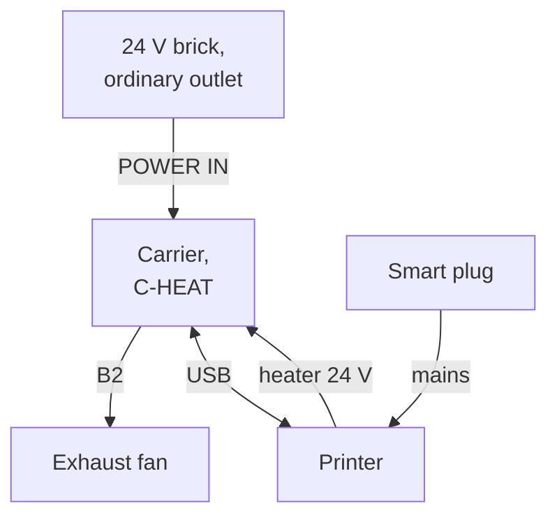
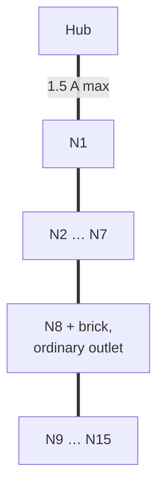
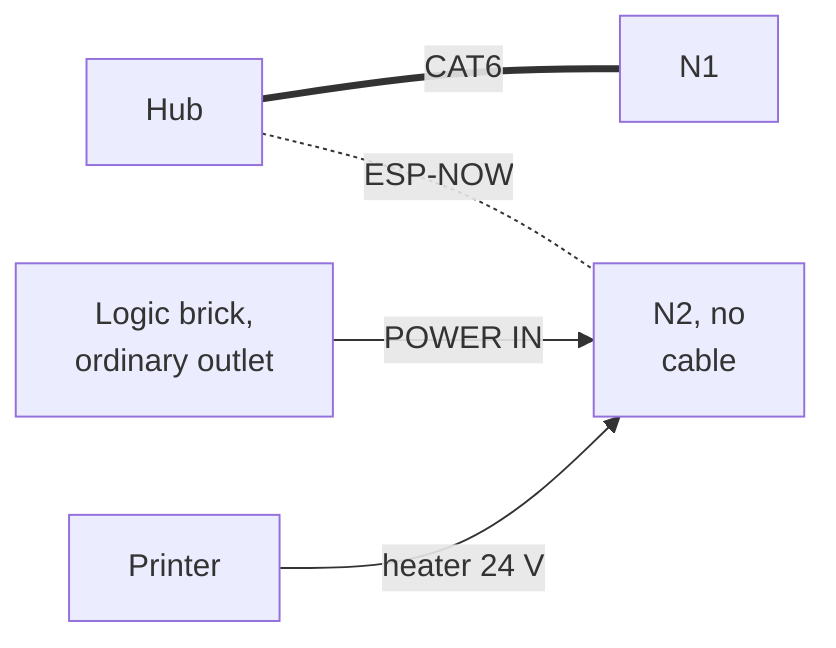
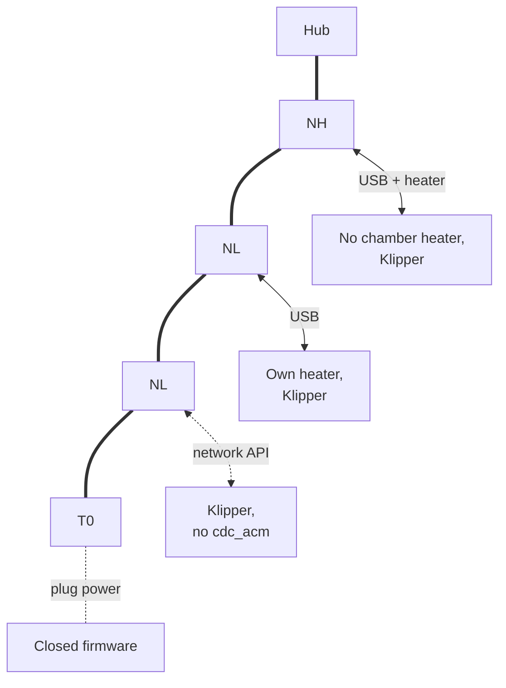
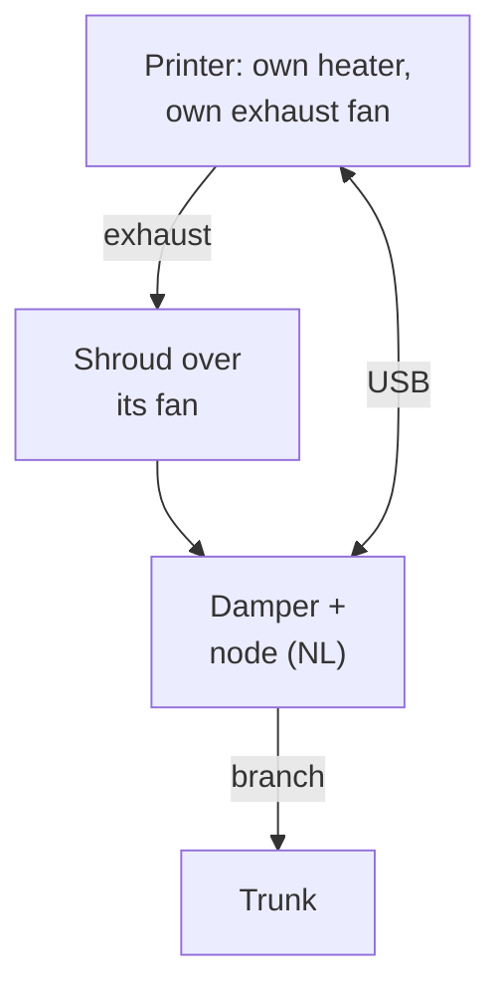
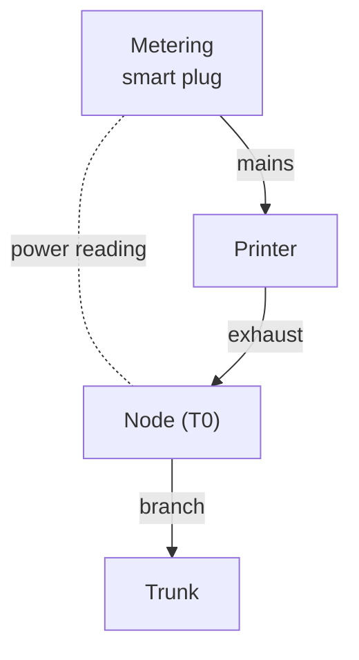

# 11 - Use Envelope

> **Status:** Phase 1 design baseline, 2026-11-07. This doc sets the limits of how the system can be used and shows hypothetical systems at those limits. None of the example systems is a real build; each exists to show where an edge is. Requirements: [doc 10](10_requirements.md). How a printer joins: [doc 12](12_porting_guide.md).
>
> **Evidence key:** [V] verified against a primary source · [E] engineering estimate · [U] needs a measurement on the real hardware.

---

## 1. Limits at a glance

| Dimension | Limit | Set by | What happens past it |
|---|---|---|---|
| Printers per fleet | **1 to 15** | Node IDs 1–15, one block of 16 CAN IDs per message type (D25, doc 07 §6.2) | Message IDs would have to change; a second fleet with its own hub and duct is the supported way to grow |
| One printer | One carrier in a combined role (C-HEAT or C-LITE) | D84 | — (lower bound) |
| Current per CAT6 segment | ≈ 1.5 A, ≈ 36 W | D17, D21 | Add injection (§2.2); the limit is deliberately not raised |
| Hub supply | Idle load of the whole chain + the busiest node's alarm peak, with every printer off | D35, doc 04 §6a | Nodes without another source drop off the bus when all printers are off |
| Purges at once | **One** (token) | doc 06 §5.1 | Others queue, contained at −3 Pa |
| Node heater chamber cap | ≤ 60 °C, hard limit cap + 5 °C, lower if the enclosure's weakest material needs it | D26, doc 05 §3.2 | Not supported with the node heater; a printer with its own heater may run above it on its own rating |
| Node heater power | 150 W PTC | doc 02 §3 | A chamber that loses more than ≈ 150 W + bed heat at the cap won't reach it: seal and insulate (D7, doc 06 §7) |
| Printer serial link | 3.3 V logic only | D100, doc 04 §5 | A 5 V 8-bit board is not supported on the serial link: use the USB-host route or a lower link tier (doc 12 §3) |
| Printer USB lead | ≤ 1.5 m, no VBUS | doc 04 §5 | Use the network link instead |
| Heater lead | 14 AWG ≤ 1.5 m when the heater shares the USB ground | R11 | Fit a USB isolator, or keep the ground share under test 9's 0.3 A |
| Duct | 4″ branches; 4″ trunk for 1–4 printers, the 6″ kit (6″ trunk, two stacked cartridges, 65 mm venturi throat, 6″ hood) for 5–15; fan at the outlet | D6, D95, doc 06 §2 | A fan inside the room would put duct above room pressure: not supported |
| Exhaust fan | ≥ 50 CFM at ≥ ≈ 250 Pa; 4-wire PWM, or a 0–10 V / 10 V PWM input with the fan's own +10 V reference; full speed with no signal; ≤ ≈ 2.2 A at 24 V on the fan tap, or its own supply. From ≈ 9 printers, a second fan in series on fan A, or a 6″ mains EC fan | D88, D91, D95, F3 | Not a supported exhaust fan (doc 02 §6.1) |
| Indoor recirculation | None; the exhaust always leaves the building | D6 | Not supported |
| Printer enclosure | Built in, or a kit that can be sealed to ≈ 2 cm² of open gap | D7, doc 06 §7 | An open-frame printer has no chamber to hold at −3 Pa: not supported |
| Mains cut | One metering smart plug per printer, alone on that plug | D14 | A shared plug cuts every printer on it and blurs Tier 0 print detection |

## 2. Example systems at the limits

Each diagram shows only what the example is about. Labels: **NH** node-heat, **NL** node-lite, **T0** a node on a Tier 0 printer.

### 2.1 One printer, one carrier (lower bound)

A single printer with no other node. One carrier in **C-HEAT** (or **C-LITE**) runs both the node and the hub: no CAN chain, the exhaust fan on B2, and a brick in POWER IN on an ordinary outlet, never on the printer's plug (doc 04 §6b).

**Edge shown:** no other carrier watches this one, so a firmware hang is seen only locally (doc 04 §7a, doc 05 §4). The hardware heater layers still stop the heater, and the fan keeps running per F3.

### 2.2 Fifteen printers on one chain (upper bound)

Fifteen nodes, the most node IDs allow. With every printer on, each node-heat node injects from its printer's supply and the chain is easy. The sizing case is **every printer off**: the hub then carries the whole chain alone.

**Edge shown:** at ≈ 2 W idle per node [E] plus ≈ 10 W for one node's alarm peak [E], the hub's first segment reaches its ≈ 36 W at about 13 nodes. A 24 V brick on an ordinary outlet at a mid-chain node (BAR injection, D13) splits the chain into two halves that each stay well inside the limit. Test 16 confirms the shares (doc 05 §9).

Other edges at fifteen printers [E]:
- **Bleed adds up:** 15 × 1–3 CFM is 15–45 CFM of bleed, plus one purge of 20–60 CFM and any cooling, so the fans work at ≈ 100–180 CFM against the filter. That is why this size takes the 6″ kit and a second fan (doc 06 §2, D95), and the airflow budget lowers the purge toward 20 CFM before it caps cooling (doc 06 §4.5).
- **Purges queue:** if many long purges end together (10–30 min each for ABS), the last one may wait hours. Containment holds while it waits (−3 Pa), but "safe to open" is late.
- **Duct:** 100 CFM in a 4″ trunk would be ≈ 1 150 fpm; in the 6″ kit's trunk it is ≈ 510 fpm, and ≈ 940 fpm at two fans' ≈ 185 CFM, which is reached only while cooling and a purge overlap.

### 2.3 A node with no cable

A printer too far from the chain, or across a doorway, joins over ESP-NOW only (D16, doc 07 §6.4). Its logic runs from a brick on an ordinary outlet, so it still purges when its printer is cut. A wireless-only node-heat needs **two** supplies: the logic brick and the heater supply on the printer's plug (doc 04 §6b).

**Edge shown:** the ESP-NOW range near metal frames is [U] (R6); check RSSI at commissioning. A lost radio link turns the heater off at 30 s, exactly as a lost cable does (test 17).

### 2.4 A mixed fleet

One of each kind of printer cell on one chain: a printer with no chamber heater (node-heat), one with its own heater (node-lite), a Klipper printer on its network API only (Tier 1) and a closed-firmware printer on plug power (Tier 0).

**Edges shown:**
- Only Tier 2 gives `M191` a blocking wait. On Tier 1 a node-heat node can still heat, but the print doesn't wait for the chamber (doc 12 §3.2).
- Tier 0 never heats. It infers print start and end from plug power (doc 07 §6.5), so a printer whose idle and printing power overlap needs its thresholds set from measurements (`power.idle_w`, `power.printing_w`).
- Material comes from the slicer macros or the printer link. On Tier 0 there is no material, so the default policy applies (bleed at −3 Pa, no heat, doc 07 §5).

### 2.5 A printer that heats its own chamber above 60 °C

A printer rated to heat its own chamber above the node-heat cap joins as node-lite. The node never heats; the printer's rating sets the cap, and the pack maps fleet modes onto the printer's own circulation macros (`klipper.modes`).

**Edges shown:** the 60 °C cap binds only the node's own heater. Fire signal F-a then comes from the printer's chamber sensor and heater duty over the link (D39); with the link unplugged it falls back to the sensor head (test 13). The material policy prefers such a printer for PC (doc 06 §6).

### 2.6 A closed printer on plug power only

The lowest integration: any enclosed printer, any firmware, nothing installed on it. The node reads only the plug's power.

**What it still gets:** bleed during prints, purge after, fire detection from the sensor head's VOC spike (F-c) and the plug's power anomaly (F-e), plus a room smoke contact if fitted (F-d), still two-signal (doc 05 §5), and the mains cut. **What it doesn't:** heat, door state from the printer, material, or mirrored alerts on the printer's screen.

## 3. Outside the envelope

These uses are not supported, and the design doesn't try to make them safe:

| Use | Why not |
|---|---|
| Chamber above 60 °C with the node heater | Enclosure plastics and the heater's thermostat ratings (D26) |
| Filtered air returned to the room | The design vents outdoors only; the filter is sized as courtesy for the outlet, not as room-air cleaning (D6) |
| Two purges at once | The trunk loop is sized for one (doc 06 §5.1) |
| An open-frame printer | No chamber to hold below room pressure |
| A fan between the printers and the filter, inside the room | Duct downstream of it would be above room pressure (D6) |
| More than one printer on one smart plug | The mains cut would stop the healthy printer too, against P-2 |
| A heater brick on an ordinary outlet | Cutting the printer wouldn't cut its heater (S-13, test 23) |
| Running without a room smoke alarm | The system supplements one and doesn't replace it (doc 05 S-6) |
