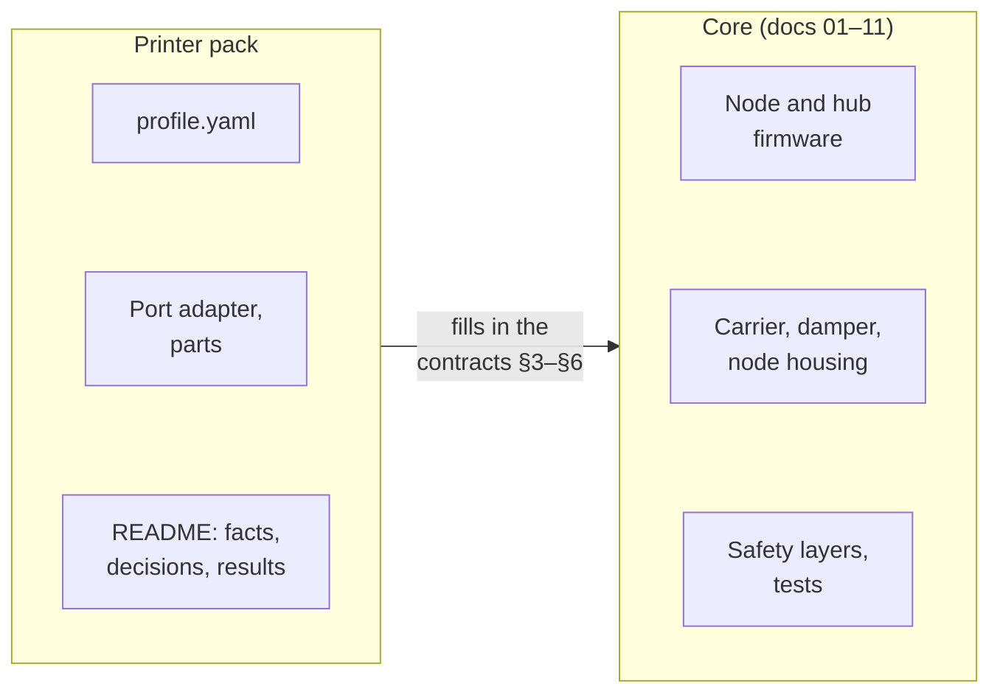
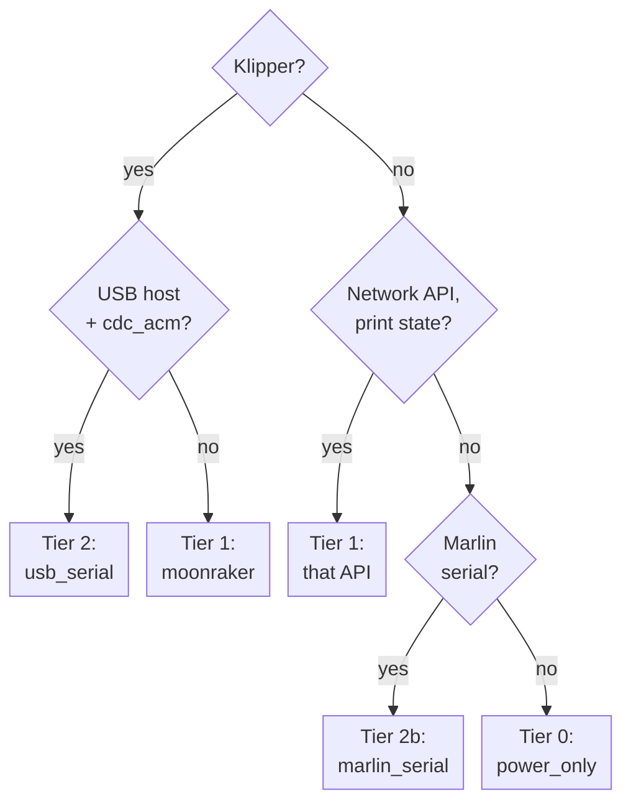
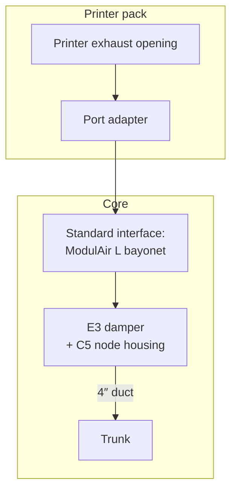
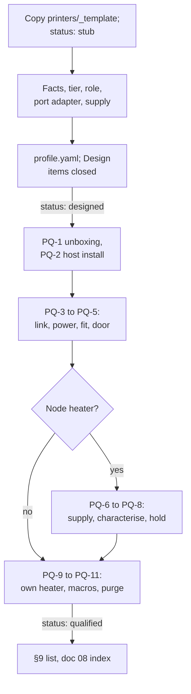

# 12 - Printer Packs: Adding a Printer

> Design baseline, 2026-11-07 (D25), qualification added 2026-11-09 (D104). How the system meets one printer model: what a printer pack is, the contracts it fills in, how to write one, how a model is qualified as supported (§7), and the list of packs (§9). Exhaust fans have packs of their own ([doc 13](13_fan_packs.md)). Phase 1 defines the structure and the contracts. Phase 2 builds the core and the first two designed packs; links for other printer families get built by whoever needs them.

---

## 1. Core and printer packs

The system splits into a **core** that every printer shares and a **printer pack** per printer model. Adding a printer means adding a pack; the core doesn't change. The core docs (01–11, 14; fan packs in doc 13 name fan products, never printers) never name a printer model. Everything about one model that any owner of it could reuse lives in its pack.

| Core (same for every printer) | Printer pack (one per model) |
|---|---|
| Carrier PCB, all roles and power inputs (doc 02 §2) | Which role (node-heat or node-lite) and which power inputs are fitted |
| Hub, bus, ESP-NOW, fan, filter, trunk (docs 02, 06) | Port adapter: the printed part from the printer's exhaust opening to the standard interface (§5) |
| Damper (E3) and node housing (C5) on the standard interface (§5) | Other printed parts for that printer (pass-throughs, door-switch mounts, recirculation) |
| Node and hub firmware, including every link type (§3) | `profile.yaml` (§4): limits, link type, printer object names |
| Safety layers (doc 05) and their validation ([`validation/`](../validation/README.md)) | Wiring to the printer: USB connection point, heater supply tap if used |
| Klipper extra and the USB-serial protocol (doc 07) | Install variant for that printer's firmware, slicer snippets |
| Smart-plug backends (doc 07 §10) | Decisions, open items and qualification results for that model (§2.2, §7) |



## 2. Pack layout

```text
printers/
  _template/              # copy this to start a new printer
  <vendor>_<model>/
    profile.yaml          # what the node needs to know (§4)
    README.md             # the pack design (§2.1), decisions, open items, results
    cad/                  # port adapter + other parts (CadQuery, STEP, STL)
    host/                 # install variant or host-side notes
    slicer/               # G-code snippets
```

**Rules:**
- A pack never edits core files. If a pack needs something the core can't express, that's a change to the core contract (§3, §4), made once for everyone.
- Parts keep catalogue IDs (doc 08) so cross-references stay stable; the pack holds the part's full definition and doc 08 §3a lists it with a link.
- Non-commercial or otherwise restricted models are linked, never copied into the pack (§8).
- A pack records **facts about the model**, never about one owner's installation (room, hosts, plugs, orders). Those stay in the builder's own records.

### 2.1 Pack README sections

Every pack README has the same sections, so packs can be compared side by side. A **stub** fills in §1, §2 and §11 and marks everything else `[U]`.

| § | Section | Contents |
|---|---|---|
| 1 | Summary | Status (§9), role, link tier and backup, chamber cap, heater supply, door source, port adapter, profile link |
| 2 | Printer facts | What the core needs to know about the model, each tagged [V], [E] or [U]: enclosure (built in or kit, panel material), exhaust opening, own chamber heater and its rating, firmware and its API, USB ports, supply rating, multi-material unit |
| 3 | Role and integration | How the node meets this printer, with a cell diagram: printer, port adapter, damper and node, heater, links |
| 4 | Enclosure modifications | Port adapter, pass-throughs, seals, insulation, makeup inlet, door switch, node mounting |
| 5 | Heater supply | Node-heat only: the sizing check (doc 02 §3.1) or the brick used. Otherwise "None" |
| 6 | Printer link | The connection point, ports reviewed, enumeration, route, fallbacks |
| 7 | Host integration | What the profile's `klipper:` keys produce, or the equivalent for other firmware |
| 8 | Printed parts | Existing models to verify and custom parts, with catalogue IDs |
| 9 | Install variant | Which variant (§3.3), paths, notifier |
| 10 | Pack decisions | Model-specific decisions (§2.2) |
| 11 | Open items | Model-specific risks and open items (§2.2) |
| 12 | Qualification results | The §7.2 tests with dates, firmware and pack versions, results and measured values (`power.*`, `heater_power`, characterise ranges) |

### 2.2 Pack decisions and open items

- **Decisions** that apply to one model only go in the pack's §10, numbered within the pack (`<pack>-1`, `<pack>-2`, …), each citing the core decision it applies (for example "applies D26"). A decision that would apply to any printer is a core `D` row in `design_decisions.md` instead.
- **Risks and open items** for one model go in the pack's §11, with columns `# | Item | Impact | Closes at | Plan`. *Closes at* names the step that closes it: **Design** (desk work before the pack can be `designed`), a qualification test (`PQ-n`, §7.2), **Link type** (core work on a link the pack waits for), or a validation test (`VAL-…`) for an item the core must prove first. An item first raised in the core register keeps its ID (`O1`, `R7`, …) when it moves to a pack, so older references still resolve. New pack items are numbered within the pack.
- An item closed by a measurement on one unit is recorded as a fact in §2 with [V] and the date, so the next owner of the model doesn't repeat it.

## 3. Printer-link contract

### 3.1 What the node needs from a printer

| Signal | Required | Used for |
|---|---|---|
| Print active / idle / finished | **Yes** | Bleed during prints, purge after, heater permission |
| Printer powered | **Yes** (from the smart plug at minimum) | Purge a powered-off printer, heater lockout checks |
| Material or job name | No | Policy selection (doc 07 §5); without it, the generic default applies |
| Chamber setpoint and a blocking wait (`M191` equivalent) | No (needed for node heating that the slicer controls) | Heated prints |
| Bed target and temperature | Only if the node heater shares the printer's supply | Bed-heat interlock (doc 05 §3.3) |
| Door state | No | Door-open purge (doc 05 §6); a reed switch on the node also works |
| A way to post a message on the printer | No | Mirrored alerts |

### 3.2 Link tiers

| Tier | Link type (`link:` in the profile) | Gives | Printers | Status |
|---|---|---|---|---|
| **0 – Standalone** | `power_only` | Print active and finished from the smart plug's power reading (doc 07 §6.5); printer powered | **Any** printer on a metering plug | Phase 2 (core) |
| **1 – Network API** | `moonraker` | Everything in §3.1 except a blocking wait; node readings also show in Mainsail/Fluidd through Moonraker `[sensor]` (doc 07 §6.3) | Any Klipper printer with Moonraker | Phase 2 (core; also the backup link on Tier 2) |
| | `octoprint`, `prusalink`, `bambu_mqtt` | Print state, job name; material where the API has it | OctoPrint hosts, and vendor network APIs | **Not built.** Add when a pack needs it |
| **2 – Host plugin over USB** | `usb_serial` | Everything in §3.1, router-independent, with `M191` blocking | Klipper printers (any distribution), via the klippy extra | Phase 2 (core) |
| **2b – Direct serial** (D48) | `marlin_serial` | Print state and progress (`M27`, SD or USB-stick printing), hotend and bed temperatures and targets (`M105`, `M155` auto-report), job name where the firmware reports it, mirrored alerts (`M117`). No door state, no blocking wait | Marlin printers with no host and no network, on 32-bit boards with 3.3 V logic (D100) | **Not built.** Add when a pack needs it |

**USB on Tier 2.** The printer end is whichever USB host port the printer offers: an external port (preferred: nothing goes inside the printer) or an internal header (pins into the footprint, never wires on pads). The lead never carries VBUS (doc 04 §5). The printer's kernel must have `cdc_acm`; without it, the printer drops to `moonraker` with no other change. Each pack reviews its ports in its §6.

**Tier 2b ports and rules (D48):**
- **`link_port: uart`:** the carrier's AUX header (doc 04 §4: A = TX, B = RX, GND) to the board's TFT or serial header. **3.3 V boards only** (D100): current 32-bit boards are 3.3 V and work both ways. The AUX lines survive a 5 V board, but the node's 3.3 V TX has too little margin for one, so 5 V 8-bit boards are not supported. The pack must confirm that port is enabled in that printer's firmware [U per printer].
- **`link_port: usb_host`:** the carrier's USB-C (the module's native USB, D72) as a USB host, to the printer's USB (CH340, CP210x or CDC-ACM). For boards whose UART on the header is shared with the USB chip, this is the only route. Whether the printer enumerates with VBUS left unconnected (doc 04 §5) is [U per printer].
- **Command allowlist:** the node sends only `M105`, `M155`, `M27`, `M31`, `M115` and `M117`, never motion, temperature, fan or file commands. The firmware enforces the list and a pack can't widen it.

Every node also uses power metering as a cross-check whatever its tier: a printer that drops to 0 W is "printer off" within seconds.

**Node heater permission:** a node heater runs only on Tier 1, 2 or 2b, with print state confirmed by the link (the 30 s rule in doc 05 §4). Tier 0 can bleed, purge and alert, but it can't heat: power alone can't tell a print from a preheat or a stuck bed heater.



### 3.3 Firmware and host side

- **Firmware:** one `PrinterLink` interface in `fleet_common`, with one implementation per link type. The node picks it from its profile. New link types are added to the core, so every pack can use them.
- **Klipper host plugin:** the klippy extra (`fleet_node.py`) uses only Klipper's own APIs and `pyserial`, so it runs on any Klipper. It's packaged once, with install variants. Each pack names its variant and paths in its §9.

| Variant | For | Install | Update | User config | Notifier |
|---|---|---|---|---|---|
| **Firmware mod** (for example zmod, which runs over a vendor's stock firmware; §9 shows which packs use it) | Printers whose vendor Klipper is locked down, where a mod adds root, Moonraker and a plugin system | Into the mod's plugin directory, enabled with the mod's command (zmod: `mod_data/plugins/fleet_exhaust/`, then `ENABLE_PLUGIN name=fleet_exhaust`) | Moonraker `[update_manager]` in the mod's Moonraker include (zmod: `mod_data/user.moonraker.conf`) | The mod's user config (zmod: `mod_data/user.cfg`) | The mod's notify plugin (zmod: Apprise URLs in `mod_data/notify.txt`, then `UPDATE_NOTIFY`) |
| **Stock Klipper with Moonraker** | Mainline or vendor Klipper with root and Moonraker, including vendor forks opened up by community helper scripts | `install.sh` symlinks the extra into `klippy/extras`; `fleet_exhaust.cfg` included from `printer.cfg` | Moonraker `[update_manager fleet_exhaust]` | `user.cfg` beside `printer.cfg` | Moonraker `[notifier]` (Apprise) |
| **None** | Tier 0, 1 (non-Klipper) and 2b printers | Nothing on the printer | — | Dashboard only | The hub only |

The extras path differs between a vendor's Klipper and a mod's own Klipper build; the pack records it, and the installer checks it (R5).

- **Protocol specs:** the USB-serial protocol (doc 07 §6.1) and the CAN messages (doc 07 §6.2) are published as versioned specs in `docs/protocol/` (Phase 2), so a host plugin for another firmware can be written from the spec alone.

## 4. Printer profile (`profile.yaml`)

The node gets its printer-specific behaviour from the profile, not from code. The profile is loaded from the dashboard and, on Tier 2, re-sent by the host plugin at the link handshake (a mismatch raises an alert; the dashboard copy wins).

| Key | Type | Meaning |
|---|---|---|
| `id`, `name` | string | Pack folder name and display name |
| `status` | enum | `stub`, `designed` or `qualified` (§9). Default `designed`. A node refuses a `stub` profile for heating |
| `link` | enum | Printer link (not the hub link of doc 07 §6.4): `usb_serial`, `moonraker`, `octoprint`, `prusalink`, `bambu_mqtt`, `marlin_serial`, `power_only` |
| `link_port` | enum | `marlin_serial` only: `uart` (AUX header) or `usb_host` (§3.2) |
| `link_backup` | enum | Usually `moonraker` on Klipper printers, else `power_only` |
| `role` | enum | `node-heat` or `node-lite` |
| `chamber.cap_c` | number | Operating cap for the chamber, set by the enclosure's weakest material, or the vendor's rating for a printer that heats its own chamber |
| `chamber.native_heater` | bool | The printer heats its own chamber. The node then never fits or runs a heater |
| `heater.allowed` | bool | Node heater permitted (needs `role: node-heat`, Tier ≥ 1) |
| `heater.max_w` | number | Upper bound for the heater element; the node's own `heater_power` and learned supply cap may be lower (doc 05 §3.3, D64) |
| `enclosure.makeup_flap` | bool | A spring-and-magnet makeup flap is fitted, so purge starts with the crack test (doc 06 §5.2, D90). Default false |
| `door.source` | enum | `node_reed`, `link` (named objects), `none` |
| `door.objects` | list | Printer object names for `link`, for example a printer's `gcode_button` names for its doors |
| `material.slot_source` | string | Where the loaded slot's material can be read on a printer with a multi-material unit (a status object and field), for default-policy level 4 (doc 07 §5). Default unset |
| `klipper.chamber_sensor` | enum | `fleet_node` (the extra provides `[temperature_sensor chamber]`) or `native` |
| `klipper.m141_m191` | enum | `plugin` or `native` |
| `klipper.modes` | map | Macros to call per fleet mode (`heated`, `cooling`, `purge`, `done`), for a printer whose own fans or circulation modes must follow the fleet mode |
| `power.idle_w`, `power.printing_w` | number | Tier 0 thresholds (doc 07 §6.5), measured in qualification (PQ-4); an installation re-learns them (INS-9) |
| `purge` | map | Optional per-printer overrides of the material defaults (doc 06 §6) |
| `outputs.b1`, `outputs.b2` | string | What the low-side outputs drive (for example a recirculation blower on B1) |

The schema is versioned (`schema: 1`). Unknown keys are rejected, so a typo can't silently fall back to a default.

**Required and optional keys (D27).** Required: `schema`, `id`, `name`, `link`, `role`, `chamber.cap_c`, `chamber.native_heater`; `heater.*` when `heater.allowed` is true; `power.*` when `link` or `link_backup` is `power_only`. Everything else is optional and takes the core default when absent. **Leave optional keys unset unless you need a different value**, so a later change to a default still reaches you (Nevermore's convention, and the same idea as the explicit-only settings push in doc 07 §3.1). The template lists them commented out with their defaults.

## 5. Mechanical interface

Every printer meets the core hardware at one interface. A new printer needs a **port adapter** to it and nothing else in the duct path.



| Feature | Standard |
|---|---|
| Duct interface | **ModulAir Large (4″ / 100 mm) QuickLock bayonet with its gasket** (D34, doc 08 §3c), so a port adapter mates with the damper and any ModulAir part. ModulAir already has adapters for some printers, which a pack can use directly. Published as a STEP "interface stub" in `hardware/cad/interface/` once the licence allows (O13); otherwise our own compatible stub |
| Node housing | C5, mounted on the E3 damper body with its thermal break. Same part on every printer |
| Cable pass-through | A grommet in the port adapter (C8 profile) for the USB lead, sensor-head cable, NTC leads, ΔP tube and, on node-heat, the heater leads |
| Sensor head | C4 cover mounted inside the chamber at the exhaust port, out of any heater jet |
| Material | Doc 08 §1 rules apply to the adapter by its location |

**Three kinds of port adapter** cover the printers met so far:

| Kind | When | Notes |
|---|---|---|
| **Kit part replacement** | The enclosure is a kit with printed or replaceable parts | The adapter replaces a kit part high on the enclosure, so no panel is cut (D2, D19) |
| **Shroud over the printer's own exhaust fan** | The printer has a built-in exhaust fan or filter outlet | The shroud seals over the outlet without blocking it; the printer's fan then adds to the branch flow, so its pack maps the fan to the fleet modes (`klipper.modes`) |
| **Panel flange** | A rigid enclosure with no usable opening | A flange through a cut panel, high on the rear; the last resort |

## 6. Safety contract

A pack **must** meet all of these. A profile can only make limits stricter; nothing in a pack can switch a safety layer off.

1. A **mains-cut smart plug** on the printer, on a supported backend (doc 07 §10).
2. Node heaters only on a **node-heat** carrier with the full hardware chain: two switches, charge pump, both KSD301s, TCO, fuse (doc 05 §3.1).
3. `chamber.cap_c` set from the weakest material in the chamber (≤ HDT − 30 °C for printed parts). With a **node heater**, never above 60 °C; the firmware hard limit is then cap + 5 °C and the chamber-air KSD301 is rated about cap + 10 °C (doc 05 §3.1). A printer that heats its own chamber uses the manufacturer's rating instead.
4. Any external heater supply on the **printer's own smart plug** (doc 05 §3.3).
5. Heater only on Tier 1 or Tier 2 links (§3.2), and never on a `stub` profile.
6. A heater supply that suits the heater: the sizing rule for a shared supply (doc 02 §3.1), and the node's `heater_power` set from the pack's qualified value (PQ-6); the learned supply cap covers a misjudged supply (doc 05 §3.3, D64).
7. The qualification tests that apply (§7.2) pass on at least one unit, with results recorded in the pack README §12. The design itself is proven once, in validation ([`validation/`](../validation/README.md)); a pack proves only what depends on the printer.
8. The host plugin, if any, never shuts down or errors the printer's firmware (doc 07 §3.2). Its only print control is the `PAUSE` of the print hold (doc 05 §4.1).
9. Latched states follow the fault levels (doc 05 §4.1): only **Clear** ends a lockout or cut, and a plug switched on while a cut is latched is cut again. A pack can't change either.

## 7. Porting checklist and printer qualification

A printer model becomes supported in two steps: the pack is **designed** on paper (§7.1), then **qualified** on a real unit (§7.2). Qualification proves only what depends on the printer: the design itself (boards, firmware, safety layers) is proven once, in validation ([`validation/`](../validation/README.md)), and every builder's own fleet is checked at installation ([doc 14 §4](14_build_your_own.md#4-install-and-commission)). It is one of three test steps (D104):

| Step | Proves | Equipment |
|---|---|---|
| Validation (`VAL-…`) | The core design, on prototype boards | Lab bench |
| **Qualification (`PQ-…`, this section)** | **One printer model works with the core** | **The system's dashboard and test modes, a multimeter, the printer. Nothing else** |
| Installation (`INS-…`) | One builder's fleet | None |

### 7.1 Designing a pack

1. Copy `printers/_template/` to `printers/<vendor>_<model>/`. Set `status: stub` until the pack is designed.
2. Record the printer facts (§2.1 section 2), each with its evidence tag.
3. Pick the link tier (§3.2) and role. Check whether the printer heats its own chamber.
4. Find the exhaust opening and choose the kind of port adapter (§5). Look for existing models first (doc 08 policy).
5. Decide the heater supply if there's a node heater (doc 02 §3.1) and record the sizing check.
6. Fill in `profile.yaml`.
7. List the pack's open items with the step that closes each (§2.2). Every item marked **Design** must be closed to set `status: designed`.
8. Add the pack's parts to doc 08's pack index, the pack to §9, and its lines to your BOM.

### 7.2 Qualification tests

Run on one unit of the model, installed as a builder would (doc 14 §4), on boards and firmware that passed validation. Test mode is the firmware's mode for injecting faults and signals (doc 07 §8). Which tests apply:

| Test | node-lite, Tier 0 | node-lite, Tier 1 / 2 / 2b | node-heat | Own chamber heater |
|---|---|---|---|---|
| PQ-1 Unboxing facts | ✓ | ✓ | ✓ | ✓ |
| PQ-2 Host install | | Tier 2 (and 1 on Klipper) | ✓ | Tier 2 |
| PQ-3 Link robustness | | ✓ | ✓ | ✓ |
| PQ-4 Plug power profile | ✓ | ✓ (backup) | ✓ | ✓ |
| PQ-5 Fit, leakage, makeup air and door | ✓ | ✓ | ✓ | ✓ |
| PQ-6 Heater supply under load | | | ✓ | |
| PQ-7 Heat-up and characterise | | | ✓ | |
| PQ-8 Chamber wait and print hold | | | ✓ (Tier 2) | |
| PQ-9 The printer's own heater and fans | | where `klipper.modes` is set | where `klipper.modes` is set | ✓ |
| PQ-10 Prints without the macros | ✓ | ✓ | ✓ | ✓ |
| PQ-11 Print cycle and purge | ✓ | ✓ | ✓ | ✓ |

**PQ-1 Unboxing facts.** Before any wiring, with the printer unplugged: read the supply label (watts, 24 V current) and trace whether the bed runs from it; check the markings on every plastic part inside the chamber (`>ABS<`, `>PC<`, `>PLA<`); find the exhaust opening and its size; list the USB host ports and meter any header's VBUS and pin order. Then with the printer on: plug a node (or any ESP32-S3 board running the node firmware) into the chosen USB port and look for `/dev/ttyACM*` and `dmesg` (`cdc_acm`). Tier 2b: confirm the port answers `M115` at the firmware's baud rate and meter the TX line's idle level (3.3 V logic, D100). Each fact goes into §2 as [V] with the date.

**PQ-2 Host install** (Tier 2, and Tier 1 on Klipper). Install the extra with the pack's variant (§3.3): it loads, the extras path matches the pack (R5), `[temperature_sensor chamber]` appears, `M141`/`M191` don't collide with a stock definition (doc 07 §3.2), the Moonraker update manager sees the repo and a test `_NOTIFY` reaches the phone. If the extra won't load, record the pack as macros-only (no blocking wait).

**PQ-3 Link robustness** (Tier 1, 2, 2b). Unplug the printer's USB lead mid-print (Tier 2): the print continues, the extra reconnects on replug, and alerts behave as in doc 05 §4. Stop Moonraker mid-print (Tier 1, and Tier 2's backup): the node falls back to the next link and alerts. Tier 2b: the node sends only the allowlisted commands (§3.2; read the printer's console log).

**PQ-4 Plug power profile.** Let the node learn the plug's power trace over one idle period and one print (doc 07 §6.5) and accept the proposed `power.idle_w` and `power.printing_w`; check that print start and end are detected on three prints, including a short one. Record the printer's peak draw: the plug's power limit (printer peak × 1.3, D16) is set from it at installation.

**PQ-5 Fit, leakage, makeup air and door.** The port adapter seals and the printer's own fans and airflow are not blocked. With the trunk at its setpoint, sweep the damper and record chamber ΔP against angle (was M3): the chamber reaches −3 Pa well inside the damper's travel. With a makeup inlet: run one branch at purge flow and read that chamber's ΔP (≤ ≈ 25 Pa at 50 CFM, scaled by flow²), and record the first crack test's opening point (≈ 8–16 Pa) (was M11). Open the door during a print with the pack's door source: damper to purge, alert at 60 s (was test 12).

**PQ-6 Heater supply under load** (node-heat; was test 8, and test 9 in part). With `heater_power` set from the pack and no print, heat the bed to its usual target, then run the heater at `heater_power` for 10 min while the printer runs a fast motion test. Meter the printer's 24 V rail at its supply terminals during the run. If the supply drops out, confirm the node sets the learned cap and alerts, then repeat until a run completes. Pass: on a shared supply, the rail stays above 23 V and the mainboard doesn't reset (R12), and the USB link's error counters stay at zero through the run (R11: the wiring rule was proven in VAL-H9; a pack that can't follow the rule fits the USB isolator). Record `heater_power` and any learned cap.

**PQ-7 Heat-up and characterise** (node-heat; was test 24 and M5). Run the characterise run (doc 05 §3.2) in the coldest room available and record the room temperature, the time to the cap and the proposed thresholds. Accept them; these become the pack's **expected ranges**, which installations check theirs against (INS-8). Then print ABS at 50 °C: heater duty and chamber ΔP stay steady (was M5). Soak the chamber at the cap for 2 h and look for creep in every stock plastic part (O11 on kit enclosures); drop `chamber.cap_c` if any part moves.

**PQ-8 Chamber wait and print hold** (node-heat on Tier 2; was test 26 on this printer's Klipper). `M191` holds print start until the chamber reaches its target, and its timeout gives the continue-or-pause choice (doc 07 §4). Lock the node out (test mode) and start a job with `M191`: the print pauses during the chamber wait with the reason on screen; `RESUME` runs it unheated; `FLEET_CLEAR` then `RESUME` on a second job heats normally.

**PQ-9 The printer's own heater and fans.** Each fleet mode calls the pack's `klipper.modes` macros and the printer's fans follow. On a printer that heats its own chamber, check its heater rating against `chamber.cap_c`, then inject two fire signals in test mode with the printer link unplugged: F-a falls back to the node's SHT40 (D39, was test 13 in part).

**PQ-10 Prints without the macros.** Start a print from the touchscreen and from the vendor's app or slicer: it gets bleed and purge under the default policy and never heats (F-11). Record which default-policy levels work on this printer: `filament_type` metadata (level 3) and the material slot source (level 4) (doc 07 §5).

**PQ-11 Print cycle and purge.** One cooling print (PLA or PETG) stays below the material policy's chamber limit with bleed (F-7). One heated or enclosed print (ABS) ends in a purge that cools at the slicer's ramp and finishes on its criteria (F-8); the bed LED goes green and the push arrives (F-10).

### 7.3 Recording and status

- Record every test in the pack README §12: date, unit, firmware and pack version, pass or fail, and the measured values. A measurement that closes an open item also goes into §2 as [V] (§2.2).
- When every applicable test passes on one unit, set `status: qualified` in `profile.yaml` and §9. A second unit is welcome, not required.
- A later pack change that touches the port adapter, heater supply, link or `klipper.modes` re-runs the tests that depend on it; a firmware release re-runs nothing unless its notes name a pack test.
- Anyone who installs a `designed` pack is running this qualification: say so in an issue, and send the results back.



## 8. Licensing and contributions

| Area | Licence | Why |
|---|---|---|
| Firmware, klippy extra, scripts | **MIT** (the repo's current `LICENSE`) | Permissive and GPL-compatible, so the extra can load into Klipper (GPLv3) |
| Carrier PCB and other hardware designs | **CERN-OHL-P-2.0** | The permissive hardware licence, matching MIT |
| Docs, printed-part CAD | **CC BY 4.0** | Reuse with attribution |
| Remixes of others' models | The original's licence | Remixes inherit it. CC BY-NC models are linked, never copied into the repo |

**Labelling and tooling (D27).** A `LICENSES/` folder holds each licence text; `REUSE.toml` labels the docs and printer packs in bulk, and every source file carries an SPDX licence header naming MIT, CERN-OHL-P-2.0 or CC-BY-4.0 (the CERN-OHL-P-2.0 text is added with the first hardware files, since `reuse lint` flags licence texts that no file uses) following the REUSE spec, so `reuse lint` in CI proves every file is labelled. For the PCB, KiBot in CI generates gerbers, the JLCPCB BOM and placement files, PDF schematics and an Interactive HTML BOM on each tag, and every part carries an `LCSC` field. Releases are tagged `vX.Y.Z` in both repos (doc 07 §3.1).

FLOOK32 (GPLv3, D23) and Nevermore Controller (AGPL-3.0, D27) contributed ideas only; none of their code may be copied into these MIT repos. [`CONTRIBUTING.md`](../CONTRIBUTING.md) points new contributors at the template, this checklist and the safety contract.

## 9. Pack list

**Status:** *stub* = facts and likely integration only, every unknown marked [U], not usable for heating until designed; *designed* = the pack design is complete and its Design items are closed; it waits for qualification (§7.2); *qualified* = every applicable qualification test passed on at least one unit, so the model is supported. Stubs are starting points for anyone who owns the printer; corrections and measurements are welcome.

| Pack | Status | Role | Link (backup) | Port adapter | Notes |
|---|---|---|---|---|---|
| [Flashforge AD5X](../printers/flashforge_ad5x/README.md) | designed | node-heat | `usb_serial` (`moonraker`) | Kit part replacement | Official enclosure kit, firmware mod; the reference node-heat design |
| [Flashforge Creator 5 Pro](../printers/flashforge_c5pro/README.md) | designed | node-lite | `usb_serial` (`moonraker`) | Shroud over its exhaust fan | Own chamber heater; the reference node-lite design |
| [Generic Klipper + Moonraker](../printers/generic_klipper_moonraker/README.md) | stub | either | `usb_serial` (`moonraker`) | Any | Any enclosed printer on mainline-style Klipper; the starting point for most new packs |
| [Flashforge Adventurer 5M / 5M Pro](../printers/flashforge_ad5m/README.md) | stub | node-heat [U] | `usb_serial` (`moonraker`) [U] | Kit or panel [U] | Close relative of the AD5X pack |
| [Bambu Lab X1 / P1 series](../printers/bambu_x1_p1/README.md) | stub | node-lite | `power_only` (`bambu_mqtt` not built) | Shroud over its rear exhaust | Closed firmware; Tier 0 until a network link exists |
| [Bambu Lab H2D](../printers/bambu_h2d/README.md) | stub | node-lite | `power_only` (`bambu_mqtt` not built) | Shroud [U] | Own chamber heating [U: rating] |
| [Prusa Core One / MK4 in an enclosure](../printers/prusa_core_one_mk4/README.md) | stub | node-lite [U] | `power_only` (`prusalink` not built) | Shroud or panel [U] | Buddy firmware; network API exists |
| [Creality K1 series](../printers/creality_k1/README.md) | stub | node-heat [U] | `moonraker` after rooting [U] | Shroud over its exhaust [U] | Klipper-based vendor firmware |
| [Creality K2 Plus](../printers/creality_k2_plus/README.md) | stub | node-lite | `moonraker` [U] | Shroud [U] | Own chamber heater [U: rating] |
| [Qidi enclosed Klipper printers](../printers/qidi_klipper/README.md) | stub | node-lite or node-heat by model | `usb_serial` (`moonraker`) [U] | Shroud over its exhaust [U] | Stock Klipper + Moonraker; some models heat their own chamber |
| [Elegoo Centauri Carbon](../printers/elegoo_centauri_carbon/README.md) | stub | node-lite [U] | `power_only` | Shroud or panel [U] | Vendor firmware and network protocol [U] |
| [Sovol SV08 with an enclosure](../printers/sovol_sv08/README.md) | stub | node-heat [U] | `usb_serial` (`moonraker`) | Panel flange or kit part [U] | Mainline-style Klipper + Moonraker |

Other enclosed printers can start from the generic Klipper + Moonraker stub, or from the Tier 0 path (§3.2) for closed firmware.
