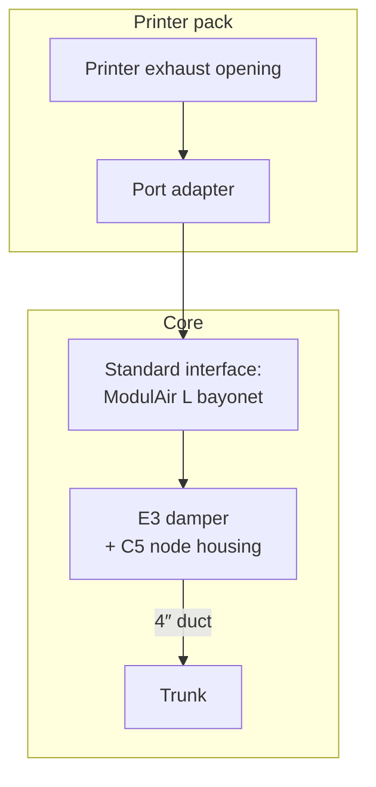

# 12 - Porting Guide: Adding Other Printers

> Design baseline, 2026-10-26 (D25). How to add a printer that isn't a Flashforge, or doesn't run zmod, using the same hardware. Phase 1 defines the structure and the contracts; Phase 2 builds the core and the two Flashforge packs. Links for other printer families get built by whoever needs them.

---

## 1. Core and printer packs

The system splits into a **core** that every printer shares and a **printer pack** per printer model. Adding a printer means adding a pack; the core doesn't change.

| Core (same for every printer) | Printer pack (one per model) |
|---|---|
| Carrier PCB, all roles and power inputs (doc 02 §2) | Which role (node-heat or node-lite) and which power inputs are fitted |
| Hub, bus, ESP-NOW, fan, filter, trunk (docs 02, 06) | Port adapter: the printed part from the printer's exhaust opening to the standard interface (§5) |
| Damper (E3) and node housing (C5) on the standard interface (§5) | Other printed parts for that printer (pass-throughs, door-switch mounts, recirculation) |
| Node and hub firmware, including every link type (§3) | `profile.yaml` (§4): limits, link type, printer object names |
| Safety layers and commissioning tests (doc 05) | Wiring to the printer: USB connection point, heater supply tap if used |
| Klipper extra and the USB-serial protocol (doc 07) | Install variant for that printer's firmware, slicer snippets |
| Smart-plug backends (doc 07 §10) | Porting checklist results (§7) |

## 2. Pack layout

```text
printers/
  _template/              # copy this to start a new printer
  flashforge_ad5x/
  flashforge_c5pro/
    profile.yaml          # what the node needs to know (§4)
    README.md             # install, wiring, parts, checklist results
    cad/                  # port adapter + other parts (CadQuery, STEP, STL)
    host/                 # install variant or host-side notes
    slicer/               # G-code snippets
```

**Rules:**
- A pack never edits core files. If a pack needs something the core can't express, that's a change to the core contract (§3, §4), made once for everyone.
- Parts keep catalogue IDs (doc 08) so cross-references stay stable; the pack holds the part's full definition and doc 08 lists it with a link.
- Non-commercial or otherwise restricted models are linked, never copied into the pack (§8).

## 3. Printer-link contract

### 3.1 What the node needs from a printer

| Signal | Required | Used for |
|---|---|---|
| Print active / idle / finished | **Yes** | Bleed during prints, purge after, heater permission |
| Printer powered | **Yes** (from the smart plug at minimum) | Purge a powered-off printer, heater lockout checks |
| Material or job name | No | Policy selection (doc 07 §5); without it, the generic default applies |
| Chamber setpoint and a blocking wait (`M191` equivalent) | No (needed for node heating that the slicer controls) | Heated prints |
| Bed target and temperature | Only if the node heater shares the printer's supply | Bed-heat interlock (doc 05 §3.3) |
| Door state | No | Door-open purge (doc 05 §6); a reed switch on the node also works |
| A way to post a message on the printer | No | Mirrored alerts |

### 3.2 Link tiers

| Tier | Link type (`link:` in the profile) | Gives | Printers | Status |
|---|---|---|---|---|
| **0 – Standalone** | `power_only` | Print active and finished from the smart plug's power reading (doc 07 §6.5); printer powered | **Any** printer on a metering plug | Phase 2 (core) |
| **1 – Network API** | `moonraker` | Everything in §3.1 except a blocking wait; node readings also show in Mainsail/Fluidd through Moonraker `[sensor]` (doc 07 §6.3) | Any Klipper printer with Moonraker | Phase 2 (core; also the backup link on Tier 2) |
| | `octoprint`, `prusalink`, `bambu_mqtt` | Print state, job name; material where the API has it | OctoPrint hosts, Prusa printers, Bambu LAN mode | **Not built.** Add when a pack needs it |
| **2 – Host plugin over USB** | `usb_serial` | Everything in §3.1, router-independent, with `M191` blocking | Klipper printers (any distribution), via the klippy extra | Phase 2 (core) |
| **2b – Direct serial** (D48) | `marlin_serial` | Print state and progress (`M27`, SD or USB-stick printing), hotend and bed temperatures and targets (`M105`, `M155` auto-report), job name where the firmware reports it, mirrored alerts (`M117`). No door state, no blocking wait | Marlin printers with no host and no network | **Not built.** Add when a pack needs it |

**Tier 2b ports and rules (D48):**
- **`link_port: uart`:** the carrier's AUX header (doc 04 §4: A = TX, B = RX, GND) to the board's TFT or serial header. The AUX lines are 5 V-tolerant. Current 32-bit boards are 3.3 V and work both ways. The pack must confirm that port is enabled in that printer's firmware [U per printer].
- **`link_port: usb_host`:** the dev board's native USB port as a USB host, to the printer's USB (CH340, CP210x or CDC-ACM). Preferred for 5 V 8-bit boards, where the node's 3.3 V TX has little margin. Whether the printer enumerates with VBUS left unconnected (doc 04 §5) is [U per printer].
- **Command allowlist:** the node sends only `M105`, `M155`, `M27`, `M31`, `M115` and `M117`, never motion, temperature, fan or file commands. The firmware enforces the list and a pack can't widen it.

Every node also uses power metering as a cross-check whatever its tier: a printer that drops to 0 W is "printer off" within seconds.

**Node heater permission:** a node heater runs only on Tier 1, 2 or 2b, with print state confirmed by the link (the 30 s rule in doc 05 §4). Tier 0 can bleed, purge and alert, but it can't heat: power alone can't tell a print from a preheat or a stuck bed heater.

### 3.3 Firmware and host side

- **Firmware:** one `PrinterLink` interface in `fleet_common`, with one implementation per link type. The node picks it from its profile. New link types are added to the core, so every pack can use them.
- **Klipper host plugin:** the klippy extra (`fleet_node.py`) uses only Klipper's own APIs and `pyserial`, so it runs on any Klipper. It's packaged once, with install variants:
  - **zmod** (Flashforge): as doc 07 §3.1.
  - **Stock Klipper with Moonraker** (Voron, RatOS, Sovol, Creality with helper scripts, …): `install.sh` symlinks the extra into `klippy/extras`, and a Moonraker `update_manager` entry keeps it updated.
- **Protocol specs:** the USB-serial protocol (doc 07 §6.1) and the CAN messages (doc 07 §6.2) are published as versioned specs in `docs/protocol/` (Phase 2), so a host plugin for another firmware can be written from the spec alone.

## 4. Printer profile (`profile.yaml`)

The node gets its printer-specific behaviour from the profile, not from code. The profile is loaded from the dashboard and, on Tier 2, re-sent by the host plugin at the link handshake (a mismatch raises an alert; the dashboard copy wins).

| Key | Type | Meaning |
|---|---|---|
| `id`, `name` | string | Pack folder name and display name |
| `link` | enum | Printer link (not the hub link of doc 07 §6.4): `usb_serial`, `moonraker`, `octoprint`, `prusalink`, `bambu_mqtt`, `marlin_serial`, `power_only` |
| `link_port` | enum | `marlin_serial` only: `uart` (AUX header) or `usb_host` (§3.2) |
| `link_backup` | enum | Usually `moonraker` on Klipper printers, else `power_only` |
| `role` | enum | `node-heat` or `node-lite` |
| `chamber.cap_c` | number | Operating cap for the chamber, set by the enclosure's weakest material (AD5X: 60; C5: 65, its own rating) |
| `chamber.native_heater` | bool | The printer heats its own chamber (C5: true). The node then never fits or runs a heater |
| `heater.allowed` | bool | Node heater permitted (needs `role: node-heat`, Tier ≥ 1) |
| `heater.max_w` | number | Upper bound; the firmware still applies the input caps (doc 05 §3.3) |
| `heater.supply` | enum | `printer_tap` (default), `upgraded_internal`, `din_brick`, `barrel_brick`. The carrier can't tell a DIN brick on its pigtail from a printer supply on the internal XT30, so this is what decides the bed interlock (doc 05 §3.3, D52, D53). The rail throttle runs on every supply |
| `heater.bed_interlock` | bool | Hold the heater during bed ramp. Defaults from `heater.supply`: true for `printer_tap` and `upgraded_internal`, false for `din_brick` and `barrel_brick` (D53) |
| `door.source` | enum | `node_reed`, `link` (named objects), `none` |
| `door.objects` | list | Printer object names for `link` (C5: `topDoor`, `frontDoor`) |
| `klipper.chamber_sensor` | enum | `fleet_node` (the extra provides `[temperature_sensor chamber]`) or `native` |
| `klipper.m141_m191` | enum | `plugin` or `native` |
| `klipper.modes` | map | Macros to call per fleet mode (C5: heated → `AIR_CIRCULATION_INTERNAL`, cooling and purge → `AIR_CIRCULATION_EXTERNAL`, done → `AIR_CIRCULATION_STOP`) |
| `power.idle_w`, `power.printing_w` | number | Tier 0 thresholds (doc 07 §6.5), measured at commissioning |
| `purge` | map | Optional per-printer overrides of the material defaults (doc 06 §6) |
| `outputs.b1`, `outputs.b2` | string | What the low-side outputs drive (AD5X: B1 = recirculation blower) |

The schema is versioned (`schema: 1`). Unknown keys are rejected, so a typo can't silently fall back to a default.

**Required and optional keys (D27).** Required: `schema`, `id`, `name`, `link`, `role`, `chamber.cap_c`, `chamber.native_heater`; `heater.*` when `heater.allowed` is true; `power.*` when `link` or `link_backup` is `power_only`. Everything else is optional and takes the core default when absent. **Leave optional keys unset unless you need a different value**, so a later change to a default still reaches you (Nevermore's convention, and the same idea as the explicit-only settings push in doc 07 §3.1). The template lists them commented out with their defaults.

## 5. Mechanical interface

Every printer meets the core hardware at one interface. A new printer needs a **port adapter** to it and nothing else in the duct path.



| Feature | Standard |
|---|---|
| Duct interface | **ModulAir Large (4″ / 100 mm) QuickLock bayonet with its gasket** (D34, doc 08 §3c), so a port adapter mates with the damper and any ModulAir part. ModulAir already has adapters for some printers (e.g. Bambu X1/P1), which a pack can use directly. Published as a STEP "interface stub" in `hardware/cad/interface/` once the licence allows (O13); otherwise our own compatible stub |
| Node housing | C5, mounted on the E3 damper body with its thermal break. Same part on every printer |
| Cable pass-through | A grommet in the port adapter (C8 profile) for the USB lead, sensor-head cable, NTC leads, ΔP tube and, on node-heat, the heater leads |
| Sensor head | C4 cover mounted inside the chamber at the exhaust port, out of any heater jet |
| Material | Doc 08 §1 rules apply to the adapter by its location |

C1 (AD5X) and C7 (C5 Pro) are the first two port adapters.

## 6. Safety contract

A pack **must** meet all of these. A profile can only make limits stricter; nothing in a pack can switch a safety layer off.

1. A **mains-cut smart plug** on the printer, on a supported backend (doc 07 §10).
2. Node heaters only on a **node-heat** carrier with the full hardware chain: two switches, charge pump, both KSD301s, TCO, fuse (doc 05 §3.1).
3. `chamber.cap_c` set from the weakest material in the chamber (≤ HDT − 30 °C for printed parts). With a **node heater**, never above 60 °C; the firmware hard limit is then cap + 5 °C and the chamber-air KSD301 is rated about cap + 10 °C (doc 05 §3.1). A printer that heats its own chamber uses the manufacturer's rating instead (C5: 65 °C).
4. Any external heater supply on the **printer's own smart plug** (doc 05 §3.3).
5. Heater only on Tier 1 or Tier 2 links (§3.2).
6. If the heater shares the printer's supply: the sizing rule (doc 02 §3.1), the bed interlock (the rail throttle runs on every supply, D53).
7. The commissioning tests that apply (doc 05 §9: always 6, 7, 10, 12, 13, 15–22, 25, 27, 29 and 31, with tests written for heating run without the heater (28 and 30 are hub tests, run once per installation); with a node heater also 1–5, 9, 11, 14, 24 and 26, plus 8 if it shares the printer's supply and 23 if it uses an external brick), with results recorded in the pack README.
8. The host plugin, if any, never shuts down or errors the printer's firmware (doc 07 §3.2). Its only print control is the `PAUSE` of the print hold (doc 05 §4.1).
9. Latched states follow the fault levels (doc 05 §4.1): only **Clear** ends a lockout or cut, and a plug switched on while a cut is latched is cut again. A pack can't change either.

## 7. Porting checklist

1. Copy `printers/_template/` to `printers/<vendor>_<model>/`.
2. Pick the link tier (§3.2) and role. Check whether the printer heats its own chamber.
3. Find the exhaust opening and design the port adapter to the standard interface (§5). Look for existing models first (doc 08 policy).
4. Decide the heater supply if there's a node heater (doc 02 §3.1) and record the sizing check.
5. Fill in `profile.yaml`; measure `power.idle_w` and `power.printing_w` with the plug.
6. Tier 2: confirm the printer exposes USB-serial (`cdc_acm`), find a USB connection point that needs no wires on pads, and install the extra with the right variant. Tier 2b: pick `uart` or `usb_host`, confirm the port answers `M115` at the firmware's baud rate, and record the board's logic level.
7. Run the safety-contract tests (§6 item 7) and record the results in the pack README.
8. Add the pack's parts to doc 08's pack index and its lines to your BOM.

## 8. Licensing and contributions

| Area | Licence | Why |
|---|---|---|
| Firmware, klippy extra, scripts | **MIT** (the repo's current `LICENSE`) | Permissive and GPL-compatible, so the extra can load into Klipper (GPLv3) |
| Carrier PCB and other hardware designs | **CERN-OHL-P-2.0** | The permissive hardware licence, matching MIT |
| Docs, printed-part CAD | **CC BY 4.0** | Reuse with attribution |
| Remixes of others' models | The original's licence | Remixes inherit it. CC BY-NC models (E7, E8 sources) are linked, never copied into the repo |

**Labelling and tooling (D27).** A `LICENSES/` folder holds each licence text; `REUSE.toml` labels the docs and printer packs in bulk, and every source file carries an SPDX licence header naming MIT, CERN-OHL-P-2.0 or CC-BY-4.0 (the CERN-OHL-P-2.0 text is added with the first hardware files, since `reuse lint` flags licence texts that no file uses) following the REUSE spec, so `reuse lint` in CI proves every file is labelled. For the PCB, KiBot in CI generates gerbers, the JLCPCB BOM and placement files, PDF schematics and an Interactive HTML BOM on each tag, and every part carries an `LCSC` field. Releases are tagged `vX.Y.Z` in both repos (doc 07 §3.1).

FLOOK32 (GPLv3, D23) and Nevermore Controller (AGPL-3.0, D27) contributed ideas only; none of their code may be copied into these MIT repos. [`CONTRIBUTING.md`](../CONTRIBUTING.md) points new contributors at the template, this checklist and the safety contract.
