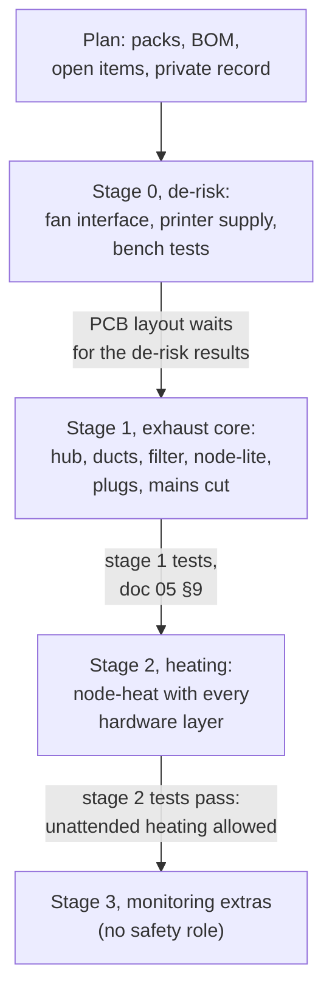

# 13 - Build Your Own: Quick Start

How to go from this repository to your own fleet. It points at the other docs rather than repeating them. Phase 2 (implementation) is still ahead, so treat the hardware and firmware steps as a plan: the boards and firmware are not built yet.

## 1. Decide whether it fits

- **Printers:** every printer needs an enclosure with an exhaust port you can connect a 4″ duct to. Printers on Klipper or with a serial/USB link get the full feature set; others can run at a lower tier (doc 12 §3, link tiers 0–2). Heating a chamber needs a printer that tolerates it (doc 12 §6, chamber caps). [Doc 11](11_use_envelope.md) shows the limits: fleet size, cable runs, power, links and heat.
- **Room:** you need a way to vent outdoors (a through-wall or window vent) and a working smoke alarm in the room (doc 05 S-6). Check makeup air (doc 05 §8).
- **Skills:** you will order PCBs and assemble some parts, work with mains-powered plugs (not wire them: the system uses off-the-shelf smart plugs), and commission safety tests (doc 05). The design uses no screw terminals and no wires soldered onto pads.

## 2. Plan your fleet

1. Pick a printer pack for each printer from [`printers/`](../printers/), or write one with the [printer-pack guide](12_porting_guide.md) and [`printers/_template/`](../printers/_template/).
2. Count the BOM for your fleet with the scaling table in [doc 03 §1.2](03_bill_of_materials.md#12-scaling-to-another-fleet).
3. Choose the open items that depend on your hardware (doc 01 §7), such as where each heated printer gets its heater power (each pack's heater-supply check).
4. Keep your own record (which printers, plugs, supplies, room, hostnames, orders) **outside this repository**. A private repository of your own that includes this one as a git submodule works well: pull the framework's updates, and send fixes and printer packs back upstream.

## 3. Build in stages

Follow the staged bring-up in [doc 01 §8](01_system_architecture.md#8-phase-2-bring-up-stages-d41): de-risk first, then the exhaust core, then heating, then the monitoring extras. Each stage has commissioning tests in [doc 05](05_safety_and_failsafes.md) that must pass before the next stage starts, and monitoring never feeds a safety layer, so the last stage can wait.

## 4. Reading order

| If you want to… | Read |
|---|---|
| Understand the system and what is still open | [01 System overview](01_system_architecture.md) |
| Check it can do what you need | [10 Requirements](10_requirements.md), [11 Use envelope](11_use_envelope.md) |
| Know what the boards and parts are | [02 Hardware](02_hardware_specification.md), [04 Wiring](04_wiring_and_pinouts.md) |
| Price a build | [03 BOM](03_bill_of_materials.md) |
| Trust it | [05 Safety](05_safety_and_failsafes.md) |
| Plan the duct and filter | [06 Pneumatics](06_pneumatics_and_ducting.md), [08 Printable parts](08_printable_catalog.md) |
| Add your printer or write the slicer side | [12 Printer packs](12_porting_guide.md), [07 Firmware and comms](07_firmware_and_comms.md) |
| See why something is the way it is | [Design decisions](design_decisions.md) |

## 5. Contributing back

Measurements, corrections and printer packs are welcome: see [CONTRIBUTING.md](../CONTRIBUTING.md).
