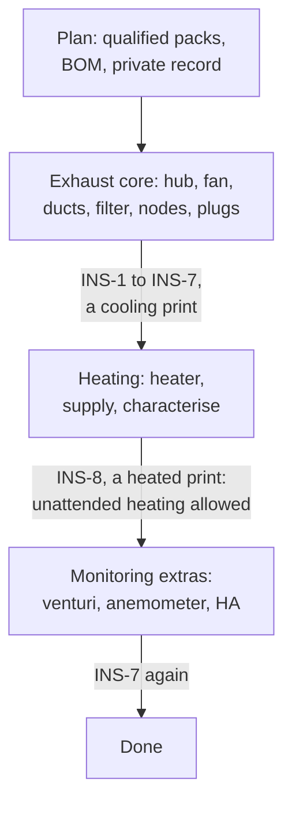

# 14 - Build Your Own: Quick Start

How to go from this repository to your own fleet. It points at the other docs rather than repeating them. Phase 2 (implementation) is still ahead, so treat the hardware and firmware steps as a plan: the boards and firmware are not built yet ([doc 15](15_phase2_plan.md) is the plan for them).

## 1. Decide whether it fits

- **Printers:** every printer needs an enclosure with an exhaust port you can connect a 4″ duct to. Printers on Klipper or with a serial/USB link get the full feature set; others can run at a lower tier (doc 12 §3, link tiers 0–2). Heating a chamber needs a printer that tolerates it (doc 12 §6, chamber caps). [Doc 11](11_use_envelope.md) shows the limits: fleet size, cable runs, power, links and heat.
- **Room:** you need a way to vent outdoors (a through-wall or window vent) and a working smoke alarm in the room (doc 05 S-6). Check makeup air (doc 05 §8).
- **Skills:** you will order PCBs and assemble some parts, and work with mains-powered plugs (not wire them: the system uses off-the-shelf smart plugs). You don't need test equipment: the design is proven in validation, each printer and fan model in its pack's qualification, and your own fleet by checks the dashboard runs for you (§4). The design uses no screw terminals and no wires soldered onto pads.

## 2. Plan your fleet

1. Pick a **printer pack** for each printer from [`printers/`](../printers/) and a **fan pack** from [`fans/`](../fans/). A pack marked `qualified` is supported. A `designed` pack works on paper but hasn't been qualified on a real unit: installing it means running its qualification ([doc 12 §7](12_porting_guide.md#7-porting-checklist-and-printer-qualification), [doc 13 §4](13_fan_packs.md#4-fan-qualification)), which needs a multimeter and some patience, and makes you its first qualifier. A `stub` can't heat. For a printer with no pack, write one with the [printer-pack guide](12_porting_guide.md).
2. Count the BOM for your fleet with the scaling table in [doc 03 §1.2](03_bill_of_materials.md#12-scaling-to-another-fleet).
3. Answer the questions your packs leave to you, such as where each heated printer gets its heater power (each printer pack's §5).
4. Keep your own record (which printers, plugs, supplies, room, hostnames, orders, and the installation report from §4) **outside this repository**. A private repository of your own that includes this one as a git submodule works well: pull the framework's updates, and send fixes and packs back upstream.

## 3. Build in stages

Install the exhaust first, then heating, then the monitoring extras, so each layer is working before the next depends on it (D41). Each stage ends with the installation checks of §4 that belong to it. Monitoring never feeds a safety layer (doc 05 S-7), so the last stage can wait.

## 4. Install and commission

Everything here is done from the hub's dashboard, which walks through the steps in order and keeps a report. You need hand tools and a phone or laptop; **no meter, no test equipment**. Each check is either automatic (press Run, wait for green) or a button. If a check fails, the dashboard says what to look at; nothing in this list asks you to measure anything.

| # | Step | You do | The system checks |
|---|---|---|---|
| **INS-1** | Room | Fit the outdoor vent and the makeup air (doc 05 §8); make sure a smoke alarm works in the room | — |
| **INS-2** | Packs and settings | Load each printer's `profile.yaml` and the fan's `fan.yaml` on the dashboard. Set the B2 jumpers (SWAP, DC) as the fan pack says | It warns on any pack that isn't `qualified` and refuses to heat on a `stub` |
| **INS-3** | Assemble and connect | Duct, filter, fan and hub on the wall; each printer's port adapter, damper and node from its pack; CAT6 between them; each printer **and its heater brick, if any,** on that printer's own smart plug | — |
| **INS-4** | First power-up | Power the hub, then each node. Join each plug to its node from the dashboard's plug wizard | **Self-check on every board:** supplies and bus voltage in range; exactly two CAN terminations (D96); CAN and ESP-NOW up, radio signal strength above the alert level; every sensor present and plausible; a damper sweep (encoder reads, closed angle learned); on node-heat, the heater chain (both switches off with no current, KSD301 loop closed, high-side sense reads off, and a short low-duty pulse that stops when the charge pump is stopped). Green per board |
| **INS-5** | Bus load | Switch every printer off, press Run | LEDs at full, servos moving, one node in an alarm pattern: the hub supply holds every node above the bus floor and no cable is overloaded (was test 16) |
| **INS-6** | Plug check, per printer | Press **Test cut**. Then try to switch that plug back on from its own app. Then **Clear** | The plug cuts and reads back; the node stays online and its damper still moves (was test 29); the heater rail drops to 0 V with the plug (was test 23); the plug is cut again within 5 s when switched on from its app (was test 25); the plug's power limit and power-on behaviour are set and read back (was test 18) |
| **INS-7** | Exhaust setup | Close the printer doors, press Run (a few minutes). Then listen at your nearest workspace and set the highest fan speed you can live with | **Duct sweep:** trunk setpoint and fan response (was M1), filter baseline (M2), each chamber reaches −3 Pa (M3 baseline); with 9 or more printers, the second fan (M12); once the venturi and anemometer are fitted, branch angle–flow curves (M8) and the duct leak test (M10) |
| **INS-8** | Heating, per heated printer | Enter `heater_power` from the printer pack. Empty the chamber, close it, press **Characterise** (about an hour), then **Accept** | The characterise run (doc 05 §3.2, was test 24): its proposed thresholds are compared with the pack's qualified ranges, and the dashboard flags any outside them |
| **INS-9** | First prints | One cooling print (PLA or PETG). Then one heated print (ABS with `M191`) on each heated printer. Open a door during one print | Print start and end detected (Tier 0 power thresholds learned and offered for you to accept); bleed during the print; the heated print waits for the chamber; the door opens the damper and alerts at 60 s; the purge ends with the bed LED green and a push |
| **INS-10** | Keep the report | Download the installation report and put it in your own fleet record | The report lists every check with its result, the board serials, firmware and pack versions |

**When to run them again.** INS-4 after any board is replaced (and a carrier that saw a heater runaway is always replaced or re-validated, doc 05 §4.1). INS-6 after changing a plug. INS-7 after changing the duct, the filter, the fan or the number of printers. INS-8 after changing a heater, the insulation, the enclosure, the hub supply or the chain length.

**Unattended heated printing** is allowed once INS-1…INS-9 have passed with a `qualified` printer pack and fan pack. With a `designed` pack you are qualifying it, and its qualification has to pass first.

## 5. Reading order

| If you want to… | Read |
|---|---|
| Understand the system and what is still open | [01 System overview](01_system_architecture.md) |
| Check it can do what you need | [10 Requirements](10_requirements.md), [11 Use envelope](11_use_envelope.md) |
| Know what the boards and parts are | [02 Hardware](02_hardware_specification.md), [04 Wiring](04_wiring_and_pinouts.md) |
| Price a build | [03 BOM](03_bill_of_materials.md) |
| Trust it | [05 Safety](05_safety_and_failsafes.md), and how it is proven: [`validation/`](../validation/README.md) |
| Plan the duct and filter, choose a fan | [06 Pneumatics](06_pneumatics_and_ducting.md), [08 Printable parts](08_printable_catalog.md), [13 Fan packs](13_fan_packs.md) |
| Add your printer or write the slicer side | [12 Printer packs](12_porting_guide.md), [07 Firmware and comms](07_firmware_and_comms.md) |
| See why something is the way it is | [Design decisions](design_decisions.md) |

## 6. Contributing back

Measurements, corrections, qualification results and new packs are welcome: see [CONTRIBUTING.md](../CONTRIBUTING.md).
