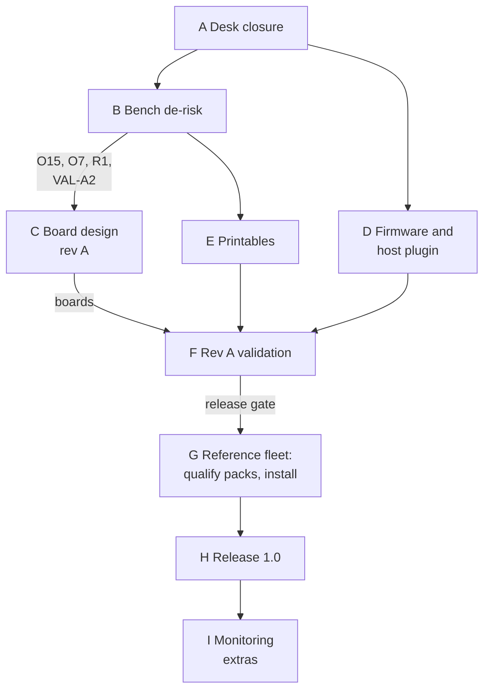

# 15 - Phase 2 Plan (proposed)

> **Status: proposed, 2026-11-09, for discussion.** Phase 1 (the design baseline, D1–D107) is mostly complete. This doc proposes how Phase 2 gets from the design to a release that builders can install: what can close on paper now (§2), the phases and their gates (§3), and what runs in parallel (§4). Test IDs are those of the three test steps (D104): `VAL-…` validation ([`validation/`](../validation/README.md)), `PQ-…` / `FQ-…` qualification ([doc 12 §7](12_porting_guide.md#7-porting-checklist-and-printer-qualification), [doc 13 §4](13_fan_packs.md#4-fan-qualification)), `INS-…` installation ([doc 14 §4](14_build_your_own.md#4-install-and-commission)).

---

## 1. Where Phase 2 starts

- **Designed:** the carrier and sensor boards (doc 02, 04, 09), safety layers (doc 05), pneumatics (doc 06), firmware and protocols (doc 07), printables catalogue (doc 08), two designed printer packs (AD5X node-heat, C5 Pro node-lite) and two designed fan packs (high-pressure 120 mm PWM, 6″ mains EC).
- **Not built:** any board, firmware, host plugin, custom printed part or cable.
- **Open:** the items in doc 01 §7. Some need hardware; the rest can close now (§2), and the sooner they do, the fewer assumptions the board layout carries.

## 2. Close on paper now

These need no prototype and no test equipment. Each says what closes it and, where it is a decision, a recommendation to talk through.

### 2.1 Decisions

All decided on 2026-11-09 and recorded as D106, except O18, whose fix is proposed (D106) and priced (D107); its accuracy is confirmed in validation.

| # | Item | Decision |
|---|---|---|
| **O14** | Node damper behaviour when the hub is lost (doc 05 §4, doc 06 §4) | **Closed.** A node keeps its chamber loop running on its own ΔP sensor while chamber ΔP shows the trunk still drawing (below about −1 Pa with the damper at or above its bleed angle), and holds its last angle otherwise. Works whatever R1 shows |
| **O12** | Fault and recovery wording, and the timed inspection window after a cut (doc 05 §4.1) | **Closed.** Keep the CLEAR button at level 4; no inspection window, since `FLEET_CLEAR` can be sent through Moonraker from anywhere. The wording comes with the dashboard mock-up in Phase D |
| Runaway recovery | What a builder must do before a node heats again after a runaway (a proven double fault) | **The installation self-check (INS-4)**, with automatic logging: the hub keeps a fault report (configuration, versions, event log, sensor history) and offers a prefilled GitHub issue (doc 07 §8, `.github/ISSUE_TEMPLATE/fault_report.md`). A failed self-check keeps the heater locked out until the carrier is replaced or repaired |
| **O18** | Rail reading without a per-board trim | **Proposed:** 0.1 % rail dividers and a second CJ431 (LCSC C3113, ±0.5 %, the part the guard comparators already use) read at boot, ≈ ±0.17 V at 24 V [E]; pass at ±0.2 V in VAL-H8. Priced against the alternatives (2026-11-09): every ±1 % CJ431 on LCSC is a JLC extended part and none is cheaper than C3113, so there is no 0.5 %-vs-1 % trade to make; C3113 is simply the better part |
| R11 | USB ground share | **Agreed:** one reference measurement (VAL-H9), link-error checks per pack (PQ-6) |
| M9 | Anemometer calibration | **Goal:** one default curve from validation, so installations run only the static zero. It needs every probe built to one standard build (doc 08 C18); per-fleet calibration with the reference venturis stays as the fallback (VAL-A5) |
| O19 | INS-4 heater-chain self-check (a short low-duty pulse with the charge pump stopped) | **Agreed**, and since it now re-admits a node after a runaway, VAL must show it catches a welded switch on either side every time |
| Packs | Heating on a `designed` printer pack | **Agreed:** allowed with a dashboard warning, as that pack's qualification (doc 14 §4) |
| Fans | The hub reads a fan profile (`fan.yaml`, doc 13 §3) | **Agreed** |

### 2.2 Research

| Item | Where it's used | What closes it |
|---|---|---|
| R9: JLC quote for the sensor board, one order per population (S, P, E) | Doc 02 §2.3, doc 03 | A quote; then order S alone and hand-solder P and E if setup costs more than the parts |
| O13 (licence): may ModulAir parts be remixed and published with this project? Licences are per model, and the ones read so far restrict derivatives (D108) | Doc 08 §3c, D34, D108 | Read the licence on the L-size Y and the hose adapters, or get written permission, before track E starts; if neither, adopt PB100 (D108). Fit stays VAL-A7 |
| TCO with a DC rating ≥ 10 A at 32 V | Doc 05 §3.1 | A datasheet that states it |
| Tap ideal diode FET: does a 57 V brick in a jack with no tap need a 60 V FET? | Doc 02 §2.2.1 | Schematic decision; VAL-P1 step 7 confirms |
| Pin-compatible clones (MX74700T vs LM74700, FCA9548T vs TCA9548A); W5500 module pin order; S3 IO MUX pins for SPI2; the port-live LED's V_F | Doc 02 §2.2.3, §2.2.5, §2.2.10; doc 04 §4 | Datasheets and the S3 technical reference manual, before layout |
| PY32F030: I²C hardware bus timeout; which DMA requests SPI1 and USART2 can use | Doc 02 §2.4, doc 09 §2.5 | The PY32F030 reference manual |
| A listed 24 V barrel brick, 5.5 × 2.5 mm, ≥ 160 W | Doc 03 | A product listing |
| Tasmota: are `MaxPower`/`MaxPowerHold`/`MaxPowerWindow` in the standard build; does its web API accept HTTP Basic authentication? | Doc 07 §10.3 | Tasmota docs and build options |
| Orca placeholder names for the chamber temperature | Doc 07 §3.5 | Orca's placeholder list |
| Operating ranges and 3.3 V operation of the catalogue sensors | Doc 09 §8.3 | DFRobot datasheets |
| A 6″ bayonet duct family | Doc 06 §2 | A search; otherwise foil-taped 6″ joints stay |
| Damper alternatives R2 and R3 | Doc 08 §3b | Read the model pages |
| Fan packs: Delta PFB1224 P–Q curve and current (DL-1), single-unit sourcing for the JC12038B24UC2 (JC-2) | `fans/` | Maker datasheets, listings |
| Printer packs: items marked **Design** (H2D-2, K2-2 rating, PR-3, SV-1, QD-1, G-1) | `printers/` | Vendor specs, or the owner of that printer |

## 3. Phases

| Phase | Work | Equipment | Exit gate |
|---|---|---|---|
| **A Desk closure** | §2: decisions recorded as D rows, research results written into the docs as [V] | None | Every §2 item closed or consciously deferred |
| **B Bench de-risk** (before layout) | **Boards:** VAL-C1 ROM bootloader and W5500 on dev boards (O15). **Heater:** VAL-H6 on the chosen element with a bench supply and a test FET board (O7, R8). **Sensors:** VAL-A1 on XGZP breakouts (R4). **Damper:** VAL-A2 bleed resolution on a printed E3 with an MG90S and an AS5600 breakout. **Fans:** VAL-X2 on any chosen fan with a proprietary port (R1); FQ-1 on paper for every pack; flow and shut-off (as FQ-5) on a temporary rig driven by a bench PWM source. **Printers:** PQ-1 unboxing and PQ-2 host install on the reference printers, with an ESP32-S3 dev board as the USB device (R5, O1, O10, O11, R7) | Lab bench, dev boards, the reference printers | O15 closed (bootloader path or SWD fallback); heater ratings set; the fan for the reference fleet chosen with R1 closed for it; R5 and `cdc_acm` known on both reference forks; damper mechanism chosen |
| **C Board design rev A** | Carrier schematic and layout, sensor boards S, P and E, KiBot CI outputs, LCSC fields, cable drawings in `hardware/cables/`; design review against docs 02, 04, 09 and 10; order 5 carriers (probe header fitted) and a set of sensor boards | CAD | Review passed; boards ordered |
| **D Firmware and host plugin** (parallel from A) | `fleet_common`: CAN and USB protocols with specs in `docs/protocol/`, `PrinterLink` (`usb_serial`, `moonraker`, `power_only`), safety state machine and latches, plug backends, test modes, the INS-4 self-check, the dashboard with the installation wizard and report, fan and printer profile loaders. `fleet-exhaust-klipper`: the extra, installers, Moonraker and notifier configs | Dev boards with simulated I/O | Runs on dev boards; every VAL procedure has the test mode it needs |
| **E Printables** (parallel from B) | E3 damper remix with the C16 encoder mount (after VAL-A2), C5 node housing (after the carrier outline), C9 hub enclosure, C2 makeup inlet, C11 filter, C17 venturi and reference venturis, C21 shutter; pack parts C1 (AD5X) and C7 (C5 Pro); ModulAir remixes after O13's licence, otherwise the PB100 bayonet, caps and 2:1 Y (D108) | Printer, CadQuery | Printed and fit-checked; VAL-A7 passed |
| **F Rev A validation** | Every test in `validation/` on rev A; reworks logged; a rev B if any rework is a design change | Lab bench | The release gate in validation README §4 |
| **G Reference fleet** | Build the reference fleet (AD5X node-heat, C5 Pro node-lite, the chosen fan) as a builder would. Run PQ on both packs and FQ on the fan: all three become `qualified`. Run INS-1…INS-10 and fix the wizard where it was unclear | The system and a multimeter only | Two printer packs and one fan pack qualified; a clean installation report |
| **H Release 1.0** | Tag both repos, publish gerbers, BOM and STLs, update the docs from Phase 1 baseline to Release 1.0 | — | Tagged release |
| **I Monitoring extras** | Thermal model, leak drift, heater step test, Moonraker `[sensor]`, Home Assistant (doc 05 S-7: no safety role) | — | Feature by feature |

## 4. Parallel tracks and the critical path

| Track | A | B | C | D | E | F | G |
|---|---|---|---|---|---|---|---|
| Board hardware | research | bench de-risk | rev A | | | validate | |
| Firmware | protocol specs | dev boards | | core, dashboard | | test modes in use | wizard fixes |
| Host plugin | | PQ-2 prototype | | extra, installers | | | PQ-2, PQ-8 |
| Printables | licence | damper test | housing outline | | parts | VAL-A7 | pack parts in use |
| Fans | FQ-1 | VAL-X2, flow rig | | | adapters | VAL-X1 | FQ on the chosen fan |
| Printers | Design items | PQ-1, PQ-2 | | | C1, C7 | | PQ on both packs |

**Critical path:** O15 (VAL-C1) and the heater numbers (VAL-H6) gate the carrier layout; the carrier gates validation; validation gates the reference fleet. Everything else (firmware, printables, packs) can run beside it. The earliest useful step is therefore Phase B's bootloader and heater bench work, alongside the desk items in §2.
