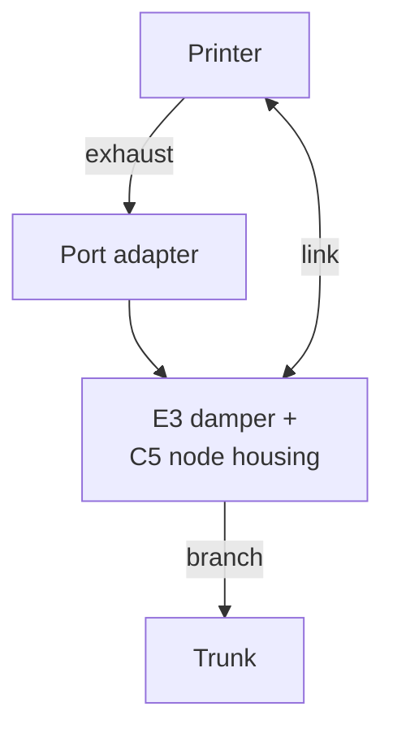

# Vendor Model — printer pack

> Copy this folder to `printers/<vendor>_<model>/` and fill it in. Structure, contracts and section rules: [doc 12](../../docs/12_porting_guide.md) (§2.1 lists what each section holds). Worked examples: [AD5X](../flashforge_ad5x/README.md) (node-heat, kit enclosure, USB link) and [C5 Pro](../flashforge_c5pro/README.md) (node-lite, own chamber heater). A stub fills in §1, §2 and §11 and marks the rest [U]. Paths to core docs are relative to this folder (`../../docs/`).

## 1. Summary

| Item | Value |
|---|---|
| Status | stub, designed or commissioned (doc 12 §9) |
| Role | node-heat or node-lite |
| Link | Tier and link type (doc 12 §3.2), plus the backup |
| Chamber cap | °C, and the material or rating that sets it |
| Heater supply | None, printer tap, upgraded internal supply or external brick |
| Door | Node reed, link objects or none |
| Port adapter | Kind (doc 12 §5), part ID and where it sits |
| Profile | [`profile.yaml`](profile.yaml) |

## 2. Printer facts

Tag each fact [V] (verified, with the source), [E] (estimated) or [U] (unknown).

| Fact | Value |
|---|---|
| Enclosure | Built in or kit; panel material |
| Exhaust opening | Where, what size, any stock fan or filter |
| Own chamber heater | No, or yes with its rating |
| Firmware | Klipper (vendor fork or mainline), Marlin, closed; Moonraker or other API |
| USB host ports | External and internal, with what is known about each |
| Main supply | Rating, and whether the bed runs from it |
| Multi-material unit | None, or what it is and where its material status can be read |

## 3. Role and integration

How the node meets this printer. Replace the diagram with this printer's cell.

## 4. Enclosure modifications

Port adapter to the standard interface (doc 12 §5), pass-throughs, seals, insulation, makeup inlet, door switch, node mounting.

## 5. Heater supply

Node-heat only: the sizing check (doc 02 §3.1) with the printer's supply rating, or the external brick used. Otherwise "None".

## 6. Printer link

Tier 2: the USB connection point (external port preferred; headers, never wires on pads), ports reviewed, `cdc_acm` check, route, fallbacks. Tier 1: host and API. Tier 0: the metering plug.

## 7. Host integration

What the profile's `klipper:` keys produce on this printer, or the equivalent for other firmware.

| Item | Value |
|---|---|
| Node link | |
| `[temperature_sensor chamber]` | |
| `M141`/`M191` | |
| `FLEET_EXHAUST` also calls | |
| `FLEET_PURGE` end of print | |
| Door state | |

## 8. Printed parts

| # | Part | Candidate source | Material | Verify |
|---|---|---|---|---|

| # | Part | Material | Key requirements |
|---|---|---|---|

Request catalogue IDs in doc 08 so cross-references stay stable.

## 9. Install variant

Firmware mod, stock Klipper with Moonraker `update_manager`, or none (doc 12 §3.3), with the extras path and the notifier.

## 10. Pack decisions

| # | Decision | Applies | Date |
|---|---|---|---|

## 11. Open items

| # | Item | Impact | Plan |
|---|---|---|---|

## 12. Commissioning results

Measured `power.idle_w` / `power.printing_w`, and the commissioning tests from doc 12 §6 item 7 with dates and results.
