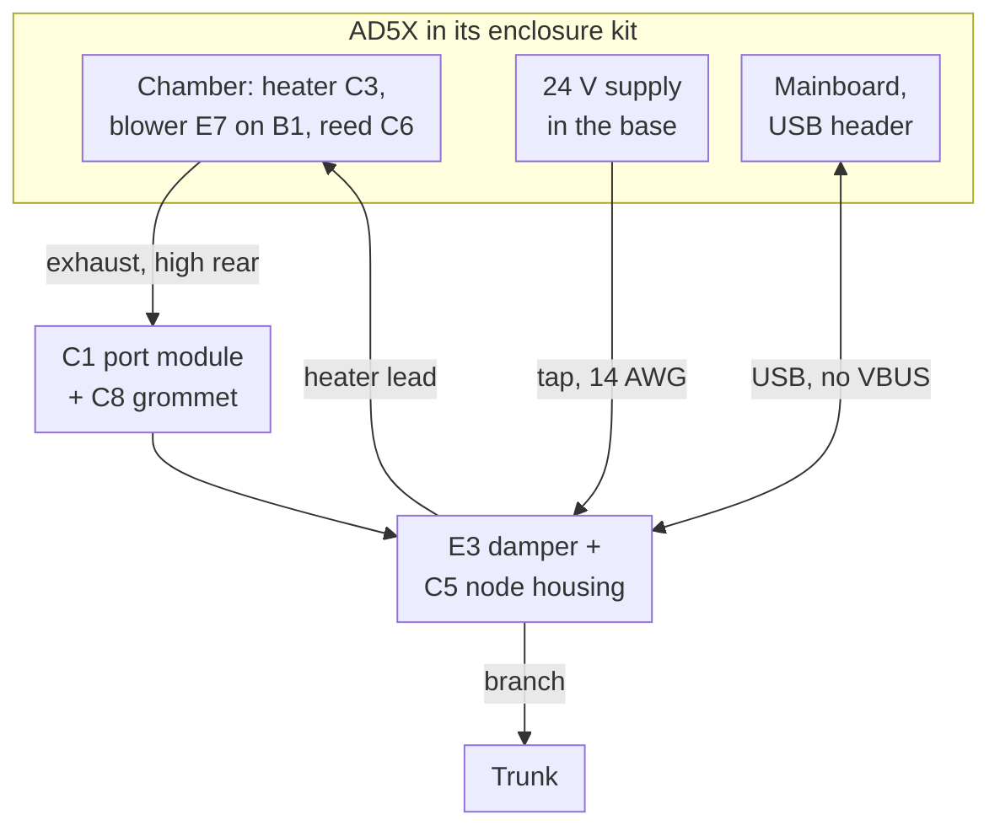
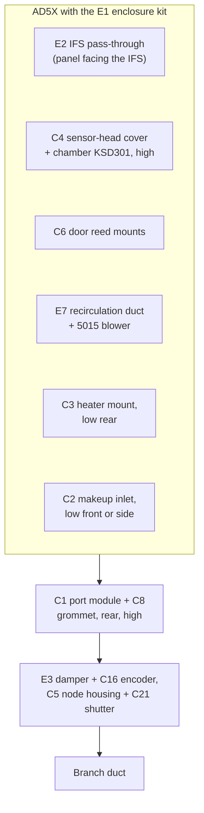

# Flashforge AD5X — printer pack

> Pack for the Flashforge AD5X with the official enclosure kit, on zmod over stock firmware. The reference **node-heat** design: a kit enclosure, a node heater fed from the printer's supply, and a USB link. Structure and contracts: [doc 12](../../docs/12_porting_guide.md). Paths to core docs are relative to this folder (`../../docs/`).

## 1. Summary

| Item | Value |
|---|---|
| Status | **designed** (waits for qualification, doc 12 §7.2) |
| Role | node-heat (150 W PTC heater, recirculation blower on B1) |
| Link | `usb_serial` (an internal USB header or the external USB-A port, §6), backup `moonraker` |
| Chamber cap | **60 °C** operating, 65 °C firmware hard limit, chamber-air KSD301 and RW-b at ≈ 70 °C (AD5X-4). Assumes a sealed, insulated chamber and every printed part in the chamber in ASA/ABS. Stock toolhead and cable-chain plastics are still [U] (O11) |
| Heater supply | The printer's own 24 V supply, reused or upgraded, or an external brick (O1, §5) |
| Door | Node reed switch (C6) |
| Port adapter | Kit part replacement: C1 port module, high at the rear (AD5X-3) |
| Profile | [`profile.yaml`](profile.yaml) |

## 2. Printer facts

| Fact | Value |
|---|---|
| Enclosure | **Official Flashforge AD5X Enclosure Kit**: polycarbonate panels (good to ~120 °C) on a frame with printed parts [V: kit]. Chamber volume ~0.1 m³, surface ~1.7 m² [E] |
| Exhaust opening | None suitable; the kit's own chamber/filter fan **recirculates** through its rear filter rather than exhausting (O3, closed) [V] |
| Own chamber heater | No |
| Multi-material unit | IFS, beside the enclosure (O2, closed); the filament path enters through an open window in the kit, the largest leak [E] |
| Firmware | Flashforge stock firmware with a Klipper 12-based fork; **zmod** adds root, Moonraker and a plugin system and keeps the Flashforge app and FlashPrint working [V: zmod] |
| USB host ports | External USB-A (stick port); bottom internal footprint on the onboard hub with **live 5.05 V VBUS**; top internal footprint of unknown role (§6.1) [V: zmod Discussion #207] |
| `cdc_acm` | Present in the stock kernel [V: zmod #348] |
| Main supply | Internal 24 V supply in the base; rating, form factor and whether the bed runs from it are [U] (O1) |
| Material status | IFS slot material is readable only with zmod's `zmod_ifs`/`zmod_color` objects after zmod #699's `get_status()` patch [U: O5] |
| Job metadata | Whether Flashforge-app and FlashPrint jobs populate Moonraker `filament_type` is [U] (O6) |

## 3. Role and integration

- **Node-heat:** the node heats the chamber to the slicer's setpoint up to the 60 °C cap, and drives the recirculation blower (B1) and the reed switch.
- **Heater power** comes from the printer's own supply through a fused tap (§5), so the heater is cut with the printer's plug.
- **Link:** USB-serial to the zmod plugin (Tier 2), Moonraker as backup.
- **Makeup air:** a low spring-and-magnet flap (`enclosure.makeup_flap: true`), so every purge starts with the crack test (doc 06 §5.2, D90).

## 4. Enclosure modifications

| Mod | Specification |
|---|---|
| Kit printed parts | Printed in **ASA/ABS** (not PETG/PLA): HDT, and corners and hinges creep at 55 °C. PETG-CF only for parts outside the chamber below ~60 °C |
| IFS/Bowden pass-through | Plate with 4 PTFE couplers and grommets replacing the open IFS window (E2). Start from the MakerWorld "AD5X Bowden Window Remix" (licence and fit check, doc 08); on the panel facing the IFS |
| Gaskets | EPDM D-profile or printed TPU on the door and lid; foam tape on panel seams. Cuts leakage area by an order of magnitude |
| Insulation | Foil-faced foam or reflective bubble inside the rear, side and top panels; front door left clear |
| Exhaust port | **High at the rear**, in a printed port module (C1) that **replaces one of the kit's printed parts**, so the polycarbonate isn't cut (AD5X-3). ModulAir L bayonet to the branch damper (D34) |
| Recirculation duct | **Required (O3):** printed duct + 24 V 5015 blower that pulls chamber air through the AD5X's rear filter and returns it inside (E7). Switched by node output B1 |
| Makeup inlet | C2, low on the front or side, ≥ ≈ 80 cm² open (≈ 17 Pa at 50 CFM, D89), with a spring-and-magnet flap (D90). Shut during heated prints at −3 Pa; opens for purge, so purge air doesn't pull through the IFS pass-through |
| Heater module | C3, low at the rear, blowing across the floor away from the bed and away from the PC panel near the element |
| Door switch | Reed switch + magnet in printed mounts (C6) |
| Cable pass-through | Grommeted (C8), in the C1 port module beside the node housing: heater feed from the supply tap (absent with an external brick), heater lead, sensor-head cable, NTC leads, USB lead, ΔP tube |
| Node mounting | **Printed housing attached to the branch damper** at the exhaust port (D19), outside the chamber, with a thermal break from the duct wall |
| Bed-lip LEDs | Mounting spot and temperature in this chamber to confirm (D44) [U] |

Where the parts sit (side view, rear on the right):

### 4.1 Heat budget at the cap

Doc 06 §7 gives the method. For this kit [E]: worst-case room 15.5 °C and chamber at the 60 °C cap (ΔT ≈ 45 K) over ~1.7 m².

| Loss path | Unmodified kit | **Insulated (rear/sides/top), sealed** |
|---|---|---|
| Panel conduction | ~380 W | **~105 W** |
| Leakage at −3 Pa: ~10 cm² open IFS window vs ~2 cm² after sealing | ~2.8 CFM → ~75 W | **~0.6 CFM → ~15 W** |
| Total | ~455 W | **~120 W** |
| Available | 150 W PTC + steady bed heat (~60–100 W) | Margin |

Sealing and insulation are what let a 150 W heater reach the cap (D7).

## 5. Heater supply (O1)

The core rules are in doc 02 §3.1 (sizing rule, tap, bed interlock, rail throttle). At unboxing: read the supply label (watts, 24 V current), measure its footprint and mounting, and check whether the bed heater runs from it (24 V bed) or from mains. Then apply the sizing rule:

| Outcome | Heater feed | Work involved |
|---|---|---|
| **Reuse** | Tap at the supply's 24 V terminals: a **10 A ATO fuse within 15 cm** of the terminals, **14 AWG ≤ 1.5 m** to the node's XT60 tap input | 24 V DC work at the terminals only |
| **Upgrade** | A Mean Well LRS-class supply with the same connections and cooling in the base, then tap as above | Mains work inside the base |
| **External brick** | A DIN-4 brick on the HEATER DIN jack, or a barrel brick on the HEATER barrel, on the printer's own smart plug with a 2-outlet adapter (doc 05 §3.3) | None inside the printer |

A stock supply freed by an upgrade can run a hub from its internal XT60 (doc 02 §3).

## 6. Printer link

Generic link rules: doc 04 §5.

| Item | Specification |
|---|---|
| Printer end | **External USB-A port** if the stick port isn't needed (no modification, reversible); otherwise the **bottom internal USB header** (hub downstream port 3) [V: zmod #207]. Footprint type and pin order of the header are unreported (R7): confirm with a meter at unboxing before wiring |
| Header | Solder a matching pin header into the footprint (pins into holes, not wires onto pads). If it turns out to be SMD pads only, use a pre-made adapter cable rather than flying wires |
| Lead | **D+, D−, GND and shield only; VBUS unconnected**, since the header's VBUS is live. Shield at the AD5X end |
| Enumeration | The node appears as a USB CDC-ACM device. The plugin opens `/dev/serial/by-id/usb-fleet_exhaust_node_<serial>-if00` [U: check that `/dev/serial/by-id` exists on the AD5X; otherwise match the VID/PID through `/sys`]. Stock firmware might claim `/dev/ttyACM*` [U] (R7) |
| Route | Inside the AD5X base → out through a grommet in the rear/base panel → the node housing at the rear |
| Ground | The heater return from the supply tap shares the printer's ground with the USB lead (R11). 14 AWG heater lead ≤ 1.5 m keeps the USB share ≲ 0.3 A [E]. If the stock supply bonds −V to earth, the grounds also meet through mains earth and the CAT6 bus; the offset stays inside the CAN transceiver's common-mode range [E] |
| Fallbacks | (1) `TVOC` 4-pin UART (3.3 V; probably `ttyS3`, **untested** [#207]). (2) UDP over Wi-Fi with the same plugin code. **Never use `J29`, `DEBUG` or `J13`** (§6.1) |

### 6.1 Ports reviewed

Checked against zmod Discussion #207 on 2026-10-25. **[207-T]** = tested and reported in the thread; **[207-S]** = stated or traced there, not tested.

| Port | What it is | Verdict |
|---|---|---|
| **External USB-A port** (the USB-stick port) | Host USB; `cdc_acm` enumerates USB serial devices [V: zmod #348] | **Preferred if you don't print from USB sticks.** No modification and fully reversible. The cable leaves through the sealed grommet. |
| **Bottom internal USB footprint** (hub downstream port 3) [207-S] | Host USB on the onboard hub. A user measured **5.05 V VBUS**, GND continuity and idle D+/D− [207-T] | **Preferred if you want the front port free.** VBUS is live, so the cable must not connect it to the node (data + GND only). Needs a header in the footprint [U]. |
| Top internal USB footprint [207-S] | SoC USB controller, possibly OTG/device role | Avoid: role unknown and untested. |
| `TVOC` 4-pin UART | Possibly a CPU UART (`ttyS3`), untested [207-S] | **Fallback only.** It's the AD5M Pro air-sensor port, so Flashforge's `firmwareExe` may probe or claim it. |
| `J29` 6-pin `GND GND RX TX 24V 24V` | ~24 V on the 24 V pins at idle [207-T]; suspected RS-232 levels [207-S] | **Do not use.** |
| `DEBUG` (3- or 4-pin) | Boot console at 115200, possibly 1.8 V [207-S] | Do not use. |
| `J13` 3-pin GND/TX/RX | No activity at boot [207-T] | Do not use. |

Some listings mention v1 boards with a USB-C port; if yours has one, identify its role before using it [U].

## 7. Host integration

| Item | AD5X |
|---|---|
| Node link | USB-serial (primary) + Moonraker WebSocket (backup) |
| `[temperature_sensor chamber]` | From `fleet_node` |
| `M141`/`M191` | Plugin (wrapped with `rename_existing` if the stock or zmod config already defines them, R5) |
| `FLEET_EXHAUST` also calls | — |
| `FLEET_PURGE` end of print | — |
| Door state | Node reed switch; Moonraker has no door object on this printer |
| Default policy | Levels 1–3 as doc 07 §5; level 4 from the IFS slot only with zmod #699 (O5) |
| Prints from the touchscreen, Flashforge app or FlashPrint | Get the default policy unless their G-code carries the macros |

## 8. Printed parts

| # | Part | Candidate source | Material | Verify |
|---|---|---|---|---|
| E1 | AD5X enclosure kit printed parts | Flashforge kit files (the official kit's printable parts) | ASA | Print as supplied; no PETG |
| E2 | IFS/Bowden pass-through plate | MakerWorld "AD5X Bowden Window Remix" (search by name; URL to record) | ASA + TPU grommets | Seals the window fully with 4 PTFE couplers; goes on the panel facing the IFS. Modify to add grommets if needed |
| E4 | AD5X exhaust flange (base for remix) | Printables [#1176762](https://www.printables.com/model/1176762), [#462199](https://www.printables.com/model/462199) | ASA | Reference for the panel mounting of custom C1; its duct end is the ModulAir L bayonet (D34) |
| E7 | **AD5X recirculation duct + 24 V 5015 blower (required, O3)** | Printables [#1473971](https://www.printables.com/model/1473971) (Dzung Vu; 4-wire 24 V 5015, pulls chamber air through the AD5X's rear filter and returns it; clears the stock mainboard fan); alternative [#1472826](https://www.printables.com/model/1472826) (Joel Whitington, a remix of Jwidess's AD5M Pro duct) | ASA (both authors suggest PETG, which creeps at 55 °C, doc 08 §1) | Fit with the kit installed and with the node's cables routed; blower on node output B1 instead of the printer's fan port; licence CC BY-NC-SA (link, don't redistribute the STLs) |

| # | Part | Material | Key requirements |
|---|---|---|---|
| C1 | **AD5X exhaust port module** | ASA | **Replaces one of the kit's printed parts** at a high rear position (part chosen at kit assembly; AD5X-3), so the polycarbonate isn't cut; ModulAir L bayonet port to the E3 damper (D34); holds the C8 grommet beside the port; inside lip keeps the sensor head out of the direct jet |
| C6 | **Door reed + magnet mounts** | ASA | Glue-free clips onto the kit's door frame |

Core parts used here: E3 damper, C2 makeup inlet, C3 heater mount, C4 sensor-head cover, C5 node housing, C8 grommet, C16 encoder mount, C21 shutter (doc 08). Pack BOM lines: the 5015 blower (≈ $8), 4 PTFE couplers, EPDM gasket, insulation (doc 03 groups B and F).

## 9. Install variant

zmod plugin (doc 12 §3.3), from the `fleet-exhaust-klipper` repo:

| Item | Value |
|---|---|
| Install | `/root/printer_data/config/mod_data/plugins/fleet_exhaust/`, then `ENABLE_PLUGIN name=fleet_exhaust` |
| Update | `[update_manager fleet_exhaust]` in `mod_data/user.moonraker.conf` |
| User config | `mod_data/user.cfg` |
| Extras path | Stock Flashforge Klipper `/usr/prog/klipper/klippy/extras`, or zmod's Klipper 13 `/usr/data/zmod/klipper/klippy/extras` [U: confirm (R5)] |
| Notifier | zmod notify plugin: `mod_data/notify.txt` → `pover://<user>@<token>`, then `UPDATE_NOTIFY` |
| Storage | Small; the reason the Klipper side is its own repo (D27) |
| Moonraker `[sensor]` | The pack ships a `[sensor fleet_exhaust]` block for the node readings and job history (doc 07 §6.3) |

## 10. Pack decisions

| # | Decision | Applies | Date |
|---|---|---|---|
| AD5X-1 | **No Klipper secondary MCU (RP2040) on the USB header.** Stock Flashforge firmware with zmod makes a version-matched secondary MCU risky here | D1, D3 | 2026-10-25 |
| AD5X-2 | **Official AD5X Enclosure Kit, and mods to the kit are allowed** (the kit study, §4, was T3) | D2, D7 | 2026-10-24 |
| AD5X-3 | **Port module replaces a kit part** high at the rear, so the polycarbonate isn't cut; the node housing rides on the damper outside it | D19 | 2026-10-25 |
| AD5X-4 | **Cap raised from 55 °C to 60 °C** (hard limit 65 °C, chamber-air KSD301 ≈ 70 °C, RW-b 70 °C), with the sealed, insulated kit and every printed part in ASA/ABS; the heat budget still closes at 60 °C (§4.1). Stock plastics remain open (O11) | D26 | 2026-10-26 |
| AD5X-5 | **Recirculation duct with a 5015 blower on B1 is required**, since the kit's own fan recirculates through its filter (O3) | D19 | 2026-10-25 |
| AD5X-6 | **Makeup flap with the crack test** on every purge; −2 Pa chamber setpoint if the measured opening point is under ≈ 6 Pa | D89, D90 | 2026-11-07 |

## 11. Open items

| # | Item | Impact | Closes at | Plan |
|---|---|---|---|---|
| **O1** | **Supply rating, form factor and whether the bed runs from it** | Decides reuse, upgrade or an external brick for the heater (§5) | PQ-1 | Read the label and trace the bed supply at unboxing. Every node-heat carrier takes all three, so the answer changes only what you buy |
| O2 | ~~IFS on top of or beside the enclosure~~ **Closed: beside** (the standard arrangement) | Pass-through plate location | — | E2 on the panel facing the IFS |
| O3 | ~~Does the kit's fan exhaust or recirculate?~~ **Closed: it recirculates** | No conflict with the exhaust | — | E7 duct + blower required (AD5X-5) |
| O5 | zmod #699 (`zmod_ifs` material status) merged? | Default-policy level 4 only | PQ-10 | Check the zmod version at setup |
| O6 | Do Flashforge-app and FlashPrint jobs populate Moonraker `filament_type`? | Default-policy level 3 | PQ-10 | Test at setup |
| **O11** | **Stock plastics inside the chamber** (toolhead shroud, fan ducts, cable chain, spool-path parts): what are they made of? | Whether the 60 °C cap holds | PQ-1, PQ-7 | At unboxing: check markings (`>ABS<`, `>PC<`, `>PLA<`) and look for heat creep after a 2 h soak at 60 °C. Replace PLA/PETG parts with ASA prints, or drop `chamber.cap_c` to 55 °C |
| R5 | The extra must load in Flashforge's Klipper 12-based fork (extras path, Python version, reactor and sensor registration) | The extra may need a variant, or run macros-only | PQ-2 | Prototype on one AD5X first. Prior art: FLOOK32's klippy sensor extra already runs on zmod printers. Macros-only fallback: G-code commands and Moonraker work, but `M191` can't wait on chamber temperature |
| R7 | Bottom internal USB header: footprint type and pin order unreported; **VBUS live (5.05 V)** [V: zmod #207]; stock firmware might claim `/dev/ttyACM*` | Link cable and port claim | PQ-1 | Inspect at unboxing; data + GND only; `/dev/serial/by-id/` naming. Fallbacks in §6 |
| R11 | Heater return shares the USB-link ground | Ground offset or heating in the USB lead; link errors | VAL-H9, then PQ-6 | Lead lengths in §6. Measured once on this printer in validation (VAL-H9), which proves the rule for every pack; qualification checks link errors under load (PQ-6). Fallback: a USB isolator (ADuM3160-class module, ~$6) |
| R12 | 24 V rail sags under bed + heater + motion load with the stock supply reused | Mainboard reset kills the print | PQ-6 | O1 sizing rule; bed-heat interlock and rail throttle; supply load test before unattended use (PQ-6) |

## 12. Qualification results

To be filled in at qualification (doc 12 §7.2): each applicable PQ test with its date, unit, firmware and pack version, and result.
