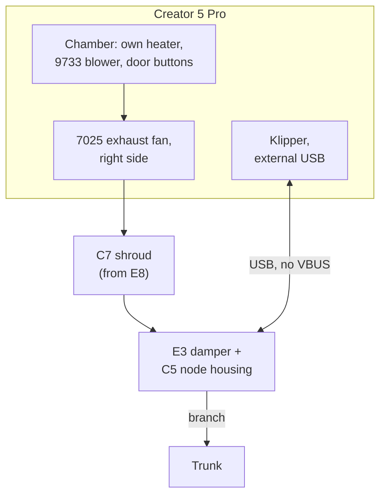

# Flashforge Creator 5 Pro — printer pack

> Pack for the Flashforge Creator 5 Pro on zmod (alpha) over stock firmware. The reference **node-lite** design for a printer that heats its own chamber: a shroud over the printer's own exhaust fan, no node heater, and a USB link. Structure and contracts: [doc 12](../../docs/12_porting_guide.md). Paths to core docs are relative to this folder (`../../docs/`).

## 1. Summary

| Item | Value |
|---|---|
| Status | **designed** (waits for commissioning; O10 decides the link) |
| Role | node-lite (the C5 heats its own chamber) |
| Link | `usb_serial` via the external USB port (C5-1, pending O10), backup `moonraker` |
| Chamber cap | **65 °C**, Flashforge's rating for the C5's own chamber heater. The node never heats, and node-heat limits (doc 05 §3) don't apply |
| Heater supply | None |
| Door | Stock `topDoor`/`frontDoor` buttons over the link |
| Port adapter | Shroud over the printer's own exhaust fan: C7, on the right side (O4) |
| Profile | [`profile.yaml`](profile.yaml) |

## 2. Printer facts

| Fact | Value |
|---|---|
| Enclosure | Built in |
| Exhaust opening | The stock **7025 exhaust fan** (Peerless DF7025B24V class, 24 V) behind the right side cover, a perforated side port [V: published models]. An internal **9733 blower** (DB9733B24V class) circulates chamber air [V] |
| Own chamber heater | Yes: active chamber heating to **65 °C** [V: Flashforge spec] |
| Circulation modes | "Adaptive Air Circulation": the exhaust fan runs in external mode for PLA/PETG/TPU; in engineering-filament (internal) mode it is off and its outlet is open. Macros `AIR_CIRCULATION_INTERNAL`, `AIR_CIRCULATION_EXTERNAL`, `AIR_CIRCULATION_STOP` [V]. Which Klipper fan name (`chamber_fan` / `chamber_cool_fan`) is which is [U] (O4) |
| Doors | `topDoor` and `frontDoor` as Klipper `gcode_button`s, readable over Moonraker [V] |
| Firmware | Flashforge stock firmware on its own Klipper fork; zmod support is alpha [V: zmod] |
| USB host ports | An **external USB port** (the thumb-drive port, on the right side per a hands-on review [U]); internal **J34** (`U_disk`, 5-pin, `5V \| D− \| D+ \| G \| G`) |
| `cdc_acm` | [U] (O10) |
| Chamber sensor | Stock `chamber_heater` / `heater_generic` objects |

## 3. Role and integration

- **Node-lite:** the printer heats its own chamber; the node adds bleed, purge, fire detection (D39) and the mains cut.
- **Fleet modes drive the printer's own circulation** through `klipper.modes`: internal circulation for heated prints (the node's bleed handles containment), external for cooling and purge.
- **Fire signals (D39):** F-a uses the printer's chamber sensor and chamber-heater duty over the link, falling back to the sensor head's SHT40; F-b compares the sensor head with the printer's chamber sensor.

## 4. Enclosure modifications

No internal changes. A printed **shroud docks over its side exhaust fan** without blocking stock airflow and carries the branch damper, with the **node housing attached to the damper** (D19). The sensor-head cable enters the chamber through a grommet in the shroud, via the existing exhaust port.

## 5. Heater supply

None: no node heater on the C5.

## 6. Printer link

Generic link rules: doc 04 §5. Same protocol, same node end and the same **VBUS-less** lead construction as every Tier 2 printer; only the printer end differs.

| Item | Specification |
|---|---|
| Printer end, first choice | The **external USB port**. Nothing goes inside the printer. This is the thumb-drive port: either give it to the node (jobs arrive over the network anyway) or put a small USB 2.0 hub on it. Check where it sits relative to the side exhaust port |
| Printer end, fallback | **J34** inside the C5, through a CH334F-class hub board so the stock USB port keeps working. Use a **5-pin-to-4-pin crossover** pigtail (D+ and D− swap between J34 and the hub's `5V \| D+ \| D− \| GND`), the hub's VBUS to our lead left unconnected, and a printed hub bracket. Only if the external port proves unusable |
| Lead | USB-C plug → USB-A plug (or → hub), **D+, D−, GND and shield only, VBUS unconnected and insulated at both ends**, ≤ 1.5 m (doc 04 §5) |
| Enumeration | Needs `cdc_acm` in the C5's kernel [U: **O10**]. If missing, the C5 stays on Moonraker over Wi-Fi with no other change |
| Ground | No heater return shares this lead's ground (R11 doesn't apply). Shield connects at the C5 end only |

## 7. Host integration

| Item | C5 Pro |
|---|---|
| Node link | **USB-serial (primary, C5-1)** + Moonraker WebSocket (backup); Moonraker only if O10 fails |
| `[temperature_sensor chamber]` | Not added (stock `chamber_heater` sensor exists). The node's exhaust-port air temperature registers as `[temperature_sensor fleet_exhaust_air]`; RH, VOC, ΔP and damper are in `printer.fleet_node` |
| `M141`/`M191` | Stock |
| `FLEET_EXHAUST` also calls | `AIR_CIRCULATION_INTERNAL` for heated modes, `AIR_CIRCULATION_EXTERNAL` for cooling (O4) |
| `FLEET_PURGE` end of print | `AIR_CIRCULATION_EXTERNAL`, then `AIR_CIRCULATION_STOP` when the node reports done |
| Door state | Stock `topDoor`/`frontDoor` buttons, read by the node over the link (Moonraker as backup) |
| Extra status | Over USB the extra also sends the `chamber_heater` state and the door buttons in its `state` frame (doc 07 §6.1) |
| Material policy | PC prefers this printer's 65 °C rating over a 60 °C node-heat cap (doc 06 §6) |

## 8. Printed parts

| # | Part | Candidate source | Material | Verify |
|---|---|---|---|---|
| E8 | C5 Pro exhaust-port adaptor (base for C7) | Printables [#1802285](https://www.printables.com/model/1802285) (adaptor over the side exhaust fan with a side-cover gasket, ⌀80 mm hose fixture, blank fixture); MakerWorld [#2934469](https://makerworld.com/en/models/2934469) (80 mm duct held by the filament-holder pins) | ASA | Port dimensions (O4); remix to a ModulAir L bayonet port (D34) that carries the E3 damper and C5 housing; licence (#1802285 is CC BY-NC) |

| # | Part | Material | Key requirements |
|---|---|---|---|
| C7 | **C5 Pro side-port shroud** | ASA | Remix of E8: docks over the side exhaust fan (O4) without blocking stock airflow; ModulAir L bayonet port carrying the E3 damper and C5 housing (D34); grommet for the sensor-head cable; side-cover gasket; tool-free removal |

Core parts used here: E3 damper, C4 sensor-head cover, C5 node housing, C16 encoder mount (doc 08).

**Not used:** a C5 Pro USB hub bracket (only needed with the J34 fallback) and a rear 4-hole flange (the C5's port is a perforated side port; replaced by C7).

## 9. Install variant

zmod plugin (doc 12 §3.3), from the `fleet-exhaust-klipper` repo; zmod's C5 support is alpha.

| Item | Value |
|---|---|
| Install, update, user config, notifier | As the zmod variant in doc 12 §3.3 (`mod_data/…`) |
| Extras path | [U: confirm on the C5's Klipper (R5)] |
| Moonraker `[sensor]` | The pack ships a `[sensor fleet_exhaust]` block for the node readings and job history (doc 07 §6.3) |

## 10. Pack decisions

| # | Decision | Applies | Date |
|---|---|---|---|
| C5-1 | **USB-serial on the C5 too**, with Moonraker over Wi-Fi as the backup, so no printer depends on the router. Printer end: the external USB port first, J34 through a hub board as the fallback. Depends on `cdc_acm` (O10) | D24 | 2026-10-26 |
| C5-2 | **No node-run secondary MCU or interposer inside the printer**: stock Flashforge Klipper and alpha zmod rule out a version-matched secondary MCU | D1, D3 | 2026-10-25 |
| C5-3 | **Cap 65 °C from Flashforge's rating**; node-heat limits don't apply | D26 | 2026-10-26 |
| C5-4 | **Node-lite with fire signals from the printer's own chamber sensor and heater duty** | D39 | 2026-10-26 |
| C5-5 | **Cables pass through the existing side exhaust port**; no panel is cut | D19 | 2026-10-25 |

## 11. Open items

| # | Item | Impact | Plan |
|---|---|---|---|
| O4 | Side port **mostly answered from published models** (§2). Still unconfirmed: which Klipper fan name is which [U] | C7 shroud design, `klipper.modes` | Base C7 on E8, opened up to 100 mm. Port dimensions come from those models; read the fan names from `printer.cfg` at setup |
| **O10** | **Does the C5's kernel have `cdc_acm`, and does the klippy extra load on the C5's Klipper?** | USB link (C5-1) or Moonraker over Wi-Fi only | At unboxing: plug a node into the external USB port and look for `/dev/ttyACM*` (and `dmesg`). If `cdc_acm` is missing, the C5 stays on Moonraker with no other change |
| O5 | Does zmod expose material status on this printer? | Default-policy level 4 only | Check the zmod version at setup |
| O6 | Do Flashforge-app and FlashPrint jobs populate Moonraker `filament_type`? | Default-policy level 3 | Test at setup |
| R5 | The extra must load on the C5's Klipper fork | Variant or macros-only | Prototype after the AD5X pack's R5 check |
| R6 | Wi-Fi range near the frame matters most here if O10 fails (Moonraker only) | Link drops | Node on the damper outside the frame, antenna away from the printer (D19); check RSSI at commissioning |

## 12. Commissioning results

To be filled in during Phase 2 commissioning (doc 12 §6 item 7, §7).
