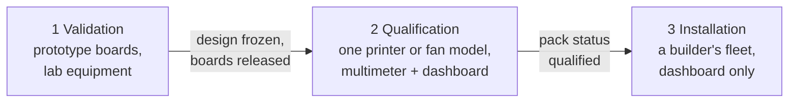

# Design Validation

> **Living procedure.** This folder is where the design is proven on prototype hardware, with lab equipment, before anyone builds from it. It sits apart from `docs/` (the design: what the system is and why) and from `hardware/` and `firmware/` (the implementation), so a test result or a board rework never has to edit a design doc to be recorded. When validation changes the design, the change goes into `docs/` as a `D` row (D104) and this folder points at it.

---

## 1. The three test steps

Testing is split by who runs it and with what (D104). Each step has its own home, and each open item closes at one of them.

| Step | Purpose | Who | Equipment | Runs | Home |
|---|---|---|---|---|---|
| **1 Validation** (`VAL-…`) | Prove the core design: boards, firmware behaviour, sensors, the duct parts, the fan port | The project, on prototype boards | Lab bench: see §3 | Once per hardware or firmware revision, on bring-up boards | This folder |
| **2 Qualification** (`PQ-…`, `FQ-…`) | Admit one printer model or one fan model as supported | Whoever owns one, usually the pack author | The system itself (dashboard, test modes) and a multimeter. Nothing else | Once per model, on at least one unit | Printers: [doc 12 §7](../docs/12_porting_guide.md#7-porting-checklist-and-printer-qualification). Fans: [doc 13 §4](../docs/13_fan_packs.md#4-fan-qualification) |
| **3 Installation** (`INS-…`) | Put a fleet into service | The builder | None: hand tools and a phone or laptop on the dashboard. Every check is automatic or a button | Once per fleet, and again after a change | [Doc 14 §4](../docs/14_build_your_own.md#4-install-and-commission) |

A test lives in the earliest step that can prove it. A check that a builder needs on every unit (a plug really cuts, a board's heater chain is intact) is made **automatic** in installation, and the step that proves the check itself works is in validation. Old test numbers (doc 05 §9 tests 1–36, doc 06 §10 M1–M12) map to the new IDs in [doc 05 §9](../docs/05_safety_and_failsafes.md#9-safety-tests-and-where-they-run) and [doc 06 §10](../docs/06_pneumatics_and_ducting.md#10-commissioning-measurements-and-where-they-run).

## 2. Files

| File | Holds |
|---|---|
| `README.md` (this) | Scope, equipment, gates, the open items that close in validation, and the status of every test |
| [`procedures.md`](procedures.md) | The procedure for each `VAL-…` test: what it proves, set-up, steps, pass criteria, items it closes |
| [`rework_log.md`](rework_log.md) | Every hardware modification made to a prototype board, and where it went in the design |
| `results/` (Phase 2) | One file per run: board serials and revision, firmware commit, instrument captures, pass or fail |

## 3. Equipment

Validation may use anything a small electronics lab has. Qualification and installation may not (§1).

| Instrument | Used for |
|---|---|
| Bench supply, 0–36 V, ≥ 5 A, current limit | Input guards, two-supply checks, injection, shorts (VAL-P1, P2, H8, H10) |
| Second 24 V brick and a 48 V passive PoE injector | Hot-plug and wrong-supply tests (VAL-P3) |
| Oscilloscope, ≥ 4 channels, ≥ 100 MHz, with a current probe or a shunt | Charge pump, heater PWM, inrush, guard timing, fan starting current (VAL-H2, P3, X1) |
| Logic analyser, ≥ 8 channels, protocol decode (I²C, UART, SPI, CAN) | Probe header (doc 04 §4a), ROM bootloader, CAN, fan control ports (VAL-C1, C2, X2) |
| SWD probe for the PY32 | Controller hold and breakpoints (VAL-C2, C3) |
| DC clamp meter or a 10 mΩ shunt | USB ground share, fan current (VAL-H9, X1) |
| Thermocouple meter, two or more probes, and a hot-air gun | Heater bench, KSD301 trip check (VAL-H3, H6) |
| Handheld vane anemometer and an optical tachometer | Venturi and fan spot checks (VAL-A6, X1) |
| Reference venturis (printed, 10 mm and 15 mm throats, doc 08 C17) | Low-flow anemometer calibration (VAL-A5) |
| A laptop, a PoE switch, a USB-C laptop charger | Network-gear and back-power tests (VAL-P3, P4) |
| Each mains-cut backend: a Shelly Gen2+ plug, a Tasmota plug, an HA instance | Plug tests (VAL-S1–S3) |
| A reference printer of each designed pack (AD5X node-heat, C5 Pro node-lite) | Tests that need a real link and chamber (VAL-H9, F8, F10) |

## 4. Boards, revisions and gates

- **Bring-up boards** have the 1.27 mm probe header fitted (D99) and a serial number written on the silkscreen label. Every result names the board serial, the board revision and the firmware commit.
- A **design revision** (rev A, rev B, …) re-runs every test in a group whose circuit changed, and the safety groups (H and F) in full.
- A **firmware release** re-runs groups F, S and the firmware half of H (H2, H4, H5, H7, H8, H10) on one board of each role.
- **Release gate:** boards are released for qualification (step 2) when every test in §6 marked *gate* has passed on the current revision and every open item in §5 that blocks release is closed. No heated printing on a fleet built from an unreleased revision.

## 5. Open items that close in validation

These moved here from the core register (doc 01 §7), which now only indexes them. IDs never change. *Blocks* says what can't proceed until the item closes.

| # | Item | Impact | Closes at | Blocks |
|---|---|---|---|---|
| **R1** | Exhaust-fan control port and silent-hub behaviour for a fan with a proprietary controller (F3, D10) | Hub may not set speed; "hub dead → fan keeps running" may be impossible | VAL-X2 maps the port, then the fan's own qualification (doc 13, FQ-6) shows F3. Per fan family, tracked in its fan pack | That fan family's pack |
| R4 | XGZP6897D offset drift (all six sensors) | Noisy chamber loop; trunk setpoint error | VAL-A1 (was M4): sets the deadband, Z4 and plausibility limits, and whether the venturi keeps the XGZP or gets an SDP31 | Release |
| R6 | ESP32-S3 radio range near metal frames, with the module in the node housing on a damper (D19) | Moonraker link drops (the backup on every node, the only link without `cdc_acm`); ESP-NOW backup | VAL-F3 records RSSI against distance and sets the alert level the installation self-check uses (INS-4); a pack whose only link is Moonraker checks it in PQ-3 | — |
| R8 | Integrated-fan PTC (C8): stall detection without a tach | Undetected fan stall | VAL-H6 on the chosen module, before buying more than one. Fallback: bare PTC + a 3-wire blower (+$8) | Heater BOM; release |
| R10 | Residual risk that the D17 RJ45 safety circuit doesn't behave as designed | 24 V into network gear | VAL-P3 (was test 21) on every revision | Release |
| R11 | Heater return shares the USB-link ground on a node-heat fed from its own printer's supply | Ground offset or heating in the USB lead | VAL-H9 measures it once on the reference node-heat printer, which proves the wiring rule (14 AWG ≤ 1.5 m). Packs then check link errors only (PQ-6, D104) | Release |
| O7 | Heater-housing temperature in normal operation | Sets the KSD301 and TCO ratings | VAL-H6 (doc 05 §3.2 procedure) | Heater BOM; layout of the heater bracket |
| O13 (fit) | ModulAir L bayonet and gasket: do they print and seal as described? The licence half closes on paper (doc 15 §2) | Duct interface (D34) | VAL-A7: print a Y, two hose adapters and a gasket; leak test them | Printables release |
| O15 | ROM-bootloader programming over the I²C pins; W5500 on its socket at 20 and 40 MHz | Bootloader path or the SWD-pad fallback | VAL-C1, on PY32 dev boards and an ESP32-S3 | **Carrier layout** |
| O17 | Shelly BLE RPC in use (D102) | Whether `ble_backup` becomes the recommended setting | VAL-S3 (was test 36) | Default for `ble_backup` only |
| O18 | **Rail reading without a trim** (D75 trim needs a meter at installation, which step 3 doesn't allow). How far is an untrimmed heater-rail reading from a meter, across the bring-up boards and temperature? | Whether the 23.0 V rail throttle needs a per-board trim | VAL-H8. **Proposed fix (D106):** 0.1 % resistors in the rail dividers and a second **CJ431** (LCSC C3113, ±0.5 %, ≈ 2.495 V on a divider; the part the guard comparators already use, JLC basic, no extended-part fee [V: LCSC, 2026-11-09]) that the ESP32 reads at boot to correct its ADC gain, ≈ ±0.7 % at room temperature, ≈ ±0.17 V at 24 V [E]. Pass at ±0.2 V. No cheaper or looser alternative exists (every ±1 % CJ431 on LCSC is an extended part, none cheaper); if C3113 falls short, re-check at the next tighter grade (CJ431B, C3031881, ±0.3 %) rather than assuming one is needed | Release |
| O19 | **Installation self-check** (D104): the automatic first-boot checks in INS-4 (heater chain with the charge pump stopped, KSD301 loop, high-side sense, encoder sweep, termination count, sensors) must catch the faults they claim to | Whether installation can skip the bench safety tests per board | VAL-H2, H3, H4 and A3 each also inject their fault under the self-check and confirm it fails. Since D106 the self-check is also what re-admits a node to heating after a runaway, so it must catch a welded switch on either side every time | Release |

**Unverified values checked along the way.** These are [U] or "confirm at bring-up" values in the design docs. None has an ID; each is checked in the test named and the doc updated to [V] with the result.

| Value | Doc | Test |
|---|---|---|
| Logic brick fails → heater rail takes over before the bus drops, fan at full | doc 02 §2.2 | VAL-P1 |
| eFuse IMON below 0.6 A | doc 02 §2.2.2 | VAL-P2 |
| 48 V brick hot-plugged into a live node (guard timing, FET SOA) | doc 02 §2.2.10 | VAL-P3 |
| PoE signature between pairs 1/2 and 3/6 is absent | doc 04 §3a | VAL-P3 |
| VBUS-less USB enumeration; dual CDC through TinyUSB | doc 04 §5, doc 07 §6.1 | VAL-P4 |
| One powered board with an empty OUT jack shows ≈ 120 Ω; activity-LED blink timing | doc 04 §3, doc 02 §2.2.9 | VAL-P7 |
| Antenna RSSI inside the node housing on a damper | doc 02 §2.1 | VAL-F3 |
| Low-side FET resistance at 3.3 V gate drive (≤ ≈ 12 mΩ, else a 5 V gate stage) | doc 02 §2.2.10 | VAL-H6 |
| PTC module fan current | doc 02 §2.2.7, doc 05 §3.3 | VAL-H6 |
| NTC pull-up value, 20–27 kΩ | doc 02 §2.2.8 | VAL-H11 |
| Bootloader drives PA9/PA14 | doc 09 §2.1 | VAL-C1 |
| PY32F030 I²C hardware bus timeout | doc 02 §2.4 | VAL-C2 (after the reference-manual check, doc 15 §2) |
| Shelly fallback time; Tasmota switch-over time; plug power-limit fields on the device | doc 07 §10 | VAL-S1, S2 |
| CTRL buffer values and a fan reference's tolerance of a 10 mA short; a fan that reads the level at ≈ 9.4 V | doc 02 §2.2.7, D97 | VAL-X1 |
| Anemometer accuracy against the venturi | doc 06 §4.4 | VAL-A5 |

## 6. Test status

*Gate* = must pass before boards are released for qualification (§4). Status is one of: not run, pass (revision, date, result file), fail (rework log entry).

| Test | Proves | Was | Gate | Status |
|---|---|---|---|---|
| **P · Power and bus** | | | | |
| VAL-P1 | Board supply selection and fan feed | test 35 | gate | not run |
| VAL-P2 | Bus power sharing, limits, back-feed | test 16 | gate | not run |
| VAL-P3 | RJ45 into network gear, wrong supplies | test 21 | gate | not run |
| VAL-P4 | USB back-power and enumeration | test 31 | gate | not run |
| VAL-P5 | Node survives its printer's cut | test 29 | gate | not run |
| VAL-P6 | Hub supply loss and back-fed mode | test 30 | gate | not run |
| VAL-P7 | Automatic CAN termination and port LEDs | new | gate | not run |
| **H · Heater safety chain** | | | | |
| VAL-H1 | ESP32 in reset stops the heater (L5) | test 1 | gate | not run |
| VAL-H2 | Static charge-pump pin stops the heater (L5) | test 2 | gate | not run |
| VAL-H3 | KSD301 loop opens the chain | test 3 | gate | not run |
| VAL-H4 | Welded FETs and the shunt zero | test 4 | gate | not run |
| VAL-H5 | Runaway → mains cut | test 5 | gate | not run |
| VAL-H6 | Heater bench: housing temperatures, stall, FET drive (O7, R8) | test 11, doc 05 §3.2 | gate | not run |
| VAL-H7 | Gain watchdog (L3) | test 14 | gate | not run |
| VAL-H8 | Rail reading, throttle and learned supply cap (O18) | test 8 (part) | gate | not run |
| VAL-H9 | USB ground share on the reference printer (R11) | test 9 | gate | not run |
| VAL-H10 | Heater supplies: two-supply check, brick on the wrong outlet | test 23 (part) | gate | not run |
| VAL-H11 | NTC inputs across their range | new | | not run |
| **C · Controller and ESP32** | | | | |
| VAL-C1 | ROM-bootloader programming; LAN module (O15) | new | before layout | not run |
| VAL-C2 | Controller hang; stuck I²C | test 32 | gate | not run |
| VAL-C3 | Controller reset line | test 33 | gate | not run |
| VAL-C4 | Expansion port | test 34 | | not run |
| **F · Firmware behaviour** | | | | |
| VAL-F1 | CAN loss | test 6 | gate | not run |
| VAL-F2 | Hub loss: heaters off, notify | test 7 | gate | not run |
| VAL-F3 | ESP-NOW failover and radio range | test 17 | gate | not run |
| VAL-F4 | Latches survive a reboot | test 19 | gate | not run |
| VAL-F5 | OTA rollback and in-print refusal | test 20 | gate | not run |
| VAL-F6 | Router off | test 22 | gate | not run |
| VAL-F7 | Latched cut holds; level-4 Clear | test 25 | gate | not run |
| VAL-F8 | Fire corroboration and response order | test 13 | gate | not run |
| VAL-F9 | Door logic | test 12 | gate | not run |
| VAL-F10 | Print hold | test 26 | gate | not run |
| VAL-F11 | Purge queue | new | gate | not run |
| VAL-F12 | Notifications and escalation | new | | not run |
| **S · Mains-cut plugs** | | | | |
| VAL-S1 | Plug reachability, node-direct cut, fallbacks, per backend | test 15 | gate | not run |
| VAL-S2 | Plug-local power limit, per backend | test 18 | gate | not run |
| VAL-S3 | BLE backup cut (O17) | test 36 | | not run |
| **A · Air path and sensors** | | | | |
| VAL-A1 | Pressure-sensor offset and drift (R4) | M4 | gate | not run |
| VAL-A2 | Damper bleed resolution | M1a | before damper design | not run |
| VAL-A3 | Damper encoder and stall | test 27 | gate | not run |
| VAL-A4 | VOC purge criterion | M6 | | not run |
| VAL-A5 | Low-flow anemometer: protection and calibration | test 28, M9 | | not run |
| VAL-A6 | Venturi against a vane anemometer | M8 (spot check) | | not run |
| VAL-A7 | ModulAir parts: fit and leakage (O13) | M10 (first run) | before printables release | not run |
| **X · Exhaust-fan port** | | | | |
| VAL-X1 | B2 port: CTRL buffer, fails to full, jacks | new | gate | not run |
| VAL-X2 | Mapping an undocumented fan control port (R1) | D10 | per fan family | not run |
